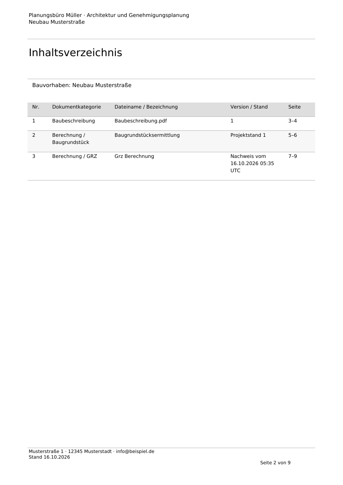
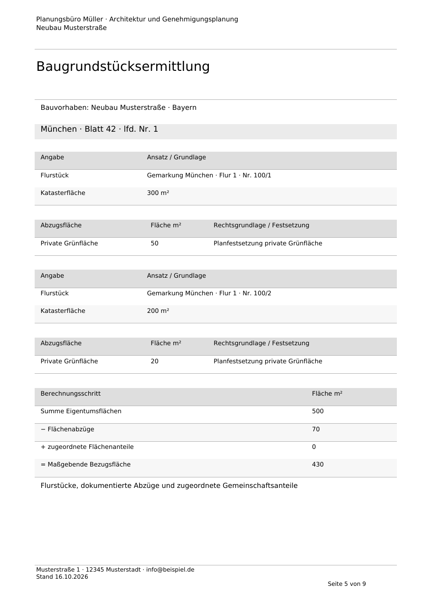
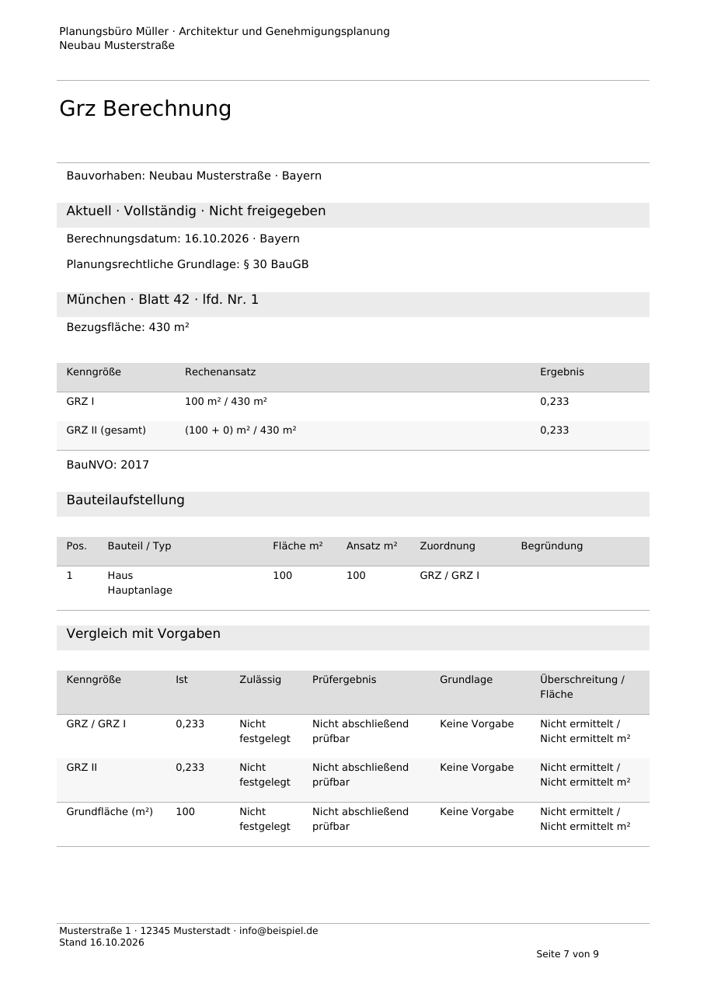

# Strukturierte Bauvorlagen und Berechnungsnachweise

Unter **Einstellungen → Briefbogen und Druckvorlagen** legt die Projektleitung den
Bürostandard für Kopfzeile, Fußzeile und das Anschreiben fest. Der Standard liegt
in der gemeinsamen Anwendungsdatenbank und gilt für neue Ausgaben aller Projekte.
Bei einer Einzelplatzinstallation ist dies die lokale Datenbank; im Büro die
zentrale Datenbank. Bestehende PDF-Dateien werden nicht nachträglich verändert.

Unter **Projekt → Unterlagen → Drucken / PDF-Ausgabe** lassen sich diese Texte für
die konkrete Ausgabe anpassen. Das Anschreiben hat Absender, Empfänger, Betreff
(Bezeichnung), Ausgabedatum, Aktenzeichen/Bezug und einen mehrzeiligen Brieftext.
Anschreiben und Inhaltsverzeichnis sind optional. Auswahl, Reihenfolge und
Seitenauswahl funktionieren auch für einzelne Unterlagen. Änderungen an Texten
oder Auswahl erfordern eine neue Vorschau, bevor wieder gedruckt/exportiert wird.
Ein Aktualisieren des Katalogs überschreibt den begonnenen Brieftext nicht.

Kopf- und Fußzeile unterstützen `{Projekt}`, `{Datum}`, `{Seite}` und `{Seiten}`.
Jeweils bis zu drei Druckzeilen werden im reservierten Seitenbereich gesetzt;
überlange Texte führen zu einer verständlichen Fehlermeldung statt Abschneiden.
Zusätzlich steht auf erzeugten Seiten die Position **Seite n von gesamt** im
zusammengestellten Paket. Das Inhaltsverzeichnis enthält die tatsächlichen
Seitenbereiche einschließlich aller Vorblätter und mehrseitigen Nachweise.

Das Inhaltsverzeichnis führt getrennte Spalten für **Dokumentkategorie**, **Dateiname /
Bezeichnung**, **Version / Stand** und **Seite**. Die Dokumentkategorie wird zum
Erstellungszeitpunkt aus der Zuordnung übernommen, einschließlich einer
vorhandenen Hauptkategorie. Nicht zugeordnete Dokumente erscheinen ausdrücklich
als „Ohne Kategorie“. Dateiname und Versionsnummer stammen aus der konkret
gewählten Dokumentversion. Erzeugte Berechnungen erhalten eine fachliche
Kategorie und ihren Nachweis-/Projektstand statt einer erfundenen Dateiversion.
Die fertige PDF hält diese Angaben fest; spätere Umbenennungen verändern sie nicht.

## Gestaltung und fachliche Lesbarkeit

- A4-Seiten mit festen Rändern, Briefbogen, vollständigen mehrzeiligen Titeln,
  Abschnittsüberschriften, Tabellenköpfen und dezenten Zeilenflächen.
- Tabellen wiederholen ihre Spaltenüberschriften auf Folgeseiten. Normale Zeilen
  bleiben zusammen; besonders lange Zellen werden vollständig fortgesetzt.
- Grundstückseinheiten beginnen auf getrennten Seiten. Gemarkung, Flur und
  Flurstück sowie gegebenenfalls vorhandene Grundbuchangaben ersetzen interne IDs.
- Baugrundstück: Katasterflächen, begründete Abzüge, Gemeinschaftsanteile mit
  Anteil und Festsetzung sowie die Rechnung Eigentumsfläche − Abzüge + Zuschläge.
- GRZ/GRZ I/GRZ II: Rechenansatz und Ergebnis je Einheit, Bauteiltyp, eingegebene
  und angerechnete Fläche sowie Zuordnung und Begründung. GFZ/Geschossigkeit:
  Geschossart, Außenmaße, Aufenthaltsräume/Wände/Erschließung und Anrechnungsfläche.
  BMZ: Baumasse, Bezugsfläche und Quotient. Keine Neuberechnung archivierter Stände.
- Soll-Ist-Vergleiche nennen Vorgabe, Ergebnis, Überschreitung und Grundlage.
  Fehlende Festsetzungen bleiben als fehlend erkennbar.
- Baugrenzen: Planversion, Baufenster, Vorhaben, überschrittene Fläche/Anteil und
  Eckpunktüberstand einschließlich der Aussagegrenze dieses Werts.
- Raumbücher: Raumnummer, Name, Nutzung, Fläche, Höhe, Volumen und Summen.
- Abstandsflächen: Rechts- und Höhenbezug, Wandübersicht, Höhen-/Dach-/Tiefenansatz,
  Grundstückszuordnung, Sonderansätze samt benannter Belegversion, Flächen,
  offene Punkte und Konflikte; ergänzend die maßstäbliche Vektorplanskizze.
- E-Mails bleiben lesbare Klartextunterlagen mit Absender, Empfänger, Datum,
  Inhalt und separat benannten Anhängen.

UUIDs, SHA-256-Prüfsummen, interne Benutzerkennungen und Rechenkerncodes werden
nicht im Behördenbericht ausgegeben. Sie bleiben im unveränderlichen
Nachweisarchiv und in den entsprechenden Datenexporten erhalten. Benannte
Quellunterlagen, Dokumentversionen, Rechtsfassungen und fachlicher Prüfstand
bleiben sichtbar. **Veraltet**, **unvollständig**, **nicht freigegeben**, offene
Angaben und Abweichungen werden ausdrücklich ausgegeben. Eine ansprechende
Druckvorlage ersetzt keine fachliche Prüfung oder Freigabe.

## Amtliche Originale

Importierte PDF-Formulare, Pläne und andere PDF-Unterlagen werden in ihrer
Gestaltung und Seitengröße übernommen. Sie bekommen keinen überdeckenden
Briefbogen und werden nicht für zusätzliche Seitenränder verkleinert.
Insbesondere bleibt der Planmaßstab in der PDF erhalten. Im Inhaltsverzeichnis
werden sie trotzdem in die Paket-Seitenzählung einbezogen; auf solchen
Originalseiten selbst wird keine zusätzliche Paketnummer aufgeprägt.
Dies gilt auch für erneut importierte frühere Druckausgaben.

## Erweiterbare Umsetzung

`core-lib::druckausgabe` bleibt der gemeinsame Vertrag für Desktop, HTTP-API und
die Druckartefakte eingefrorener Abgabestände. Die Fachadapter in `berichte.rs`
und `abstandsbericht.rs` liefern Absätze, Abschnitte, Seitenwechsel oder Tabellen
mit expliziten Spalten. `layout.rs` übernimmt Satz und Briefbogen; `pdf.rs`
weiterhin Originalseiten, Formular-Druckdarstellungen und Zusammenführung.
Neue Fachberechnungen benötigen einen Präsentationsadapter, keine eigene
PDF-Engine. Berechnungsregeln, Archivdaten und DMS-Versionen werden nicht geändert.

Der additive Vertrag `Druckgestaltung` enthält `kopfzeile`, `fusszeile` und
`anschreiben`. `Druckkatalog.gestaltung` liefert den aktuellen Bürostandard.
`Druckauftrag.gestaltung` kann ihn für die konkrete Ausgabe ersetzen; fehlt das
Feld oder ist es `null`, löst der Core einmal den gespeicherten Standard auf.
`aktenzeichen` und `datum` sind ebenfalls additive Felder mit sicheren Vorgaben.
Alte JSON-Aufträge bleiben lesbar; bestehende Daten benötigen keine Migration.

`GET /api/v1/druckgestaltung` liest den Bürostandard,
`PUT /api/v1/druckgestaltung` ändert ihn mit Büroangabenrecht (Projektleitung).
Desktop-Commands verwenden dieselben Core-Methoden. Projektleser dürfen ihre
Druckausgabe anpassen, aber den gemeinsamen Bürostandard nicht überschreiben.

## Beispiel und Prüfung

[Beispiel-PDF mit Anschreiben, Inhaltsverzeichnis, Grundstücken und GRZ](beispiel.pdf)
enthält auch ein synthetisches PDF-Formular und verwendet ausschließlich fiktive Testdaten. Die nicht vorhandenen Festsetzungen
und die fehlende Bürofreigabe sind absichtlich sichtbar; es handelt sich um ein
Gestaltungsbeispiel, keinen einreichungsfertigen Musternachweis.

Prüfungen: 240 Rust-Workspace-Tests einschließlich PostgreSQL/OCR/Bürosicherung,
Clippy mit allen Targets, Formatierung und identische generierte TypeScript-
Verträge; Svelte ohne Fehler/Warnungen, Produktionsbuild und fünf Browserabläufe
(Projektregister, Plattform, Druckausgabe, Verfahrensakte, Abstandsflächen).
Zusätzliche Satztests prüfen lange mehrseitige Tabellen, fortgesetzte Zellen,
wiederholte Köpfe und den freigehaltenen Briefbogenbereich. Browser lesen echte
Core-PDFs mit PDF.js: Rechenwerte, keine internen Kennungen, Paketnummern,
Originalfelder und Vektorplan. Die Beispielseiten wurden zusätzlich gerendert
und visuell geprüft.

Weitere Fachmodule: [Ausbauplan für Stellplätze, Wohnflächen und ergänzende Nachweise](../berechnungen-ausbau.md).
