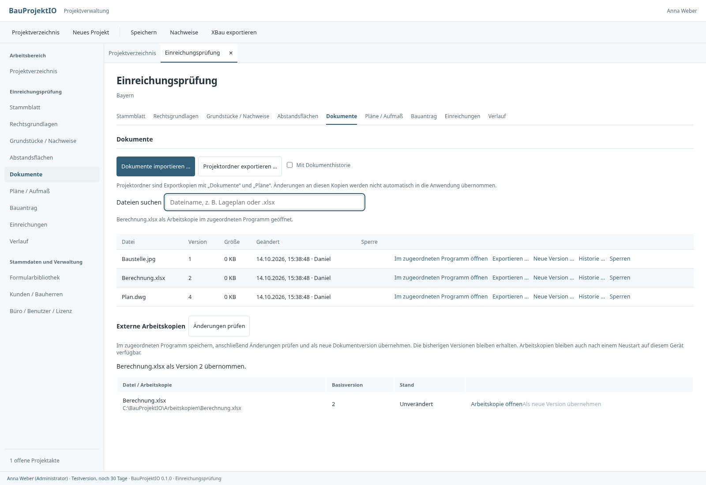
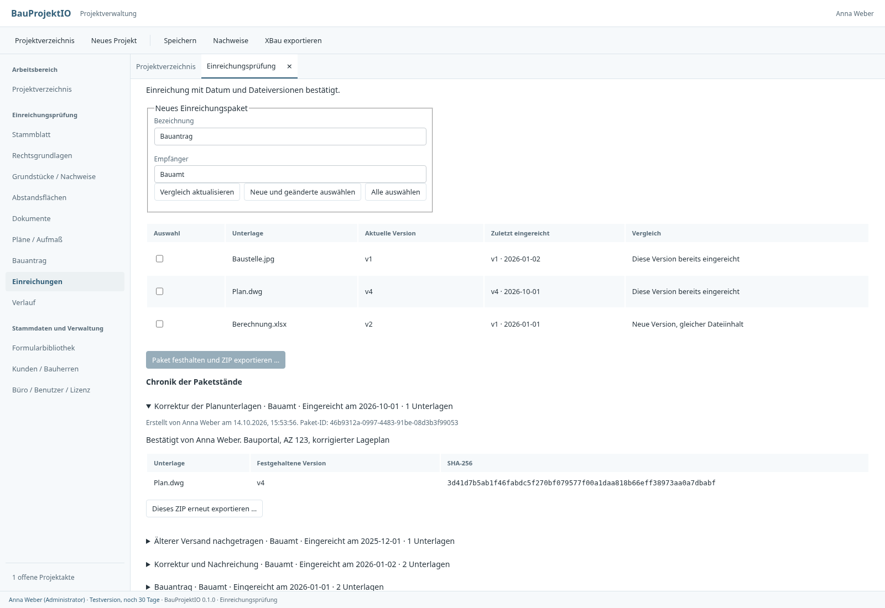

# Projektdateien und Einreichungsstände

## Alle Projektdateien verwalten

Die Dokumentenablage nimmt beliebige Dateien auf, darunter DWG, Excel, Word,
Fotos und PDF. Die Dateisuche filtert nach Namen oder Endung (`.xlsx` usw.).
Alle Dateien verwenden dieselbe Dokumentidentität, Versionshistorie und
unveränderliche DMS-Ablage. Die Originalanwendungen müssen auf dem Arbeitsplatz
installiert und dem jeweiligen Dateityp zugeordnet sein.

**Im zugeordneten Programm öffnen** erzeugt eine lokale Arbeitskopie mit der
angezeigten Basisversion und startet die Dateizuordnung des Betriebssystems:
Windows ShellExecuteW, macOS `open`, Linux `xdg-open`. Der DMS-Dateispeicher wird
nicht direkt im externen Programm geöffnet. Ausführbare Programme und Skripte
können gespeichert/exportiert, aber nicht über diese Aktion gestartet werden.

Nach dem Speichern in Excel, CAD oder einem anderen Programm:

1. **Änderungen prüfen** aktualisiert die Liste der externen Arbeitskopien.
2. **Als neue Version übernehmen** speichert den aktuellen Inhalt in derselben
   Dokumenthistorie. Eine unveränderte Arbeitskopie erzeugt keine neue Version.
3. Die Basis der Arbeitskopie wird erst nach dem DMS-Commit aktualisiert; die
   lokale Datei bleibt erhalten. Weitere Bearbeitung kann erneut übernommen werden.

Arbeitskopien und ihre Basisinformationen bleiben unter `Arbeitskopien` im
App-Datenordner dieses Geräts über Neustarts erhalten. Die Liste ist projektbezogen.
Bei Konflikten oder fremden Dokumentsperren bleiben die Arbeitskopie und die
bereits gespeicherten Versionen erhalten. Ein Startfehler des externen Programms
löscht die erstellte Kopie ebenfalls nicht. Direktes Öffnen/Übernehmen ist bis
512 MB je Arbeitsdatei vorgesehen. Es gibt keine automatische Synchronisierung,
keinen Dateibeobachter und keinen automatischen Import beim Schließen von Excel.

Im Büro verbleiben die verbindlichen Dateiversionen auf der konfigurierten
NAS-/S3-/Serverablage; die lokale Arbeitskopie wird erst durch die ausdrückliche
Übernahme als neue Version für andere Nutzer verfügbar. CAD-Dateien können
zusätzliche externe Referenzen benötigen: Einzeldateien werden nicht automatisch
als XRef-/Verknüpfungsverbund erkannt oder gebündelt.

## Einreichungen und Nachreichungen

Der Projektbereich **Einreichungen** unterscheidet einen vorbereiteten Paketstand
von der tatsächlichen Einreichung:

1. Bezeichnung und Empfänger angeben, dann **Vergleich aktualisieren**.
2. Einzelne Unterlagen, **Neue und geänderte auswählen** oder **Alle auswählen**.
   Die angezeigten aktuellen Versionen werden bei der Erstellung festgehalten.
3. **Paket festhalten und ZIP exportieren** speichert das Paket im DMS-Speicher
   und die zugehörigen Metadaten in der Projektdatenbank. Ein abgebrochener
   Dateidialog erzeugt kein Paket. Bei einem späteren Exportfehler bleibt das
   gespeicherte Paket in der Chronik und kann erneut exportiert werden.
4. Nach der tatsächlichen Übermittlung **Einreichungsdatum erfassen** verwenden.
   Datum, Benutzer, Bestätigungszeit und eine Notiz (etwa Übermittlungsweg oder
   Aktenzeichen) werden festgehalten. Export allein bestätigt keine Einreichung.

Das ZIP enthält die ausgewählten Dateiversionen unter
`Unterlagen/<Dokument-ID>/v<Version>-<Dateiname>` sowie `Einreichungsstand.json` mit
Dokumentidentitäten, Dateinamen, Versionen und Prüfsummen. Das gespeicherte ZIP ist
unveränderlich: Ein späterer Export desselben Pakets liefert dieselben Bytes,
auch wenn Projektdokumente inzwischen bearbeitet wurden. Das ZIP-Manifest hält
den **Paketstand** fest; die spätere Einreichungsbestätigung wird separat in der
Chronik gespeichert und verändert das ZIP nicht.

Für den gewählten Empfänger zeigt der Vergleich je Dokument:

| Anzeige | Bedeutung |
| --- | --- |
| Noch nicht eingereicht | Keine bestätigte Einreichung dieses Dokuments an diesen Empfänger |
| Diese Version bereits eingereicht | Aktuelle und zuletzt eingereichte Versionsnummer stimmen überein |
| Neue Version, gleicher Dateiinhalt | Höhere Versionsnummer, aber identischer Inhalts-Hash |
| Seit Einreichung geändert | Höhere Version mit verändertem Dateiinhalt |
| Älter als eingereichter Stand | Der verglichene Stand liegt unter der zuletzt eingereichten Version |

Der aktuelle Einreichungsstand wird über alle bestätigten Pakete des Projekts
und Empfängers zusammengestellt. Eine Teilnachreichung ersetzt nur die darin
enthaltenen Dokumentstände. Das tatsächliche Einreichungsdatum bestimmt die
Reihenfolge; bei gleichem Datum entscheidet die Bestätigungszeit, danach die
Paket-ID. Eine später erfasste historische Einreichung setzt den neueren
Behördenstand nicht zurück. Empfängernamen werden für den Vergleich getrimmt und
ohne ASCII-Groß-/Kleinschreibung verglichen; unterschiedliche Bezeichnungen
werden nicht automatisch als dieselbe Behörde erkannt.

Die Chronik zeigt die festgehaltenen Unterlagen und Versionen jedes Pakets.
Ein Datum kann einmal bestätigt werden; bestätigte Pakete werden nicht verändert
oder gelöscht. Korrekturen/Nachreichungen benötigen einen neuen Paketstand.
Eine Korrektur einer versehentlich bestätigten Datumsangabe ist noch nicht
enthalten. Die Ansicht dokumentiert die Angaben der Nutzer, keinen automatischen
Eingangsnachweis des Bauamts. Ausdruck oder Übermittlung erfolgen außerhalb der
Anwendung. Für die Auswahl stehen derzeit die neuesten DMS-Versionen zur
Verfügung; die Core-Schnittstelle unterstützt auch explizit ausgewählte ältere
Versionen. ZIP-Grenzen: 1–500 Dokumente, insgesamt maximal 512 MB unkomprimiert.

Das Festhalten und Bestätigen erfordert Bearbeitungsrechte und eine gültige
Lizenz. Einreichungsentwürfe bleiben über Bereichs- und Projektwechsel erhalten.
Beim Schließen müssen sie im Einreichungsbereich abgeschlossen oder ausdrücklich
verworfen werden; allgemeines Projektspeichern bestätigt keine Einreichung.

## Architektur und Migration

- `core-lib::dateiverwaltung`: typisierter `Arbeitsstand` mit konkreter DMS-Basis,
  unterstützte Dateitypen für den Betriebssystemaufruf.
- `storage::arbeitskopie`: lokale bearbeitbare Kopien und atomare Basisaktualisierung.
  Die Desktop-Commands starten Programme und verwenden den bestehenden
  `CoreServices::store_document`-Vertrag für neue Versionen.
- `core-lib::einreichung`: Paketvalidierung, Inhaltsstand, ZIP-Erzeugung und
  Empfängervergleich. Das eigene Service-Modul koordiniert Rechte, Dokumente,
  unveränderliche ZIP-Ablage, Repository und Änderungsprotokoll.
- `EinreichungRepository`: eigenes Persistenzinterface; SQLite und PostgreSQL
  implementieren denselben Vertrag mit atomarer Basisversionsprüfung bei Bestätigung.
- Migration `0007_einreichungen.sql` ergänzt jeweils eine Tabelle und einen Index.
  Bestehende Projekte, Dokumentversionen und Formularvorlagen bleiben unverändert.
- Neue Core-/Desktop-Aufrufe ergänzen bestehende Verträge. HTTP:
  `GET/POST /api/projekte/{id}/einreichungen`,
  `GET /api/projekte/{id}/einreichungsvergleich?empfaenger=…`,
  `POST /api/einreichungen/{id}/bestaetigen` (`basis`, `datum`, `notiz`),
  `GET /api/einreichungen/{id}/zip`.

Pakete werden in der bestehenden Storage-Ablage unter dem jeweiligen Projekt
archiviert, unabhängig von den veränderlichen Arbeitskopien und von ZIP-Exporten
auf dem Gerät. Datenbank und Dateispeicher müssen gemeinsam gesichert werden.
Die bisherige Server-Anmeldung über ein technisches Konto bleibt unverändert.

## Nachweise

- Rust-Integration mit realer SQLite-Datenbank und Dateispeicher: Arbeitskopien,
  Versionskonflikt, feste ZIP-Inhalte, initiale Einreichung, Teilnachreichung,
  gleiche Inhalte, historische Daten, Empfängertrennung und Neustart.
- PostgreSQL-Test mit dedizierter Testdatenbank: Migration, Persistenz und
  gleichzeitige Bestätigung – genau ein erfolgreicher Commit.
- HTTP-Integration: Paket erstellen, ZIP laden, Bestätigung und Konflikt,
  Versionsvergleich nach Korrektur, unverändertes ursprüngliches ZIP.
- Kompilierte UI mit Test-IPC: Dateiöffnung, externe Änderung, Konflikt,
  Paket-Auswahl, Exportabbruch/-fehler, Chronik und Datumsbestätigung. Die UI
  verwendet Daten aus der realen Rust-Integration. Excel/AutoCAD unter Windows
  werden in dieser Linux-Testumgebung nicht tatsächlich gestartet.

[UI-Prüfprotokoll](ui-pruefung.json)

