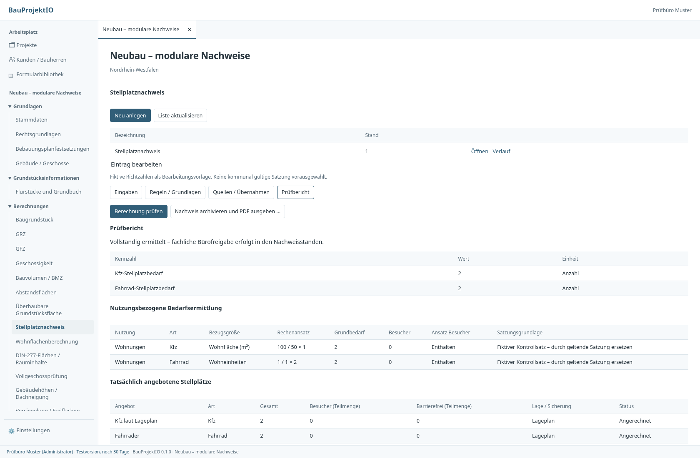
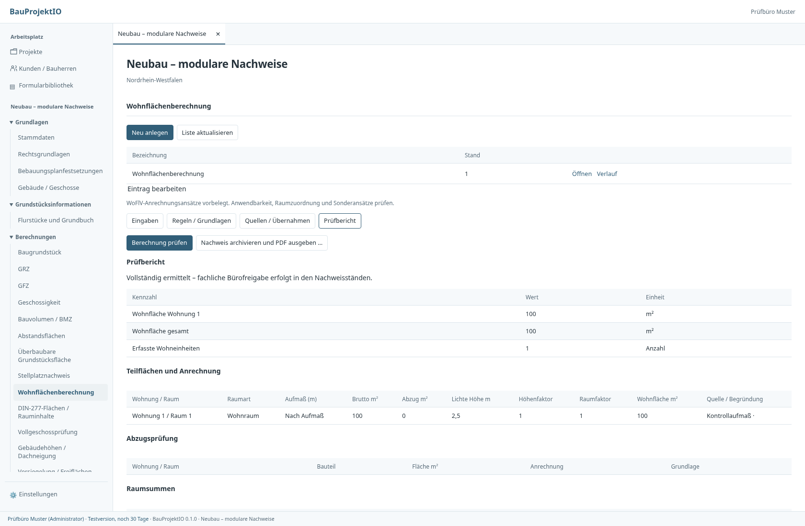

# Modulare Fachberechnungen

Im Projekt unter **Berechnungen** stehen acht zusätzliche Fachmodule bereit.
Bestehende Grundstücks-, GRZ-, GFZ-, Geschossigkeits-, BMZ-, CAD-Baugrenzen- und
Abstandsflächenmodule bleiben ihre eigenen fachlichen Anbieter. Das Raumbuch
liefert Raumfakten; es entscheidet nicht über deren rechtliche Anrechnung.

## Arbeitsablauf

1. Grundstückseinheiten ermitteln und speichern; bei Bedarf Gebäude/Geschosse
   und Raumfakten anlegen. Je Modul können mehrere getrennte Nachweise für
   unterschiedliche Grundstücke, Gebäude und Regelgrundlagen angelegt werden.
2. Im Fachmodul einen Datensatz anlegen, Grundstück/Gebäude auswählen und
   Aufmaß-/Nutzungspositionen eingeben. Fehlende Angaben bleiben erkennbar offen.
3. Unter **Regeln / Grundlagen** den anwendbaren Regelstand, Quellen,
   Geltungsbereich und Prüfvermerk erfassen. Regeln sind in beschrifteten Feldern
   bearbeitbar. Ein JSON-Regelpaket mit `modul`, `regelkontext` und `regeln`
   kann alternativ importiert werden; es ersetzt keine Projektdaten.
4. Unter **Quellen / Übernahmen** Dokumentversionen und passende archivierte
   Kennzahlen auswählen. Wohnfläche und DIN-277-Flächen lassen sich außerdem
   ausdrücklich aus einem Raumbuch vorbereiten. Raumart, Höhenzonen,
   Wohnungszuordnung, DIN-Klassifikation und Maßbezug müssen danach geprüft werden.
5. Speichern und prüfen. Nach Änderungen wird die Anwendbarkeitsbestätigung
   zurückgesetzt. Die Projektleitung bestätigt den unveränderten gespeicherten
   Ansatz erneut. Änderungen an Regeln benötigen eine neue Regelversion.
6. **Nachweis archivieren und PDF ausgeben …** erzeugt einen unveränderlichen
   Berechnungsstand. Er ist einzeln oder im bestehenden Stapeldruck auswählbar
   und kann als Projektdokument abgelegt werden. Bürofreigaben erfolgen getrennt
   in der Nachweisverwaltung. Wiederholte Archivierung desselben Vorgangs legt
   keinen zweiten Stand an.

Die PDF-Ausgabe enthält Regel-/Planbezug, tabellarische Ansätze, Ergebnisse,
Prüfpunkte und lesbare Quellnachweise. Briefkopf, Fußzeile, Anschreiben und
Inhaltsverzeichnis folgen der vorhandenen Druckgestaltung. Originale
PDF-Formulare bleiben in der Stapelausgabe unverändert ohne zusätzlichen Briefbogen.

## Module und fachlicher Umfang

| Modul | Eingaben und Berechnung |
| --- | --- |
| Stellplätze | Nutzungen, Gebäudetypen, Zonen und Größenbereiche; eindeutige Regelwahl für Kfz/Fahrräder; Faktoren je WE, ausdrücklich bezeichneter Fläche, Sitzplatz, Bett oder Beschäftigtem; Mindestbedarf, Besucheranteil, Rundung je Position/Nutzung/Gesamt; belegte Reduktion, Altbedarf und Ablösung; Angebot, externe Sicherung und barrierefreie Teilmenge getrennt. |
| Wohnflächen | Rechteck, Dreieck, Trapez oder direktes Aufmaß; Raumarten und getrennte Höhenzonen; WoFlV-Ansätze einschließlich Außenflächen und Wintergärten; begründete Sonderfaktoren, Treppen-/Bauteilabzüge und Wohnungs-/Gesamtsummen. WE werden nur bei ausdrücklich bestätigter vollständiger Wohnungszuordnung ausgegeben. |
| DIN 277 | NUF, TF, VF und KGF, Bereiche R/S und Geschosssummen; NRF/BGF nur mit vollständigem jeweiligem Ansatz; BRI separat aus äußeren Volumenkörpern. Optional ausdrücklich erforderlicher Rauminhaltsnachweis. Keine Gleichsetzung mit Wohn- oder GFZ-Fläche. |
| Vollgeschosse | Konfigurierbare lichte Höhe, Flächenanteil, strenge/nicht strenge Grenzwerte, eigene/unterliegende Vergleichsfläche, Gelände-/Oberirdischkriterium; begründete Sonderklassifikationen. Ergebnisse sind ausdrücklich mit realen Gebäude-Geschossen verknüpfbar und werden dort vom bestehenden GFZ-/Geschossigkeitsnachweis geprüft. |
| Gebäudehöhen / Dächer | Absolute Vermessungspunkte, Höhensystem/Bezugsniveau, relative Höhen, zugeordnete Mindest-/Höchstfestsetzungen und Dachneigung aus Traufe, First und horizontaler Entfernung. |
| Überbaubare Fläche | Maßbezogene Prüfung von Baugrenzen, Baulinien und Vorbauten; vorzeichenbehaftete Extremabstände, abgegrenzte Überschreitungsflächen und belegte Entscheidungen. Baulinien prüfen auch Zurücktreten. Ergänzt die vorhandene geometrische Baufensterprüfung im Planbereich. |
| Freiflächen | Reale Grundstücksfläche und maßgebende Fläche aus dem Grundstücksanbieter; geschlossene Teilflächenbilanz; gesonderte gewichtete Versiegelungs-/Grünansätze, Grünanteil, Pflanz- und Spielflächenansätze. |
| Regenwasser | Reale angeschlossene Teilflächen, eigene Abflussbeiwerte, Regenspenden und Dauerstufen, Drosselabfluss, optional belegte Versickerungsleistung; vereinfachte stationäre Zufluss-/Speichervolumenbilanz und Vergleich mit vorhandenem Rückhalteraum. |

### Grenzen und anzuwendende Grundlagen

Die gelieferten Stellplatzfaktoren und Vollgeschossparameter sind ausdrücklich
**fiktive, unbestätigte Konfigurationsbeispiele**, kein geprüfter Katalog aller
Kommunen oder LBO-Fassungen. Die konkrete Satzung, zeitliche Geltung,
Planfestsetzung und Sonderentscheidung müssen vor Verwendung hinterlegt und
fachlich geprüft werden. Mehrdeutige oder fehlende Stellplatzregeln erzeugen
keinen stillschweigenden Bedarf. Der Nachweis wird dann offen ausgewiesen.

Die Rundungsstufen sind Position, Nutzungsgruppe oder Gesamtansatz eines
Datensatzes. Benötigte Gebäude-/Grundstückstrennungen erfolgen über eigene
Datensätze. Zeitlich versetzte Mehrfachnutzung wird nicht automatisch simuliert;
ihre zulässige Wirkung muss als belegte Reduktion erfasst werden. Ablösung ist
kein physisch angebotener Stellplatz. Planungsrechtliche Gebäudehöhen sind kein
vollständiger Gebäudegeometrie- oder Abstandsflächennachweis.

Der Baulinien-/Vorbaunachweis übernimmt **geprüfte Extremmaße aus dem Aufmaß**;
er leitet sie nicht automatisch aus beliebigen CAD-Kanten ab. Die geometrische
Baugrenzen-Flächenprüfung bleibt separat. Eine eingetragene Maßtoleranz schafft
kein Baurecht. Positive Überschreitungen bleiben auch bei bestätigter Entscheidung
numerisch im Bericht sichtbar. Bestätigte Belege ersetzen keine Genehmigung.

Der Regenwasserkern ist eine nachvollziehbare Konstantregen-/Speicherbilanz,
**kein vollständiger hydraulischer Nachweis nach DWA/DIN**: kein Kanalnetzmodell,
keine dynamische Versickerungsbemessung und kein vollständiger Überflutungsnachweis.
KOSTRA-Daten, Wiederkehrzeiten, Boden-/Grundwasserprüfung und örtliche Vorgaben
sind fachlich zu bestimmen. Unbestätigte Versickerung wird nicht angerechnet.

## Modulverträge und unabhängige Weiterentwicklung

- Jeder Rechenkern liegt unter `crates/core-lib/src/berechnungen/<modul>.rs`
  mit eigenen typisierten Eingaben/Regeln und eigenem `RECHENSTAND`.
  Er ist ohne UI, Datenbank, Netzwerk und Druckbibliothek aufrufbar.
- Jede Form-/Standardkonfiguration liegt separat unter
  `regelwerke/fachberechnungen/<modul>.json`. Die jeweilige Svelte-Komponente
  registriert das Fachmodul; die gemeinsame Eingabehülle berechnet nichts.
- `FachPlan` enthält Modul, Grundstücks-/Gebäudeidentität, Regelkontext,
  Belegversionen, fachliche Quellen, Übernahmen und modulbezogene Eingaben.
  `eingaben` ist am Transport als JSON erweiterbar, wird im Kern strikt gegen den
  jeweiligen Modulvertrag validiert und kanonisiert; unbekannte Felder werden
  abgelehnt. Dezimalzahlen und Ganzzahlen erhalten einheitliche Archividentität.
- `FachErgebnis` liefert Tabellen, benannte Kennzahlen, Einheiten und fachliche
  Bedeutungen sowie Vollständigkeit/offene Prüfpunkte. Verbraucher übernehmen
  Kennzahlen über deren stabile Kennung, **nicht über eine Tabellenposition**.
- Eine Übernahme enthält Quellnachweis und Kennzahl sowie stabile Zielpositions-ID
  und Zielfeld. Der Kern prüft Projekt, Grundstück, gegebenenfalls Gebäude,
  Aktualität, Vollständigkeit, Einheit und Flächenart. Eine DIN-Fläche kann nicht
  als Wohnfläche ausgegeben werden. Gewichtete Versiegelung ist keine reale
  Entwässerungsfläche; dafür stellt die Freiflächenbilanz physische Teilflächen
  als eigene Kennzahlen bereit. Grundstücksflächen werden ausschließlich vom
  Grundstücksanbieter bezogen, nicht vom Formular neu berechnet.
- Raumbuchquellen tragen Objektidentität und Revision. Vollgeschossergebnisse
  tragen eine ausdrückliche Zuordnung zum Gebäude-Geschoss. Abgeleitete
  Vollgeschossmarkierungen gehen nicht erneut in ihren eigenen Quellenfingerprint
  ein; physische Gebäudeänderungen dagegen schon.
- Nachweise speichern den konkreten Regelinhalt, kanonisierte Eingaben,
  Ergebnisse und Quellbezüge. Änderung von Plan, Grundstück, Raumquelle,
  Belegversion oder Quelle macht betroffene Nachweise veraltet und propagiert
  den Status an abhängige Nachweise. Ein neuer Rechenstand macht alte Ergebnisse
  prüfbedürftig, überschreibt sie aber nicht. Eine Wiederholung mit abweichendem
  Rechenkern wird ausdrücklich abgelehnt.
- Speicherung verwendet vorhandene Fachstandhistorie, CAS-Konfliktprüfung und
  Rollen-/Projektgrenzen, ohne neue SQL-Tabellen. Lokale ungespeicherte Entwürfe
  bleiben pro Projekt, Modul und Benutzer erhalten. Tauri/HTTP sind dünne Adapter;
  PDF/DMS/Verfahrensakte konsumieren archivierte Ergebnisverträge.

Bei fachlichen Erweiterungen zuerst Modulvertrag und Konfiguration ändern,
dann Rechenkern mit unabhängigen Kontrollfällen prüfen, bei mathematischer
Änderung den **betroffenen** Rechenstand erhöhen. Anschließend gemeinsame
TS-Verträge generieren und Verbraucher-/Archiv-/PDF-Tests ausführen.

## Prüfung und Beispiele

- `cargo test -p core-lib berechnungen`: Zahlenkontrollen und Grenzfälle,
  unter anderem 1-/2-m-Zonen, Balkon-/Treppenansätze, Rundungsstufen,
  Besucheranteile, Flächenkonservierung, Regenvolumen und Baulinienabweichung.
- `cargo test -p storage --test fachberechnungen`: alle Module gegen echte
  Grundstücke, Quellübernahmen, Rechte, CAS, Regelversionierung, veraltete Quellen,
  Vollgeschoss→Gebäude→GFZ und Raumbuch→Wohnfläche, Replay und echte PDF-Ausgabe.
- `cargo test -p server --test zugriff`: Leserrechte und Projektgrenzen auch auf
  Vorschau-/Importwegen.
- `apps/desktop/tests/fachberechnungen.py`: produktive Oberfläche mit echten
  Core-Testdaten und PDF-Dateien; Module, Entwurfsrettung, Speicherkonflikt,
  wiederholte Archivierung, PDF-Vorschau, Berichtsinhalte und Seitenzählung.
  Nur der native Transport ist im Browser ersetzt; gerechnet wird im Core-Test.

CI erzeugt die Fixtures mit `BAUPROJEKT_FACH_ARTEFAKTE=/tmp/bauprojekt-fach` und
prüft die Browserwege. [Beispielausgabe](beispiel-nachweise.pdf) enthält fiktive
Kontrollfälle und ist keine reale Bauantragseinreichung.

