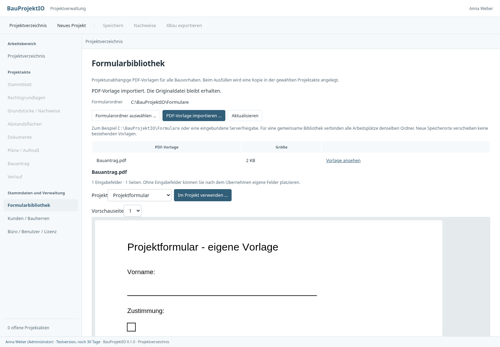

# Zentrale PDF-Formularbibliothek

**Formularbibliothek** ist ein eigener Arbeitsbereich, der auch ohne geöffnetes
Projekt verfügbar ist. Der Formularordner ist von Projektdateien und von den
JSON-Dateien für automatische Feldzuordnungen getrennt.

## Ordner und Vorlagen

- Als Administrator **Formularordner auswählen** verwenden, beispielsweise
  `C:\BauProjektIO\Formulare` oder eine eingebundene Freigabe
  `\\Firmenserver\BauProjektIO\Formulare`.
- Ohne eigene Auswahl werden im Einzelplatzmodus `Formularvorlagen` im
  App-Datenordner und bei einer NAS-/Dateisystem-Netzwerkkonfiguration `Formulare`
  unter deren Ablageroot verwendet. Bei S3 bleibt die Bibliothek ein separat
  wählbarer Dateisystemordner; sie wird nicht automatisch im Bucket abgelegt.
- Die Auswahl wird pro Arbeitsplatz in `formularbibliothek.json` im
  App-Konfigurationsordner gespeichert und nach Neustart wieder geladen.
  Für eine gemeinsame Bibliothek verbinden alle Arbeitsplätze denselben Ordner.
- Ein Ordnerwechsel verbindet den neuen Ordner. Bisherige Vorlagen bleiben am
  alten Ort; es findet keine automatische Verschiebung oder Kopie statt.
- **PDF-Vorlage importieren** kopiert die gewählte PDF in die Bibliothek.
  Vorhandene gleichnamige Dateien werden erhalten; die neue Datei bekommt dann
  eine eindeutige Ergänzung. Vorlagen können auch direkt in den Ordner gelegt
  werden; **Aktualisieren** liest sie erneut ein. Unterordner werden nicht durchsucht.

Die Bibliothek arbeitet mit regulären PDF-Dateien bis 100 MB. Import und
Projektübernahme erfordern die Rolle Bearbeitung oder höher. Dateisystemrechte
auf dem Server gelten zusätzlich. Nur Administratoren können den Ordner über
die Anwendung wechseln. Das gemeinsame Verzeichnis sollte ausschließlich
Formularvorlagen enthalten; eine nicht lesbare/zu große Datei wird als Fehler
angezeigt und nicht still ignoriert.

## Im Projekt verwenden

1. **Vorlage ansehen** zeigt die PDF und die Anzahl vorhandener Eingabefelder.
2. Zielprojekt auswählen und **Im Projekt verwenden** anklicken.
3. Die Anwendung legt eine eigenständige Dokumentkopie im Zielprojekt ab und
   öffnet die Eingabemaske. Hat das PDF noch keine Felder, öffnet sie stattdessen
   den bestehenden Editor zum Platzieren eigener Felder.
4. **Ausfüllen und ablegen** speichert ein neues, ausgefülltes Dokument in der
   Projektakte und bietet den Export an. Ein abgebrochener Export entfernt das
   bereits gespeicherte Projektdokument nicht.

Die gemeinsame Vorlage wird weder beim Übernehmen noch beim Ausfüllen verändert.
Wurde die Datei nach ihrer Auswahl extern geändert, wird die Übernahme mit einer
Prüfsummenfehlermeldung abgelehnt; die Bibliothek muss neu geladen werden.

Eigene, im Projekt erstellte Vorlagen können über **Dokumente → In
Formularbibliothek ablegen** bereitgestellt werden. Dabei werden auch bereits
vorhandene PDF-Eingaben kopiert: Für gemeinsame Vorlagen eine leere Fassung ohne
personenbezogene Projektdaten verwenden. Der Bibliotheksimport löscht keine
Feldwerte. Die Quelle im Projekt bleibt erhalten. Eine direkte Feldbearbeitung
innerhalb der gemeinsamen Bibliothek ist nicht enthalten.

## Prüfung

- Rust-Integration: dieselbe Vorlage in zwei unabhängigen Projekten; ausgefülltes
  Ergebnis verändert weder gemeinsame Vorlage noch zweites Projekt; Namenskollision,
  direkt abgelegte PDF, externe Dateiänderung, ungültiger Pfad, Links und Rollen.
- Kompilierte UI mit Test-IPC und echter PDF.js-Darstellung: Bibliothek ohne
  geöffnetes Projekt, Import-Abbruch, Zielprojektwahl, Projektkopie, Maske, Export
  und fehlgeschlagener/erfolgreicher Ordnerwechsel.
- [UI-Prüfprotokoll](ui-pruefung.json) und [Ansicht](01-bibliothek.png).

