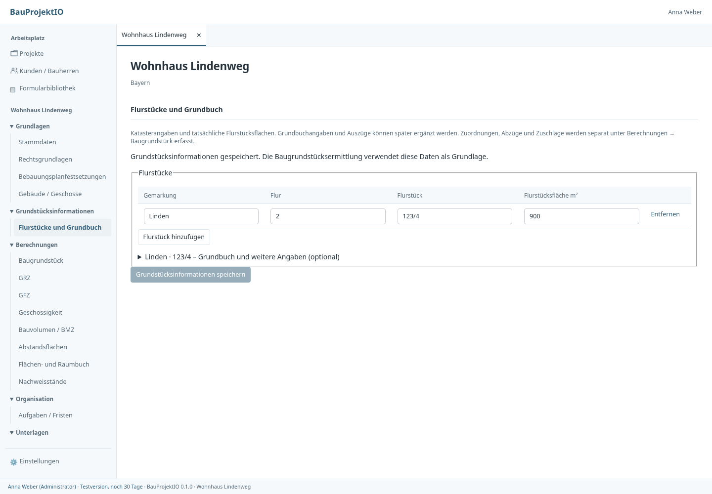
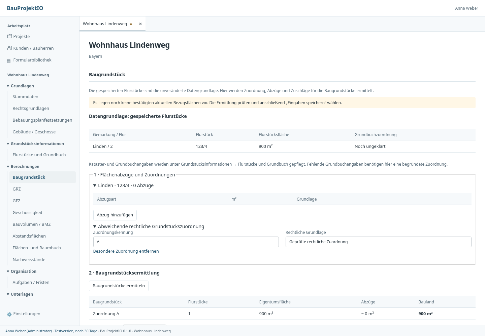

# Flurstücksfakten und Baugrundstücksermittlung

## Bedienung

Unter **Grundstücksinformationen → Flurstücke und Grundbuch** werden Gemarkung,
Flur, Flurstücknummer und tatsächliche Flurstücksfläche erfasst. Grundbuchbezirk,
Blatt, laufende Nummer, Eigentümer, Bemerkung und ein Dokumentbezug auf eine
konkrete Version des Grundbuchauszugs sind optional. Eigentümer sind Kunden aus
der Kundendatenbank: bei Vorhabenflurstücken Bauherren oder Beteiligte mit der
Rolle Grundstückseigentümer bzw. Erbbauberechtigter, bei Nachbar- und sonstigen
Flurstücken beliebige Kunden. Eine Eigentümerzuordnung ändert keine Fläche; die
Baugrundstücksermittlung bleibt aktuell. Auszüge werden zunächst als
Projektdatei importiert und anschließend ausgewählt. Die Flurstücke lassen sich
ohne Grundbuch und ohne fertige Baugrundstücksberechnung speichern. Im Dialog
zum Anlegen/Bearbeiten eines Projekts gibt es deshalb keine zweite Flächeneingabe.
Gemessene Planflächen verweisen zur Prüfung auf die Flurstücksinformationen und
überschreiben keine Kataster- oder Baugrundstücksfläche.

Jedes Flurstück hat einen **Bezug zum Vorhaben**: Vorhabengrundstück (Normalfall),
Nachbarflurstück oder Sonstiges (etwa Zuwegung oder Baulastfläche). Nur
Vorhabenflurstücke bilden Baugrundstücke, stehen im Bauantrag und im XBau-Export
und ergeben die Grundstücksfläche des Projekts (Summe ihrer Flurstücksflächen).
Die übrigen bleiben als Fakten erfasst, etwa für Abstandsflächen. Ein
Buchgrundstück gehört nur ganz zum Vorhaben, und mindestens ein Flurstück muss
dazugehören. Ein Wechsel des Bezugs ändert den Quellenstand; die
Baugrundstücksermittlung ist danach erneut zu bestätigen. Ohne erfasste
Flurstücke bleibt die Flächenangabe eines Bestandsprojekts stehen.

Unter **Berechnungen → Baugrundstück** stehen diese gespeicherten Fakten lesend
bereit. Dort werden die Grundstückszuordnung, einzelne begründete Flächenabzüge
und zugeordnete Gemeinschaftsanteile angesetzt. Die Flurstücksfläche wird dabei
nicht verändert. GRZ, GFZ und Formulare erhalten die maßgebenden Bezugsflächen je
Baugrundstück, niemals eine stillschweigend zusammengezählte Katasterfläche.

Grundbuchangaben sind auch für die Berechnung optional. Ohne vollständige
Grundbuchzuordnung wird jedes Flurstück als eigene Berechnungseinheit angesetzt.
Ein einzelnes Flurstück kann damit unmittelbar berechnet werden. Mehrere
Flurstücke werden niemals allein wegen gleicher fehlender Angaben summiert.
Vollständige Angaben mit gleichem Bezirk, Blatt und laufender Nummer bilden eine
gemeinsame Einheit; unterschiedliche Zuordnungen ergeben getrennte Einheiten.
Eine ausdrückliche gemeinsame Zuordnung ist über dieselbe besondere Kennung mit
Grundlage möglich. Die Grundbuchzuordnung beeinflusst damit die Gruppierung und
die Anzahl der nachgelagerten Nutzungsberechnungen, nicht die grundsätzliche
Berechenbarkeit. Ein einzelner Ansatz ohne Grundbuch ist keine Bestätigung einer
grundbuchrechtlichen Einheit.

Nach Änderungen an Grundstücksinformationen muss die Ermittlung erneut geprüft
und mit **Eingaben speichern** bestätigt werden. Bis dahin wird keine alte
Bezugsfläche automatisch in Formulare übernommen. Bereits archivierte Nachweise
bleiben mit ihren ursprünglichen Daten nachrechenbar. Ein offener, abweichender
Berechnungsentwurf bleibt bei Konflikten erhalten; das Laden aktueller Quellen
mit Verwerfen des Entwurfs ist eine ausdrücklich beschriftete Aktion.

## Modulverträge und Speicherung

- `grundstuecksinformationen::Grundstuecksinformationen` besitzt die Fakten und
  validiert sie unabhängig von Planfestsetzungen und Nutzungsnachweisen.
- `BaugrundstuecksErmittlung` speichert nur flurstücksbezogene Ansätze,
  Nutzungsberechnungseingaben und den vom Core gesetzten Quellenhash. Kataster-
  und Grundbuchdaten werden nicht als zweite Faktenkopie darin gespeichert.
- Die beiden Felder liegen getrennt im bestehenden Projekt-JSON. Die
  Schreibbereiche `grundstuecksinformationen` und `grundstuecke` verwenden den
  Drei-Wege-Abgleich und übernehmen ausschließlich ihre verantworteten Felder.
- `grundstuecksinformationen::plan` verbindet Fakten und Ansätze zu dem bestehenden
  `BaugrundstuecksPlan` für Berechnungsaufrufe und unveränderliche Archive.
  Die bestehende Ergebnisliste der Baugrundstücksermittlung bleibt erhalten.
- `grundstueckskontext::ermitteln` prüft den Quellenstand und liefert weiterhin
  getrennte Einheiten, Identitäten und Bezugsflächen an Formulare und andere
  Verbraucher. Eine alte Projektgesamtfläche ersetzt keine unbestätigte Ermittlung.
- Berechnungsaufrufe und neue Nachweisstände prüfen, dass ihre Flurstücksfakten
  mit den gespeicherten Projektquellen übereinstimmen. Neue Nutzungsnachweise
  verlangen zusätzlich die bestätigte Zuordnung mit ihren gespeicherten Abzügen
  und Gemeinschaftsanteilen. Abweichende Flächen können
  nicht im Berechnungsdialog an der Faktenverwaltung vorbei verwendet werden.
- Neue Frontendtypen für Fakten und Ansätze werden aus Rust generiert. Der
  Frontendadapter verbindet ausschließlich Daten; Gruppierung, Anrechnung und
  Flächenberechnung bleiben im Core.

## Bestandsdaten

Das bisherige Feld `baugrundstuecke` bleibt als lesbarer Bestandsvertrag erhalten.
Bei der nächsten tatsächlichen Bereichsspeicherung übernimmt der Core daraus
Fakten und Berechnungsansätze und entfernt die bisherige Live-Doppelstruktur.
Flurstücksidentitäten, Abzüge, besondere Zuordnungen und Nutzungseingaben bleiben
erhalten. Eine reine Formatumstellung ändert keine Grundstücksidentitäten oder
Nachweisaktualität. Änderungen an den Quellen erfordern dagegen eine erneute
Bestätigung. Historische Nachweise werden nicht umgeschrieben. Es ist keine
SQL-Migration erforderlich.

## Validierung

Core-Tests prüfen optionale Grundbuchdaten, fehlende Zuordnungen, getrennte
Grundbuchblätter und verlustfreie Formatübernahme. SQLite-/Storage-Integration
prüft unabhängige Speicherbereiche, Quellenkonflikte, Faktenfläche gegenüber
Bezugsfläche, GRZ-/Formularübergabe und historische Nachweiswiederholung.

Die Browserregression prüft den neuen Ablauf ohne Grundbuchpflicht, Fehlererhalt
beim Speichern, die lesende Faktenansicht in der Berechnung, begründete Zuordnung,
getrennte Speicherpayloads, Projektwechsel und schmale Fenster. Die Screenshots
verwenden Testdaten und einen Testtransport; sie ersetzen keine native Abnahme.

