# BauPlanIO – Bedienhandbuch

Für Architekten, Entwurfsverfasser und Planer

Stand: 23.10.2026

## Inhaltsverzeichnis

- [01. Mit BauPlanIO arbeiten](#01-mit-bauplanio-arbeiten)

- [02. Oberfläche, Projektregister und Speichern](#02-oberfläche-projektregister-und-speichern)

- [03. Arbeitsplatz und Büro einrichten](#03-arbeitsplatz-und-büro-einrichten)

- [04. Benutzer und Projektmitglieder](#04-benutzer-und-projektmitglieder)

- [05. Dateiablage und lesbare Projektordner](#05-dateiablage-und-lesbare-projektordner)

- [06. Projekt anlegen und Stammdaten pflegen](#06-projekt-anlegen-und-stammdaten-pflegen)

- [07. Kunden, Bauherren und weitere Beteiligte](#07-kunden-bauherren-und-weitere-beteiligte)

- [08. Rechtsgrundlagen des Vorhabens](#08-rechtsgrundlagen-des-vorhabens)

- [09. Bebauungsplanfestsetzungen eingeben](#09-bebauungsplanfestsetzungen-eingeben)

- [10. Flurstücke und Grundbuch erfassen](#10-flurstücke-und-grundbuch-erfassen)

- [11. Baugrundstücke ermitteln](#11-baugrundstücke-ermitteln)

- [12. Gebäude und Geschosse aufbauen](#12-gebäude-und-geschosse-aufbauen)

- [13. Berechnungen bearbeiten und prüfen](#13-berechnungen-bearbeiten-und-prüfen)

- [14. GRZ und GRZ I / II](#14-grz-und-grz-i--ii)

- [15. GFZ und Geschossigkeit](#15-gfz-und-geschossigkeit)

- [16. Bauvolumen und BMZ](#16-bauvolumen-und-bmz)

- [17. Überbaubare Fläche und Baugrenzen](#17-überbaubare-fläche-und-baugrenzen)

- [18. Vollgeschosse, Gebäudehöhen und Dachneigung](#18-vollgeschosse-gebäudehöhen-und-dachneigung)

- [19. Abstandsflächen nachweisen](#19-abstandsflächen-nachweisen)

- [20. Stellplatznachweis](#20-stellplatznachweis)

- [21. Raumbuch und Wohnflächen](#21-raumbuch-und-wohnflächen)

- [22. DIN-277-Flächen und Rauminhalte](#22-din-277-flächen-und-rauminhalte)

- [23. Freiflächen und Regenwasser](#23-freiflächen-und-regenwasser)

- [24. Pläne ansehen und zuordnen](#24-pläne-ansehen-und-zuordnen)

- [25. PDF-Aufmaß erstellen und übernehmen](#25-pdf-aufmaß-erstellen-und-übernehmen)

- [26. Nachweisstände archivieren und freigeben](#26-nachweisstände-archivieren-und-freigeben)

- [27. Projektdateien und Versionen verwalten](#27-projektdateien-und-versionen-verwalten)

- [28. Dokumentkategorien im Büro pflegen](#28-dokumentkategorien-im-büro-pflegen)

- [29. E-Mails und Anhänge dokumentieren](#29-e-mails-und-anhänge-dokumentieren)

- [30. PDF-Formulare im Projekt ausfüllen](#30-pdf-formulare-im-projekt-ausfüllen)

- [31. Formularbibliothek und eigene PDF-Vorlagen](#31-formularbibliothek-und-eigene-pdf-vorlagen)

- [32. Einzeldruck, Stapeldruck und Behördenausgabe](#32-einzeldruck-stapeldruck-und-behördenausgabe)

- [33. Projektübersicht, Aufgaben und Chronik](#33-projektübersicht-aufgaben-und-chronik)

- [34. Aktensuche, OCR und Wiedervorlagen](#34-aktensuche-ocr-und-wiedervorlagen)

- [35. Verfahrensakte und Vorhabenprofil anlegen](#35-verfahrensakte-und-vorhabenprofil-anlegen)

- [36. Unterlagenbedarf und Freigaben organisieren](#36-unterlagenbedarf-und-freigaben-organisieren)

- [37. Abweichungen, Ausnahmen und Befreiungen](#37-abweichungen-ausnahmen-und-befreiungen)

- [38. Unterschriften und Freigaben dokumentieren](#38-unterschriften-und-freigaben-dokumentieren)

- [39. Bauantrag und XBau-Grunddaten](#39-bauantrag-und-xbau-grunddaten)

- [40. Workflow: Unterlagen für die Erstabgabe vorbereiten](#40-workflow-unterlagen-für-die-erstabgabe-vorbereiten)

- [41. Abgabestände und Einreichungsvergleich](#41-abgabestände-und-einreichungsvergleich)

- [42. Über das zuständige Bauportal einreichen](#42-über-das-zuständige-bauportal-einreichen)

- [43. Kommunikation, Versand und Eingang dokumentieren](#43-kommunikation-versand-und-eingang-dokumentieren)

- [44. Workflow: Nachforderung und Nachreichung](#44-workflow-nachforderung-und-nachreichung)

- [45. Schreiben und behördliche Zwischenschritte](#45-schreiben-und-behördliche-zwischenschritte)

- [46. XBau-Nachrichten austauschen und auswerten](#46-xbau-nachrichten-austauschen-und-auswerten)

- [47. Bescheide, genehmigte Unterlagen und Auflagen](#47-bescheide-genehmigte-unterlagen-und-auflagen)

- [48. Nach der Genehmigung und Verfahrensabschluss](#48-nach-der-genehmigung-und-verfahrensabschluss)

- [49. Sicherung, Wiederherstellung und Aktenexport](#49-sicherung-wiederherstellung-und-aktenexport)

- [50. Durchgängiges Beispiel: Einfamilienhaus](#50-durchgängiges-beispiel-einfamilienhaus)

- [51. Häufige Fragen und Störungen](#51-häufige-fragen-und-störungen)

- [52. Begriffe und Abschlusscheckliste](#52-begriffe-und-abschlusscheckliste)

## 01. Mit BauPlanIO arbeiten

Vom ersten Projekt bis zur nachvollziehbaren Behördenakte.

BauPlanIO unterstützt die Erfassung von Bauvorhaben, Berechnungen, Formularen und Projektdateien sowie die Dokumentation des Genehmigungsverfahrens. Dieses Handbuch richtet sich an Architekten, Entwurfsverfasser, Fachplaner und die Projektorganisation im Büro.

Die Anleitung beschreibt den Stand mit den Workflow-Verbesserungen vom 23.10.2026. Die Bezeichnungen folgen der Oberfläche; kurze Seitentitel wie „Flurstücke“ können neben ausführlichen Namen wie „Flurstücke und Grundbuch“ stehen.

### Empfohlene Reihenfolge

1. Arbeitsplatz, Büroangaben, Speicherorte und Zugriffsrechte einrichten.
2. Projekt und Bauherrschaft anlegen; Rechtsgrundlagen, Flurstücke und Gebäudedaten erfassen.
3. Baugrundstücke ermitteln, Planaufmaße verknüpfen und die erforderlichen Berechnungen bearbeiten.
4. Nachweise prüfen, freigeben und als Projektunterlagen ablegen; amtliche Formulare ausfüllen.
5. Verfahrensakte und Unterlagenanforderungen bearbeiten; konkrete Dokumentversionen als Abgabestand festhalten.
6. Unterlagen im zuständigen Portal einreichen; Versand, Zugang und Rückmeldungen mit Belegen dokumentieren.
7. Nachforderungen, Änderungen und Bescheide bis zur Bauausführung weiterführen.

### So nutzen Sie die Hilfe

Über „Hilfe / Handbuch“ im Arbeitsplatz oder „Hilfe → Bedienhandbuch“ im Anwendungsmenü (F1) öffnen Sie diese Anleitung. „Hilfe zu diesem Bereich“ im Aktenkopf führt zum passenden Kapitel. Die Suche durchsucht alle Kapiteltexte. Das gesamte Handbuch kann gedruckt oder als Markdown-Datei heruntergeladen werden.

Ein Wechsel zur Hilfe schließt keine Projektakte und verwirft keine Eingaben. Zum Weiterarbeiten den betreffenden Projekttab anklicken.

> Die fachliche Verantwortung bleibt beim Planungsteam. Ungeprüfte Regelbeispiele, unvollständige Angaben oder offene Prüfpunkte sind keine behördlich bestätigten Nachweise. Maßgebend sind die für das Vorhaben geltenden Rechtsgrundlagen, Satzungen und Anforderungen der zuständigen Stelle.

### Lesepfade für typische Aufgaben

Die Abbildungen zeigen mehrere fiktive Beispielprojekte. Namen, Termine, Flächen und Regelansätze dienen der Erläuterung. Unterschiedliche Screenshots bilden keinen gemeinsamen rechtlich geprüften Musterantrag ab. Die Aufnahme erfolgte in der aktuellen Weboberfläche mit kontrollierten Testadaptern; native Dateidialoge und ein realer Portalversand sind damit nicht nachgewiesen.

| Prüfpunkt / Eingabe | Bedeutung und Kontrolle |
| --- | --- |
| Erstes Projekt | Kapitel 3–12: Arbeitsplatz, Projekt, Beteiligte, Rechtsgrundlagen, Flurstücke und Gebäude. Danach die benötigten Berechnungen auswählen. |
| Vorhandenes Projekt weiterführen | Kapitel 2 und 33: richtigen Projekttab öffnen, offene Arbeitsschritte und Aktualität prüfen. Anschließend nur betroffene Quellen und Nachweise bearbeiten. |
| Antragsunterlagen erstellen | Kapitel 13–32: Berechnungen prüfen, Nachweisstände festhalten, Formulare ausfüllen, Dateien kategorisieren und die Druckausgabe kontrollieren. |
| Bauantrag einreichen | Kapitel 35–43: Verfahrensakte, Unterlagenbedarf, Freigaben, Abgabestand und Portalübergabe. Export, Versand und Eingang getrennt dokumentieren. |
| Nachforderung / Genehmigung | Kapitel 44–49: Originaleingang sichern, einzelne Forderungspunkte bearbeiten, Folgeversionen einreichen und genehmigte Versionen mit Auflagen dokumentieren. |

Weiterlesen: [Durchgängiges Beispiel: Einfamilienhaus](#50-durchgängiges-beispiel-einfamilienhaus) · [Workflow: Unterlagen für die Erstabgabe vorbereiten](#40-workflow-unterlagen-für-die-erstabgabe-vorbereiten) · [Begriffe und Abschlusscheckliste](#52-begriffe-und-abschlusscheckliste)

## 02. Oberfläche, Projektregister und Speichern

Orientierung, parallele Projekte und sichere Entwurfsbearbeitung.

### Arbeitsplatz und Projektakte

Oben wechseln Sie zwischen „Projekte“, „Kunden / Bauherren“, „Formularbibliothek“, „Einstellungen“ und der Hilfe. Die darunter geöffneten Projekttabs bleiben unabhängig davon erhalten.

Innerhalb einer Projektakte wechseln Sie über die Register „Übersicht“, „Grundlagen“, „Berechnungen“, „Unterlagen“ und „Verfahren“. Links erscheint jeweils die Gliederung des gewählten Registers. Ein gesperrter Bereich nennt beim Darüberfahren konkret die fehlenden Schritte. Über das Informationssymbol ist die Erklärung mit Tastatur erreichbar und mit Escape schließbar. Nutzungsmodule können über „Entwurf öffnen“ vorbereitet werden; für Berechnung und Nachweise bleiben die fachlichen Voraussetzungen erforderlich.

### Orientierung in der Oberfläche

Die folgende Abbildung zeigt einen Ausschnitt des Arbeitsablaufs im fiktiven Beispielprojekt.

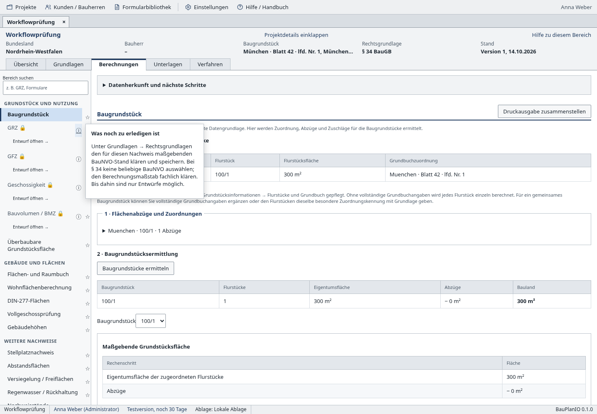

Abbildung 2.1 · Die Erklärung am gesperrten GRZ-Eintrag nennt fehlende Grundlagen. Der angebotene Entwurf erlaubt vorbereitende Eingaben; eine verbindliche Berechnung benötigt weiterhin die angezeigten Voraussetzungen.

### Eingaben richtig behandeln

- Mit * markierte Felder sind erforderlich. Eine leere Zahl ist nicht dasselbe wie die ausdrückliche Angabe 0. Einheiten stehen am Feld.
- Übernommene oder schreibgeschützte Werte werden an der Quelle geändert. Bei PDF-Aufmaßen muss ein neuer Stand ausdrücklich übernommen werden.
- „Speichern“ sichert den bearbeiteten Stand. Prüfen, Archivieren und Freigeben sind zusätzliche Schritte mit eigener Bedeutung.
- Ein Punkt am Projekttab bzw. „Ungespeicherte Änderungen“ weist auf einen Entwurf hin. Beim Wechseln bleibt dieser erhalten; vor dem Schließen speichern oder bewusst verwerfen.
- Nach einem Absturz kann ein lokaler Entwurf zur Wiederherstellung angeboten werden. Er ersetzt keinen gespeicherten, freigegebenen oder gesicherten Projektstand.

### Bei gleichzeitiger Bearbeitung

Meldet die Anwendung einen Versionskonflikt, den Entwurf zunächst erhalten und die Änderungen mit dem Kollegen abstimmen. Den aktuellen Stand erst nach Sicherung der eigenen Angaben laden. Ein erneuter Speicherversuch ist kein bewusster Zusammenführungsentscheid.

### Einheitliche Bearbeitungsstände

Statusanzeigen enthalten Text und ein Symbol. „Gespeichert“, „Berechnet“, „Archiviert“, „Fachlich freigegeben“, „Exportiert“ und „Eingang belegt“ beschreiben unterschiedliche Arbeitsschritte. Die aufklappbare Statushilfe erläutert diese in Übersicht, Nachweisen und Einreichung.

Beim Bearbeiten eines Fachobjekts lässt sich die Eintragsliste über dem Formular ein- und ausklappen. Ungespeicherte Änderungen bleiben geschützt. Ein Eingabefehler öffnet den betroffenen Formularabschnitt und setzt den Fokus auf das Feld.

### Kürzere Arbeitswege

Die Gliederung bietet eine Bereichs-/Aktionssuche (Strg+K), Favoriten und zuletzt geöffnete Bereiche. Projektdetails lassen sich im Aktenkopf einklappen.

„Datenherkunft und nächste Schritte“ zeigt ungespeicherte Quellentwürfe. „Nur diese Quelle speichern“ speichert gezielt deren registrierte Editoren. Über den Rückweg gelangen Sie zur aufrufenden Berechnung; Übernahmen anschließend bewusst prüfen.

### Sicher zwischen Aufgaben und Projekten wechseln

1. Vor jedem Bearbeitungsschritt den Namen des aktiven Projekttabs und den gewählten Bereich prüfen. Bei mehreren gleichartigen Vorhaben eine eindeutige Projektbezeichnung verwenden.
2. Zum schnellen Wechsel Strg+K verwenden oder im Feld „Bereich suchen“ einen Begriff eingeben. Favoriten mit dem Stern markieren; „Zuletzt geöffnet“ führt zu kürzlich verwendeten Bereichen dieser Akte.
3. Bei deaktiviertem GRZ-/GFZ-Eintrag darüberfahren oder das Informationssymbol aktivieren. Den genannten Grundlagenbereich öffnen und die fehlenden Angaben dort speichern. Für vorbereitende Eingaben gegebenenfalls „Entwurf öffnen“ verwenden.
4. Vor dem Schließen die betroffenen Bearbeitungsbereiche speichern. Ein Wechsel des Registers ist kein Ersatz für Speichern. Bei Rückfragen zum Schließen die genannten Bereiche einzeln prüfen.

| Prüfpunkt / Eingabe | Bedeutung und Kontrolle |
| --- | --- |
| Gespeicherter Stand | Für andere Benutzer und nachfolgende Module verfügbare Daten im vorgesehenen Projekt-/Fachspeicher. |
| Lokaler Entwurf | Vorbereitung bzw. Wiederherstellung auf diesem Gerät und für diesen Benutzer. Keine Bürosicherung und keine verbindliche Unterlagenfreigabe. |
| Geprüft / archiviert / freigegeben | Unterschiedliche Arbeitsschritte. Ein erfolgreiches Rechenergebnis besitzt erst nach Archivierung einen festen Nachweisstand; die fachliche Freigabe ist zusätzlich erforderlich. |

Weiterlesen: [Benutzer und Projektmitglieder](#04-benutzer-und-projektmitglieder) · [Häufige Fragen und Störungen](#51-häufige-fragen-und-störungen) · [Begriffe und Abschlusscheckliste](#52-begriffe-und-abschlusscheckliste)

## 03. Arbeitsplatz und Büro einrichten

Anmeldung, Darstellungsstil, Briefbogen und Updates.

### Erste Einrichtung

1. Unter „Einstellungen“ das Farbschema Hell, Dunkel oder System wählen.
2. Die Büroangaben mit Absender und vorhandener Behördenkennung pflegen. Projektbezogene Behördenangaben gehören später in die Verfahrensakte.
3. Speicherorte für Formularvorlagen und lesbare Projektordner festlegen; den Status der verwalteten Dateiablage prüfen.
4. Dokumentkategorien und Druckgestaltung für das Büro einrichten.
5. Unter „Benutzer und Rechte“ die benötigten Konten und Zuständigkeiten einrichten; den Lizenzstatus kontrollieren.

### Orientierung in der Oberfläche

Die folgende Abbildung zeigt einen Ausschnitt des Arbeitsablaufs im fiktiven Beispielprojekt.

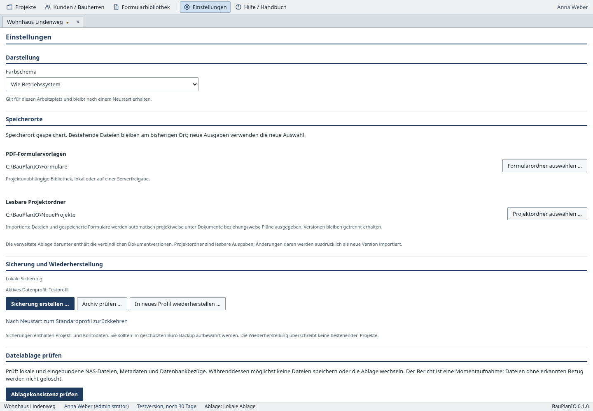

Abbildung 3.1 · Farbschema, projektunabhängiger Formularordner, lesbare Projektordner und Sicherungsfunktionen liegen in den Einstellungen. Die lesbare Ausgabe und die verwaltete Originalablage erfüllen unterschiedliche Aufgaben.

### Weitere Ansicht

Die folgende Abbildung zeigt einen Ausschnitt des Arbeitsablaufs im fiktiven Beispielprojekt.

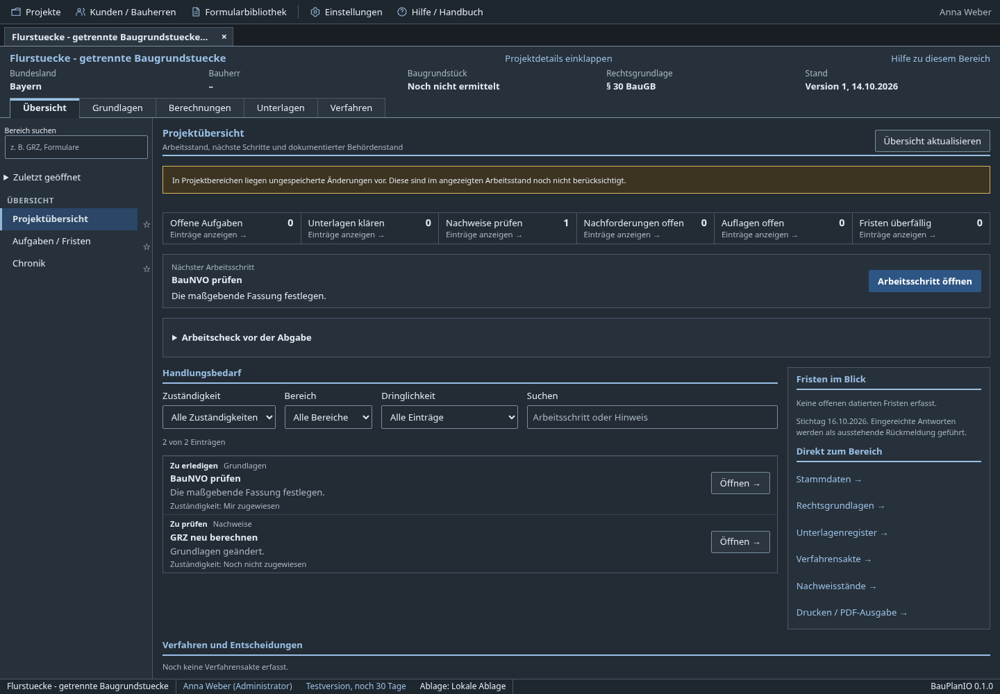

Abbildung 3.2 · Dasselbe Bedienkonzept ist auch im dunklen Farbschema verfügbar. Die Darstellung wird pro Arbeitsplatz über Hell, Dunkel oder System gewählt.

### Anmeldung

Im Einzelplatzbetrieb erfolgt die Anmeldung über das Benutzerkonto des Rechners. Im Netzwerkbetrieb melden Sie sich mit Anmeldename und Kennwort an. Ein vom Administrator vergebenes Erstkennwort muss bei der nächsten Anmeldung ersetzt werden. Bei Sperre oder fehlendem Erstkennwort die Administration ansprechen.

„Anwendung → Abmelden / Benutzer wechseln …“ ist für den Netzwerkbetrieb vorgesehen. Offene Entwürfe vorher speichern. Ein gemeinsamer Dateiordner allein stellt noch keinen Mehrbenutzerbetrieb her.

### Updates

Unter „Einstellungen → Anwendung und Updates“ lässt sich „Updates prüfen“ ausführen. Eine Installation verlangt eine dafür eingerichtete, signierte Updatequelle. Vor „Update installieren und neu starten“ offene Eingaben speichern und laufende Dateiaktionen beenden. Meldet die App fehlende Konfiguration, richtet die Administration den Updatekanal ein.

### Einrichtung mit einer Probeausgabe abschließen

1. Ein fiktives Testprojekt anlegen, bevor echte Projektunterlagen importiert werden. Die gewünschte Darstellung bei normalem und vergrößertem Bildschirmmaßstab prüfen.
2. Eine unkritische Testdatei importieren und prüfen, ob sich die gespeicherte Version aus der Anwendung wieder öffnen lässt.
3. Ein einfaches Formular im Testprojekt speichern. Den angezeigten Ablagehinweis sowie die Ausgabe im lesbaren Projektordner kontrollieren.
4. Eine Berechnung oder ein Schreiben als Probe-PDF ausgeben. Büroabsender, Briefkopf, Fußzeile, Seitenzählung und Lesbarkeit prüfen.
5. Eine Sicherung erstellen und deren Integrität prüfen. Zuständigkeit für laufende Sicherungen und den Wiederherstellungsfall im Büro festlegen.

Weiterlesen: [Dateiablage und lesbare Projektordner](#05-dateiablage-und-lesbare-projektordner) · [Benutzer und Projektmitglieder](#04-benutzer-und-projektmitglieder) · [Einzeldruck, Stapeldruck und Behördenausgabe](#32-einzeldruck-stapeldruck-und-behördenausgabe) · [Sicherung, Wiederherstellung und Aktenexport](#49-sicherung-wiederherstellung-und-aktenexport)

## 04. Benutzer und Projektmitglieder

Büroweite Rollen und projektbezogenen Zugriff unterscheiden.

Die Benutzerverwaltung unter „Einstellungen → Benutzer und Rechte“ regelt Konten, Rollen und im Netzwerk Erstkennwörter. Projektbezogene Freigaben werden zusätzlich über die Mitgliedschaft im Projekt gesteuert. Eine büroweite Rolle allein ist kein pauschaler Zugriff auf jede fremde Projektakte.

### Mitglieder zuordnen

1. Im Projekt „Grundlagen → Stammdaten → Projektmitglieder …“ öffnen.
2. Die benötigten Personen zuordnen und deren Projektrecht für Lesen, Bearbeitung oder Leitung festlegen.
3. Die gespeicherte Zuordnung prüfen. Falls die Schaltfläche fehlt, die Projektleitung oder Administration um die Änderung bitten.

### Rollen im Alltag

| Aufgabe | Vorgehen |
| --- | --- |
| Lesen | Daten und Nachweise ansehen; gesperrte Eingabefelder sind beabsichtigt. |
| Bearbeiten | Erlaubte Projektangaben und Unterlagen bearbeiten. Fachfreigaben können weitergehende Rechte benötigen. |
| Projektleitung | Projektbezogene Freigaben und Mitglieder im erlaubten Umfang verwalten. |
| Administration | Konten, Büro- und Ablagekonfiguration im jeweils freigegebenen Umfang betreuen. |

> Ein deaktivierter Speichern-Knopf kann auf fehlende Rechte, einen unveränderten Stand, einen laufenden Vorgang oder eine Sperre hinweisen. Nicht durch Umbenennen oder Kopieren an der Versionsverwaltung vorbei arbeiten.

### Zusammenarbeit organisieren

Für jede Akte sollte klar sein, wer Grundlagen pflegt, wer die einzelnen Nachweise erstellt und wer fachlich freigibt. Gemeinsame Bearbeitungsrechte bedeuten nicht, dass zwei Personen dieselbe Maske gleichzeitig ohne Abstimmung ändern sollten.

Bei einer Leseberechtigung zunächst prüfen, ob die richtige Projektmitgliedschaft vorliegt. Bei fehlenden Schaltflächen nicht sofort einen zweiten Datensatz anlegen: Zuerst Rolle, Sperre und bereits vorhandene Datensätze kontrollieren. Eine unabhängige Kopie würde die Nachvollziehbarkeit erschweren.

Weiterlesen: [Oberfläche, Projektregister und Speichern](#02-oberfläche-projektregister-und-speichern) · [Projektdateien und Versionen verwalten](#27-projektdateien-und-versionen-verwalten) · [Häufige Fragen und Störungen](#51-häufige-fragen-und-störungen)

## 05. Dateiablage und lesbare Projektordner

Verbindliche Dokumentversionen von ausgegebenen Ordnerkopien unterscheiden.

### Drei verschiedene Speicheraufgaben

| Bereich | Aufgabe |
| --- | --- |
| Verwaltete Dateiablage | Verbindliche Originaldateien und Dokumentversionen; Projektdaten werden zusätzlich in der Datenbank geführt. |
| Lesbare Projektordner | Geordnete Ausgaben unter Dokumente bzw. Pläne für den Zugriff außerhalb der App. |
| PDF-Formularvorlagen | Projektunabhängige Bibliothek wiederverwendbarer Vorlagen. |

### Ordner wählen

1. Unter „Einstellungen → Speicherorte“ den „Formularordner auswählen …“ und/oder „Projektordner auswählen …“. Die Auswahl benötigt die entsprechenden Administrationsrechte.
2. Bei einem geänderten Ausgabeordner beachten: Bestehende Dateien verbleiben zunächst am bisherigen Ort; neue Ausgaben verwenden die neue Auswahl.
3. Für einen tatsächlichen Wechsel der verwalteten Originalablage „Verwaltete Dateiablage → Speicherort auswählen …“ verwenden. „Kopieren und wechseln“ kopiert und prüft die Versionen. Die Datenbank wird dabei nicht verschoben.

### Arbeiten im Büro

Mehrere Arbeitsplätze benötigen eine gemeinsame PostgreSQL-Datenbank und eine gemeinsame, passend konfigurierte NAS-/Server- oder Objektablage. Die Einrichtung erfolgt durch die Administration. Eine gemeinsame SQLite-Datei auf einer Netzwerkfreigabe ist dafür nicht vorgesehen.

Eine außerhalb der Anwendung geänderte Ausgabe wird nicht automatisch zur neuen Dokumentversion. Die Änderung über eine Arbeitskopie übernehmen oder gezielt als neue Version importieren. Eine Projektordnerkopie allein ist keine vollständige Datensicherung.

### Welche Datei ist verbindlich?

| Prüfpunkt / Eingabe | Bedeutung und Kontrolle |
| --- | --- |
| Original in der verwalteten Ablage | Die Anwendung führt konkrete Versionen. Diese Version auswählen, wenn ein Formular, Plan oder Beleg in einem Abgabestand referenziert werden soll. |
| Lesbare Ordnerausgabe | Zum Zugriff mit externen Programmen und zur geordneten Bereitstellung. Prüfen, ob die Ausgabe erfolgreich war; bei Ordnerfehlern kann die verwaltete Version trotzdem bereits gespeichert sein. |
| Arbeitskopie in Excel / CAD | Bearbeitbar außerhalb der App. Nach Abschluss ausdrücklich übernehmen oder als neue Version am richtigen Dokument importieren. Erst dann ist die Änderung in der Akte nachvollziehbar. |
| Formularvorlage | Projektunabhängiges Ausgangsdokument. Ausgefüllte projektbezogene Inhalte gehören zum Projektdokument, nicht in eine gemeinsame Blankovorlage. |

Weiterlesen: [Projektdateien und Versionen verwalten](#27-projektdateien-und-versionen-verwalten) · [Sicherung, Wiederherstellung und Aktenexport](#49-sicherung-wiederherstellung-und-aktenexport)

## 06. Projekt anlegen und Stammdaten pflegen

Bauvorhaben, Standort und Bauherrschaft eindeutig erfassen.

### Neues Projekt

1. Im Arbeitsplatz „Projekte“ auf „Neues Projekt“ klicken.
2. Einen unterscheidbaren Projektnamen und das Bundesland des Vorhabens auswählen. Vorhandene Bauherrschaft zuordnen, soweit im Dialog angeboten.
3. Projekt anlegen und über den Projekttab öffnen. Unter „Grundlagen → Stammdaten“ mit „Bearbeiten …“ die Stammdaten pflegen.
4. Unter „Bauherren …“ die Bauherrschaft und unter „Weitere Beteiligte …“ weitere Projektbeteiligte zuordnen.
5. Die Projektmitglieder festlegen und anschließend Standort, Gemeinde und Vorhabenbeschreibung in den jeweiligen Grundlagen vervollständigen.

### Orientierung in der Oberfläche

Die folgende Abbildung zeigt einen Ausschnitt des Arbeitsablaufs im fiktiven Beispielprojekt.

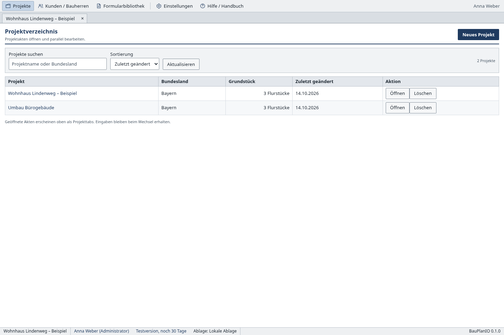

Abbildung 6.1 · Aus dem Projektverzeichnis werden Akten als Projekttabs geöffnet. Vor der Bearbeitung den aktiven Projektnamen kontrollieren.

### Weitere Ansicht

Die folgende Abbildung zeigt einen Ausschnitt des Arbeitsablaufs im fiktiven Beispielprojekt.

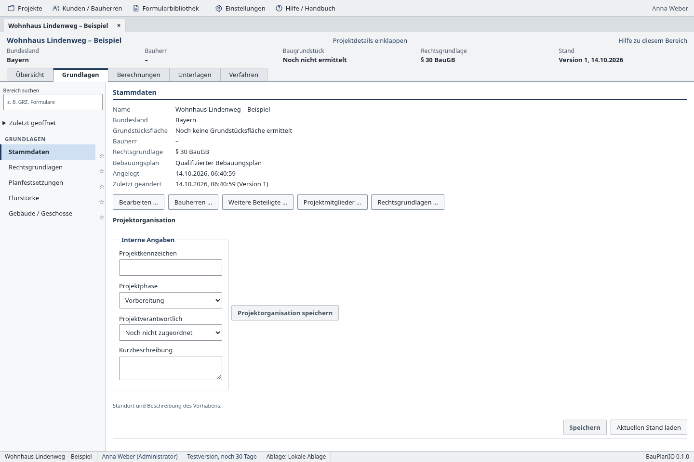

Abbildung 6.2 · Stammdaten und Beteiligtenzuordnung bilden den Einstieg. Standortbeschreibung und rechtliche Grundlagen werden in ihren jeweiligen Fachbereichen gepflegt.

### Projektorganisation

Das Bundesland ist eine fachliche Grundlage und sollte vor der Auswahl von Rechts- und Regelständen stimmen. Die rechnerische Grundstücksfläche wird aus den Flurstücken und der Baugrundstücksermittlung gewonnen; sie ist kein Ersatz für die tatsächlichen Katasterdaten.

Zum Wechseln zwischen Vorhaben mehrere Projekte aus dem Projektverzeichnis öffnen und ihre Tabs verwenden. Das × schließt die Arbeitsakte; das Löschen im Projektverzeichnis ist ein anderer Vorgang. Löschaktionen nur nach Prüfung des betroffenen Projekts und einer vorhandenen Sicherung ausführen.

### Ergebnis

Eine eindeutige Projektakte mit richtigem Bundesland, zugeordneter Bauherrschaft und geklärtem Zugriff ist der Ausgangspunkt für sämtliche weiteren Unterlagen.

### Vor der fachlichen Bearbeitung kontrollieren

| Prüfpunkt / Eingabe | Bedeutung und Kontrolle |
| --- | --- |
| Projektname | Vorhaben und Ort unterscheidbar benennen; gleichnamige Tabs erschweren die tägliche Arbeit. |
| Bundesland / Standort | Mit dem realen Bauort abgleichen. Landesbauordnung und Verfahrensregeln hängen davon ab. |
| Bauherrschaft / weitere Beteiligte | Vorhandene Stammdatensätze zuordnen. Antragsteller, Eigentümer und Entwurfsverfasser sind unterschiedliche Rollen. |
| Projektmitglieder | Lesen, Bearbeiten und Leitung passend zur Büroorganisation zuordnen. |
| Grundlagen / Unterlagen | Planungsrecht und Katasterfakten zuerst erfassen; Pläne und Quellen als Dokumentversionen importieren. |

Weiterlesen: [Kunden, Bauherren und weitere Beteiligte](#07-kunden-bauherren-und-weitere-beteiligte) · [Rechtsgrundlagen des Vorhabens](#08-rechtsgrundlagen-des-vorhabens) · [Projektübersicht, Aufgaben und Chronik](#33-projektübersicht-aufgaben-und-chronik)

## 07. Kunden, Bauherren und weitere Beteiligte

Kontaktdaten wiederverwenden und projektbezogene Rollen zuordnen.

### Kundenstamm

1. „Kunden / Bauherren“ im Arbeitsplatz öffnen. Eine vorhandene Person oder Organisation suchen, bevor ein neuer Eintrag angelegt wird.
2. Namen, Anschrift und Kontaktdaten erfassen bzw. aktualisieren. Unterschiedliche Beteiligte nicht nur wegen gleicher Anschrift zusammenfassen.
3. Im Projekt über „Stammdaten → Bauherren …“ die passenden Einträge zuordnen. Mehrere Bauherren können gemeinsam geführt werden.
4. Weitere Rollen über „Weitere Beteiligte …“ erfassen, z. B. Entwurfsverfasser oder Fachplaner.

### Vor Formularausgabe prüfen

- Sind alle Antragsteller vollständig und richtig bezeichnet?
- Stimmen zustellfähige Anschrift, Ansprechpartner und Entwurfsverfasser?
- Sind Vollmachten und weitere erforderliche Erklärungen als konkrete Projektdateien vorhanden?
- Nach Änderung von Kontaktdaten ein bereits ausgefülltes Formular erneut öffnen und die angebotenen aktuellen Projektdaten prüfen. Alte PDF-Versionen ändern sich dadurch nicht.

### Änderung einer Anschrift nachvollziehen

Ändert sich eine Kontaktanschrift, zuerst den zugehörigen Stammdatensatz korrigieren. Danach die betroffenen projektbezogenen Formulare öffnen und die Übernahmeangebote kontrollieren. Bereits archivierte PDFs oder eingereichte Versionen behalten ihren damaligen Inhalt.

Eine neue Formularausgabe wird als Folgeversion geführt, wenn sie dieselbe Unterlage ersetzt. Eine bloße Stammdatenänderung belegt weder eine behördliche Mitteilung noch einen geänderten Behördenstand. Die notwendige Mitteilung separat im Verfahren dokumentieren.

Weiterlesen: [Projekt anlegen und Stammdaten pflegen](#06-projekt-anlegen-und-stammdaten-pflegen) · [PDF-Formulare im Projekt ausfüllen](#30-pdf-formulare-im-projekt-ausfüllen) · [Bauantrag und XBau-Grunddaten](#39-bauantrag-und-xbau-grunddaten)

## 08. Rechtsgrundlagen des Vorhabens

Bebauungsplan, BauNVO-Fassung und Beurteilungsgrundlage festlegen.

### Grundlagen erfassen

1. „Grundlagen → Rechtsgrundlagen“ öffnen. Gemeinde, Standort, Nutzung und Vorhabenbeschreibung nachvollziehbar angeben.
2. Festlegen, ob ein Bebauungsplan vorhanden ist. Bei vorhandenem Plan Art, Bezeichnung, Nummer/Fassung und Rechtskraftdatum dokumentieren.
3. Die Rechtsgrundlage nach § 30, § 34 oder § 35 BauGB passend zum Vorhaben wählen. Bei einfachem Bebauungsplan die ergänzende Beurteilung dokumentieren.
4. Die zugrunde liegende BauNVO-Fassung und anzuwendende Landesbauordnung einschließlich Quelle bestimmen. Bei fehlender Klärung keine fachliche Bestätigung vortäuschen.
5. Speichern. Unter § 30 mit vorhandenem Plan die „Bebauungsplanfestsetzungen“ getrennt bearbeiten.

### Orientierung in der Oberfläche

Die folgende Abbildung zeigt einen Ausschnitt des Arbeitsablaufs im fiktiven Beispielprojekt.

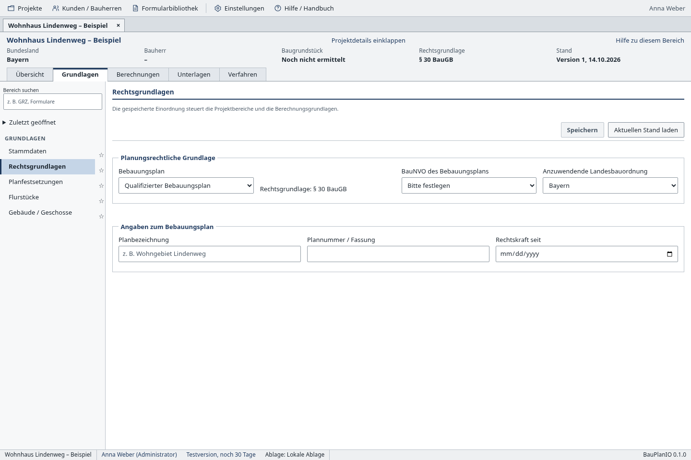

Abbildung 8.1 · Planungsrecht und anwendbare Fassungen zuerst klären und speichern. Ein hier ausgewählter Rechtsstand ist fachlich anhand der Originalquellen zu begründen.

### Ohne Bebauungsplan

Für § 34 lassen sich Vergleichswerte und Referenzbebauung der näheren Umgebung dokumentieren. Sie sind eine Beurteilungsgrundlage, keine automatisch geltende Planfestsetzung. Bei § 35 das Außenbereichsvorhaben und offene Beurteilungsfragen erfassen.

GRZ, GFZ, Geschossigkeit und BMZ werden in der Oberfläche erst mit gewählter Rechtsgrundlage und BauNVO zugänglich. Daraus folgt nicht, dass ohne Bebauungsplan automatisch eine bestimmte BauNVO oder ein verbindlicher Grenzwert anzusetzen wäre; die fachliche Anwendbarkeit muss geklärt werden.

### Entscheidungen an Quellen binden

Nach einer Änderung des rechtlichen Kontexts die betroffenen Berechnungen erneut öffnen und ihre Hinweise zur Aktualität auswerten. Alte archivierte Nachweise bleiben als historische Stände erhalten; für eine neue Einreichung gegebenenfalls einen neuen geprüften Nachweisstand erstellen.

| Prüfpunkt / Eingabe | Bedeutung und Kontrolle |
| --- | --- |
| § 30 BauGB / Bebauungsplan | Planart, räumliche Geltung, Planfassung, Rechtskraft und zugrunde liegende BauNVO am Original prüfen. Zeichnerische und textliche Festsetzungen gemeinsam berücksichtigen. |
| § 34 BauGB | Die konkrete Umgebungsbeurteilung dokumentieren. Ein Vergleichsmaß ist keine automatisch verbindliche Festsetzung. Bei offenem Rechtsstand die Bearbeitung als Vorbereitung kennzeichnen. |
| § 35 BauGB | Außenbereichsbezug und konkrete Zulässigkeitsgrundlage klären. Die Auswahl allein erzeugt keine positive Beurteilung des Vorhabens. |
| BauNVO / Landesbauordnung | Fassung und Anwendungsgrundlage dokumentieren. Nicht allein das aktuelle Kalenderjahr oder ein gewünschtes Rechenergebnis als Auswahlgrund verwenden. |

Weiterlesen: [Bebauungsplanfestsetzungen eingeben](#09-bebauungsplanfestsetzungen-eingeben) · [GRZ und GRZ I / II](#14-grz-und-grz-i--ii) · [GFZ und Geschossigkeit](#15-gfz-und-geschossigkeit)

## 09. Bebauungsplanfestsetzungen eingeben

Festgesetzte Werte mit Wortlaut und Fundstelle dokumentieren.

### Planwerte erfassen

1. Unter „Grundlagen → Bebauungsplanfestsetzungen“ den angezeigten Planbezug prüfen. Änderungen der Planidentität erfolgen bei den Rechtsgrundlagen.
2. Die tatsächlich festgesetzten Werte erfassen: GRZ, gegebenenfalls GRZ einschließlich Nebenanlagen, GFZ, BMZ, absolute Grund-/Geschossfläche und Vollgeschosszahl. Nicht festgesetzte Werte offen lassen.
3. Weitere Festsetzungen, besondere Anrechnungsanteile und Abweichungen mit Wortlaut bzw. Fundstelle ergänzen.
4. Baufenster und sonstige geometrische Einschränkungen zusätzlich anhand der Originalunterlage in den dafür vorgesehenen Plan-/Berechnungsbereichen prüfen.
5. Speichern und nach Änderung bereits erstellte Berechnungen und Nachweise auf Aktualität prüfen.

### Orientierung in der Oberfläche

Die folgende Abbildung zeigt einen Ausschnitt des Arbeitsablaufs im fiktiven Beispielprojekt.

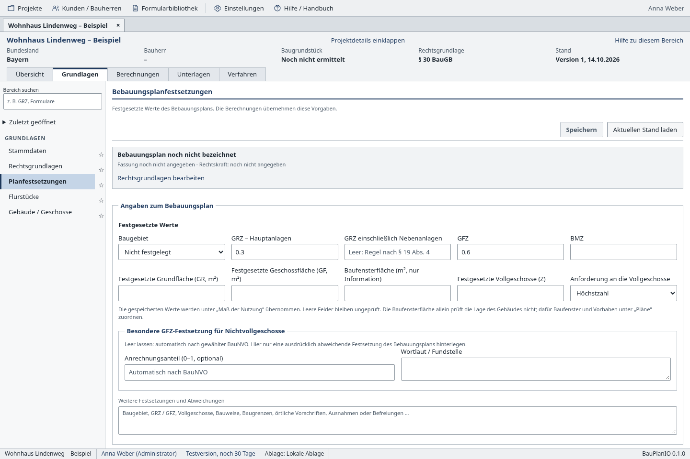

Abbildung 9.1 · Die Planwerte werden getrennt von der Wahl der Rechtsgrundlage erfasst. Nur tatsächlich geltende Werte eintragen und Sonderregelungen mit Quelle dokumentieren.

> Die Baufensterfläche ist allein kein geometrischer Nachweis, dass ein Gebäude innerhalb einer Baugrenze liegt. Ebenso ersetzt ein eingetragener Zahlenwert nicht die Prüfung textlicher Festsetzungen und Ausnahmen.

### Festsetzung, Rechenwert und Erläuterung trennen

Einen Grenzwert nur eintragen, wenn er tatsächlich gilt. Ein leerer Wert bedeutet „nicht erfasst / nicht festgesetzt“, während 0 eine ausdrückliche numerische Vorgabe ist. Den Wortlaut ergänzender Regelungen bei der Quelle dokumentieren.

Beispiel: Bei festgesetzter GRZ 0,4 und einer separat geltenden Nebenanlagenregel müssen sowohl der Hauptansatz als auch die zulässigen Nebenflächen anhand des Regelstands geprüft werden. Eine pauschale zweite Zahl ohne Rechtsbezug reicht als Nachweis nicht aus. Bei mehreren Planbereichen die Zuordnung zu den betreffenden Grundstücken und Gebäuden prüfen.

Weiterlesen: [Rechtsgrundlagen des Vorhabens](#08-rechtsgrundlagen-des-vorhabens) · [Überbaubare Fläche und Baugrenzen](#17-überbaubare-fläche-und-baugrenzen) · [Nachweisstände archivieren und freigeben](#26-nachweisstände-archivieren-und-freigeben)

## 10. Flurstücke und Grundbuch erfassen

Katasterfakten getrennt von der rechnerischen Grundstücksbildung pflegen.

### Grundstücksinformationen

1. „Grundlagen → Flurstücke“ bzw. „Flurstücke und Grundbuch“ öffnen und ein Flurstück hinzufügen.
2. Gemarkung, Flur, Flurstücksnummer und tatsächliche Flurstücksfläche eingeben. Die Rolle des Flurstücks, etwa Vorhaben- oder Nachbarbezug, richtig festlegen.
3. Soweit bekannt Grundbuchbezirk/-blatt, laufende Nummer, Eigentümer und einen gespeicherten Grundbuchauszug als konkrete Dokumentversion ergänzen.
4. Grundstücksinformationen speichern. Erst danach im Register „Berechnungen“ die Baugrundstücksermittlung durchführen.

### Orientierung in der Oberfläche

Die folgende Abbildung zeigt einen Ausschnitt des Arbeitsablaufs im fiktiven Beispielprojekt.

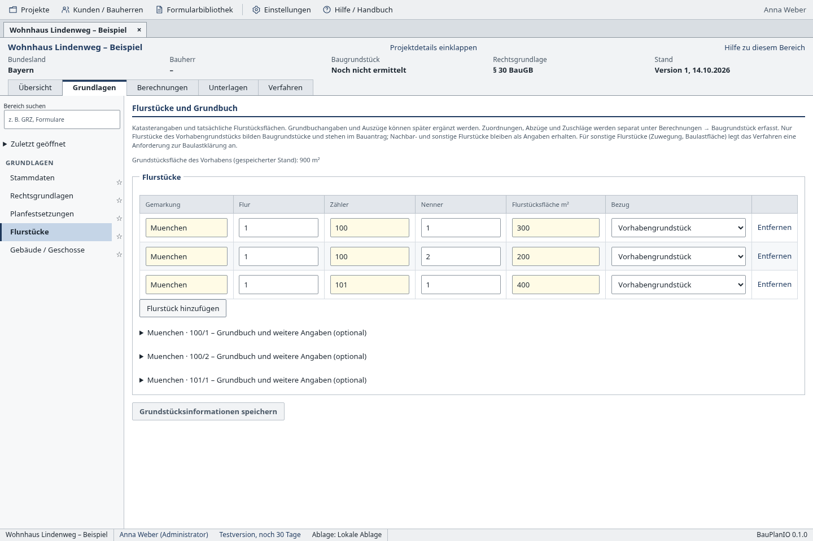

Abbildung 10.1 · Die tatsächlichen Katasterfakten stehen in den Grundstücksinformationen. Grundbuchangaben sind ergänzende Informationen und keine Pflicht für die Erfassung eines Flurstücks.

### Grundbuch ist optional

Fehlende Grundbuchangaben verhindern nicht die Erfassung der Katasterfakten. Ohne eindeutige gemeinsame Zuordnung werden Flurstücke vorsorglich getrennt angesetzt; die angezeigten Hinweise sind fachlich zu prüfen. Eine Zusammenfassung ohne belastbare Grundlage darf nicht allein zur Verbesserung von Nutzungswerten erfolgen.

Grundbuchblatt und laufende Nummer müssen im Zusammenhang mit dem zugehörigen Grundbuch betrachtet werden. Für eine besondere Zuordnung die dafür vorgesehene begründete Zuordnung in der Baugrundstücksermittlung verwenden.

### Änderungen und Entfernen

Vor dem Entfernen eines Flurstücks die genannten Gebäude- und Abstandsplanbezüge prüfen. Nach Änderungen an relevanten Flächen oder Zuordnungen Baugrundstücke erneut ermitteln und abhängige Nachweise aktualisieren.

### Ein Flurstück erfassen und später ergänzen

1. Die Katasterunterlage heranziehen und die Identifikation unverändert übertragen. Einen Bruch in der Flurstücksnummer über Zähler und Nenner erfassen, soweit die Maske diese getrennt anbietet.
2. Die tatsächliche Flurstücksfläche in m² eingeben. Hier weder private Grünflächen noch spätere rechnerische Zuschläge verrechnen.
3. Grundbuchfelder leer lassen, wenn deren Angaben noch nicht vorliegen. Den Auszug später als Datei importieren und die passende Version verknüpfen.
4. Grundstücksinformationen speichern. Danach unter „Berechnungen → Baugrundstück“ die getrennten Einheiten prüfen.
5. Bei später ergänzten Zuordnungsdaten die Baugrundstücksermittlung erneuern. Kontrollieren, ob bisher getrennte Recheneinheiten zusammengeführt wurden und welche Gebäudebezüge davon betroffen sind.

Weiterlesen: [Baugrundstücke ermitteln](#11-baugrundstücke-ermitteln) · [Gebäude und Geschosse aufbauen](#12-gebäude-und-geschosse-aufbauen)

## 11. Baugrundstücke ermitteln

Bezugsflächen je Grundstück nachvollziehbar herleiten.

### Berechnung vorbereiten

1. Gespeicherte Vorhabenflurstücke und vorhandene Grundbuchzuordnungen prüfen.
2. „Berechnungen → Baugrundstück“ öffnen. Flächenabzüge je Flurstück, z. B. festgesetzte nicht maßgebende Flächen, mit Bezeichnung und Grundlage erfassen.
3. Eine besondere rechtliche Zuordnung nur mit belegter Grundlage und eindeutiger Zuordnungskennung verwenden.
4. „Baugrundstücke ermitteln“ wählen und die entstandenen Einheiten, zugehörigen Flurstücke und Flächensummen prüfen.
5. Etwaige Zuschläge oder zugeordnete Gemeinschaftsflächen in den vorgesehenen Ansätzen dokumentieren. Die maßgebenden Bezugsflächen berechnen und „Eingaben speichern“ wählen.

### Orientierung in der Oberfläche

Die folgende Abbildung zeigt einen Ausschnitt des Arbeitsablaufs im fiktiven Beispielprojekt.

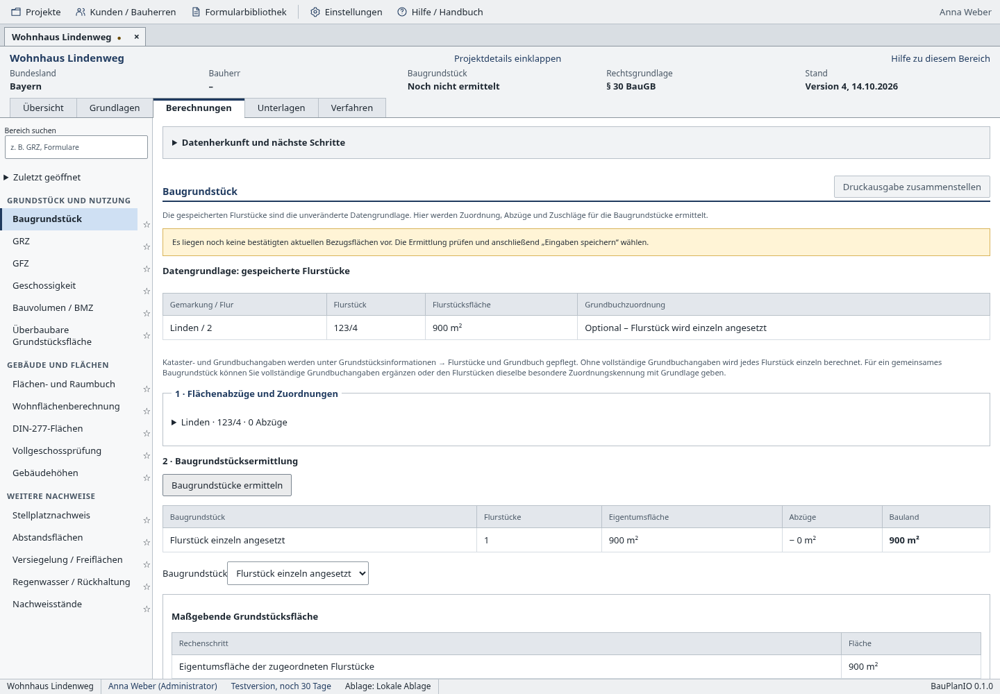

Abbildung 11.1 · Das Beispiel zeigt ein einzeln angesetztes Flurstück mit 900 m². Aus Fakten, Zuordnung und Abzügen entsteht die rechnerische Einheit. Erst der gespeicherte bestätigte Stand dient als Grundlage weiterer Nachweise.

### Ergebnis kontrollieren

Eigentumsfläche, Abzüge und rechnerische Bezugsfläche sind unterschiedliche Werte. Nachfolgende GRZ-/GFZ-Berechnungen erhalten die getrennten Baugrundstücke; ein Projektgesamtwert ersetzt die Einzelprüfung nicht.

Bei Aufteilung oder Zusammenlegung bisheriger Einheiten die angebotene Übernahme alter Eingaben prüfen. Eine nicht eindeutige Nachfolge verlangt eine bewusste Entscheidung. Gebäude sind über ihre Flurstücke verortet und werden daraus den aktuellen Einheiten zugeordnet.

> Bei „Ermittlung ist veraltet“ die zugrunde liegenden Flurstücke bzw. Zuordnungen prüfen, neu ermitteln und speichern. Abzüge nicht noch einmal im nachfolgenden GRZ-/GFZ-Modul abziehen.

### Kontrollrechnung mit zwei Flurstücken

Fiktives Beispiel: Flurstück A hat 500 m², Flurstück B hat 200 m². Ohne belastbare gemeinsame Grundbuchzuordnung werden zunächst zwei Einheiten geführt. Die Nutzungswerte sind je Einheit zu prüfen. Ein Gesamtquotient über 700 m² würde die Einzelverhältnisse verdecken.

Bei belegter gemeinsamer Grundstückseinheit ergibt sich zunächst eine Eigentumsfläche von 700 m². Sind nach der maßgebenden Grundlage 50 m² abzuziehen, beträgt die rechnerische Fläche 650 m². Zuschläge für Gemeinschaftsanlagen nur mit tatsächlich anwendbarer Zuordnung und nachvollziehbarer Berechnung erfassen. Diese Zahlen illustrieren lediglich die Trennung von Fakten und Rechenansatz.

| Prüfpunkt / Eingabe | Bedeutung und Kontrolle |
| --- | --- |
| Einheiten | Sind alle zugehörigen Flurstücke enthalten und fremde / reine Nachbarflurstücke ausgeschlossen? |
| Abzüge | Bezeichnung, Fläche und Rechts-/Planbezug je Ansatz prüfen; Überschneidungen und Doppelabzüge vermeiden. |
| Zuschläge | Anteil, Grundlage und Zielgrundstück belegen. Derselbe Anteil darf nicht mehrfach in verschiedenen Einheiten angesetzt werden. |
| Übernahme | Ermittlung, Bezugsflächen und gespeicherten Stand prüfen. Erst danach abhängige Nutzungsmodule bearbeiten. |

Weiterlesen: [Flurstücke und Grundbuch erfassen](#10-flurstücke-und-grundbuch-erfassen) · [Gebäude und Geschosse aufbauen](#12-gebäude-und-geschosse-aufbauen) · [GRZ und GRZ I / II](#14-grz-und-grz-i--ii)

## 12. Gebäude und Geschosse aufbauen

Das Gebäudemodell als gemeinsame Quelle für Berechnungen nutzen.

### Gebäudedaten

1. „Grundlagen → Gebäude / Geschosse“ öffnen und „Neu anlegen“ wählen. Bezeichnung und Gebäudetyp erfassen.
2. Die Flurstücke zuordnen, auf denen das Gebäude tatsächlich steht. Eine Baugrundstücksnummer ist kein Ersatz für diese Lagezuordnung.
3. Gebäudegrundfläche, vorhandene Nutzungsangaben und gegebenenfalls absolute Gelände-, Trauf- und Firsthöhen mit Höhensystem erfassen.
4. Einzelne Geschosse mit Fläche und Einstufung ergänzen und speichern. Bei einem Gebäude ohne einzelne Geschosse die geprüfte Einstufung des Einzelgeschosses mit Grundlage festlegen.
5. Für aus Plänen gewonnene Werte das gespeicherte PDF-Aufmaß an den angebotenen Feldern übernehmen und das Gebäude speichern.

### Orientierung in der Oberfläche

Die folgende Abbildung zeigt einen Ausschnitt des Arbeitsablaufs im fiktiven Beispielprojekt.

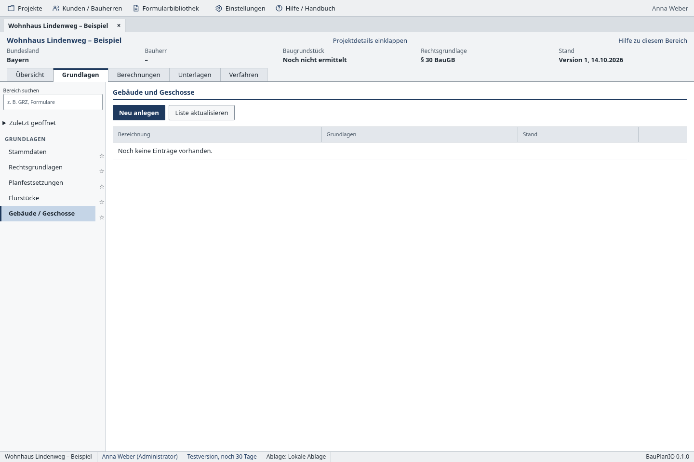

Abbildung 12.1 · Gebäude gehören zu den gespeicherten Grundlagen. Lagezuordnung und Geschossdaten werden hier geführt; rechtliche Einstufungen sind mit passenden Nachweisen zu belegen.

### Wirkung auf andere Bereiche

Vollständige und eindeutig zugeordnete Gebäude fließen in GRZ sowie mit ihren Geschossen in GFZ und Geschossigkeit ein. Die Übernahme kann im Nutzungsmaß als ungespeicherte Änderung erscheinen. Vor dem Ergänzen manueller Positionen auf Doppelansätze achten.

Für die Vollgeschosseinstufung kann ein eigener Vollgeschossnachweis verknüpft werden. Gebäudemaße allein entscheiden nicht automatisch über die rechtliche Einstufung. Die BMZ benötigt weiterhin einen eigenen Volumenansatz.

### Vollgeschossstatus aus dem Geschoss klären

„Vollgeschossstatus dieses Geschosses prüfen …“ speichert den Gebäudeentwurf und öffnet einen Prüfauftrag für das Gebäude. Dort die neue Prüfung ausdrücklich anlegen; vorhandene Entwürfe werden nicht überschrieben.

Nach der Prüfung und Archivierung über den Rückweg zum Geschoss zurückkehren. Den passenden aktuellen Nachweis unter „Aus Vollgeschossnachweis übernehmen“ bewusst auswählen und das Gebäude speichern.

### Geschosse und Quellen sauber führen

Jedes Gebäude eindeutig benennen, etwa „Wohnhaus A“ oder „Garage“. Ein Geschoss beschreibt eine tatsächliche Ebene. Die rechtliche Einstufung als Vollgeschoss sowie die GFZ-Anrechnung hängen zusätzlich vom anwendbaren Recht und den dokumentierten Grundlagen ab.

Wird ein Gebäude aus mehreren Vorhabenflurstücken verortet, nach Änderungen der Grundstückseinheiten die Zuordnung kontrollieren. Übernommene Grundflächen und Geschossdaten nicht nochmals als freie Positionen in GRZ/GFZ ansetzen. Für ein geändertes Aufmaß den neuen Quellenstand ausdrücklich übernehmen; eine externe Planänderung aktualisiert keine bereits gespeicherte Zahl von selbst.

Weiterlesen: [PDF-Aufmaß erstellen und übernehmen](#25-pdf-aufmaß-erstellen-und-übernehmen) · [Vollgeschosse, Gebäudehöhen und Dachneigung](#18-vollgeschosse-gebäudehöhen-und-dachneigung) · [GRZ und GRZ I / II](#14-grz-und-grz-i--ii) · [GFZ und Geschossigkeit](#15-gfz-und-geschossigkeit)

## 13. Berechnungen bearbeiten und prüfen

Eingaben, Regelgrundlagen, Quellen und Nachweisstände zusammenführen.

### Gemeinsamer Ablauf der Fachmodule

1. Den benötigten Berechnungsbereich öffnen; einen vorhandenen Datensatz mit „Öffnen“ bearbeiten oder „Neu anlegen“ wählen. Für getrennte Gebäude, Grundstücke oder Varianten passende getrennte Datensätze verwenden.
2. Unter „Eingaben“ Bezeichnung, Grundstück/Gebäude und erforderliche Positionen erfassen. Pflichtzahlen ergänzen; eine reale Null ausdrücklich als 0 eingeben.
3. Unter „Regeln / Grundlagen“ die geltenden Regeln, Quelle, Geltung und Prüfvermerk hinterlegen. Gelieferte Beispielregeln vor Verwendung ersetzen bzw. fachlich bestätigen.
4. Unter „Quellen / Übernahmen“ konkrete Unterlagenversionen und verfügbare Mess-/Nachweiswerte verknüpfen.
5. „Berechnung prüfen“ ausführen; Ergebnis und Prüfbericht einschließlich offener Punkte lesen. Änderungen speichern.
6. Anwendbarkeit und erforderliche fachliche Freigaben durch berechtigte Personen bestätigen. Anschließend den Nachweis archivieren und als PDF ausgeben.

### Aktualität erhalten

Eine Änderung kann eine Bestätigung zurücksetzen und verknüpfte Nachweise veralten lassen. Gespeicherte Berechnungen und archivierte Nachweise aktualisieren sich nicht unbemerkt. Bei einer Quellenänderung den angebotenen aktuellen Stand übernehmen und erneut prüfen.

Ein Regelpaket-Import ersetzt Regeln des ausgewählten Moduls, keine vollständige Projektakte. Nur Pakete mit passendem Modul und nachvollziehbarem Regelstand verwenden.

### Entwurf, Grundlagenbestätigung und Nachweis

„Nachweis erstellen …“ führt zur Archivierung und PDF-Ausgabe. Ein archivierter Stand bleibt auch erhalten, wenn die spätere PDF-Ausgabe fehlschlägt. Die fachliche Freigabe erfolgt weiterhin gesondert.

Nach Änderungen „Gespeicherte Grundlagen bestätigen …“ verwenden. Die Aktion speichert zunächst den Entwurf und bestätigt anschließend mit Berechtigung die gespeicherte Revision. Das ist keine automatische Nachweisfreigabe.

„Positionen als Tabelle bearbeiten“ wechselt zwischen Tabellen- und Detailerfassung. Gebundene Quellwerte bleiben schreibgeschützt.

### Vom bearbeitbaren Ansatz zum einreichbaren Nachweis

| Prüfpunkt / Eingabe | Bedeutung und Kontrolle |
| --- | --- |
| 1 · Eingaben | Bezeichnung, Bezugseinheit und Positionen vollständig erfassen. Zahlen mit der am Feld genannten Einheit eingeben; unbekannte Werte nicht durch 0 ersetzen. |
| 2 · Regeln / Grundlagen | Anwendbarkeit, Fassung, räumlichen Geltungsbereich und Quelle prüfen. Ein persönliches gespeichertes Regelpaket ist eine Arbeitserleichterung, keine automatisch gültige Satzung. |
| 3 · Quellen / Übernahmen | Konkrete Dateiversionen und geeignete Aufmaß-/Nachweisstände wählen. Übernahmevergleich prüfen, bevor bestehende Positionen ersetzt werden. |
| 4 · Prüfen | Rechenansätze und Prüfbericht lesen. Offene Punkte fachlich auflösen; Warnungen nicht durch Umbenennen umgehen. |
| 5 · Speichern / bestätigen | Die gespeicherten Grundlagen ausdrücklich bestätigen, soweit angeboten. Änderungen können die Bestätigung wieder aufheben. |
| 6 · Nachweis / Freigabe | Nachweisstand erstellen und im Archiv prüfen. Bürofreigabe und PDF-Ablage gesondert durchführen, anschließend erst dem Abgabestand zuordnen. |

Weiterlesen: [Nachweisstände archivieren und freigeben](#26-nachweisstände-archivieren-und-freigeben) · [Häufige Fragen und Störungen](#51-häufige-fragen-und-störungen)

## 14. GRZ und GRZ I / II

Bauteilflächen abhängig von der gewählten BauNVO ansetzen.

### Grundflächenaufstellung

1. Aktuelle Baugrundstücke und die gewählte BauNVO prüfen; „Berechnungen → GRZ“ öffnen.
2. Das betreffende Baugrundstück auswählen. Automatisch eingebundene Gebäude prüfen. Zusätzliche Bauteile mit Bezeichnung, Bauteiltyp und Grundfläche erfassen, etwa Garage, Zufahrt oder Terrasse.
3. Bauteile nach ihrer tatsächlichen Art zuordnen. Ein Bauteiltyp steuert die Anrechnung; die bloße Bezeichnung tut dies nicht.
4. Berechnen und die angesetzten Flächen sowie die Hinweise zu Anrechnung und Überschreitungen je Einheit kontrollieren. Eingaben speichern und einen Nachweisstand erstellen.

### Orientierung in der Oberfläche

Die folgende Abbildung zeigt einen Ausschnitt des Arbeitsablaufs im fiktiven Beispielprojekt.

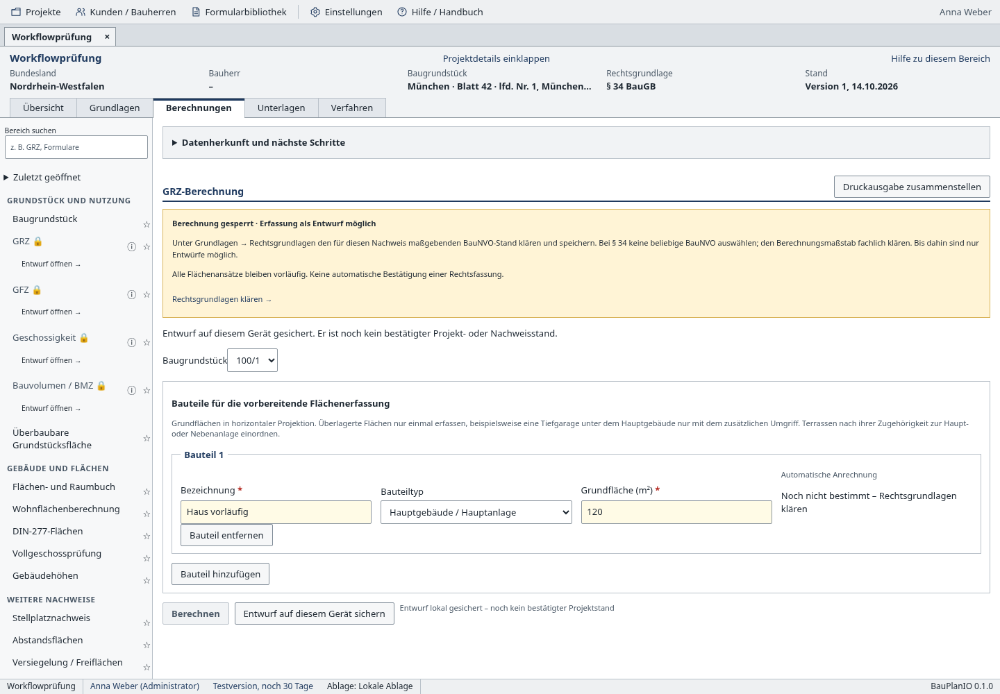

Abbildung 14.1 · Eine Grundfläche kann vorbereitet werden, obwohl die Berechnung noch gesperrt ist. Die lokale Entwurfssicherung ersetzt weder gespeicherte Rechtsgrundlagen noch einen geprüften Nachweis.

### Fassungen unterscheiden

Die Regelpakete unterscheiden die BauNVO-Fassungen 1962, 1968, 1977, 1990 und 2017. Die gewählte Fassung bezieht sich auf die anwendbare Planungsgrundlage, nicht automatisch auf das aktuelle Kalenderjahr.

Bei BauNVO 1990/2017 werden GRZ I und GRZ II getrennt ausgewiesen. Die erweiterten Flächen des § 19 Abs. 4 und besondere Festsetzungen sind gesondert zu prüfen. Bei früheren Fassungen gelten andere Anrechnungsregeln. Flächen nicht von Hand weglassen, nur weil sie im Ergebnis unerwünscht sind.

### Plausibilität

Prüfen Sie Bezugsfläche, Gebäudegrundflächen und ergänzende Bauteile auf doppelte oder fehlende Ansätze. Eine rechnerische Überschreitung kann einen Abweichungs-/Befreiungsbedarf anzeigen; sie ist keine erteilte Ausnahme.

### Erfassung bei ungeklärtem Berechnungsmaßstab

Bei fehlenden Rechtsgrundlagen oder BauNVO können die Flächen über „GRZ: Entwurf öffnen“ vorbereitet werden. Die Anrechnung bleibt offen; keine beliebige BauNVO auswählen, um eine Sperre zu umgehen.

„Entwurf auf diesem Gerät sichern“ speichert benutzer- und projektbezogen lokal. Nach erneutem Öffnen „Lokalen Entwurf wiederherstellen“ verwenden und die aktuellen Quellen neu prüfen. Diese lokale Sicherung ist noch kein bestätigter Projektstand, nicht zwischen Arbeitsplätzen geteilt und kein Ersatz für eine Datensicherung.

### Bauteile ohne Doppelansatz erfassen

Die Typisierung steuert die regelabhängige Berücksichtigung. Das Entfernen einer rechnerisch ungünstigen Position ist keine Korrektur ihrer fachlichen Einordnung. Quelle und besondere Planregelungen so dokumentieren, dass der Ansatz auch ohne die Anwendung nachvollziehbar bleibt.

1. Die richtige Baugrundstückseinheit und ihren aktuellen Flächenstand prüfen. Gebäudeübernahmen mit den gespeicherten Gebäuden abgleichen.
2. Für freie Ergänzungen Bezeichnung, Bauteiltyp und Fläche erfassen. Garage, Zufahrt, Terrasse oder unterirdisches Bauteil fachlich passend typisieren; nicht nur einen beliebigen Namen vergeben.
3. Überlappende Flächen geometrisch prüfen. Eine Fläche, die bereits in einer Gebäudegrundfläche enthalten ist, darf nicht ohne Prüfung nochmals als Zusatzfläche gezählt werden.
4. Bei BauNVO 1990/2017 die getrennten Ansätze für GRZ I und GRZ II sowie den Grenzwertvergleich lesen. Für frühere Fassungen den jeweils ausgewiesenen Rechenweg und Sonderregelungen prüfen.
5. Nach Änderungen der BauNVO, Grundstücksfläche oder Bauteile neu berechnen und einen neuen Nachweisstand erstellen.

Weiterlesen: [Baugrundstücke ermitteln](#11-baugrundstücke-ermitteln) · [Gebäude und Geschosse aufbauen](#12-gebäude-und-geschosse-aufbauen) · [Abweichungen, Ausnahmen und Befreiungen](#37-abweichungen-ausnahmen-und-befreiungen)

## 15. GFZ und Geschossigkeit

Geschossflächen und Vollgeschosse nachvollziehbar zuordnen.

### Geschossflächen erfassen

1. „Berechnungen → GFZ“ bzw. „Geschossigkeit“ öffnen und die Grundstückseinheit prüfen.
2. Die aus Gebäude/Geschosse eingebundenen Geschosse kontrollieren. Weitere manuelle Geschosse nur ergänzen, wenn sie nicht bereits enthalten sind.
3. Geschosstyp und Geschossfläche nach Außenmaßen erfassen. Bei Nichtvollgeschossen die erforderlichen Teilflächen für Aufenthaltsräume, umfassende Wände und Erschließung getrennt angeben.
4. Bei gebundenen Geschossen die Einstufung an der Gebäudequelle bzw. im verknüpften Vollgeschossnachweis ändern.
5. Berechnen, Anrechnung je Geschoss und Grundstück sowie festgesetzte Grenzwerte prüfen; speichern und Nachweis erstellen.

### Wichtige Abgrenzung

Je nach BauNVO und besonderen Planfestsetzungen werden Nichtvollgeschosse unterschiedlich berücksichtigt. Nicht jedes Geschoss zählt vollständig oder überhaupt zur GFZ. Umgekehrt darf ein Nichtvollgeschoss nicht grundsätzlich mit 0 angesetzt werden.

GFZ-Fläche, Wohnfläche und DIN-277-Fläche beruhen auf unterschiedlichen Maßbezügen. Ergebnisse dieser Nachweise nicht ungeprüft gegeneinander austauschen. Die Geschossigkeit setzt eine dokumentierte Vollgeschosseinstufung voraus.

### Vollgeschoss und Geschossfläche unterscheiden

Zunächst jedes Geschoss im Gebäudemodell mit Fläche und nachvollziehbarer Einstufung erfassen. Ein Nicht-Vollgeschoss ist nicht in jeder BauNVO-Fassung automatisch vollständig ohne Einfluss auf die GFZ. Maßgebend sind die konkrete Fassung und gegebenenfalls besondere Festsetzungen.

Soweit Aufenthaltsräume in Nicht-Vollgeschossen einschließlich zugehöriger Umfassungswände und Erschließung anzusetzen sind, die dafür vorgesehenen Flächen getrennt und nachvollziehbar erfassen. Eine Wohnflächenzahl ist kein Ersatz für diese GFZ-Geschossfläche. Im Ergebnis die angesetzten und nicht angesetzten Geschosse mit ihrer Grundlage prüfen.

Weiterlesen: [Gebäude und Geschosse aufbauen](#12-gebäude-und-geschosse-aufbauen) · [Vollgeschosse, Gebäudehöhen und Dachneigung](#18-vollgeschosse-gebäudehöhen-und-dachneigung) · [Raumbuch und Wohnflächen](#21-raumbuch-und-wohnflächen) · [DIN-277-Flächen und Rauminhalte](#22-din-277-flächen-und-rauminhalte)

## 16. Bauvolumen und BMZ

Volumenansatz und Bezugsfläche getrennt dokumentieren.

### Arbeitsablauf

1. Die aktuelle Baugrundstückseinheit und eine vorhandene BMZ-Festsetzung prüfen.
2. Im Bereich „Bauvolumen / BMZ“ den nachvollziehbar hergeleiteten Baumassen-/Bauvolumenansatz in m³ erfassen.
3. Berechnen und die Bezugsfläche sowie den Vergleich mit dem zulässigen Ansatz kontrollieren.
4. Eingaben speichern und für die Einreichung einen Nachweisstand mit den zugrunde liegenden Unterlagen ablegen.

Der BMZ-Ansatz wird nicht automatisch vollständig aus den Gebäudedaten erzeugt. Einen vorhandenen DIN-277-BRI nicht ohne Prüfung als Baumasse im planungsrechtlichen Sinn einsetzen. Unterschiedliche Definitionen und gegebenenfalls ausgeschlossene Bauteile ausdrücklich berücksichtigen.

### Volumenansatz kontrollieren

Die BMZ verwendet den nach der maßgebenden Grundlage anzusetzenden Rauminhalt und die zugeordnete Grundstücksbezugsfläche. Ein aus der Wohnflächenberechnung oder DIN 277 stammender Wert darf nur übernommen werden, wenn seine Definition tatsächlich zum benötigten Ansatz passt.

Vor dem Nachweis die äußeren Abmessungen, Höhenbezüge, einbezogenen Gebäudeteile und Abgrenzungen belegen. Einheiten in m³ und m² sorgfältig unterscheiden. Teilvolumina so benennen, dass der Prüfer die Summe einem Grundriss bzw. Schnitt zuordnen kann.

Weiterlesen: [Baugrundstücke ermitteln](#11-baugrundstücke-ermitteln) · [DIN-277-Flächen und Rauminhalte](#22-din-277-flächen-und-rauminhalte) · [Nachweisstände archivieren und freigeben](#26-nachweisstände-archivieren-und-freigeben)

## 17. Überbaubare Fläche und Baugrenzen

Baugrenze, Baulinie und Vorbauten anhand der Planung prüfen.

### Prüfung vorbereiten

1. Originalplan, Baufenster und Gebäudeumrisse im passenden Grundstücksbezug bereitstellen.
2. Im Bereich „Überbaubare Grundstücksfläche“ den Prüfdatensatz anlegen und Baugrenze, Baulinie oder Vorbau als Prüfgegenstand wählen.
3. Die maßgebenden Abstände und abgegrenzten Überschreitungsflächen mit nachvollziehbarem Maß- und Quellenbezug erfassen.
4. Unter Regeln/Grundlagen die anwendbaren Vorgaben und besonderen Entscheidungen dokumentieren.
5. Prüfen und Ergebnis lesen; erforderliche Ausnahmen/Befreiungen in der Verfahrensakte als eigene Vorgänge behandeln.

### Orientierung in der Oberfläche

Die folgende Abbildung zeigt einen Ausschnitt des Arbeitsablaufs im fiktiven Beispielprojekt.

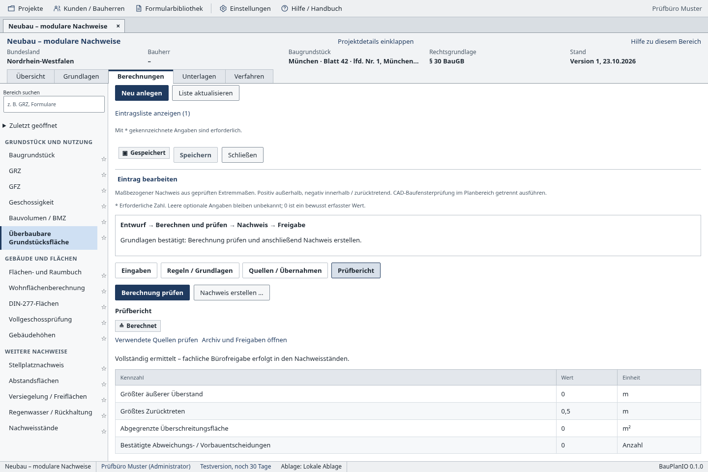

Abbildung 17.1 · Der Bericht macht Ansätze und Ergebnisse des Beispielnachweises sichtbar. Für einen belastbaren Baugrenzennachweis zusätzlich Lage, Geometrie und konkrete Planquelle kontrollieren.

Die maßbezogene Prüfung ergänzt die geometrische Baufensterprüfung im Planbereich. Ein negativer bzw. positiver Abstand ist entsprechend der im Formular genannten Richtung zu verstehen; nicht allein einen Absolutbetrag einsetzen. Bei einer Baulinie ist auch ein unzulässiges Zurücktreten relevant.

Bei mehreren Baugrundstücken den Geometrie-/Baufensterbezug eindeutig zuordnen. Eine Fläche im Stammdatensatz allein lässt keine Überschreitung räumlich prüfen.

### Geometrie und Flächensumme gemeinsam prüfen

Für einen nachvollziehbaren Überschreitungsnachweis werden neben Zahlenwerten eindeutige Baugrenzen bzw. Baulinien, der Gebäudeumriss und die tatsächliche Lage benötigt. Eine festgesetzte Baufensterfläche und die Gebäudegrundfläche allein sagen nicht, ob die Umrisse richtig zueinander liegen.

Übernommene Plan-/Messdaten auf Maßstab, Koordinaten und Quelle prüfen. Betroffene Vorbauten oder Gebäudeteile getrennt bezeichnen. Die rechnerische Überschreitung mit Lage, Umfang und gegebenenfalls gesondertem Abweichungs-/Befreiungsantrag dokumentieren. Ein positiver Rechenvergleich ersetzt keine rechtliche Zulassung einer Ausnahme.

Weiterlesen: [Bebauungsplanfestsetzungen eingeben](#09-bebauungsplanfestsetzungen-eingeben) · [Pläne ansehen und zuordnen](#24-pläne-ansehen-und-zuordnen) · [Abweichungen, Ausnahmen und Befreiungen](#37-abweichungen-ausnahmen-und-befreiungen)

## 18. Vollgeschosse, Gebäudehöhen und Dachneigung

Landesrechtliche Einstufung und Höhenbezug nachvollziehbar prüfen.

### Vollgeschossprüfung

1. Einen Nachweis für das betreffende Gebäude/Geschoss anlegen und die relevante Rechtsfassung bestimmen.
2. Vergleichsfläche, lichte Höhen, erforderliche Flächenanteile und gegebenenfalls Gelände-/Oberirdischkriterium erfassen.
3. Die Regelparameter einschließlich Grenzvergleich mit der konkreten Landesregel abgleichen; Beispielwerte nicht ungeprüft bestätigen.
4. Prüfen und archivieren. Den geprüften Nachweis im Gebäudegeschoss verknüpfen, damit GFZ und Geschossigkeit dieselbe Einstufung nutzen.

### Orientierung in der Oberfläche

Die folgende Abbildung zeigt einen Ausschnitt des Arbeitsablaufs im fiktiven Beispielprojekt.

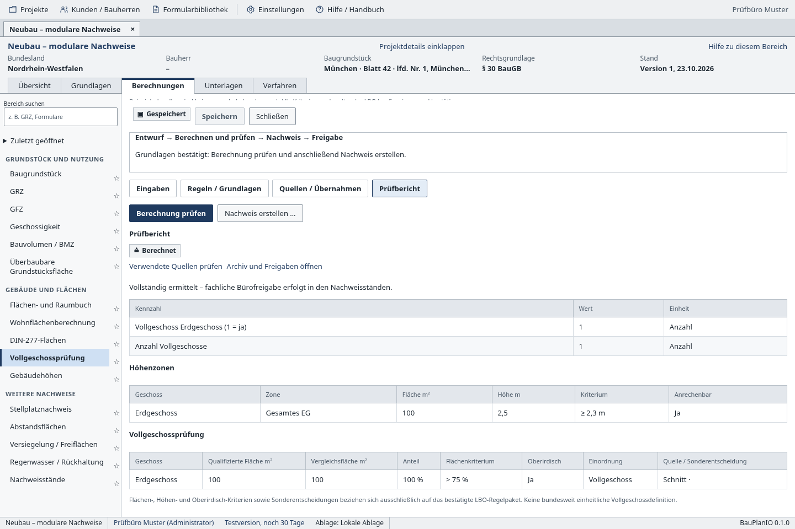

Abbildung 18.1 · Die Vollgeschossprüfung ist ein eigener Nachweis. Einen passenden gespeicherten Stand anschließend bewusst beim betroffenen Geschoss verknüpfen.

### Gebäudehöhen / Dachneigung

Messpunkte, absolute und relative Höhen sowie das Höhensystem festlegen. Gelände, Traufe und First dürfen nicht mit verschiedenen Bezugsnullpunkten vermischt werden. Im Höhenmodul die Gebäudeübernahme prüfen oder mit passenden PDF-Höhenpunkten und Strecken verknüpfen.

Höhenfestsetzungen und Dachneigung aus passenden horizontalen Entfernungen und Höhendifferenzen prüfen. Ein Höhenpunkt mit m ü. NHN ist nicht dasselbe wie eine relative Höhe über Gebäudenull. Bei Quellenänderungen aktuelle Werte übernehmen und erneut prüfen.

### Einstufung nachvollziehbar belegen

1. Gebäude, Geschoss und den maßgebenden Landesrechtsstand bestimmen. Begriffe wie Gelände, lichte Höhe oder Bezugsebene am konkreten Recht prüfen.
2. Die benötigten Höhen und Flächen mit Quelle und Einheit eingeben. Dachschrägen und Teilflächen entsprechend dem tatsächlichen Schnitt berücksichtigen.
3. Prüfbericht lesen und den gespeicherten Nachweisstand erstellen. Danach zum ursprünglichen Gebäudegeschoss zurückkehren.
4. Dort den passenden Vollgeschossnachweis ausdrücklich auswählen und das Gebäude speichern. Die bloße Erstellung einer Prüfung ändert keine beliebige Geschosseinstufung automatisch.

Weiterlesen: [Gebäude und Geschosse aufbauen](#12-gebäude-und-geschosse-aufbauen) · [PDF-Aufmaß erstellen und übernehmen](#25-pdf-aufmaß-erstellen-und-übernehmen) · [GFZ und Geschossigkeit](#15-gfz-und-geschossigkeit)

## 19. Abstandsflächen nachweisen

Wände, Gelände, Grundstück und Konflikte gemeinsam dokumentieren.

### Abstandsplan aufbauen

1. „Berechnungen → Abstandsflächen“ öffnen und einen Abstandsplan anlegen. Gemeinde, Rechtsfassung, Anwendbarkeit, Plan-/Satzungsbezug sowie Höhen- und Koordinatenbezug dokumentieren.
2. Gebäudeumrisse mit Eckpunkten in Umlaufrichtung erfassen. „Seiten als Wände übernehmen“ erzeugt die zugehörigen Wandseiten; deren Lage und Außenseite anschließend am Plan prüfen. Alternativ manuelle Wände erfassen.
3. Gelände- und Wandabschlussprofile, Dachanteile und relevante Bauteile je Wand ergänzen. Gebäude- oder PDF-Übernahmen bewusst verknüpfen.
4. Grundstücksgrenzen und weitere Konfliktgeometrien im selben Koordinatenbezug erfassen. Abweichende Ansätze, Sicherungen und Entscheidungen mit Belegen dokumentieren.
5. Abstandsflächen berechnen. Wandtiefen, Flächen, Richtungen und geometrische Konflikte in Tabelle und Plandarstellung prüfen.
6. Den geprüften Umfang bestätigen, speichern und „Nachweis erstellen …“ nutzen. Tabellarischen Nachweis und Vektorplanskizze vor der Abgabe gemeinsam ansehen.

### Orientierung in der Oberfläche

Die folgende Abbildung zeigt einen Ausschnitt des Arbeitsablaufs im fiktiven Beispielprojekt.

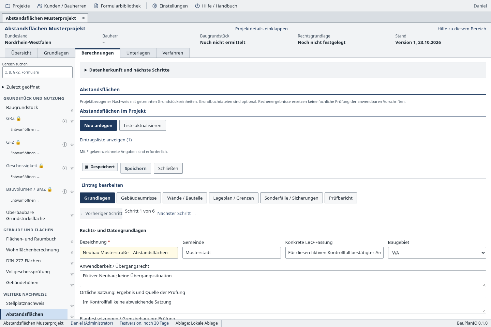

Abbildung 19.1 · Der Abstandsplan führt durch sechs Arbeitsschritte. Zuerst den tatsächlichen Rechts- und Regelkontext festlegen; die Beispielregel ist kein automatisch gültiges Landesregelwerk.

### Weitere Ansicht

Die folgende Abbildung zeigt einen Ausschnitt des Arbeitsablaufs im fiktiven Beispielprojekt.

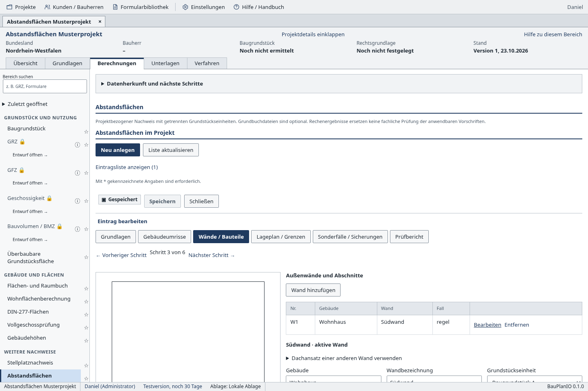

Abbildung 19.2 · Im Wandbereich Lage, Höhen und Dachparameter je Bauteil kontrollieren. Die grafische Auswahl hilft, die Eingaben der richtigen Wand zuzuordnen.

### Weitere Ansicht

Die folgende Abbildung zeigt einen Ausschnitt des Arbeitsablaufs im fiktiven Beispielprojekt.

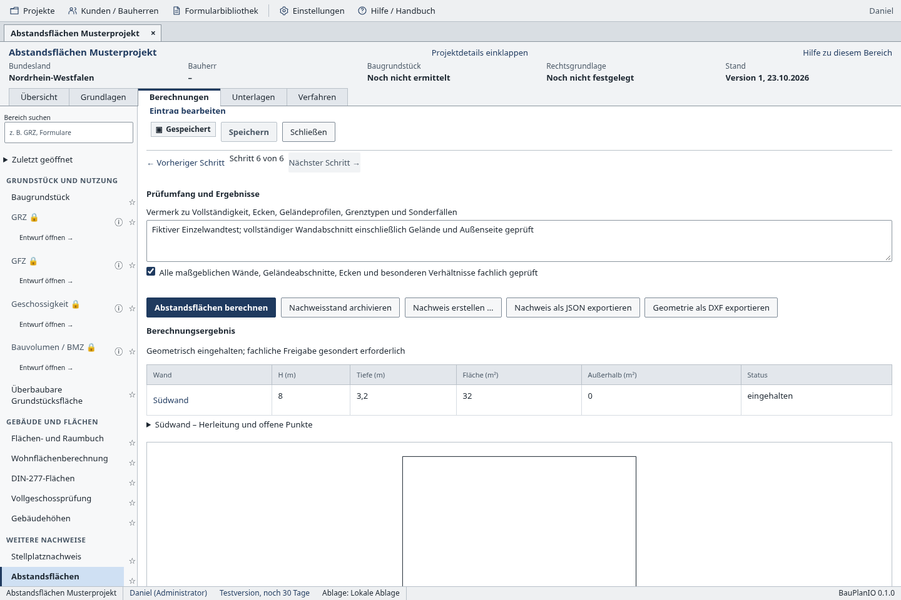

Abbildung 19.3 · Der Ausschnitt zeigt H, Tiefe, Fläche und Konfliktstatus einer Beispielwand. „Geometrisch eingehalten“ ist von der gesonderten fachlichen Freigabe zu unterscheiden.

> Die „Einfache Tiefenvorprüfung“ ersetzt keinen vollständig dokumentierten Abstandsplan. Ein rechnerisch konfliktfreier Plan beweist keine fehlenden oder falsch eingegebenen Nachbar-/Grundstücksgeometrien. Auch örtliche Satzungen, Sonderfälle und rechtliche Sicherungen sind zu prüfen.

### Geführte Geometriebearbeitung

„Vorheriger Schritt“ und „Nächster Schritt“ führen durch Grundlagen, Gebäudeumrisse, Wände, Grenzen, Sonderfälle und Prüfbericht. Sonderfälle nur bei tatsächlicher Anwendbarkeit erfassen.

Unter „Wände / Bauteile“ steht die Planskizze neben der Bearbeitung. Eine Wand durch Anklicken oder Tastatur auswählen; die aktive Wand wird hervorgehoben. Bei kleinen Fenstern stehen Plan und Felder untereinander.

„Dachansatz einer anderen Wand verwenden“ kopiert nur die angezeigten Dachparameter. Geometrie, Gelände, Sicherungen, Belege und Freigaben werden nicht kopiert. Dachgrundlage und Rechtsanwendung erneut prüfen. Ein ungeklärtes Baugebiet wird nicht als WA vorbelegt.

### Sechs Arbeitsschritte für einen prüfbaren Abstandsplan

Die Funktion zur Übernahme von Dachparametern erleichtert wiederkehrende Ansätze. Sie überträgt keine Wandlage, Geländedaten oder rechtlichen Sicherungen. Danach die Dachquelle und Bestätigungen für die Zielwand erneut prüfen. Ein zeichnerisch plausibler Plan ist noch kein Beleg für eine rechtlich zulässige Abstandsflächenübernahme.

| Prüfpunkt / Eingabe | Bedeutung und Kontrolle |
| --- | --- |
| 1 · Grundlagen | Bundesland, anwendbaren Regelstand, Baugebiet und Verfahrenskontext klären. Ein unbekanntes Baugebiet bleibt offen; kein günstiger Standard darf die Prüfung ersetzen. |
| 2 · Gebäudeumrisse | Den richtigen Gebäude-/Planstand übernehmen. Geometrische Änderungen an ihrer Quelle bearbeiten und einen neuen Abgleich bewusst ausführen. |
| 3 · Wände / Bauteile | Jede Wand eindeutig benennen. Lage, Länge, Gelände-/Oberkantenprofil sowie Dachanteile mit einheitlichem Höhenbezug erfassen. Wandwahl im Plan und zugehörige Eingabemaske gemeinsam kontrollieren. |
| 4 · Lageplan / Grenzen | Grundstücksgrenzen, Nachbarbezug und gegebenenfalls öffentliche Flächen mit belastbarer Quelle erfassen. Koordinatensystem, Maßstab und Einheiten prüfen. |
| 5 · Sonderfälle / Sicherungen | Privilegierungen, Überdeckungen, Abweichungen und Sicherungen nur bei tatsächlich belegter Anwendbarkeit erfassen. Passende Originalunterlagen verknüpfen. |
| 6 · Prüfbericht | Ergebnis jeder Wand, Tiefen, Flächen und geometrische Konflikte kontrollieren. Offene rechtliche und geometrische Punkte bearbeiten, danach Stand archivieren und PDF samt Plan-/Wanddarstellung ausgeben. |

Weiterlesen: [Gebäude und Geschosse aufbauen](#12-gebäude-und-geschosse-aufbauen) · [PDF-Aufmaß erstellen und übernehmen](#25-pdf-aufmaß-erstellen-und-übernehmen) · [Nachweisstände archivieren und freigeben](#26-nachweisstände-archivieren-und-freigeben) · [Einzeldruck, Stapeldruck und Behördenausgabe](#32-einzeldruck-stapeldruck-und-behördenausgabe)

## 20. Stellplatznachweis

Kommunale Faktoren für Kfz und Fahrräder richtig zuordnen.

### Satzung anwenden

1. Die für Standort und Vorhaben geltende Stellplatzsatzung einschließlich Datum, Zone und Geltungsbereich beschaffen.
2. Im Nachweis die Nutzungen, Gebäudetypen und Bezugsgrößen erfassen: z. B. Wohneinheiten, ausdrücklich definierte Fläche, Sitzplätze oder Beschäftigte.
3. Unter „Regeln / Grundlagen“ die zutreffenden Faktoren, Größenbereiche, Mindestwerte, Besucheranteile und Rundung festlegen. Kfz und Fahrräder getrennt beachten.
4. Reduktion, anrechenbaren Altbestand, Ablösung oder extern gesicherte Plätze nur mit passender Grundlage und Nachweis erfassen.
5. Bedarf und Angebot einschließlich barrierefreier Teilmengen prüfen, offene/mehrdeutige Regelzuordnungen klären und den Nachweis archivieren.

### Orientierung in der Oberfläche

Die folgende Abbildung zeigt einen Ausschnitt des Arbeitsablaufs im fiktiven Beispielprojekt.

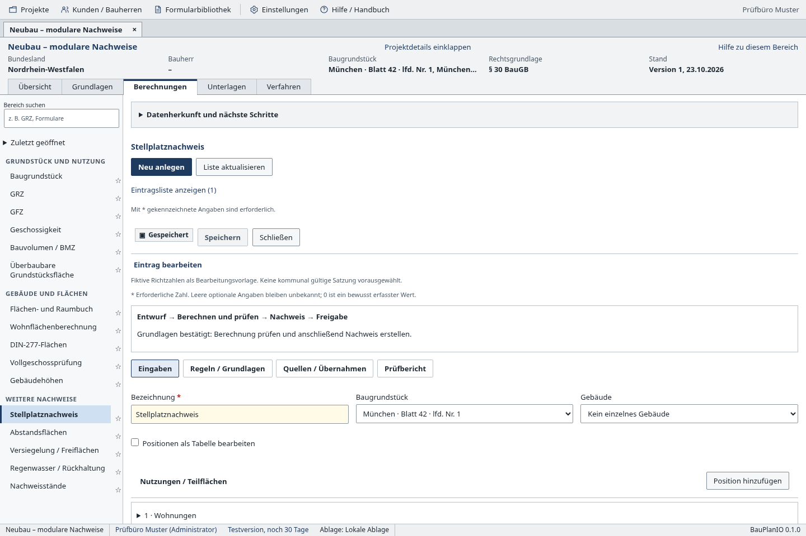

Abbildung 20.1 · Nutzungen, Bezugsgrößen und Stellplatzangebote werden getrennt erfasst. Die Maske weist auf die Prüfung der tatsächlichen kommunalen Satzung hin.

### Weitere Ansicht

Die folgende Abbildung zeigt einen Ausschnitt des Arbeitsablaufs im fiktiven Beispielprojekt.

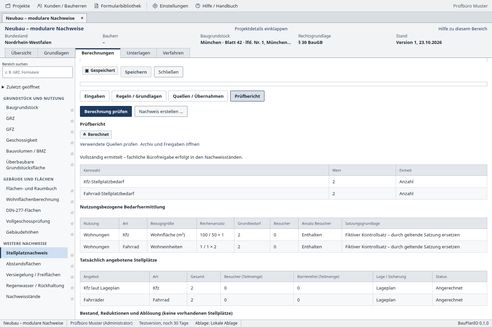

Abbildung 20.2 · Im Prüfbericht Bedarf und Angebot sowie die zugrunde liegenden Nutzungen vergleichen. Die sichtbaren Faktoren sind ausdrücklich fiktive Kontrollwerte.

> Gelieferte Faktoren sind Konfigurationsbeispiele und kein geprüfter Katalog kommunaler Satzungen. „1,5 je WE“ ist eine andere Regel als „1 je 100 m²“. Vor Anwendung klären, welche Fläche gemeint ist und auf welcher Stufe gerundet werden muss.

### Kommunale Regelpakete wiederverwenden

Unter „Regeln / Grundlagen“ lassen sich bestätigte Regelversionen auf diesem Gerät merken und als JSON für andere Büroarbeitsplätze exportieren. Die persönliche Sammlung ist keine zentrale Serverbibliothek.

Bei Wiederverwendung wird die Bestätigung nicht übertragen. Kommune, Fassung, Gültigkeit und Anwendbarkeit im neuen Projekt prüfen. Für geänderte Regeln eine neue Regelversion verwenden; ungeprüfte Beispielsätze sind keine Gemeindesatzung.

### Kommunale Satzung in einen Rechenansatz übertragen

Fiktiver Vergleich: Zwei Wohnungen bei 1,5 Stellplätzen je Wohneinheit ergeben zunächst 3 Plätze. Eine Satzung mit Bezug auf 50 m² Wohnfläche führt zu einem anderen Ansatz; Bezugsfläche und Rundungsstufe müssen dazu passen. Diese Beispiele sind keine kommunalen Vorgabewerte.

1. Originalsatzung, aktuelle Fassung, räumlichen Geltungsbereich und Vorhabenart prüfen. Die Datei in der Akte ablegen und den konkreten Stand als Quelle verknüpfen.
2. Jede Nutzung getrennt erfassen, etwa Wohnungen, Büro oder Verkaufsfläche. Die Bezugsgröße der Satzung wählen: Wohneinheiten und Quadratmeter sind nicht austauschbar.
3. Faktor bzw. Verhältnis, Mindestwerte, Besucheranteile und Rundungsregeln entsprechend der Quelle erfassen. Kfz- und Fahrradbedarf getrennt kontrollieren.
4. Reduktionen, Bestand, Ablösung und gesicherte fremde Stellplätze nur mit den erforderlichen Grundlagen berücksichtigen. Angebotene Stellplätze mit Lageplan und Sicherung dokumentieren.
5. Bedarf, Angebot und etwaige Differenz im Prüfbericht lesen. Einen offenen Fehlbedarf nicht durch bloße Erhöhung der Angebotszahl als erfüllt darstellen.

Weiterlesen: [Berechnungen bearbeiten und prüfen](#13-berechnungen-bearbeiten-und-prüfen) · [Nachweisstände archivieren und freigeben](#26-nachweisstände-archivieren-und-freigeben) · [Durchgängiges Beispiel: Einfamilienhaus](#50-durchgängiges-beispiel-einfamilienhaus)

## 21. Raumbuch und Wohnflächen

Raumfakten erfassen, anschließend die Wohnflächenanrechnung prüfen.

### Raumfakten vorbereiten

1. Im „Flächen- und Raumbuch“ Gebäude und Geschoss zuordnen und die Räume erfassen. Bei vorhandenem PDF-Aufmaß „Räume aus PDF-Aufmaß übernehmen“ nutzen.
2. Im Wohnflächenmodul einen Nachweis anlegen und Räume „aus Raumbuch“ übernehmen oder eigene Positionen erfassen.
3. Je Position Raumart, Wohnung, Aufmaßform und Flächen erfassen. Bei Dachschrägen die getrennten Höhenzonen verwenden; Außenflächen und Wintergärten passend klassifizieren.
4. Bauteil-/Treppenabzüge, belegte Sonderfaktoren und Vollständigkeit der Wohnungszuordnung prüfen.
5. Berechnung prüfen und Wohnungs-/Gesamtsummen mit Grundrissen abgleichen. Nachweis speichern, archivieren und gegebenenfalls als Projektunterlage ablegen.

### Orientierung in der Oberfläche

Die folgende Abbildung zeigt einen Ausschnitt des Arbeitsablaufs im fiktiven Beispielprojekt.

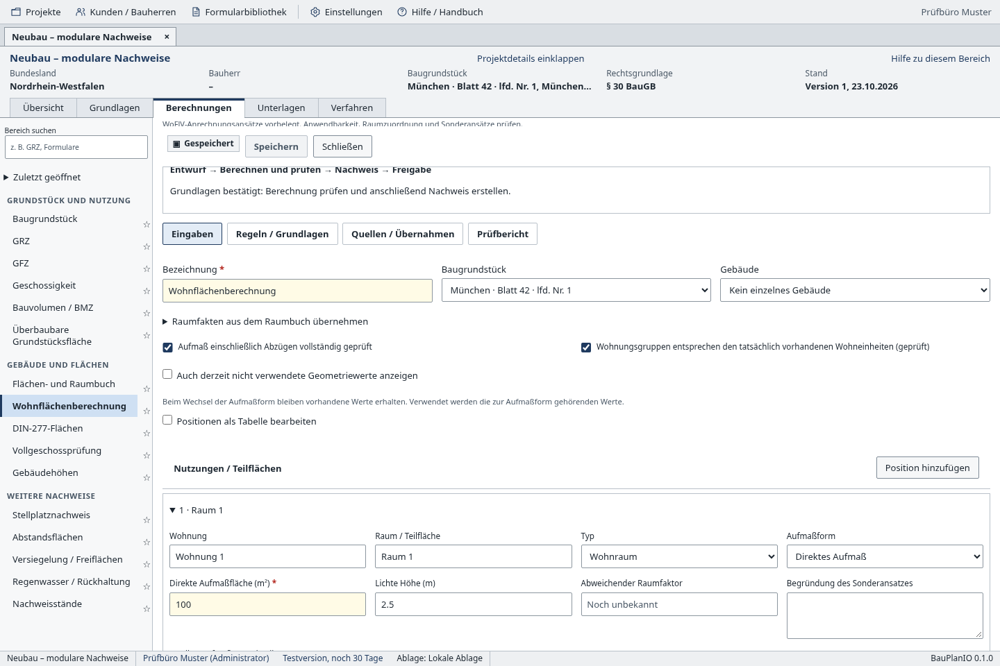

Abbildung 21.1 · Raum- und Teilflächenpositionen mit dem richtigen Regelkontext bearbeiten. Übernommene Raumfakten erst nach Prüfung des angebotenen Vergleichs aktualisieren.

### Weitere Ansicht

Die folgende Abbildung zeigt einen Ausschnitt des Arbeitsablaufs im fiktiven Beispielprojekt.

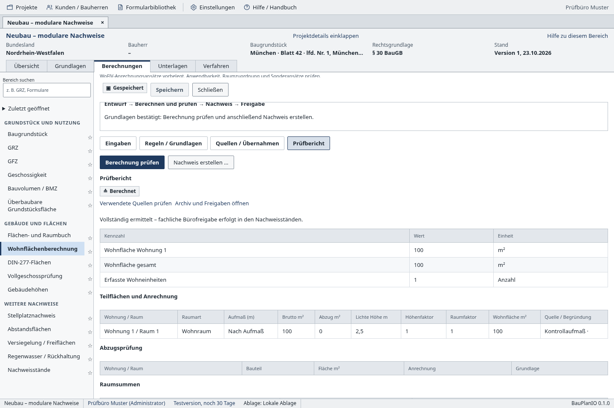

Abbildung 21.2 · Raumweise Anrechnungen und Summen kontrollieren. Eine Wohnfläche darf nicht ohne Definitionsprüfung als GFZ- oder DIN-277-Fläche verwendet werden.

### Nach einer Planänderung

Zuerst das PDF-Aufmaß und dann das Raumbuch aktualisieren. Die erneute Übernahme in Wohnfläche/DIN 277 gleicht über die Raumidentität ab; eigene Klassifikationen bleiben im vorgesehenen Umfang erhalten. Die Meldung zu neuen, aktualisierten oder entfallenen Räumen prüfen.

Eine Raumfläche ist noch keine anrechenbare Wohnfläche. Eine Wohnungsanzahl wird nur mit entsprechend bestätigter vollständiger Zuordnung ausgegeben. Fachberechnungsergebnisse wie Wohnflächen werden derzeit nicht automatisch in jedes PDF-Formular übertragen; die konkreten Formularfelder prüfen.

### Raumänderungen vergleichen

Vor der Übernahme von Raumfakten zeigt ein Vergleich neue, aktualisierte, entfallene und erhaltene manuelle Positionen. Erst „Vergleich bestätigen und Entwurf übernehmen“ ändert den Entwurf.

Die letzte Raumübernahme kann bis zur nächsten Speicherung und solange keine weiteren Änderungen vorgenommen wurden rückgängig gemacht werden. Archivierte Nachweise bleiben unverändert.

### Raumbuch übernehmen und Änderungen prüfen

1. Räume im Raumbuch mit stabilen Bezeichnungen und Gebäude-/Geschossbezug führen. Aufmaßfläche, Nutzungsart und erforderliche Teilflächen nachvollziehbar dokumentieren.
2. In der Wohnflächenberechnung das richtige Raumbuch auswählen und „Raumfakten übernehmen / aktualisieren“ ausführen. Im Vergleich neue, geänderte, entfallene und manuell beibehaltene Positionen prüfen.
3. Den Vergleich erst nach Kontrolle bestätigen. Eine angebotene Rücknahme unmittelbar nutzen, bevor weitere Bearbeitungen oder Speicherung den Vergleichsstand verändern.
4. Die wohnflächenrechtlichen Anrechnungsregeln und Sonderflächen prüfen. Räume unter Dachschrägen sowie Balkone/Terrassen nicht ohne korrekte Teilflächen bzw. Faktoren pauschal übernehmen.
5. Raumweise Ansätze und Gesamtsumme im Prüfbericht kontrollieren; danach speichern, prüfen und einen neuen Nachweisstand erstellen.

Weiterlesen: [PDF-Aufmaß erstellen und übernehmen](#25-pdf-aufmaß-erstellen-und-übernehmen) · [DIN-277-Flächen und Rauminhalte](#22-din-277-flächen-und-rauminhalte) · [PDF-Formulare im Projekt ausfüllen](#30-pdf-formulare-im-projekt-ausfüllen)

## 22. DIN-277-Flächen und Rauminhalte

NUF, TF, VF und KGF sowie Volumenkörper sauber trennen.

### Nachweis erstellen

1. Den maßgebenden Norm-/Regelbezug und den Nachweisumfang festlegen. Gebäude und Geschosse zuordnen.
2. Teilflächen manuell oder aus dem Raumbuch vorbereiten und nach NUF, TF, VF bzw. KGF sowie den vorgesehenen Bereichen klassifizieren.
3. Flächen vollständig je Geschoss erfassen. Das Modul weist NRF/BGF nur bei entsprechend vollständigem Ansatz aus.
4. Für BRI eigene äußere Volumenkörper erfassen; eine lichte Raumhöhe ist nicht ohne Weiteres deren Außenhöhe.
5. Prüfen, Summen und Quellen abgleichen und den Nachweis archivieren.

### Orientierung in der Oberfläche

Die folgende Abbildung zeigt einen Ausschnitt des Arbeitsablaufs im fiktiven Beispielprojekt.

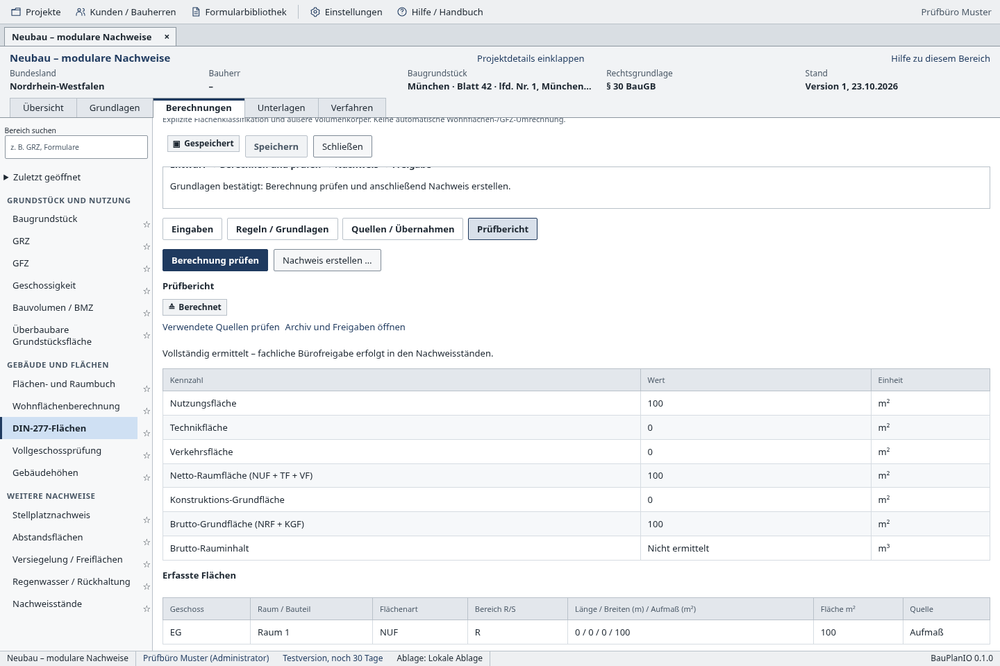

Abbildung 22.1 · Flächenarten und Rauminhalte im jeweiligen Regelkontext lesen. Ähnliche Einheiten bedeuten keine fachliche Austauschbarkeit mit anderen Nachweisen.

DIN-277-Flächen, Wohnfläche und Geschossfläche nach BauNVO dürfen nicht gleichgesetzt werden. Übernommene Raumfakten erleichtern die Erfassung, ersetzen aber weder Klassifikation noch die Prüfung des Maßbezugs. Ein ausdrücklich verlangter Rauminhaltsnachweis ist gesondert in seinem notwendigen Umfang zu führen.

### Flächenarten nicht vermischen

Die DIN-277-Ermittlung beschreibt andere Größen als die Wohnflächenberechnung oder eine GFZ. Raum- und Gebäudebezüge dürfen geteilt werden; die jeweiligen Ergebnisdefinitionen bleiben verschieden. Beim Import deshalb nicht allein auf eine ähnliche Zahl achten.

Geschoss, Flächenart, Abgrenzung und Regelstand so dokumentieren, dass Brutto-, Netto- und Teilflächen nachvollzogen werden können. Die resultierenden Summen anhand der Teilflächen prüfen. Einen in m³ geführten Rauminhalt nicht mit einer Grundfläche in m² verwechseln.

Weiterlesen: [Raumbuch und Wohnflächen](#21-raumbuch-und-wohnflächen) · [Bauvolumen und BMZ](#16-bauvolumen-und-bmz) · [Berechnungen bearbeiten und prüfen](#13-berechnungen-bearbeiten-und-prüfen)

## 23. Freiflächen und Regenwasser

Flächenbilanz und vereinfachten Rückhalteansatz nachvollziehbar aufstellen.

### Versiegelung / Freiflächen

Im Nachweis reale Grundstücksfläche und maßgebende Bezugsfläche unterscheiden. Die Teilflächen vollständig bilanzieren, etwa Gebäude, befestigte Flächen und Grünflächen. Für gewichtete Versiegelungs-/Grünansätze die tatsächlichen Faktoren und deren Satzungs-/Planbezug dokumentieren. Grün-, Pflanz- und Spielflächenansätze anschließend getrennt prüfen.

### Orientierung in der Oberfläche

Die folgende Abbildung zeigt einen Ausschnitt des Arbeitsablaufs im fiktiven Beispielprojekt.

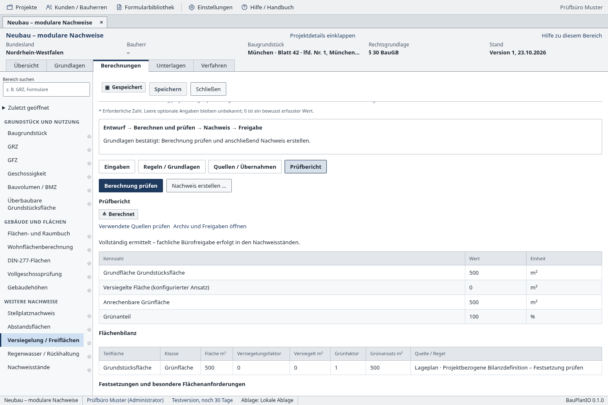

Abbildung 23.1 · Flächenarten und Anrechnung anhand der konkreten Grundlage prüfen. Dieselbe geometrische Fläche kann in anderen Berechnungen anders bewertet werden.

### Weitere Ansicht

Die folgende Abbildung zeigt einen Ausschnitt des Arbeitsablaufs im fiktiven Beispielprojekt.

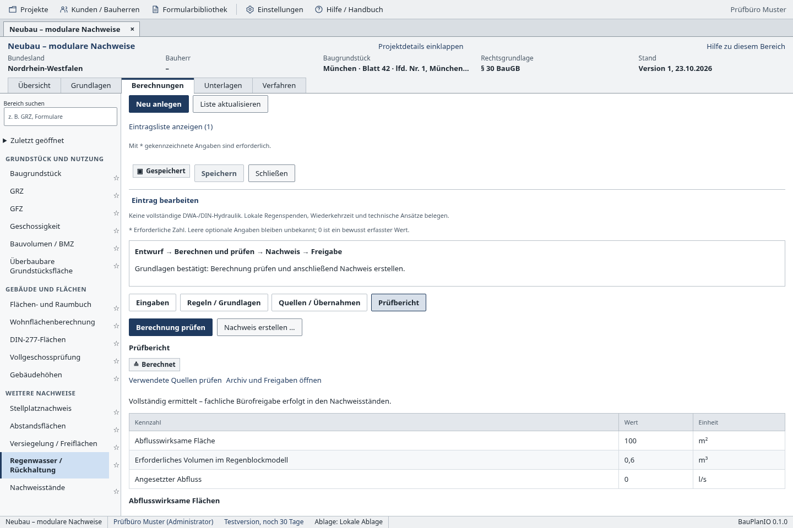

Abbildung 23.2 · Der Prüfbericht zeigt die gespeicherten Bemessungsannahmen. Örtliche Vorgaben und erforderliche Fachplanungen sind am tatsächlichen Vorhaben zu klären.

### Regenwasser / Rückhaltung

1. Angeschlossene Teilflächen mit zutreffendem Abflussbeiwert erfassen. Unangeschlossene Grundstücksteile nicht ohne Grund als wirksame Abflussfläche ansetzen.
2. Örtlich zutreffende Regenspenden, Dauerstufen, Wiederkehrbezug und Quellen eingeben. Drosselabfluss und gegebenenfalls belegte Versickerungsleistung ergänzen.
3. Stationäre Zufluss-/Speicherbilanz prüfen und erforderlichen mit vorhandenem Rückhalteraum vergleichen.
4. Ergebnis, Ansatzgrenzen und gegebenenfalls weiterführenden Fachnachweis als Unterlagen dokumentieren.

> Das Regenwassermodul ist eine vereinfachte stationäre Bilanz, kein vollständiger hydraulischer Netz-, Versickerungs- oder Überflutungsnachweis nach DWA/DIN. Gegebenenfalls weitere Fachplanung beauftragen und deren Unterlagen im Projekt verwalten.

### Freiflächen und Rückhaltung abstimmen

Eine Fläche kann in mehreren Nachweisen vorkommen, dabei aber unterschiedlich bewertet werden. Eine begrünte Fläche ist beispielsweise nicht automatisch in jedem Regelkontext vollständig unversiegelt oder anrechenbar. Für jeden Nachweis die jeweilige Definition und Quelle prüfen.

Beim Regenwasseransatz wirksame Einzugsflächen, Beläge, Abflussannahmen, Bemessungsgrundlagen und vorhandene Anlagen nachvollziehbar führen. Örtliche Entwässerungsvorgaben und erforderliche Fachnachweise berücksichtigen. Änderungen an einem Lageplan können sowohl GRZ als auch Freiflächen- und Entwässerungsansätze betreffen; betroffene Stände einzeln aktualisieren.

Weiterlesen: [Berechnungen bearbeiten und prüfen](#13-berechnungen-bearbeiten-und-prüfen) · [Projektdateien und Versionen verwalten](#27-projektdateien-und-versionen-verwalten) · [Nachweisstände archivieren und freigeben](#26-nachweisstände-archivieren-und-freigeben)

## 24. Pläne ansehen und zuordnen

Originalunterlagen verwalten und ihren Zweck im Projekt festlegen.

### Planunterlagen

1. Die Planquelle als Projektdatei importieren und sinnvoll kategorisieren, etwa Lageplan oder Bauzeichnungen.
2. Die gewünschte Dokumentversion wählen. Im Planbereich unterstützte Darstellungen öffnen und den Planbezug prüfen.
3. DWG- oder andere Fachdateien über eine externe Arbeitskopie mit der passenden Anwendung öffnen. Eine Dateizuordnung im Betriebssystem muss vorhanden sein.
4. Für Maße aus PDF-Plänen „PDF-Aufmaß“ verwenden; ein Planimport allein überträgt keine Messwerte in Berechnungen.

Quelle, Blatt, Stand und Maßstab müssen zusammenpassen. Eine neue Planversion ist als neue Dokumentversion zu übernehmen, damit alte Einreichungs- und Genehmigungsstände erhalten bleiben. Für den Behördenexport aus einer Fachdatei eine von der Behörde akzeptierte, druckfähige Ausgabe zusätzlich ablegen.

### Einen Planwechsel sicher übernehmen

1. Den überarbeiteten Plan als neue Version des vorhandenen Plandokuments importieren, wenn er denselben Plan ersetzt. Dateiname und Kategorie kontrollieren.
2. Neue Version öffnen und Planstand, Blattformat, Maßstab und Lesbarkeit prüfen. Die frühere Version für die Verfahrenshistorie erhalten.
3. Bei vorhandenen Aufmaßen prüfen, ob deren Grundlage noch passt. Eine neue PDF-Version verschiebt oder aktualisiert frühere Markierungen nicht automatisch fachlich korrekt.
4. Abhängige Gebäude-, Grenz- oder Flächendaten an ihrer Quelle aktualisieren, neue Messstände übernehmen und betroffene Berechnungen erneut prüfen.

Weiterlesen: [PDF-Aufmaß erstellen und übernehmen](#25-pdf-aufmaß-erstellen-und-übernehmen) · [Projektdateien und Versionen verwalten](#27-projektdateien-und-versionen-verwalten) · [Einzeldruck, Stapeldruck und Behördenausgabe](#32-einzeldruck-stapeldruck-und-behördenausgabe)

## 25. PDF-Aufmaß erstellen und übernehmen

Messwerte mit dokumentierter PDF-Version und passender Bedeutung verknüpfen.

### Zeichnen und zuordnen

1. PDF unter „Projektdateien“ importieren. „Unterlagen → PDF-Aufmaß → Neu anlegen“ öffnen, Unterlage, Dokumentversion, Seite und Bezeichnung festlegen.
2. Blattmaßstab 1:n setzen oder eine bekannte Strecke über zwei Punkte kalibrieren. Mit einer zweiten bekannten Länge plausibilisieren.
3. Bei Sammelblättern für Grundriss, Schnitt oder Ansicht jeweils einen Ausschnitt mit eigenem Maßstab anlegen. Für Höhen eine Bezugslinie und das Höhensystem festlegen.
4. Unter „Aufgaben“ das benötigte Ziel auswählen und „Zeichnen“ verwenden oder manuell Polygon, Rechteck, Kreis, Strecke bzw. Höhenpunkt erstellen. Bedeutung, Gebäude und Geschoss zuordnen.
5. Aufmaß speichern. Über „Aufgaben → Übernehmen“ oder an der jeweiligen Zielmaske „Aus PDF-Aufmaß“ den Messwert verknüpfen und den Verbraucher speichern.
6. Bei Fachberechnungen die vorhandene Position unter „Quellen / Übernahmen“ mit der passenden Markierung verknüpfen. Die reine Beschriftung einer Markierung erzeugt noch keine Berechnung.

### Bedienung der Zeichenfläche

| Aktion | Bedienung |
| --- | --- |
| Zoomen | Strg + Mausrad oder Pinch; Z für Zoomfenster |
| Verschieben | Leertaste oder mittlere Maustaste halten |
| Vollbild / zurück | F11 / Esc |
| Markierung bearbeiten | Auswählen, Eckpunkte bearbeiten; Entf zum Löschen |
| Rückgängig / Wiederholen / Duplizieren | Strg+Z / Strg+Y / Strg+D innerhalb des Aufmaßeditors |
| Maßeingabe | Nach dem ersten Punkt eine Ziffer tippen; die eingeblendete Maßeingabe und Einheit beachten |

### Änderungen weitergeben

Nach Änderung der gebundenen Kontur, des Maßstabs, Höhenbezugs oder der PDF-Version den Verbraucher öffnen, „Aktuellen Aufmaßstand übernehmen“ und erneut speichern/prüfen. Änderungen an Ebenensichtbarkeit oder unbeteiligten Markierungen erfordern keine ungeprüfte Neuberechnung anderer Werte.

Eine leere Markierungsauswahl nennt meist eine fehlende Bedeutung, falsche Geometrie, Zuordnung oder ein unpassendes Höhensystem. Erst die Quelle korrigieren. Prüfen Sie besonders Gebäude-/Geschosszuordnung und den Unterschied zwischen absoluten Höhen und Höhendifferenzen.

### Vor jeder Übernahme kontrollieren

| Prüfpunkt / Eingabe | Bedeutung und Kontrolle |
| --- | --- |
| Planversion | Das Aufmaß muss zu der tatsächlich ausgewerteten Dateiversion gehören. |
| Maßstab / Kalibrierung | Mit einer bekannten Strecke kontrollieren. Blattgröße, Scanverzerrungen und ungleichmäßige Skalierung können falsche Maße verursachen. |
| Messart | Strecke, Fläche, Höhe bzw. fachliche Bedeutung passend zur Zielgröße wählen. |
| Bauteilbezug | Gebäude, Geschoss und Bezeichnung müssen eindeutig sein. |
| Übernahmestand | Markierung speichern und im Zielmodul ausdrücklich auswählen. Spätere Quellenänderungen erfordern eine erneute Prüfung. |

Weiterlesen: [Gebäude und Geschosse aufbauen](#12-gebäude-und-geschosse-aufbauen) · [Raumbuch und Wohnflächen](#21-raumbuch-und-wohnflächen) · [Abstandsflächen nachweisen](#19-abstandsflächen-nachweisen) · [Häufige Fragen und Störungen](#51-häufige-fragen-und-störungen)

## 26. Nachweisstände archivieren und freigeben

Unveränderliche Nachweise von bearbeitbaren Berechnungen unterscheiden.

### Nachweisführung

1. Die Berechnung vollständig prüfen und ihre aktuellen Eingaben speichern. Gegebenenfalls speichert „Nachweisstand speichern“ bzw. „Nachweis erstellen …“ die offenen Eingaben zuerst und berechnet neu.
2. Den erzeugten Stand unter „Berechnungen → Nachweisstände“ kontrollieren. Grundlagen, Ergebnis, Hinweise und Quellen müssen zum beabsichtigten Planungsstand passen.
3. Erforderliche Bürofreigaben durch die berechtigte Leitung erfassen. Archivieren und Freigeben sind unterschiedliche Handlungen.
4. PDF ausgeben und bei Bedarf mit „Als Projektunterlage ablegen“ in die Projektdateien übernehmen. Für einen Abgabestand konkrete Dokumentversionen auswählen.

### Veraltete Stände

Ändert sich eine abhängige Grundlage, bleibt der archivierte Inhalt erhalten, wird aber als veraltet bzw. neu zu prüfen markiert. Den alten Stand nicht als aktuellen Nachweis ausgeben, ohne den Hinweis zu bewerten. Nach Aktualisierung einen neuen Nachweisstand erstellen und dessen PDF gegebenenfalls als Folgeversion übernehmen.

Ein archivierter Nachweis allein belegt weder, dass er dem Bauamt vorliegt, noch dass das Bauamt ihn genehmigt hat. Dafür Abgabe und später Bescheid separat dokumentieren.

### Nach geänderten Grundlagen weiterarbeiten

1. „Grundlagen prüfen / neu berechnen“ am Nachweis öffnet den zugehörigen Berechnungsbereich beziehungsweise den konkreten Fachplan.
2. Quellen und Eingaben prüfen, Änderungen speichern und neu berechnen. Einen neuen Nachweisstand archivieren; der frühere bleibt erhalten.
3. Den neuen Stand fachlich prüfen und freigeben. Unterlagen und geplante Abgaben anschließend bewusst auf die passende Dokumentversion umstellen.

### Nachweis ersetzen, ohne die Historie zu verlieren

Ein archivierter Nachweis hält die damaligen Eingaben, Regeln und Quellen fest. Eine nachträgliche Änderung am Arbeitsansatz schreibt diesen Stand nicht um. Bei geänderten Grundlagen einen neuen Nachweis erstellen und seine Aktualität bzw. Freigabe getrennt vom Vorgänger prüfen.

Vor einer Einreichung sicherstellen, dass die erzeugte PDF zum vorgesehenen Nachweisstand gehört. Die neueste Datei im Dokumentenmanager ist nicht allein deshalb fachlich freigegeben. Bei Rückfragen muss erkennbar sein, welcher Nachweis welcher PDF-Version und welchem Abgabestand zugrunde liegt.

Weiterlesen: [Berechnungen bearbeiten und prüfen](#13-berechnungen-bearbeiten-und-prüfen) · [Einzeldruck, Stapeldruck und Behördenausgabe](#32-einzeldruck-stapeldruck-und-behördenausgabe) · [Abgabestände und Einreichungsvergleich](#41-abgabestände-und-einreichungsvergleich) · [Begriffe und Abschlusscheckliste](#52-begriffe-und-abschlusscheckliste)

## 27. Projektdateien und Versionen verwalten

PDF, CAD, Office-Dateien und Fotos zentral und nachvollziehbar führen.

### Dateien aufnehmen

1. „Unterlagen → Projektdateien“ öffnen und die Importaktion verwenden. Datei prüfen und eine passende Kategorie auswählen.
2. Mit Dateisuche, Kategorie und Sortierung die Unterlagen ordnen. Über „Dokumentangaben“ die vorgesehenen Metadaten ergänzen. Kategorien können auch gesammelt zugeordnet werden.
3. Zum Austausch eines bestehenden Inhalts „Neue Version“ bzw. den Versionsimport am bestehenden Dokument verwenden. Eine gleich benannte, neu importierte Datei ist sonst ein anderes Dokument.
4. Über „Versionen“ bzw. die Historie alte Stände ansehen; für eine Ausgabe ausdrücklich die gewünschte Version wählen.

### Orientierung in der Oberfläche

Die folgende Abbildung zeigt einen Ausschnitt des Arbeitsablaufs im fiktiven Beispielprojekt.

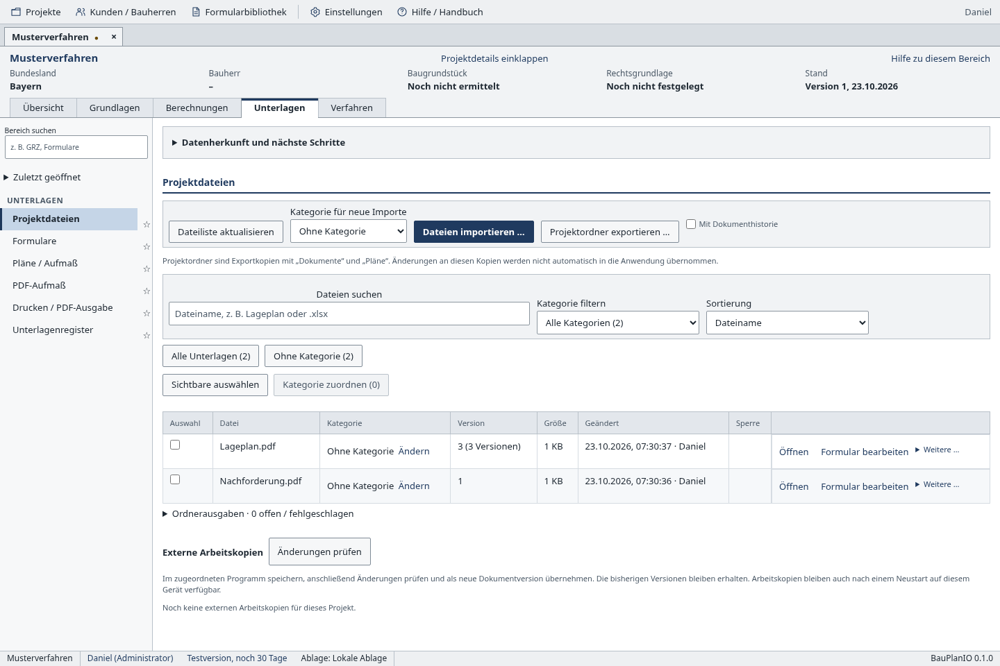

Abbildung 27.1 · Projektdateien sind der zentrale Zugang zu Originalen und Versionen. Dateiname, fachliche Kategorie und Dateityp sind unterschiedliche Eigenschaften.

### Extern bearbeiten

„Öffnen“ stellt eine Arbeitskopie bereit und startet die vom Betriebssystem zugeordnete Anwendung, beispielsweise Excel oder CAD. Bei fehlender Zuordnung zuerst die passende Fachanwendung installieren/zuordnen.

Nach externer Bearbeitung unter „Externe Arbeitskopien“ die Änderungen prüfen und gezielt übernehmen. Erst diese Übernahme erzeugt einen verwalteten neuen Stand. Dokumentensperren anderer Bearbeiter beachten; sie nicht durch einen zweiten Import umgehen.

### Kategorie ist kein Dateiformat

„Baubeschreibung“, „Lageplan“ oder „E-Mail“ beschreiben den fachlichen Zweck. Eine DWG wird durch die Kategorie Lageplan nicht zu einer druckbaren PDF. Eine Kategorieänderung erzeugt keine neue Dateiversion. Ein eingefrorener Abgabestand behält seine damalige Kategorie und Version.

### Neue Datei oder neue Version

Beim Import einer einzelnen gleichnamigen Datei bietet die Anwendung an, das vorhandene Dokument als neue Version fortzuschreiben oder eine separate Datei anzulegen. Der Dateiname allein entscheidet keine Dokumentidentität.

Aus einer Anforderung heraus eine Datei importieren oder die genaue Version auswählen. Zurück im Ausgangsbereich die Zuordnung ausdrücklich bestätigen.

### Neue Version oder eigenständige Unterlage?

Bei einer historischen Version niemals stillschweigend die aktuellste Datei öffnen und als damaligen Stand ausgeben. In der Dokumentauswahl bei Bedarf die Anzeige älterer Versionen einschalten. Nicht mehr auflösbare Bezüge zuerst klären; nicht durch ein ähnlich benanntes Dokument ersetzen.

| Prüfpunkt / Eingabe | Bedeutung und Kontrolle |
| --- | --- |
| Korrigierter Lageplan | Neue Version des bestehenden Lageplans. Frühere Abgaben können weiterhin auf Version 1 verweisen. |
| Zusätzlicher Schnitt | Eigenständiges Dokument, wenn es eine weitere Unterlage neben dem bisherigen Plan ist. |
| Gleicher Dateiname beim Import | Im Dialog bewusst „Neue Version“, „Separate Datei“ oder „Abbrechen“ wählen. Gleicher Name allein beweist keine Identität. |
| Extern bearbeitete Excel-/DWG-Datei | Arbeitskopie übernehmen oder die geänderte Datei als neue Version importieren. Die auf dem Rechner zugeordnete Anwendung muss installiert sein. |
| Archivierte E-Mail | Original im passenden E-Mail-Format erhalten; Anhänge gezielt als Unterlagen übernehmen und ihre Herkunft dokumentieren. |

Weiterlesen: [E-Mails und Anhänge dokumentieren](#29-e-mails-und-anhänge-dokumentieren) · [PDF-Formulare im Projekt ausfüllen](#30-pdf-formulare-im-projekt-ausfüllen) · [Dateiablage und lesbare Projektordner](#05-dateiablage-und-lesbare-projektordner) · [Abgabestände und Einreichungsvergleich](#41-abgabestände-und-einreichungsvergleich)

## 28. Dokumentkategorien im Büro pflegen

Haupt- und Unterkategorien einheitlich verwenden.

### Katalog bearbeiten

1. Unter „Einstellungen“ den Dokumentkategorien-Katalog öffnen. Bestehende Kategorien wie Lageplan, Baubeschreibung, Berechnungen oder E-Mail zunächst auf Eignung prüfen.
2. Mit „Kategorie hinzufügen“ einen Namen erfassen. Für eine Unterkategorie die passende Hauptkategorie auswählen.
3. „Aktiv“ für künftig verwendbare Kategorien setzen und „Kategorie speichern“ wählen. Nicht mehr benötigte Kategorien archivieren, statt historische Zuordnungen umzudeuten.
4. Vor dem Archivieren einer Hauptkategorie deren Unterkategorien archivieren oder anders zuordnen.

### Im Projekt verwenden

Beim Dateiimport bzw. in den Dokumentangaben die passende Kategorie wählen. Mehrere ausgewählte Dokumente lassen sich gesammelt kategorisieren. Ein Hauptkategorie-Filter berücksichtigt auch zugehörige Unterkategorien; „Ohne Kategorie“ hilft beim Nachpflegen.

Eine Vorlagenvorgabe in der Formularbibliothek gilt für daraus neu erzeugte Unterlagen. Sie ändert bereits gespeicherte Projektdokumente nicht nachträglich. Umbenennungen im Katalog verändern keine eingefrorenen Kategoriesnapshots früherer Abgaben.

### Bürostandard für Dokumente aufbauen

Kategorien nach fachlichem Zweck verwenden, etwa Bauantrag, Baubeschreibung, Lageplan, Berechnung, Statik, Schriftverkehr oder E-Mail. Das Dateiformat bleibt davon unabhängig: Eine PDF kann Lageplan oder Anschreiben sein, eine E-Mail kann mehrere fachlich unterschiedliche Anlagen enthalten.

Vorlagen für Dateinamen und Kategorien im Büro abstimmen. Kategorien erleichtern Filter, Unterlagenvergleich und Inhaltsverzeichnis; sie bestätigen keine fachliche Vollständigkeit. Ein als „Statik“ kategorisiertes Dokument ist nicht automatisch ein geprüfter bautechnischer Nachweis.

Weiterlesen: [Projektdateien und Versionen verwalten](#27-projektdateien-und-versionen-verwalten) · [Formularbibliothek und eigene PDF-Vorlagen](#31-formularbibliothek-und-eigene-pdf-vorlagen) · [Abgabestände und Einreichungsvergleich](#41-abgabestände-und-einreichungsvergleich)

## 29. E-Mails und Anhänge dokumentieren

Archivierte Nachrichten lesen und als Verfahrensbelege verwenden.

### Nachricht archivieren

1. Eine archivierte E-Mail als EML oder MSG in die Projektdateien importieren und der Kategorie „E-Mail“ zuordnen.
2. „E-Mail lesen“ öffnen. Absender, Betreff, Datum, Empfänger, Nachrichtentext und Anhangsangaben prüfen; bei Bedarf eine ältere Dokumentversion wählen.
3. Benötigte Anhänge gezielt als eigene Projektunterlagen übernehmen. Die Herkunft aus der konkreten Nachrichtenversion bleibt nachvollziehbar.
4. In der Verfahrensakte einen Kommunikationseintrag mit Richtung, Datum und Bezug anlegen und die Originalnachricht als Beleg zuordnen.

### Darstellungsgrenzen

Die Vorschau zeigt Nachrichtentext, führt aber keine aktiven HTML-Inhalte aus und lädt keine externen Bilder. Geschützte, verschlüsselte oder nur als RTF vorhandene MSG-Texte können unlesbar bleiben. In diesem Fall das Original exportieren bzw. im zugeordneten Mailprogramm öffnen.

Die Anwendung ist damit ein Archiv für Projektkommunikation, kein automatischer Posteingang und kein E-Mail-Versanddienst. Eine abgelegte E-Mail mit Versandabsicht ist noch kein belegter Zugang bei der Behörde.

### Original, Inhalt und Anlagen auseinanderhalten

1. Die archivierte E-Mail in den Projektdateien importieren und als E-Mail kategorisieren. Vorhandene Betreff-, Absender-, Empfänger- und Datumsinformationen mit dem Original vergleichen.
2. In der Inhaltsanzeige prüfen, ob der Text vollständig lesbar ist. Bei nicht unterstützten oder beschädigten Formaten das Original mit einer geeigneten externen Anwendung öffnen.
3. Benötigte Anlagen gezielt übernehmen, korrekt kategorisieren und bei einer Korrektur dem bestehenden Dokument als neue Version zuordnen.
4. Den tatsächlichen Eingang in der Verfahrenskommunikation mit dem Originalbeleg dokumentieren. Eine eingelesene E-Mail ist keine automatisch bestätigte elektronische Antragseinreichung.

Weiterlesen: [Projektdateien und Versionen verwalten](#27-projektdateien-und-versionen-verwalten) · [Kommunikation, Versand und Eingang dokumentieren](#43-kommunikation-versand-und-eingang-dokumentieren)

## 30. PDF-Formulare im Projekt ausfüllen

Eine Vorlage auswählen, Eingaben prüfen und die ausgefüllte Original-PDF ablegen.

### Projektbezogener Ablauf

1. Im geöffneten Projekt „Unterlagen → Formulare“ wählen. Nach Vorlage oder Kategorie suchen und „Ausfüllen“ öffnen.
2. Bei mehreren Grundstücken, Bauherren oder Verfahren den passenden Kontext auswählen. Angebotene Projektwerte prüfen und nur passende Werte übernehmen.
3. Felder ergänzen; mehrzeilige Texte wie Anschriften im dafür vorgesehenen Textfeld eingeben. Die PDF-Vorschau kontrollieren und gegebenenfalls die Seite wechseln.
4. Nach Änderungen anderer Projektbereiche „Projektdaten neu laden“ bzw. die angebotene Aktualisierung verwenden. Bereits getippte Werte nicht unbesehen durch alle Vorschläge ersetzen.
5. „Im Projekt speichern“ wählen. Die ausgefüllte PDF wird als Projektunterlage geführt und im eingestellten Projektordner ausgegeben. Ein separater Export ist dafür nicht der normale Speicherschritt.
6. Für eine Korrektur das vorhandene Projektdokument über „Formular bearbeiten“ öffnen und erneut im Projekt speichern; damit bleibt der Dokumentbezug erhalten.

### Orientierung in der Oberfläche

Die folgende Abbildung zeigt einen Ausschnitt des Arbeitsablaufs im fiktiven Beispielprojekt.

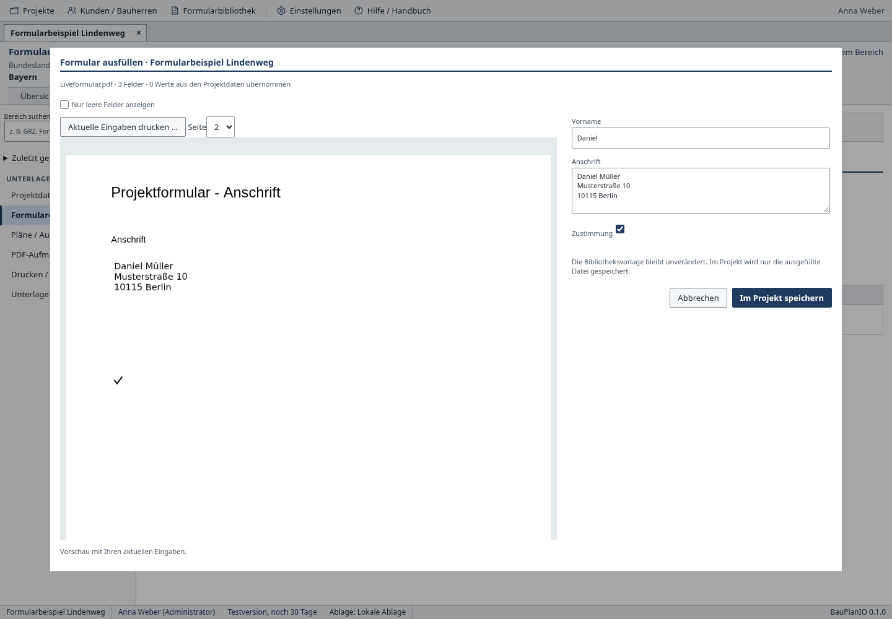

Abbildung 30.1 · Die Anschrift wird rechts mehrzeilig erfasst und links auf Seite 2 des originalen Beispiel-PDFs angezeigt. Vor „Im Projekt speichern“ die vollständige Darstellung aller betroffenen Seiten kontrollieren.

### Vorschau und Ausgabe

Die Vorschau zeigt die befüllte Originalvorlage. „Aktuelle Eingaben drucken …“ ist eine Ausgabe des aktuellen Formularstands; vor einer verbindlichen Abgabe die benötigte Dokumentversion im Projekt sichern. Im Stapeldruck werden amtliche Formularseiten ohne zusätzlichen Bürobriefkopf oder Fußzeile übernommen.

Nicht alle Fachberechnungsergebnisse stehen automatisch als Formularquelle bereit. Insbesondere Wohnfläche, DIN-277-Ergebnisse und weitere Fachwerte am konkreten Formular prüfen und gegebenenfalls mit ihrem Nachweis manuell eintragen.

### Aus einer Anforderung heraus arbeiten

Unter „Anforderungen“ mit „Formular für diese Anforderung erstellen …“ beginnen. Nach dem Speichern „Diese Version zur Zuordnung übernehmen“ wählen und im Ausgangsbereich die genaue Version ausdrücklich zuordnen. Die Zuordnung setzt die fachliche Freigabe zurück.

„Vorlagen hinzufügen / Eingabefelder einrichten …“ öffnet die globale Bibliothek. Dort führt „Zurück zu Formularen im Projekt“ zurück; die Bibliothek wird beim Wiederöffnen aktualisiert.

### Vom Bibliotheksformular zur Projektdatei

Originalformulare werden bei Einzel- und Stapeldruck mit ihrem Formularinhalt ausgegeben. Der Bürobriefkopf wird nicht über das amtliche PDF gelegt. Im Inhaltsverzeichnis können Kategorie, Dateiname, Version und Startseite aufgeführt werden.

1. Das Zielprojekt öffnen und „Unterlagen → Formulare“ wählen. Bei einem Anforderungspunkt möglichst den dort angebotenen Formularweg verwenden, damit der Rückbezug erhalten bleibt.
2. Eine passende Blankovorlage aus der gemeinsamen Bibliothek auswählen. Formularfassung, Bundesland und Verwendungszweck anhand des Originals prüfen.
3. Die Eingabemaske ausfüllen. Bei mehrzeiligen Feldern Zeilenumbrüche verwenden. Checkboxen und Auswahlfelder gemäß der Bedeutung im Originalformular setzen.
4. Die aktualisierte Vorschau kontrollieren. Auf abgeschnittene Texte, zu kleine Schrift, fehlende Zeilen und die richtige Seitenwahl achten. Lange Anschriften gegebenenfalls kürzen oder die Felddefinition der Vorlage prüfen.
5. „Im Projekt speichern“ verwenden. Danach die Projektdatei und ihren Versionsstand kontrollieren. Für eine zusätzliche Ausgabe auf dem Gerät den Export des gespeicherten Dokuments verwenden.
6. Beim Rückweg zu einer Unterlagenanforderung die konkrete neue Dokumentversion ausdrücklich zuordnen und erforderliche Freigaben erneut prüfen.

Weiterlesen: [Formularbibliothek und eigene PDF-Vorlagen](#31-formularbibliothek-und-eigene-pdf-vorlagen) · [Einzeldruck, Stapeldruck und Behördenausgabe](#32-einzeldruck-stapeldruck-und-behördenausgabe) · [Projektdateien und Versionen verwalten](#27-projektdateien-und-versionen-verwalten) · [Bauantrag und XBau-Grunddaten](#39-bauantrag-und-xbau-grunddaten)

## 31. Formularbibliothek und eigene PDF-Vorlagen

Wiederverwendbare Vorlagen unabhängig von einzelnen Projekten vorbereiten.

### Vorlage bereitstellen

1. Die globale „Formularbibliothek“ öffnen und „PDF-Vorlage importieren …“ wählen. Das unveränderte Original aufbewahren.
2. Vorhandene PDF-Eingabefelder und Checkboxen prüfen. Bei fehlenden Feldern „Felder hinzufügen …“ verwenden.
3. Auf der betreffenden PDF-Seite Textfeld oder Checkbox platzieren. Feldname/Platzhalter, Beschriftung, Größe und gegebenenfalls „Mehrzeiliges Textfeld“ festlegen. Eindeutige Feldnamen wie Vorname oder Anschrift verwenden.
4. „Vorlage erstellen“ ausführen und die neu ausfüllbare Vorlage prüfen. Bei Bedarf eine Standardkategorie für spätere Projektdokumente setzen.
5. Zum Ausfüllen zurück in ein konkretes Projekt unter „Formulare“ wechseln und dort die Vorlage wählen.

### Orientierung in der Oberfläche

Die folgende Abbildung zeigt einen Ausschnitt des Arbeitsablaufs im fiktiven Beispielprojekt.

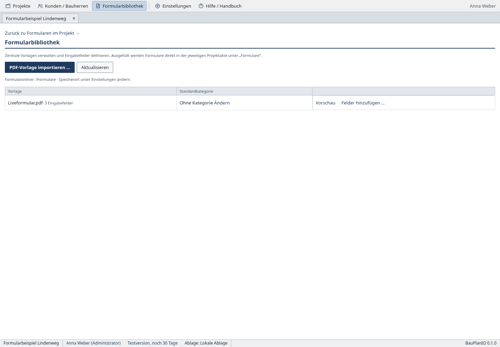

Abbildung 31.1 · Blankovorlagen werden gemeinsam verwaltet. Für die projektbezogene Bearbeitung das richtige Projekt öffnen und dort die gewünschte Vorlage auswählen.

### Bibliothek im Büro

Der Vorlagenordner ist projektunabhängig und kann zentral auf einer Serverfreigabe liegen. Eine geänderte Vorlage schreibt bereits ausgefüllte Projektdokumente nicht nachträglich um. Für eine neue amtliche Formularfassung den Versions-/Fassungsbezug in der Vorlagenbezeichnung klar kenntlich machen.

Ein Feldname wie &lt;Platzhalter1&gt; stellt ein Eingabefeld bereit; er ist allein keine automatische Zuordnung zu einem beliebigen Berechnungsergebnis. Die angebotenen Feld-/Quellenzuordnungen prüfen.

### Eigene Vorlage vor der Büronutzung testen

1. Eine Kopie der richtigen Blankovorlage in die projektunabhängige Bibliothek aufnehmen. Keine ausgefüllte Datei mit personenbezogenen Beispieldaten als gemeinsame Vorlage veröffentlichen.
2. Vorhandene PDF-Felder analysieren. Echte Textfelder, Checkboxen, Auswahlfelder und mehrzeilige Eigenschaften prüfen.
3. Wenn Felder fehlen, Platzhalter mit sinnvoller Bezeichnung und Position definieren, z. B. „Vorname“ oder „Anschrift“. Schreibgeschützte Originalbereiche nicht als frei bearbeitbar behandeln.
4. Mit langen, mehrzeiligen und leeren Testwerten sowie angekreuzten Feldern probeweise ausfüllen. Jede betroffene Seite der Original-PDF prüfen.
5. Bei geänderter amtlicher Formularfassung eine geprüfte neue Vorlage bereitstellen. Bereits im Projekt gespeicherte Formularversionen behalten ihre Herkunft und ihren bisherigen Inhalt.

Weiterlesen: [Dateiablage und lesbare Projektordner](#05-dateiablage-und-lesbare-projektordner) · [PDF-Formulare im Projekt ausfüllen](#30-pdf-formulare-im-projekt-ausfüllen)

## 32. Einzeldruck, Stapeldruck und Behördenausgabe

Einreichungsfähige Ausgaben kontrolliert zusammenstellen.

### Ausgabe vorbereiten

1. Unter „Einstellungen“ die Druckgestaltung mit Kopfzeile, Fußzeile und Standardanschreiben pflegen. Projektbezogene Empfänger- und Bezugstexte anschließend im Druckauftrag kontrollieren.
2. Im Projekt „Unterlagen → Drucken / PDF-Ausgabe“ öffnen oder den Druckknopf eines Nachweises verwenden.
3. Einzeln oder gesammelt die verfügbaren Nachweise und druckbaren Original-PDFs auswählen. Reihenfolge, gewünschte Seiten bzw. Druckumfang prüfen.
4. Anschreiben formulieren und Bezeichnung, Empfänger, Aktenzeichen, Datum sowie die angebotenen Optionen für Inhaltsverzeichnis und Gestaltung kontrollieren.
5. „Druckausgabe erstellen“ wählen und die Vorschau aller Seiten prüfen: Vollständigkeit, Lesbarkeit, Tabellen, Planmaßstab, Seitenformat und richtige Version.
6. Als PDF speichern, mit „Als Projektunterlage ablegen“ versioniert sichern oder „Drucken …“ für den Systemdruck verwenden.

### Orientierung in der Oberfläche

Die folgende Abbildung zeigt einen Ausschnitt des Arbeitsablaufs im fiktiven Beispielprojekt.

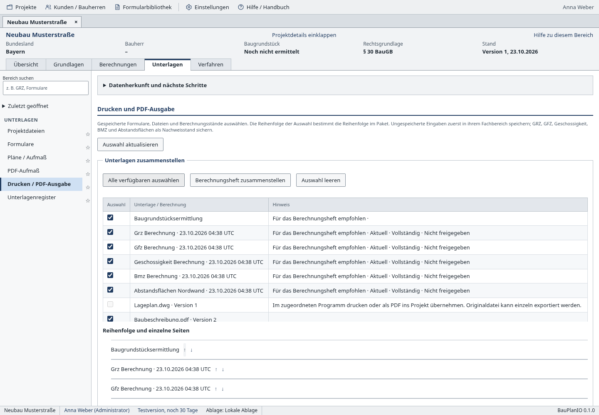

Abbildung 32.1 · Konkrete Nachweise und Dateiversionen auswählen, Reihenfolge und optionale Begleitunterlagen prüfen. Nicht druckbare Originalformate benötigen gegebenenfalls eine zusätzliche PDF-Ausgabe.

### Weitere Ansicht

Die folgende Abbildung zeigt einen Ausschnitt des Arbeitsablaufs im fiktiven Beispielprojekt.

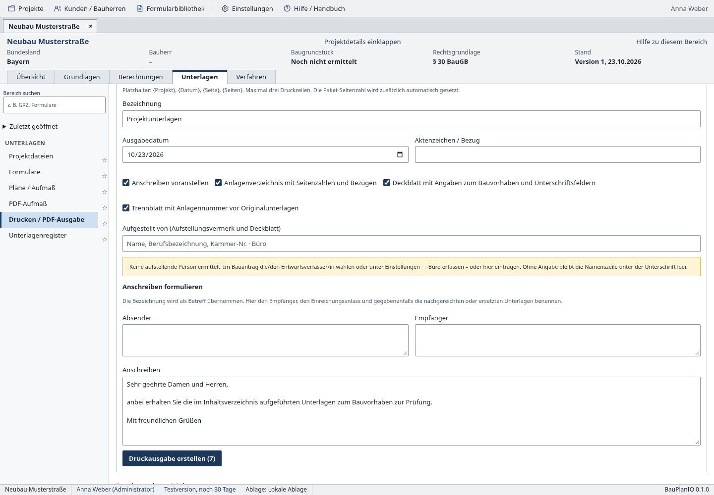

Abbildung 32.2 · Die erzeugte PDF vor Export und Ablage prüfen. Originalformulare behalten ihre Gestaltung; erzeugte Berichte verwenden den eingestellten Briefbogen.

### Platzhalter im Briefbogen

In Kopf- und Fußzeile stehen die angebotenen Platzhalter {Projekt}, {Datum}, {Seite} und {Seiten} zur Verfügung. Jeweils höchstens drei Druckzeilen vorsehen und die fertige Ausgabe kontrollieren. Das Standardanschreiben unter „Vorlage für das Anschreiben“ pflegen und mit „Druckvorlage speichern“ sichern. Texte einer einzelnen Ausgabe können im Projekt angepasst werden.

### Formulare und Inhaltsverzeichnis

Erzeugte Berichte verwenden die Druckgestaltung. Original-PDF-Formulare bleiben auf ihren Seiten unverändert; sie erhalten keinen zusätzlichen Briefkopf. Im Inhaltsverzeichnis werden Dokumentkategorie, Dateiname, Version und Startseite aufgeführt, soweit der Katalog diese Angaben liefert.

Nicht druckbare Fachdateien wie DWG oder Excel müssen zunächst mit der zugehörigen Fachsoftware in ein akzeptiertes Ausgabeformat gebracht und als PDF verwaltet werden. Ein PDF-Stapel ersetzt nicht die vom Portal geforderte Einzeldateistruktur.

> Ein Druck-PDF ist eine Ausgabe, keine Übermittlungsbestätigung. Bevor Sie es einer Abgabe zuordnen, den tatsächlich zu verwendenden Stand als Projektunterlage sichern. Bei maßstäblichen Plänen Skalierung im Systemdruck prüfen.

### Mit dem Abgabestand vergleichen

Im verfahrensbezogenen Arbeitsplatz einen eingefrorenen Abgabestand wählen und dessen Dokumentversionen zur Druckausgabe übernehmen. Dort „Versionen aus Abgabestand auswählen“ ausdrücklich auslösen.

Nicht verfügbare oder nicht druckbare Versionen werden gemeldet. DWG und andere Originaldateien separat über das Abgabepaket berücksichtigen. Eine andere Druckauswahl verändert den eingefrorenen Stand nicht. Originalformulare erhalten weiterhin keinen zusätzlichen Briefbogen.

### Ein prüfbares Paket zusammenstellen

1. Im Projekt „Drucken / PDF-Ausgabe“ öffnen. Den passenden Anlass wählen: einzelner Nachweis, frei zusammengestellte Ausgabe oder Unterlagen eines festgehaltenen Abgabestands.
2. Konkrete Nachweisstände und Dateiversionen wählen. Fehlende bzw. nicht direkt druckbare Dateitypen klären. Eine DWG-, Word- oder Excel-Originaldatei gegebenenfalls mit dem zuständigen Programm zusätzlich als geprüfte PDF bereitstellen.
3. Bei Bedarf Anschreiben und Inhaltsverzeichnis ergänzen. Empfänger, Betreff, Aktenzeichen, Anlagen und frei formulierten Text prüfen. Briefkopf und Fußzeile stammen aus der eingestellten Bürogestaltung.
4. Reihenfolge kontrollieren. Bei Originalformularen und beigefügten PDFs den Originalinhalt erhalten; die Gestaltung der erzeugten Berechnungsseiten nicht mit dem amtlichen Formular verwechseln.
5. Druckausgabe erstellen und die Vorschau seitenweise durchsehen. Inhaltsverzeichnis auf Kategorie, Dateiname, Version und richtige Startseiten prüfen.
6. Bei Bedarf als Projektunterlage ablegen oder extern exportieren. Die Ausgabe danach im passenden Abgabestand auswählen; Drucken oder Exportieren bestätigt keinen Versand.

Weiterlesen: [Nachweisstände archivieren und freigeben](#26-nachweisstände-archivieren-und-freigeben) · [Abgabestände und Einreichungsvergleich](#41-abgabestände-und-einreichungsvergleich) · [PDF-Formulare im Projekt ausfüllen](#30-pdf-formulare-im-projekt-ausfüllen)

## 33. Projektübersicht, Aufgaben und Chronik

Handlungsbedarf, Fristen und Bearbeitungsstand im Blick behalten.

### Projektübersicht nutzen

„Übersicht → Projektübersicht“ zeigt offene Aufgaben, fehlende Unterlagen, zu prüfende Nachweise und Verfahrenshinweise. Über „Arbeitsschritt öffnen“ oder einen konkreten Hinweis gelangen Sie zum zugehörigen Bereich. Ein vorhandener anderer Entwurf kann den Objektwechsel verhindern; zuerst bewusst speichern oder verwerfen.

Die Übersicht ist eine Auswertung der erfassten Daten. Nicht erfasste Anforderungen oder ein nicht dokumentiertes Schreiben können darin nicht als erledigt oder offen erkannt werden. Bei Ladestörungen den Hinweis zum letzten geladenen Stand beachten und aktualisieren.

### Orientierung in der Oberfläche

Die folgende Abbildung zeigt einen Ausschnitt des Arbeitsablaufs im fiktiven Beispielprojekt.

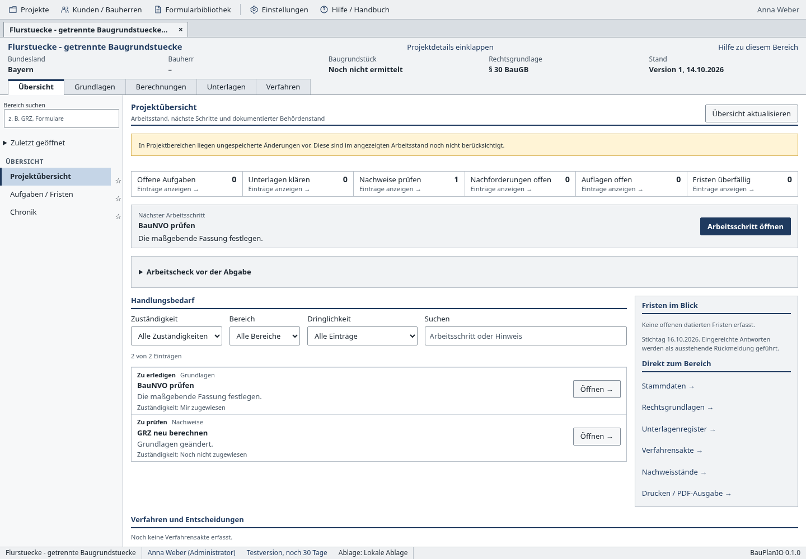

Abbildung 33.1 · Die Übersicht bündelt offene Arbeitsschritte und Verweise auf die betroffenen Bereiche. Ein Hinweis auf ungespeicherte Änderungen bedeutet, dass diese noch nicht in den ausgewerteten Stand eingeflossen sind.

### Aufgaben und Fristen

1. Unter „Aufgaben / Fristen“ Aufgabe, Verantwortliche, Termin und Bearbeitungsstand erfassen.
2. Bezüge und Nachweise so ergänzen, dass ein Kollege die Aufgabe übernehmen kann.
3. Erledigung erst dokumentieren, wenn das Ergebnis vorliegt. Für eine behördliche Nachforderung zusätzlich den einzelnen Forderungspunkt in der Verfahrensakte führen.

### Chronik

Die Projektchronik dokumentiert gespeicherte Aktionen und Änderungen. Sie ergänzt die fachliche Verfahrenschronik, ersetzt aber weder einen Originalbeleg noch einen Versandnachweis. Für Vorgang und Zeitpunkt stets den passenden fachlichen Bereich verwenden.

### Arbeitscheck und Zuständigkeit

1. Unter Handlungsbedarf nach „Mir zugewiesen“ oder „Ohne Zuweisung“ filtern. Mit „Alle Filter zurücksetzen“ wieder alle Arbeitspunkte anzeigen.
2. Den eingeklappten „Arbeitscheck vor der Abgabe“ öffnen. Die Gruppen führen direkt zu offenen Grundlagen, Nachweisen, Unterlagen und Verfahrenspunkten.
3. Im dokumentierten Behördenstand auf den Dateinamen klicken: Die Historie hebt die damals eingereichte Version hervor; neuere Projektversionen bleiben davon unterscheidbar.

> Der Arbeitscheck verwendet gespeicherte Daten. Ungespeicherte Entwürfe, fehlende Anforderungen und nicht erreichbare Prüfungen ergeben keine bestätigte Abgabereife.

### Täglicher Einstieg in eine laufende Akte

1. Den richtigen Projekttab öffnen und „Übersicht“ aufrufen. Bei Bedarf den Stand aktualisieren. Hinweise auf ungespeicherte Änderungen beachten, weil die Übersicht gespeicherte Grundlagen auswertet.
2. Zuerst Fristen und überfällige Arbeitsschritte prüfen. Nach Zuständigkeit und Bereich filtern, um die eigenen Aufgaben von offenen Grundlagenfragen zu unterscheiden.
3. Den vorgeschlagenen nächsten Arbeitsschritt öffnen. Den fehlenden Wert an seiner Quelle ändern, speichern und anschließend zur Übersicht zurückkehren.
4. Vor einer Abgabe den Arbeitscheck durchgehen. Einträge zu veralteten Nachweisen, fehlenden Dokumenten und unklaren Bezügen klären.
5. Die Anzeige des Behördenstands anhand der dokumentierten Abgaben und Eingangsbelege beurteilen. Nicht dokumentierte externe Einreichungen werden nicht automatisch erkannt.

Weiterlesen: [Unterlagenbedarf und Freigaben organisieren](#36-unterlagenbedarf-und-freigaben-organisieren) · [Workflow: Nachforderung und Nachreichung](#44-workflow-nachforderung-und-nachreichung) · [Häufige Fragen und Störungen](#51-häufige-fragen-und-störungen)

## 34. Aktensuche, OCR und Wiedervorlagen

Inhalte finden, Termine exportieren und die vollständige Akte ausgeben.

### Suchen und indexieren

1. „Verfahren → Suche / Wiedervorlagen“ öffnen. Für die Suche einen Begriff eingeben und „Akte durchsuchen“ wählen. Dateinamen und Verfahrenseinträge sind unmittelbar durchsuchbar.
2. Für Dokumentinhalte einen konkreten Dokumentstand auswählen und „Text aus PDF / E-Mail indexieren“ verwenden.
3. Bei einem Scan-PDF „Scan-PDF mit OCR indexieren“ wählen. Hierfür muss Tesseract mit passenden Sprachpaketen am Arbeitsplatz eingerichtet sein.
4. Gefundene Textstellen mit dem Original abgleichen. OCR ist eine Suchhilfe; die Originaldatei bleibt unverändert und maßgebend.

### Termine weitergeben

Mit „Wiedervorlagen aktualisieren“ den Stand laden und gegebenenfalls „Nur meine Zuständigkeiten“ wählen. „Termine als Kalender (ICS) exportieren“ erzeugt eine Kalenderdatei zur Übernahme in die eingesetzte Kalenderanwendung. Nach Änderungen erneut exportieren und im Kalender auf doppelte bzw. alte Einträge achten.

„Systembenachrichtigungen aktivieren“ benötigt eine Berechtigung des Betriebssystems. Hinweise setzen eine geöffnete Anwendung voraus; sie ersetzen keinen verlässlich organisierten Bürofristenkalender.

### Gesamte Akte exportieren

„Projektakte als ZIP exportieren …“ umfasst die Projektakte mit allen Dokumentversionen, Fachhistorien und festgehaltenen Ausgabe-Artefakten. Für eine Behördenabgabe stattdessen den ausgewählten Abgabestand verwenden. Für die Wiederherstellung einer Installation sind Profil-/Bürosicherungen vorgesehen.

### Wenn die Suche einen Inhalt nicht findet

Zunächst die richtige Akte, den Suchbegriff und die Filter prüfen. Eine Datei kann vorhanden sein, obwohl ihr Inhalt noch nicht indexiert wurde. Für geeignete PDFs und E-Mails die angebotene Textindexierung ausführen und danach erneut suchen.

Ein Scan enthält gegebenenfalls nur Bildpunkte. OCR-Ergebnisse auf Erkennungsfehler prüfen; das Original bleibt maßgeblich. Bei unklaren Terminen immer das Originalschreiben öffnen. Wiedervorlagen unterstützen die Organisation, ersetzen aber keine eigenständige Prüfung von Fristbeginn, Hemmungen und Zustellung.

Weiterlesen: [Projektübersicht, Aufgaben und Chronik](#33-projektübersicht-aufgaben-und-chronik) · [Kommunikation, Versand und Eingang dokumentieren](#43-kommunikation-versand-und-eingang-dokumentieren) · [Sicherung, Wiederherstellung und Aktenexport](#49-sicherung-wiederherstellung-und-aktenexport)

## 35. Verfahrensakte und Vorhabenprofil anlegen

Behörde, Verfahren und Anforderungskatalog projektbezogen festlegen.

### Akte anlegen

1. „Verfahren → Verfahrensakte → Neu anlegen“ öffnen. Eine eindeutige Verfahrensbezeichnung wählen. Ein Projekt kann mehrere Verfahren mit eigenem Aktenzeichen enthalten.
2. Verfahrensart und gegebenenfalls reguläres/vereinfachtes Prüfverfahren wählen. Behörde, Behördenkennung, Kontakt und bei Vorliegen Aktenzeichen erfassen.
3. Die angebotene Verfahrenswahl mit Vorhabenmerkmalen prüfen. „Als Verfahrensart der Akte übernehmen“ erst verwenden, wenn die Bedingungen passen. Hinweise auf ungeprüfte Landesregeln ausdrücklich fachlich klären.
4. Bei Vorbescheid die konkreten Fragen erfassen; bei Folgeverfahren den Vorgänger zuordnen. Eine Freistellung entsprechend den angezeigten Angaben vorbereiten.
5. Im Vorhabenprofil Bundesland, Nutzung, Gebäudeklasse und Sonderbauangaben prüfen. Einen passenden mitgelieferten oder eigenen Katalog anwenden und speichern.

### Orientierung in der Oberfläche

Die folgende Abbildung zeigt einen Ausschnitt des Arbeitsablaufs im fiktiven Beispielprojekt.

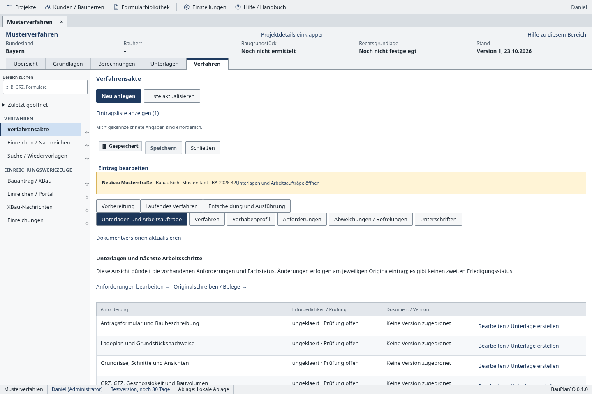

Abbildung 35.1 · Der verfahrensbezogene Arbeitsplatz führt Anforderungen und Aufgaben zusammen. Behörde und Aktenzeichen im Kontextkopf vor jeder weiteren Bearbeitung prüfen.

### Laufend pflegen

Die Lageanzeige benennt den dokumentierten Stand und mögliche nächste Schritte. Sie ist eine Arbeitshilfe auf Basis der gespeicherten Tatsachen, keine eigenständige Rechtsentscheidung. Bearbeitungsfrist, Vollständigkeitsdatum und Fristen nur anhand belastbarer Angaben eintragen.

Bei Projekt-/Bauantragsdaten und Akte auf abweichende Behörden, Verfahrensarten oder Prüfverfahren achten. Die für eine Abgabe eingefrorenen Empfängerangaben stammen aus der Verfahrensakte.

### Phasen und gemeinsamer Arbeitsplatz

Die Bereiche sind in „Vorbereitung“, „Laufendes Verfahren“ und „Entscheidung und Ausführung“ gegliedert. Behörde und Aktenzeichen der aktiven Akte bleiben im Verfahrenskopf sichtbar.

„Unterlagen und Arbeitsaufträge“ bündelt Anforderungen, konkrete Dokumentstände, Nachforderungspunkte und Pflichten aus Bescheiden. Die Ansicht besitzt keinen zweiten Erledigungsstatus; Änderungen führen zum Originaleintrag. Hinweise ohne Pflicht werden nicht als Aufgabe gezählt.

### Einen Vorgang innerhalb des Projekts wählen

Ein Projekt kann mehr als einen fachlich getrennten Vorgang enthalten. Vor jedem Verfahrensschritt Bezeichnung, Behörde und Aktenzeichen im Kontextkopf kontrollieren. Ein Änderungs- oder Folgeverfahren mit dem passenden Bezug führen, statt unverbundene Angaben in einer Sammelakte zu vermischen.

Die Bereiche sind in „Vorbereitung“, „Laufendes Verfahren“ und „Entscheidung und Ausführung“ gegliedert. Unter „Unterlagen und Arbeitsaufträge“ werden Anforderungen und offene Verfahrensaufgaben zusammengeführt. Die Anzeige leitet sich aus den jeweiligen Einträgen ab; es ist kein zweiter unabhängig zu pflegender Erledigungsstatus.

Weiterlesen: [Unterlagenbedarf und Freigaben organisieren](#36-unterlagenbedarf-und-freigaben-organisieren) · [Bauantrag und XBau-Grunddaten](#39-bauantrag-und-xbau-grunddaten) · [Abgabestände und Einreichungsvergleich](#41-abgabestände-und-einreichungsvergleich)

## 36. Unterlagenbedarf und Freigaben organisieren

Erforderlichkeit entscheiden und konkrete Dokumentstände zuordnen.

### Anforderungsliste vervollständigen

1. In der Verfahrensakte das zum Vorhaben passende Profil bzw. den Bauvorlagenkatalog anwenden. Die vorgeschlagenen Anforderungen prüfen.
2. Für jede Anforderung ausdrücklich „ungeklärt“, „erforderlich“ oder „nicht erforderlich“ entscheiden. Abweichungen vom Katalog mit Grund und Quelle dokumentieren.
3. Vorhandene Projektdateien als konkrete Dokumentversionen zuordnen. Ein Dateiname ohne Versionsbezug genügt nicht für einen eindeutigen Abgabestand.
4. Verantwortliche und interne Termine als Aufgaben organisieren. Im „Unterlagenregister“ zusätzliche projektbezogene Unterlagen und Prüfstände führen.
5. Fachliche Freigaben durch die berechtigte Projekt-/Büroleitung erteilen lassen. Bei geänderten Grundlagen oder neuen Versionen zurückgesetzte Freigaben erneut prüfen.

### Vollständigkeit

Eine passende Kategorie kann die Zuordnung erleichtern; sie bestätigt weder Inhalt noch Erforderlichkeit automatisch. Anforderungen aus einem Katalog auf den örtlichen und konkreten Verfahrensumfang abgleichen. Zusätzliche Fachgutachten, Erklärungen und Unterschriften nicht allein wegen fehlendem Katalogeintrag weglassen.

### Durchsuchbare Dokumentversionen

Die Dokumentauswahl lässt sich nach Dateiname, Kategorie und Dateityp filtern. Standardmäßig werden aktuelle Versionen angeboten; historische Stände können ausdrücklich eingeblendet werden. Eine bereits zugeordnete ältere Version bleibt trotz Filter sichtbar.

„Genau diese Version ansehen“ öffnet die referenzierte Historie. Fehlende Metadaten werden als nicht auflösbar angezeigt; die Referenz wird nicht still gelöscht. Kategorie allein erfüllt keine Anforderung.

### Unterlagenbedarf mit konkreten Versionen abarbeiten

1. Den Unterlagenbedarf für das tatsächliche Vorhabenprofil prüfen. Unzutreffende Punkte mit nachvollziehbarer Begründung behandeln; zusätzliche Anforderungen ergänzen.
2. Für jede benötigte Unterlage Zuständigkeit und fachlichen Bearbeitungsstand klären. Ein Formular über den zugehörigen Anforderungsweg erstellen oder ein vorhandenes Dokument auswählen.
3. In der Auswahl nach Dateiname, Kategorie oder Dateityp filtern. Bei Bedarf historische Versionen einblenden. Die Version wählen, die tatsächlich den Inhalt der Anforderung erfüllt.
4. Nach Rückkehr die Zuordnung ausdrücklich bestätigen. Neue Versionen erfordern eine erneute fachliche Freigabe; eine frühere Freigabe darf keine unkontrollierte Folgeversion abdecken.
5. Vor der Abgabe nicht nur den Dateibesitz, sondern Vollständigkeit, Lesbarkeit, Unterschriften und Widerspruchsfreiheit prüfen.

Weiterlesen: [Projektdateien und Versionen verwalten](#27-projektdateien-und-versionen-verwalten) · [Unterschriften und Freigaben dokumentieren](#38-unterschriften-und-freigaben-dokumentieren) · [Workflow: Unterlagen für die Erstabgabe vorbereiten](#40-workflow-unterlagen-für-die-erstabgabe-vorbereiten)

## 37. Abweichungen, Ausnahmen und Befreiungen

Soll/Ist-Abweichungen mit Antrag, Begründung und Entscheidung dokumentieren.

### Vorgang erfassen

1. In der Verfahrensakte „Abweichungen / Befreiungen“ öffnen. Angezeigten Bedarf aus aktuellen Nachweisen mit der Planung abgleichen.
2. Art, betroffene Vorschrift, Rechtsgrundlage, Gegenstand und Soll-/Ist-Werte erfassen.
3. Die konkrete Begründung und zugehörige Dokumentversionen ergänzen. Nachbarbeteiligungen und Zustimmungen mit Beleg dokumentieren.
4. Eintrag speichern und seine Vollständigkeit vor dem Festhalten eines Abgabestands prüfen. Erforderliche Codes für eine XBau-Ausgabe entsprechend den angebotenen Codelisten bestimmen.
5. Die spätere Behördenentscheidung beim Bescheid zuordnen. Ein Antragseintrag ist noch keine Bewilligung.

Gespeicherte Wortlaute werden nicht still überschrieben. Wird ein Bedarf durch Umplanung gegenstandslos, den Vorgang begründet als entfallen dokumentieren. Eine geänderte Sachlage oder Begründung über den dafür vorgesehenen Folge-/Berichtigungsablauf führen.

Eine Freistellung mit notwendiger planungsrechtlicher Ausnahme oder Befreiung kann gesperrt sein. In diesem Fall das richtige Verfahren fachlich klären und nicht nur den Nachweiswert ändern.

### Antrag und Entscheidung auseinanderhalten

Einen Abweichungs-, Ausnahme- oder Befreiungsbedarf konkret auf die betroffene Vorschrift/Festsetzung und den nachgewiesenen Umfang beziehen. Begründung, Pläne und betroffene Nachweise mit ihren Versionen verknüpfen.

Die Dokumentation eines Antrags ist noch keine Zulassung. Behördliche Entscheidung und etwaige Bedingungen am Original dokumentieren. Ändert sich die betroffene Planung, muss geprüft werden, ob die frühere Begründung und eine vorhandene Entscheidung den neuen Stand weiterhin abdecken.

Weiterlesen: [Überbaubare Fläche und Baugrenzen](#17-überbaubare-fläche-und-baugrenzen) · [GRZ und GRZ I / II](#14-grz-und-grz-i--ii) · [Bescheide, genehmigte Unterlagen und Auflagen](#47-bescheide-genehmigte-unterlagen-und-auflagen) · [Abgabestände und Einreichungsvergleich](#41-abgabestände-und-einreichungsvergleich)

## 38. Unterschriften und Freigaben dokumentieren

Person, Rolle und konkrete Unterlagenversion zusammenführen.

### Unterschriften erfassen

1. In der Verfahrensakte „Unterschriften“ öffnen und den ermittelten Bedarf je Unterlage prüfen.
2. Die tatsächlich unterschreibende Person, Rolle, Art der Unterschrift und Datum erfassen.
3. Die Unterschrift mit der konkreten Dokumentversion verbinden. Bei einer neuen Version den Unterschriftsbedarf erneut prüfen.
4. Im Portal klären, welche Erklärungen oder Signaturen dort eingeholt werden und welche bereits an der Unterlage erforderlich sind.

> Eine erfasste Unterschriftsangabe erzeugt keine handschriftliche oder qualifizierte elektronische Signatur in einer PDF. Fehlende Unterschriften können am Abgabestand nur als Hinweis erscheinen, weil Portale eigene Abläufe haben. Den tatsächlichen Bedarf daher vor Abgabe unabhängig von einer technischen Sperre prüfen.

### Unterschriften vor der Paketbildung prüfen

Für jede erforderliche Erklärung prüfen, wer unterschreiben bzw. freigeben muss und welche Form das konkrete Verfahren bzw. Portal verlangt. Die in der Anwendung dokumentierte Bürofreigabe ersetzt keine gesetzlich erforderliche Unterschrift oder anerkannte elektronische Signatur.

Unterschriebene Folgeversionen dem richtigen Dokument zuordnen. Danach kontrollieren, dass der Abgabestand die unterschriebene und keine ältere unsignierte Version enthält. Bei späteren inhaltlichen Korrekturen den erneuten Unterschriftsbedarf klären.

Weiterlesen: [Unterlagenbedarf und Freigaben organisieren](#36-unterlagenbedarf-und-freigaben-organisieren) · [PDF-Formulare im Projekt ausfüllen](#30-pdf-formulare-im-projekt-ausfüllen) · [Über das zuständige Bauportal einreichen](#42-über-das-zuständige-bauportal-einreichen)

## 39. Bauantrag und XBau-Grunddaten

Antragsangaben mit Projekt, Beteiligten und Verfahrensakte abstimmen.

### Antragsdaten vorbereiten

1. „Verfahren → Bauantrag / XBau“ öffnen. Büro, Bauherrschaft, Beteiligte und Grundstücks-/Standortangaben prüfen.
2. Vorhaben, Nutzung, Gebäude und benötigte technische Antragsangaben vervollständigen. Automatisch aus dem Gebäudemodell übernommene Angaben an ihrer Quelle pflegen.
3. Behördenkennung und Verfahrensbezug mit der ausgewählten Verfahrensakte abgleichen. Hinweise auf Widersprüche klären.
4. Für ein amtliches Formular die passende PDF-Vorlage zusätzlich im Projekt ausfüllen. Die strukturierte Antragsmaske ist kein pauschaler Ersatz für jedes Landesformular.
5. Eine gewünschte XBau-Ausgabe später aus dem Abgabestand der Verfahrensakte erzeugen und gegen den vorgesehenen Übermittlungsweg prüfen.

Nicht jede im Programm dokumentierbare Verfahrensart besitzt eine unterstützte XBau-Antragsnachricht. Die Oberfläche nennt solche Grenzen. Keine andere Nachricht als technisch passenden Ersatz wählen, wenn dies das tatsächlich beantragte Verfahren falsch beschreibt.

### Vor Export der Antragsgrunddaten

Antragsteller, Vorhabenadresse, Flurstücksbezeichnungen, Beteiligtenrollen und Behördenbezug mit den Originalquellen abgleichen. Eine konsistente Akte erleichtert die Übernahme; sie entbindet nicht von der Prüfung der einzelnen Formular- und Nachrichtenfelder.

XBau-Daten, ein amtliches PDF-Formular und der Datensatz im Bauportal können unterschiedliche Eingabemöglichkeiten haben. Prüfen, was das zuständige Portal tatsächlich annimmt. Ein lokal erfolgreich erzeugtes XML ist keine Zusicherung eines dort unterstützten Importwegs.

Weiterlesen: [Verfahrensakte und Vorhabenprofil anlegen](#35-verfahrensakte-und-vorhabenprofil-anlegen) · [PDF-Formulare im Projekt ausfüllen](#30-pdf-formulare-im-projekt-ausfüllen) · [XBau-Nachrichten austauschen und auswerten](#46-xbau-nachrichten-austauschen-und-auswerten) · [Abgabestände und Einreichungsvergleich](#41-abgabestände-und-einreichungsvergleich)

## 40. Workflow: Unterlagen für die Erstabgabe vorbereiten

Die vollständige Abgabe vom Entwurf bis zum dokumentierten Zugang durchführen.

### Schrittfolge

1. Projekt, Standort, Bauherrschaft, Rechtsgrundlagen, Flurstücke und Gebäudedaten vervollständigen.
2. Baugrundstücke und alle für das Vorhaben erforderlichen Berechnungen prüfen; Quellen aktualisieren, offene Punkte klären und Nachweise archivieren/freigeben.
3. Nachweis-PDFs, Pläne, Fachgutachten und ausgefüllte Formulare als konkrete Projektdateien ablegen und kategorisieren.
4. Verfahrensakte und Vorhabenprofil prüfen. Anforderungen entscheiden, Dokumentversionen zuordnen und Abweichungs-/Unterschriftsbedarf bearbeiten.
5. „Einreichen / Nachreichen“ als Einstieg verwenden und die passende Verfahrensakte auswählen. Die dortigen Arbeitsschritte führen zu Anforderungen, Formularen, Dateien und Portalbereich.
6. Unter „Abgabestände“ die tatsächlich abzugebenden Dokumentversionen festhalten. Paket, Dateiliste und gegebenenfalls Druck-PDF/XBau prüfen.
7. Portalziel bestätigen, Bereitstellung festhalten und Dateien exportieren. Im zuständigen Portal anmelden, Dateien hochladen und die verbindliche Abgabe dort auslösen.
8. Originalbelege importieren. Versand und bestätigten Eingang mit Datum, Referenz und zugehörigem Abgabestand dokumentieren.

### Vor dem verbindlichen Klick

- Richtige Behörde und richtiges Verfahren?
- Nur aktuelle, fachlich geprüfte und tatsächlich benötigte Dokumentversionen ausgewählt?
- Planmaßstäbe, Lesbarkeit, Vollständigkeit und Dateiformate kontrolliert?
- Unterschriften, Vollmachten und separate Fachnachweise geklärt?
- Einreichungsbeleg heruntergeladen und der eigenen Abgabe zuordenbar?

### Arbeitscheck vor der Portalübergabe

1. In „Einreichen / Nachreichen“ die Verfahrensakte wählen und den Arbeitscheck aktualisieren. Verfahrensbezogene Meldungen werden auf diese Akte eingegrenzt; gemeinsame Projektgrundlagen bleiben sichtbar.
2. Jeden offenen Prüfpunkt über den Direktlink bearbeiten. Eine leere Gruppe bedeutet lediglich, dass dazu keine offenen Meldungen erfasst sind.
3. Über die Schrittauswahl zu Anforderungen, Antragsdaten, Unterlagen, Abgabe oder Eingangsbeleg springen. Abschließende Paketprüfung und tatsächlichen Eingang im zuständigen Bereich dokumentieren.

### Vier Augen vor der ersten Einreichung

| Prüfpunkt / Eingabe | Bedeutung und Kontrolle |
| --- | --- |
| Fachprüfung | Rechtliche Grundlagen, Recheneinheiten, Einheiten, Grenzwertvergleiche und offene Prüfhinweise kontrollieren. |
| Dokumentprüfung | Alle Pläne und Formulare öffnen; Planstand, Maßstab, Unterschriften und lesbare Ausgabe prüfen. |
| Paketprüfung | Kategorien, Dateinamen, konkrete Versionen, Empfänger und Inhaltsverzeichnis des festgehaltenen Stands abgleichen. |
| Nach dem Versand | Bestätigung und Referenz sichern, tatsächlichen Uploadumfang abgleichen und Eingang mit Originalbeleg dokumentieren. |

Weiterlesen: [Abgabestände und Einreichungsvergleich](#41-abgabestände-und-einreichungsvergleich) · [Über das zuständige Bauportal einreichen](#42-über-das-zuständige-bauportal-einreichen) · [Kommunikation, Versand und Eingang dokumentieren](#43-kommunikation-versand-und-eingang-dokumentieren) · [Workflow: Nachforderung und Nachreichung](#44-workflow-nachforderung-und-nachreichung)

## 41. Abgabestände und Einreichungsvergleich

Festhalten, welche Unterlagen in welcher Version abgegeben werden.

### Abgabestand festhalten

1. In der Verfahrensakte „Abgabestände“ öffnen und die konkrete Auswahl zusammenstellen. Kategorien, Dateinamen und Versionen im Vergleich prüfen.
2. Empfänger, Aktenzeichen und gegebenenfalls Antrag/Nachreichungsbezug kontrollieren.
3. Den Stand verbindlich festhalten. Er friert die ausgewählten Versionen und zugehörigen Angaben ein; erzeugte ZIP-/PDF-/XBau-Artefakte bleiben diesem Stand zugeordnet.
4. Bei Korrekturen einen neuen Abgabestand mit den Folgeversionen anlegen. Ersetzte Dokumente bzw. Vorgänger nachvollziehbar zuordnen.
5. Versand, Eingang oder Zurückweisung für diesen Stand separat erfassen. Bei einer früher erfolgten, nachträglich dokumentierten Einreichung den vorgesehenen Ablauf für externe Einreichungen verwenden.

### Orientierung in der Oberfläche

Die folgende Abbildung zeigt einen Ausschnitt des Arbeitsablaufs im fiktiven Beispielprojekt.

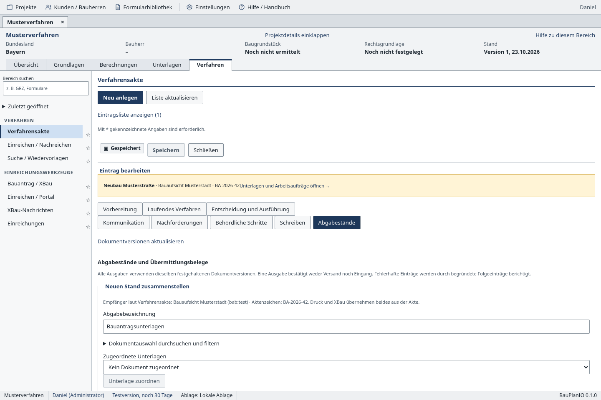

Abbildung 41.1 · Ein Abgabestand hält konkrete Versionen fest. Spätere Projektänderungen schreiben den damaligen Umfang nicht um; Versand und Eingang werden zusätzlich belegt.

### Vergleich lesen

„Neu“, „geändert“ oder „bereits eingereicht“ beziehen sich auf den dokumentierten Vergleichsstand. Eine geänderte Kategorie ist nicht automatisch ein geänderter Dateiinhalt; eine neue Dateiversion ist nicht automatisch ein bestätigter Zugang.

Der gesonderte Bereich „Einreichungen“ dient der Paket- und Versionsübersicht. Für einen laufenden Genehmigungsvorgang die Verfahrensakte als führenden Zusammenhang nutzen und keine unverbundenen Doppelvorgänge anlegen. Historische Abgaben bleiben erhalten.

### Versionsvergleich an einem einfachen Fall

Erstabgabe: Lageplan Version 1 und Baubeschreibung Version 1. Nachforderung: Der Lageplan wird korrigiert und als Version 2 gespeichert; zusätzlich entsteht ein Stellplatznachweis Version 1. Die nächste Abgabe enthält die tatsächlich nachgereichten bzw. ersetzten Versionen.

Die frühere Abgabe bleibt weiterhin mit Lageplan Version 1 verbunden. Der Versionsvergleich macht Änderung und Ergänzung sichtbar. Ob dem Amt inzwischen Version 2 vorliegt, ergibt sich aus der dokumentierten Übermittlung und dem Abgleich mit Belegen, nicht aus dem bloßen Vorhandensein von Version 2 in der Akte.

Weiterlesen: [Über das zuständige Bauportal einreichen](#42-über-das-zuständige-bauportal-einreichen) · [Workflow: Nachforderung und Nachreichung](#44-workflow-nachforderung-und-nachreichung) · [Begriffe und Abschlusscheckliste](#52-begriffe-und-abschlusscheckliste)

## 42. Über das zuständige Bauportal einreichen

Die lokale Bereitstellung mit der tatsächlichen Portalabgabe verbinden.

### Ziel und Bereitstellung

1. „Verfahren → Einreichen / Portal“ öffnen und die passende Verfahrensakte wählen.
2. Portalprofil, Kommune und HTTPS-Portaladresse erfassen. Die Zuständigkeit für die konkrete Verfahrensart prüfen und bestätigen.
3. Einen eingefrorenen Abgabestand wählen bzw. erstellen. Uploadnamen, Unterlagenarten und gegebenenfalls Ersatzbeziehungen prüfen.
4. Die Portalbereitstellung festhalten und ZIP oder einzelne Originaldateien exportieren.
5. „Portal im Systembrowser öffnen“ verwenden. Dort anmelden, den Antrag bearbeiten, Dateien entsprechend den Portalvorgaben hochladen und verbindlich absenden.
6. Versand-/Eingangsbeleg, Portalreferenz und Originaldatum sichern. Den tatsächlichen Dateiabgleich und Beleg in der Anwendung zuordnen. Ungeklärte Abweichungen ausdrücklich offen lassen.

### Was der Export bedeutet

BauPlanIO unterstützt die manuelle Übergabe. Es gibt keinen automatischen Portalversand und keine automatische Postfachabholung. Weder Browseröffnung noch Dateiexport verändern allein den Versandstatus.

Die lokale Bereitstellungs-ZIP ist kein zugesichertes Portalimportformat. Ebenso muss die Annahme einer XBau-Datei mit dem konkreten Portal geklärt sein. Gegebenenfalls Originaldateien einzeln hochladen. Rückmeldungen später als Originale importieren und der Akte zuordnen.

### Nach einem abgebrochenen Upload

1. Im Portal prüfen, ob nur ein Entwurf gespeichert wurde oder eine verbindliche Abgabe stattgefunden hat. Eine lokale ZIP-Erstellung und Browseröffnung reichen als Nachweis nicht aus.
2. Den lokal festgehaltenen Abgabestand unverändert erhalten. Bei geändertem Umfang einen neuen passenden Stand vorbereiten, statt den früheren Umfang nachträglich umzudeuten.
3. Tatsächlich hochgeladene Dateinamen und Versionen vergleichen. Bei Portalumbenennung den Bezug zur lokalen Originalversion nachvollziehbar dokumentieren.
4. Beleg, Zeitstempel und Portalreferenz sichern. Nur den tatsächlich nachgewiesenen Versand-/Eingangsstatus eintragen; unklare Übergaben offen lassen, bis der Sachverhalt geklärt ist.

Weiterlesen: [Abgabestände und Einreichungsvergleich](#41-abgabestände-und-einreichungsvergleich) · [Kommunikation, Versand und Eingang dokumentieren](#43-kommunikation-versand-und-eingang-dokumentieren) · [XBau-Nachrichten austauschen und auswerten](#46-xbau-nachrichten-austauschen-und-auswerten)

## 43. Kommunikation, Versand und Eingang dokumentieren

Originalbelege und tatsächliche Ereignisse in der Akte zusammenführen.

### Ereignis erfassen

1. Eingehendes Schreiben, E-Mail, Portalbeleg oder sonstigen Nachweis als Projektdatei importieren und kategorisieren.
2. In „Verfahrensakte → Kommunikation“ Richtung, Art, Ereignisdatum, Betreff und Bezug erfassen. Den konkreten Originalstand als Beleg zuordnen.
3. Bei einem Abgabestand Versand, bestätigten Eingang oder Zurückweisung mit tatsächlichem Datum, Übermittlungsweg und Referenz erfassen. Ein bestätigter Eingang benötigt einen Dokumentbeleg.
4. Telefonate und Besprechungen mit Datum und nachvollziehbarer Notiz dokumentieren. Diese Notiz nicht als behördliche Empfangsbestätigung einer Datei behandeln.
5. Fehler in gespeicherten Originalangaben über einen begründeten Folge-/Berichtigungseintrag korrigieren.

### Orientierung in der Oberfläche

Die folgende Abbildung zeigt einen Ausschnitt des Arbeitsablaufs im fiktiven Beispielprojekt.

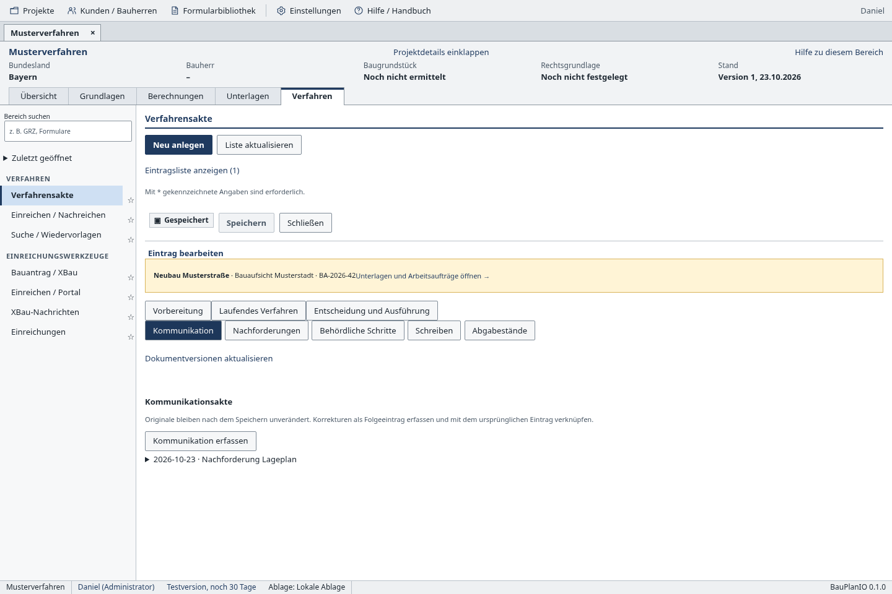

Abbildung 43.1 · Originaleingänge und tatsächliche Versand-/Eingangsereignisse mit Datum und Bezug dokumentieren. Ein gespeicherter Entwurf ist noch kein behördlicher Zugang.

### Behördenstand

Ein Export beweist keine Übermittlung, ein Versand noch keinen bestätigten Eingang und eine Eingangsbestätigung noch keine Genehmigung. Die Versionsübersicht kann nur den tatsächlich dokumentierten Behördenstand zeigen.

In einem Portal anders benannte, entfernte oder ausgetauschte Dateien mit der lokalen Bereitstellung abgleichen. Ungeklärte Übergaben zuerst klären; keinen vollständigen Dateiabgleich bestätigen, wenn Belege oder Zuordnungen fehlen.

### Ereignisdatum und Erfassungszeit unterscheiden

Eine heute erfasste Nachricht kann gestern eingegangen sein. Das tatsächliche Ereignisdatum am Original prüfen; die spätere Eingabe in der Software ist kein neuer Zugang. Versanddatum, Eingang, Zustellung und Kenntnisnahme können unterschiedliche rechtliche Bedeutung haben.

Bei Rückfragen zum Behördenstand zuerst den betreffenden Abgabestand, dessen konkrete Dateien und die zugeordneten Belege öffnen. Ein allgemeines Telefongespräch sollte nur das dokumentieren, was tatsächlich besprochen wurde. Nicht belegte Aussagen über Dateistände als ungeklärt behandeln.

Weiterlesen: [E-Mails und Anhänge dokumentieren](#29-e-mails-und-anhänge-dokumentieren) · [Über das zuständige Bauportal einreichen](#42-über-das-zuständige-bauportal-einreichen) · [Workflow: Nachforderung und Nachreichung](#44-workflow-nachforderung-und-nachreichung) · [XBau-Nachrichten austauschen und auswerten](#46-xbau-nachrichten-austauschen-und-auswerten)

## 44. Workflow: Nachforderung und Nachreichung

Einzelne Forderungspunkte, Antworten und neue Dokumentstände verfolgen.

### Nachforderung bearbeiten

1. Das behördliche Original importieren und als eingehende Kommunikation in der richtigen Verfahrensakte erfassen.
2. Unter „Nachforderungen“ die einzelnen Punkte mit Wortlaut, Grundlage, Frist, Zuständigkeit und Erinnerung anlegen. Mehrere Forderungen nicht in einem unprüfbaren Sammelstatus verstecken.
3. Jeden Punkt fachlich bearbeiten. Betroffene Berechnungen aktualisieren, neue Nachweise erzeugen und korrigierte Dateien als neue Version desselben Dokuments übernehmen.
4. Antwort und konkrete Antwortunterlagen je Punkt zuordnen. Bei Teilantworten die verbleibenden Punkte offen lassen.
5. Unter „Schreiben“ eine Antwort auf die Nachforderung vorbereiten, prüfen und als Projektunterlage ablegen.
6. Einen neuen Abgabestand mit den tatsächlichen Antwortunterlagen und Ersatzbeziehungen festhalten, im Portal einreichen und Versand/Eingang dokumentieren.
7. Den Forderungspunkt mit der tatsächlichen Abgabe verknüpfen. Eine behördliche Bestätigung erst mit einer passenden eingehenden Kommunikation erfassen.

### Orientierung in der Oberfläche

Die folgende Abbildung zeigt einen Ausschnitt des Arbeitsablaufs im fiktiven Beispielprojekt.

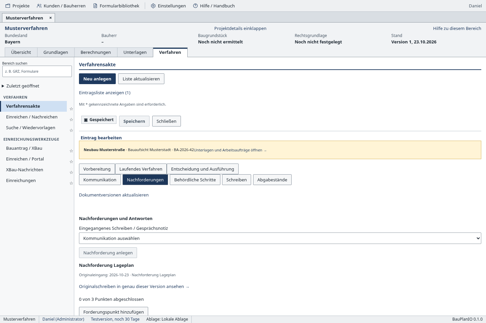

Abbildung 44.1 · Forderungen getrennt bearbeiten und Antwortunterlagen je Punkt zuordnen. Eine Teilantwort darf die übrigen offenen Forderungen nicht als erledigt darstellen.

### Frist und Wortlaut

Gespeicherter Forderungswortlaut bleibt erhalten. Ändert die Behörde den Inhalt, einen neuen Punkt erfassen und den alten begründet als entfallen führen. Friständerungen und Verlängerungen mit dem zugehörigen Schreiben belegen.

Die Antworten „in Bearbeitung“, „eingereicht“ und „behördlich bestätigt“ haben unterschiedliche Bedeutung. Eine fertige neue PDF allein erledigt keinen noch nicht übermittelten Punkt. Fristfolgen fachlich prüfen; Hinweise der Anwendung ersetzen keine Auswertung des konkreten Schreibens.

### Arbeitsbeispiel: drei Forderungspunkte

1. Das Originalschreiben enthält einen korrigierten Lageplan, einen Stellplatznachweis und eine ergänzende Baubeschreibung. Drei getrennte Punkte mit der tatsächlichen Frist und Zuständigkeit führen.
2. Lageplan Version 2 als Antwortunterlage zu Punkt 1 zuordnen. Punkt 2 bleibt in Bearbeitung, solange der Stellplatznachweis noch nicht geprüft ist.
3. Wird zunächst nur Punkt 1 übermittelt, einen entsprechend begrenzten Nachreichungsstand erstellen und den Versand dokumentieren. Die übrigen Punkte bleiben offen.
4. Nach Eingang einer weiteren behördlichen Rückmeldung deren Original erfassen. „Behördlich bestätigt“ nur verwenden, wenn die Bestätigung dem konkreten Punkt zugeordnet werden kann.

Weiterlesen: [Abgabestände und Einreichungsvergleich](#41-abgabestände-und-einreichungsvergleich) · [Schreiben und behördliche Zwischenschritte](#45-schreiben-und-behördliche-zwischenschritte) · [Kommunikation, Versand und Eingang dokumentieren](#43-kommunikation-versand-und-eingang-dokumentieren)

## 45. Schreiben und behördliche Zwischenschritte

Antworten, Fristverlängerungen und Stellungnahmen aus der Akte vorbereiten.

### Schreiben erstellen

1. In der Verfahrensakte „Schreiben“ öffnen und den passenden Anlass wählen, etwa Nachforderungsantwort, Fristverlängerung, Stellungnahme, Abweichungsantrag, Sachstandsanfrage oder Rücknahme.
2. Bezug, Antwortpunkte, gewünschtes Datum, Begründung und Anlagen ausfüllen.
3. Vorschau auf Lücken prüfen; Empfänger, Aktenzeichen und Wortlaut vor Ausgabe fachlich freigeben.
4. PDF im Briefbogen erstellen und auf Wunsch als Projektunterlage in „Schriftverkehr“ ablegen.
5. Übermittlung anschließend über Abgabestand/Portal bzw. die tatsächliche Kommunikation dokumentieren.

### Anhörung, Zurückstellung und Beteiligung

Behördliche Schritte an das eingegangene Original binden. Frist zur Stellungnahme, Ende einer Zurückstellung oder Beteiligungsfristen entsprechend dem Schreiben erfassen. Die zugehörige Antwortkommunikation bzw. spätere Entscheidung zuordnen.

Automatische Terminhinweise, Genehmigungsfiktionen oder Handlungsvorschläge hängen vom erfassten Datum und vom Regelstand ab. Ungeprüfte Landesregeln und unbekannte Hemmungen nicht als gesicherte Rechtsfrist verwenden. Im Zweifel die zuständige fachliche/rechtliche Prüfung einholen.

### Anschreiben vor Ausgabe redaktionell prüfen

Betreff und Einleitung sollen Vorhaben, Aktenzeichen und Anlass eindeutig nennen. Im Haupttext auf einzelne Forderungspunkte oder Änderungen eingehen; in den Anlagen nur tatsächlich beigefügte Unterlagen aufführen. Automatisch vorbelegte Angaben mit dem konkreten Vorgang abgleichen.

Die PDF-Vorschau auf vollständigen Text, richtige Datumsangaben, Seitenumbrüche und Briefbogen prüfen. Soll das Schreiben Bestandteil einer Einreichung sein, als Projektunterlage ablegen und dessen konkrete Version dem Abgabestand zuordnen. Das Erstellen des Schreibens ist noch kein Kommunikationsereignis an die Behörde.

Weiterlesen: [Workflow: Nachforderung und Nachreichung](#44-workflow-nachforderung-und-nachreichung) · [Bescheide, genehmigte Unterlagen und Auflagen](#47-bescheide-genehmigte-unterlagen-und-auflagen) · [Projektübersicht, Aufgaben und Chronik](#33-projektübersicht-aufgaben-und-chronik)

## 46. XBau-Nachrichten austauschen und auswerten

Strukturierte Nachrichten archivieren, prüfen und kontrolliert übernehmen.

### Ausgehende Nachrichten

XBau-Ausgänge werden aus dem Abgabestand der Verfahrensakte erzeugt. Je nach unterstützter Verfahrensart entstehen Antrag, Nachreichung oder Folgenachricht. Behördenkennung, Aktenzeichen und Nachrichtenbezug müssen zum Vorgang passen.

„Im XBau-Journal erfassen“ übernimmt die eingefrorene Nachricht als ausgehenden Journaleintrag. Das dokumentiert die Nachricht, führt aber keinen Transport zur Behörde aus. Die Nutzung im zuständigen Portal muss gesondert geklärt sein.

### Eingang prüfen und übernehmen

1. Originalnachricht bzw. Paket importieren und im Bereich „XBau-Nachrichten“ der richtigen Verfahrensakte zuordnen.
2. Nachrichtenkopf, Anlagen, Integrität, Schemaergebnis und Zuordnung prüfen. Nicht bestandene Prüfungen zuerst klären.
3. Mit „Auswerten“ die vorgeschlagenen Auswirkungen ansehen, beispielsweise Eingangsbestätigung, Aktenzeichen, Befundliste, Anhörung, Bescheid oder Gebühreninformation.
4. Zugangsdatum, Bezüge und gegebenenfalls genehmigte Unterlagen anhand der Originale bestätigen. Erst danach ausdrücklich übernehmen.
5. Die erzeugten Akteneinträge prüfen. Nicht automatisch ausgewertete Inhalte bleiben Originalkommunikation und werden bei Bedarf manuell bearbeitet.

> Schema-Konformität ist keine inhaltliche Genehmigung und keine Transportbestätigung. Die Anwendung stellt keinen universellen Direktversand an alle Behörden und keinen automatisch abgerufenen Portalposteingang bereit.

### Prüfung einer eingehenden Nachricht

| Prüfpunkt / Eingabe | Bedeutung und Kontrolle |
| --- | --- |
| Original | Nachricht und Anlagen unverändert sichern; Herkunft und konkreten Vorgangsbezug klären. |
| Technische Prüfung | Schema, Integrität und unterstützte Nachrichtenart auswerten. Bei Fehlern keine scheinbar erfolgreiche Übernahme bestätigen. |
| Fachliche Zuordnung | Behörde, Aktenzeichen, Referenznachricht und betroffene Dokumentversionen prüfen. |
| Auswirkungen | Vorgeschlagene Aktenänderungen lesen und erst danach ausdrücklich übernehmen. Nicht unterstützte Inhalte am Original bearbeiten. |
| Transport | Die lokale Verarbeitung oder Journaleintragung bestätigt weder Absendung noch behördlichen Zugang. |

Weiterlesen: [Bauantrag und XBau-Grunddaten](#39-bauantrag-und-xbau-grunddaten) · [Abgabestände und Einreichungsvergleich](#41-abgabestände-und-einreichungsvergleich) · [Über das zuständige Bauportal einreichen](#42-über-das-zuständige-bauportal-einreichen) · [Bescheide, genehmigte Unterlagen und Auflagen](#47-bescheide-genehmigte-unterlagen-und-auflagen)

## 47. Bescheide, genehmigte Unterlagen und Auflagen

Die Entscheidung mit ihren Originalen und verbindlichen Versionen festhalten.

### Entscheidung dokumentieren

1. Originalbescheid und zugehörige Unterlagen importieren. In der Akte „Bescheide / Auflagen“ öffnen.
2. Entscheidung, Zugang/Zustellung und Bezug zu versandten/eingegangenen Abgabeständen oder einer dokumentierten externen Einreichung erfassen.
3. Die ausdrücklich genehmigten Dokumentversionen zuordnen. Nicht pauschal die derzeit neuesten Projektdateien als genehmigt auswählen.
4. Nebenbestimmungen ihrer tatsächlichen Art nach erfassen: Auflage, Bedingung, Befristung, Vorbehalt oder Hinweis. Begründung, Termin/Auslöser, Zuständigkeit und Belege ergänzen.
5. Den Verfahrensstand passend zur Entscheidung speichern. Erfüllungsnachweise und spätere Folgebescheide fortlaufend dokumentieren.

### Orientierung in der Oberfläche

Die folgende Abbildung zeigt einen Ausschnitt des Arbeitsablaufs im fiktiven Beispielprojekt.

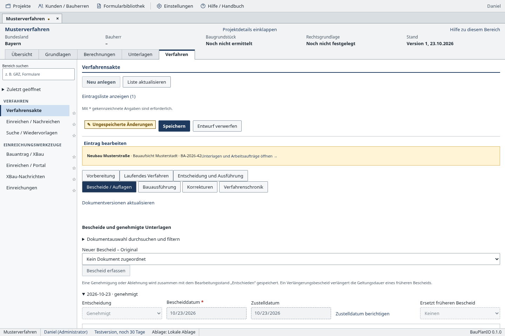

Abbildung 47.1 · Den Originalbescheid, die konkret genehmigten Versionen und Nebenbestimmungen dokumentieren. Eine spätere Planversion ist nicht automatisch vom früheren Bescheid umfasst.

### Korrektur und Folgeentscheidung

Ein gespeicherter Bescheid wird nicht nachträglich umformuliert. Falsche Zustellangaben über die vorgesehene begründete Berichtigung berichtigen; einen Folgebescheid mit seinem ausdrücklichen Ersetzungs-/Verlängerungsbezug anlegen.

Auflagen und Bedingungen können bis zur Erfüllung offen bleiben. Befristungen und Vorbehalte haben eine andere Wirkung und sind nicht wie erledigte Aufgaben abzuhaken. Bei Ablehnung Gründe und mögliche Reaktionen dokumentieren; Fristen und Rechtsbehelfsbelehrung am Original fachlich prüfen. Ein geänderter Antrag kann als verknüpftes Folgeverfahren geführt werden.

### Nachbarn und Rechtsbehelfe

Bekanntgaben an Nachbarn und deren tatsächliche Zugangsangaben im vorgesehenen Bescheidbezug dokumentieren. Ein Nachbar kann einen anderen Fristbeginn haben als die Bauherrschaft. Eine Rechtsbehelfsfrist deshalb anhand von Zustellung, Rechtsbehelfsbelehrung und tatsächlicher Verfahrenslage prüfen; den angezeigten Termin nicht ungeprüft als Rechtsberatung verwenden.

### Genehmigte Unterlagen dauerhaft unterscheiden

Der Bescheid kann ältere, abgestempelte oder ausdrücklich benannte Planstände genehmigen. Daher immer die konkret erfassten Versionen zuordnen. Die neueste Projektversion ist nicht automatisch genehmigt; spätere Planänderungen bleiben getrennt erkennbar.

Nebenbestimmungen nach ihrer tatsächlichen Art erfassen. Eine Bedingung oder Auflage benötigt gegebenenfalls Erfüllungsbelege und Termine. Ein Hinweis wird nicht als erfüllbare Pflicht abgearbeitet. Geltungsdauer, Zugang, Zustellung und Rechtsbehelfsbelehrung am Original prüfen; abgeleitete Fristinformationen nur mit geklärten Voraussetzungen verwenden.

Weiterlesen: [Nach der Genehmigung und Verfahrensabschluss](#48-nach-der-genehmigung-und-verfahrensabschluss) · [Kommunikation, Versand und Eingang dokumentieren](#43-kommunikation-versand-und-eingang-dokumentieren) · [Workflow: Nachforderung und Nachreichung](#44-workflow-nachforderung-und-nachreichung)

## 48. Nach der Genehmigung und Verfahrensabschluss

Baubeginn, Nutzungsaufnahme und verbleibende Pflichten weiterverfolgen.

### Weitere Begleitung

1. In „Verfahrensakte → Bauausführung“ die Checklisten für Baubeginn bzw. Nutzungsaufnahme öffnen.
2. Zugang der Entscheidung, Geltungsdauer, Bauleitung, erforderliche Absteckung und die jeweils notwendigen Anzeigen prüfen.
3. Bautechnische Nachweise mit zuständiger Fachperson und tatsächlichem Vorlagedatum dokumentieren. Vor Baubeginn oder Nutzungsaufnahme fällige Auflagen mit Erfüllungsbelegen abschließen.
4. Eine erforderliche Anzeige als Unterlage bzw. unterstützte Folgenachricht aus dem passenden Abgabestand erstellen und über den tatsächlichen Weg einreichen.
5. Bei Änderungen genehmigter Unterlagen den Bedarf eines Änderungsverfahrens prüfen und neue Versionen getrennt vom genehmigten Stand führen.
6. Zum Projektabschluss Akte auf offene Pflichten und fehlende Belege prüfen, Aktenexport erstellen und eine vollständige Sicherung veranlassen.

### Orientierung in der Oberfläche

Die folgende Abbildung zeigt einen Ausschnitt des Arbeitsablaufs im fiktiven Beispielprojekt.

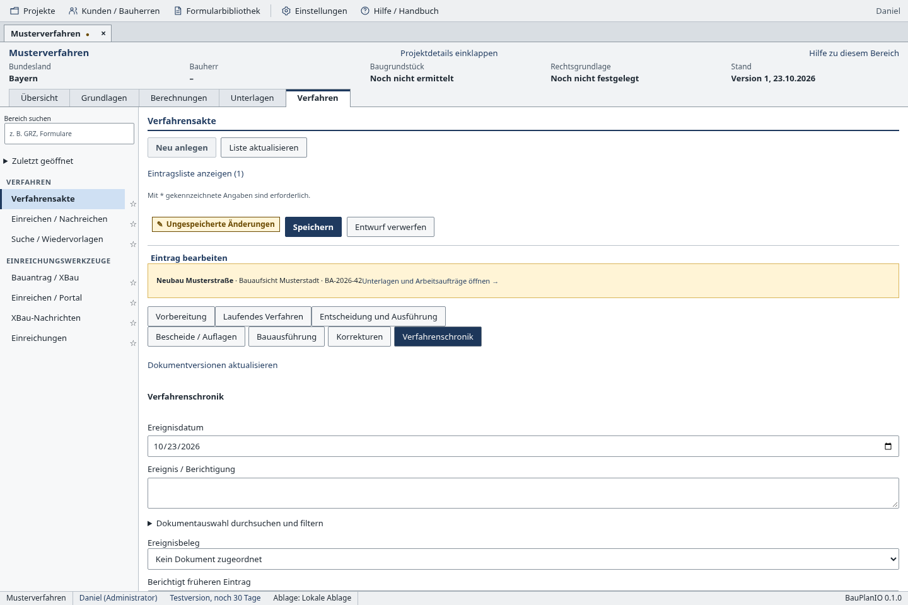

Abbildung 48.1 · Die Chronik unterstützt die Rückverfolgung von Änderungen und Verfahrensereignissen. Für die Ausführung bleiben Bescheid, genehmigte Versionen und noch offene Pflichten maßgeblich.

> Die Kennzeichnung „genehmigt“ ist keine pauschale Freigabe jeder Bauausführung. Bedingungen, Geltungsdauer, Anzeigen, bautechnische Nachweise und aktuelle Ausführungsvoraussetzungen müssen gesondert erfüllt sein.

### Übergabe an die Ausführungsplanung

Vor Beginn der Ausführung den genehmigten Dokumentensatz, offene Bedingungen und erforderliche Anzeigen zusammenstellen. Die Projektübersicht auf verbleibende Aufgaben prüfen und Verantwortliche festlegen. Ein positiver Bescheid allein erledigt keine noch offene Voraussetzung für Baubeginn oder Nutzung.

Neue Ausführungspläne und spätere behördliche Freigaben versioniert führen. Bei Abweichungen vom genehmigten Stand den nötigen Verfahrensweg klären. Zum Abschluss eine nachvollziehbare Akte mit Bescheiden, genehmigten Versionen, Nachreichungen, Belegen und fortbestehenden Pflichten übergeben.

Weiterlesen: [Bescheide, genehmigte Unterlagen und Auflagen](#47-bescheide-genehmigte-unterlagen-und-auflagen) · [Sicherung, Wiederherstellung und Aktenexport](#49-sicherung-wiederherstellung-und-aktenexport) · [Abgabestände und Einreichungsvergleich](#41-abgabestände-und-einreichungsvergleich)

## 49. Sicherung, Wiederherstellung und Aktenexport

Projektunterlagen und Projektdaten zusammen erhalten.

### Sicherung durchführen

1. Unter „Einstellungen → Sicherung und Wiederherstellung“ den angezeigten Umfang und die Betriebsart prüfen.
2. „Sicherung erstellen …“ verwenden und das Archiv außerhalb der laufenden Arbeitsablage sicher aufbewahren. Ein geeignetes büroweites Sicherungskonzept ersetzt dies nicht.
3. Mit „Archiv prüfen …“ die Integrität kontrollieren. Ein erfolgreich erzeugtes Archiv regelmäßig durch eine kontrollierte Wiederherstellung erproben.
4. Im unterstützten lokalen Ablauf „In neues Profil wiederherstellen …“ verwenden. Bestehende Arbeitsdaten werden damit nicht über eine bloße Ordnerkopie ersetzt.
5. Falls angeboten „Wiederhergestelltes Profil nach Neustart verwenden“ wählen; für die Rückkehr den angebotenen Standardprofil-Wechsel verwenden.

### Netzwerk und Aktenexport

Im Netzwerkbetrieb die angebotene Bürosicherung bzw. das administrierte Verfahren für gemeinsame Datenbank und Dateiablage nutzen. Zuständigkeit, Zugriffsrechte und Wiederherstellungsweg mit der Administration klären.

Ein Aktenexport aus der Verfahrensakte dient der nachvollziehbaren Weitergabe eines Vorgangs mit seinen Artefakten. Eine Einreichungs-ZIP enthält dagegen nur den festgehaltenen Abgabeumfang. Weder diese ZIP noch ein lesbarer Projektordner sind automatisch eine vollständige Wiederherstellung der Anwendung.

### Wiederherstellung im Büro vorbereiten

| Prüfpunkt / Eingabe | Bedeutung und Kontrolle |
| --- | --- |
| Zuständigkeit | Wer sichert Datenbank, Originalablage, Konfiguration und gegebenenfalls Formularbibliothek? Zuständigkeiten schriftlich festhalten. |
| Umfang | Den im Sicherungsdialog genannten Inhalt prüfen. Eine Sammlung ausgegebener PDFs enthält nicht die komplette Projekt- und Verfahrensstruktur. |
| Aufbewahrung | Sicherungen getrennt vom laufenden Arbeitsmedium und mit passenden Zugriffsrechten aufbewahren. |
| Probe | Integrität prüfen und eine Wiederherstellung in einem geeigneten getrennten Profil erproben. Nicht erst beim Ausfall feststellen, dass Dateien fehlen. |

Weiterlesen: [Dateiablage und lesbare Projektordner](#05-dateiablage-und-lesbare-projektordner) · [Abgabestände und Einreichungsvergleich](#41-abgabestände-und-einreichungsvergleich) · [Nach der Genehmigung und Verfahrensabschluss](#48-nach-der-genehmigung-und-verfahrensabschluss)

## 50. Durchgängiges Beispiel: Einfamilienhaus

Einen Musterablauf ohne produktive Daten ausprobieren.

### Beispielprojekt öffnen

Über „Hilfe → Beispielprojekt öffnen …“ lässt sich das mitgelieferte Projekt „Neubau Einfamilienhaus Mustermann“ in einem eigenen Profil öffnen. Die Bestätigung und den Hinweis zum Beispielprofil beachten. Veränderungen betreffen diese Arbeitskopie; die mitgelieferte Ausgangssicherung bleibt erhalten. Zur Rückkehr den angebotenen Wechsel zurück zum bisherigen Profil verwenden.

Die folgenden Zahlen sind ein zusätzliches didaktisches Beispiel. Sie sind weder Vorgabewerte des mitgelieferten Projekts noch eine Satzung oder rechtliche Musterentscheidung.

### Vom Flurstück zum Nachweis

1. Ein Vorhabenflurstück mit 500 m² erfassen. Im Beispiel seien 50 m² nach der konkret zu prüfenden Grundlage abzuziehen. Daraus ergibt sich eine Bezugsfläche von 450 m².
2. Ein Gebäude mit 120 m² Grundfläche und zwei geprüften Vollgeschossen zu je 100 m² Geschossfläche erfassen. Für eine angenommene anwendbare BauNVO 1990/2017 zusätzlich 30 m² Garage und 45 m² weitere maßgebende Nebenflächen korrekt typisieren.
3. Im vereinfachten Zahlenbeispiel ergeben sich GRZ I = 120/450 ≈ 0,267, GRZ II = (120+30+45)/450 ≈ 0,433 und GFZ = 200/450 ≈ 0,444. Mit den tatsächlichen Festsetzungen und Sonderregeln vergleichen.
4. Für zwei Wohneinheiten ergäben fiktive 1,5 Kfz-Stellplätze je WE einen Bedarf von 3 Plätzen. In einem echten Projekt stattdessen die konkrete Stellplatzsatzung und deren Rundung verwenden.

### Erstabgabe und Korrektur

Nachweise und Formulare prüfen und als Version 1 in einen Abgabestand aufnehmen. Im Portal einreichen und den Beleg zuordnen. Verlangt die Behörde eine Korrektur der Baubeschreibung, den Forderungspunkt erfassen, dasselbe Dokument als Version 2 speichern und einen neuen Abgabestand mit dieser Version festhalten.

Antwortschreiben und Version 2 tatsächlich übermitteln. Danach kann die Akte zwischen dem früher eingegangenen Stand und der Nachreichung unterscheiden. Erst mit dem Bescheid die ausdrücklich genehmigten Versionen zuordnen.

### Kontrollpunkte des gesamten Beispielablaufs

| Prüfpunkt / Eingabe | Bedeutung und Kontrolle |
| --- | --- |
| Nach Grundlagen | 500 m² tatsächliche Flurstücksfläche und 450 m² rechnerische Bezugsfläche bleiben als unterschiedliche Werte erkennbar. |
| Nach Berechnung | GRZ I, GRZ II und GFZ mit den dokumentierten Beispielansätzen überprüfen. Ergebnisse gerundet lesen; Eingaben nicht auf gerundete Quotienten zurückrechnen. |
| Nach Dokumentausgabe | Jeder Nachweis und jedes Formular als konkrete Dokumentversion vorhanden. Kategorien und Dateinamen ermöglichen einen verständlichen Paketüberblick. |
| Nach Erstabgabe | Abgabestand und Originalbeleg verbunden. Eingangsstatus nur entsprechend dem tatsächlichen Nachweis. |
| Nach Korrektur | Version 1 bleibt in der historischen Abgabe; korrigierte Version 2 erscheint in der Nachreichung. |
| Nach Genehmigung | Ausdrücklich genehmigte Versionen ausgewählt; Auflagen, Bedingungen und Ausführungsaufgaben weiterhin nachvollziehbar. |

Weiterlesen: [Workflow: Unterlagen für die Erstabgabe vorbereiten](#40-workflow-unterlagen-für-die-erstabgabe-vorbereiten) · [Workflow: Nachforderung und Nachreichung](#44-workflow-nachforderung-und-nachreichung) · [Bescheide, genehmigte Unterlagen und Auflagen](#47-bescheide-genehmigte-unterlagen-und-auflagen)

## 51. Häufige Fragen und Störungen

Gezielt zur Ursache zurückgehen und Entwürfe erhalten.

### Berechnungen

| Meldung / Beobachtung | Nächster Schritt |
| --- | --- |
| GRZ/GFZ deaktiviert | Rechtsgrundlage und fachlich zutreffende BauNVO in den Rechtsgrundlagen prüfen und speichern. |
| Baugrundstück fehlt oder ist veraltet | Gespeicherte Flurstücke, Zuordnungen und Abzüge prüfen; neu ermitteln und speichern. |
| Mehrere Grundstücke werden angezeigt | Die getrennten rechtlichen Einheiten prüfen und jede einzeln berechnen; nicht ohne Grundlage zusammenlegen. |
| Gebäude fehlt in GRZ/GFZ | Flurstückszuordnung, Gebäudetyp, Grundfläche, Geschossflächen und Einstufung im Gebäudemodell prüfen. |
| Aufmaßauswahl ist leer | Gespeicherte Markierung auf Bedeutung, Geometrie, Gebäude/Geschoss und Höhenbezug prüfen. |
| Verknüpfung veraltet | Quelle prüfen, im Verbraucher aktuellen Aufmaßstand übernehmen, speichern und erneut prüfen. |
| Nachweis nennt offene Punkte | Prüfbericht lesen; fehlende fachliche Angaben ergänzen. Eine 0 ersetzt keinen unbekannten Wert. |

### Dateien, Speichern und Abgabe

| Meldung / Beobachtung | Nächster Schritt |
| --- | --- |
| Versionskonflikt | Entwurf erhalten; aktuellen Stand mit Kollegen abstimmen. Nicht blind überschreiben oder neu importieren. |
| Datei extern geändert, App zeigt alten Stand | Arbeitskopie gezielt übernehmen oder neue Version am bestehenden Dokument importieren. |
| Formular ist gespeichert, Ordnerausgabe fehlt | Projektdateien prüfen; Ausgabeordner/Serverzugriff wiederherstellen. Nicht durch mehrfaches Speichern unverbundene Dokumente erzeugen. |
| PDF-Feld zeigt keine Eingabe oder nur eine Zeile | Vorlage auf echtes Textfeld, Schreibschutz und Mehrzeiligkeit prüfen; bei eigener Vorlage Felddefinition korrigieren. |
| Abgabestand lässt sich nicht festhalten | Genannte Anforderungen, fehlende Bezüge, Abweichungen und Aktualität der Nachweise prüfen. |
| Exportiert, aber nicht als eingereicht angezeigt | Tatsächliche Portalabgabe ausführen und Ereignis samt Originalbeleg zuordnen. |
| E-Mail-Vorschau unlesbar | Original extern öffnen; geschützte oder nur RTF-Inhalte können die Textvorschau begrenzen. |
| Keine Schreibmöglichkeit | Rechte, Dokumentensperre, laufende Aktion und Lizenzstatus prüfen. |

### Für eine Supportanfrage

App-Version, betroffenen Bereich, genaue Meldung und nachvollziehbare Schritte nennen. Projektdaten und Originale zunächst erhalten; keine verwalteten Dateien oder Datenbankdateien auf Verdacht löschen. Personenbezogene Bauherrendaten vor einer Weitergabe an Support angemessen begrenzen.

### Fehler so melden, dass sie nachvollziehbar sind

1. Projektname, betroffenen Bereich und sichtbare Meldung notieren. Einen Screenshot mit ausreichendem Kontext erstellen; personenbezogene oder vertrauliche Inhalte bei externer Weitergabe schützen.
2. Die zuletzt ausgeführten Schritte beschreiben: Quelle geändert, neue Version importiert, Berechnung geprüft, gespeichert oder exportiert? Erwartungen und tatsächliches Ergebnis getrennt nennen.
3. Ungespeicherte Eingaben erhalten bzw. angebotene lokale Sicherung verwenden. Nicht mehrfach auf Erstellen/Importieren klicken, wenn der Speicherausgang noch unklar ist.
4. Bei Dateiaktionen Dokumentname und konkrete Version nennen; bei Berechnungen Regelstand und betroffene Einheit. Diagnose nicht allein auf einen unlesbaren internen Schlüssel stützen.

Weiterlesen: [Oberfläche, Projektregister und Speichern](#02-oberfläche-projektregister-und-speichern) · [Berechnungen bearbeiten und prüfen](#13-berechnungen-bearbeiten-und-prüfen) · [PDF-Formulare im Projekt ausfüllen](#30-pdf-formulare-im-projekt-ausfüllen) · [Über das zuständige Bauportal einreichen](#42-über-das-zuständige-bauportal-einreichen)

## 52. Begriffe und Abschlusscheckliste

Die wichtigsten Zustände und Übergaben eindeutig unterscheiden.

### Begriffe

| Begriff | Bedeutung |
| --- | --- |
| Flurstück | Erfasste Katastereinheit mit tatsächlicher Fläche und gegebenenfalls Grundbuchdaten. |
| Baugrundstück / Bezugsfläche | Rechnerisch hergeleitete Einheit bzw. maßgebende Fläche für nachfolgende Nachweise. |
| Entwurf | Noch nicht verbindlich gespeicherte Eingabe; kann lokal gesichert sein. |
| Berechnung | Bearbeitbarer Ansatz mit Regeln, Quellen und aktuellem Prüfergebnis. |
| Nachweisstand | Archivierter Berechnungsstand; eine Freigabe ist ein weiterer Schritt. |
| Dokument / Version | Eine fortgeführte Unterlage und ihr konkreter unveränderlicher Dateistand. |
| Kategorie | Fachlicher Zweck einer Unterlage; unabhängig von Dateiname und Dateiformat. |
| Abgabestand | Eingefrorene Auswahl konkreter Unterlagenversionen mit Verfahrensbezug. |
| Portalbereitstellung | Vorbereitete Dateien für eine manuelle Übermittlung; noch kein Versandnachweis. |
| Versand / Eingang | Dokumentierte tatsächliche Übermittlung bzw. bestätigter Zugang. |
| Genehmigter Stand | Die ausdrücklich im Bescheid zugeordneten Unterlagenversionen. |

### Vor Projektabschluss

- Verfahren, Entscheidung und zugehörige Originalbescheide vollständig dokumentiert.
- Genehmigte Unterlagenversionen eindeutig zugeordnet; spätere Änderungen erkennbar getrennt.
- Nachforderungen mit tatsächlicher Antwortabgabe und gegebenenfalls behördlicher Bestätigung nachvollziehbar.
- Auflagen, Bedingungen und Geltungs-/Ausführungsfristen geprüft; verbleibende Pflichten verantwortlich zugeordnet.
- Versand-/Eingangsbelege, Schriftverkehr und relevante Anhänge in der Akte enthalten.
- Aktenexport geprüft und vollständige Sicherung erstellt bzw. durch die Administration bestätigt.

### Kurze Entscheidungsregel im Arbeitsalltag

Fakten an der Quelle erfassen, Berechnungen auf diesen Quellen prüfen, nachvollziehbare Nachweisstände erzeugen und konkrete Dateiversionen einreichen. Anschließend den tatsächlichen Eingang und spätere Entscheidungen belegen. Jede dieser Stufen hat eine eigene Aufgabe.

Wenn ein Wert, eine Datei oder ein Status unklar ist, zur führenden Quelle zurückgehen. Eine ähnliche Dateibezeichnung, die neueste Version oder ein grüner Status ersetzt weder die fachliche Prüfung noch den Nachweis einer Übermittlung.

Weiterlesen: [Mit BauPlanIO arbeiten](#01-mit-bauplanio-arbeiten) · [Bescheide, genehmigte Unterlagen und Auflagen](#47-bescheide-genehmigte-unterlagen-und-auflagen) · [Sicherung, Wiederherstellung und Aktenexport](#49-sicherung-wiederherstellung-und-aktenexport)
