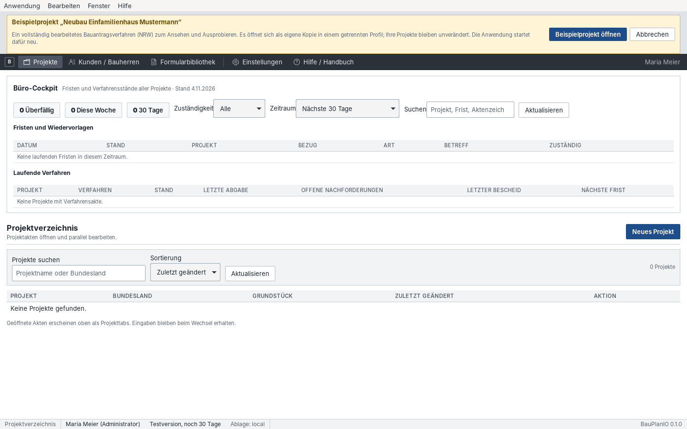

# 1 Einstieg

[← Inhalt](README.md) · [Weiter: Oberfläche und Bedienung →](02-oberflaeche.md)

## Was BauPlanIO leistet

BauPlanIO führt ein Bauvorhaben vom Flurstück bis zur genehmigten Bauausführung
in einer Projektakte zusammen:

- **Grundlagen erfassen:** Bauherrschaft, Rechtsgrundlagen (§ 30/34/35 BauGB,
  BauNVO-Fassung, Landesbauordnung), Bebauungsplanfestsetzungen, Flurstücke
  und Grundbuch.
- **Werte ermitteln:** Projektdateien versionieren, Flächen, Längen und Höhen
  auf PDF-Plänen, DXF-Zeichnungen oder eigenen Zeichnungen aufmessen und mit
  Gebäudemodell und Raumbuch verknüpfen; IFC-Modelle (BIM) prüfen,
  nacharbeiten, auswerten und als IFC-Datei weitergeben.
- **Nachweisen:** Baugrundstück, GRZ I/II, GFZ, Geschossigkeit, BMZ,
  überbaubare Fläche, Abstandsflächen, Stellplätze, Wohnflächen, DIN 277,
  Vollgeschosse, Höhen, Freiflächen und Regenwasser berechnen und als
  unveränderliche Nachweisstände archivieren.
- **Ausgeben:** amtliche PDF-Formulare mit Projektdaten ausfüllen,
  Berechnungsheft und Behördenausgabe im Briefbogen drucken.
- **Verfahren führen:** Verfahrensakte mit Behörde, Aktenzeichen,
  Unterlagenbedarf, Abgabeständen, Portalübergabe, XBau-Nachrichten,
  Nachforderungen, Bescheiden und Bauausführung.

BauPlanIO bereitet die Übergabe an das Bauportal vor und dokumentiert sie. Die
verbindliche Abgabe selbst erfolgt im Portal der zuständigen Behörde.

## Wichtige Begriffe

| Begriff | Bedeutung |
| --- | --- |
| Projektakte | Alles zu einem Bauvorhaben; wird als Projekttab geöffnet. |
| Flurstück | Katastereinheit mit amtlicher Fläche. |
| Baugrundstück | Rechnerisch gebildete Einheit aus Flurstücken mit Abzügen und Zuschlägen; Bezugsfläche für GRZ/GFZ. |
| Aufmaß | Messungen auf einer Unterlage (PDF/DXF) oder eigenen Zeichnung. Eine einzelne Fläche, Strecke oder Höhe darin heißt Markierung. |
| Übernahme / Verknüpfung | Ein Messwert wird in ein Zielfeld (z. B. Gebäudegrundfläche) übernommen und bleibt mit der Markierung verbunden. |
| Nachweisstand | Archivierter, unveränderlicher Stand einer Berechnung. Freigabe ist ein eigener Schritt. |
| Abgabestand | Eingefrorene Auswahl konkreter Dokumentversionen für eine Einreichung. |

Ausführliches Glossar: [Kapitel 10](10-anhang.md#begriffe).

## Beispielprojekt öffnen

Das mitgelieferte Beispielprojekt ist ein vollständig bearbeitetes
Bauantragsverfahren (Einfamilienhaus mit Garage in NRW, Bauantrag im Bauportal
eingereicht, eine offene Nachforderung). Es eignet sich zum Ausprobieren und
zum Schulen neuer Kolleginnen und Kollegen.

1. Menü **Hilfe → Beispielprojekt öffnen** wählen.
2. Den Hinweis lesen und **Beispielprojekt öffnen** bestätigen. Die Anwendung
   startet neu und öffnet eine eigene Kopie in einem getrennten Profil.

Solange das Beispiel geöffnet ist, steht oben ein gelber Hinweis „Sie arbeiten
im Beispielprojekt“. Änderungen betreffen nur diese Kopie; Ihre eigenen
Projekte bleiben unverändert. **Zu meinen Projekten zurückkehren** startet die
Anwendung wieder mit Ihrem bisherigen Profil. Beim nächsten Öffnen können Sie
die bearbeitete Kopie fortsetzen oder neu beginnen.

> In den Bildern dieses Handbuchs ist der gelbe Hinweis ausgeblendet, damit sie
> der normalen Arbeit entsprechen.

## Empfohlene Reihenfolge im Projekt

1. Büro einrichten (einmalig): [Kapitel 3](03-einrichtung.md).
2. Projekt anlegen, Grundlagen und Flurstücke erfassen: [Kapitel 4](04-projekt-grundlagen.md).
3. Pläne ablegen, aufmessen, Gebäude und Räume aufbauen: [Kapitel 5](05-ermittlung.md).
4. Baugrundstück und Nachweise berechnen, archivieren, freigeben: [Kapitel 6](06-nachweise.md).
5. Formulare ausfüllen und Unterlagen drucken: [Kapitel 7](07-formulare-druck.md).
6. Verfahrensakte führen, einreichen, Rückmeldungen dokumentieren: [Kapitel 8](08-verfahren.md).

Die Abläufe als Checklisten stehen in [Kapitel 9](09-workflows.md).
