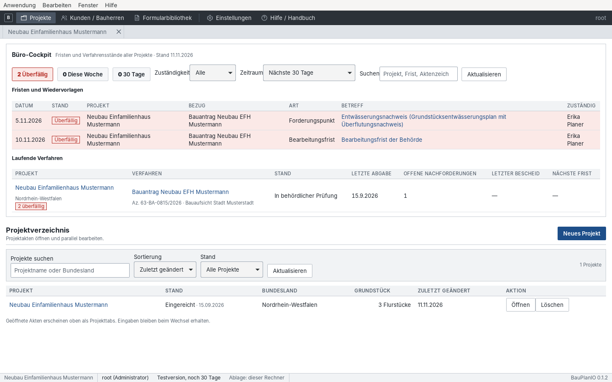
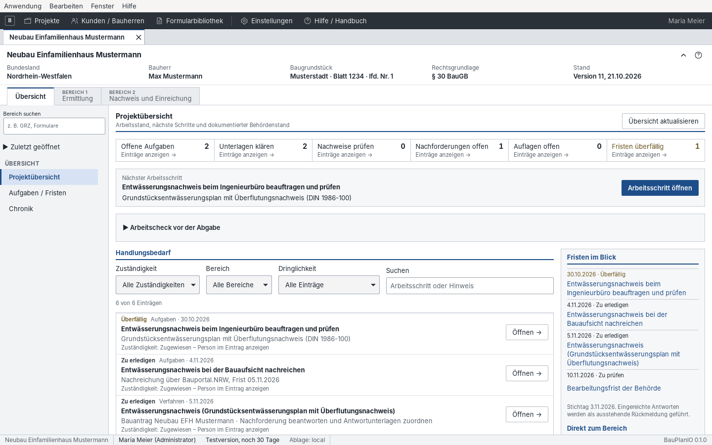
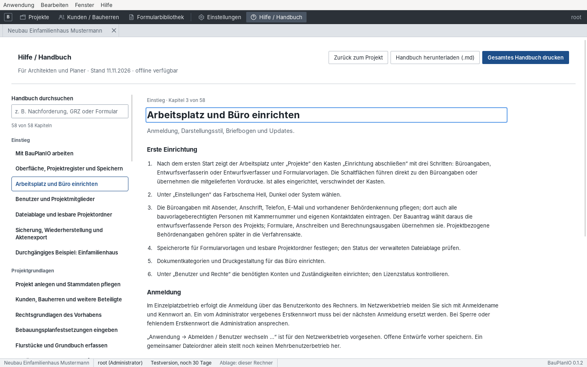

# 2 Oberfläche und Bedienung

[← Einstieg](01-einstieg.md) · [Inhalt](README.md) · [Weiter: Büro einrichten →](03-einrichtung.md)

## Arbeitsplatz und Projektverzeichnis

Nach dem Start zeigt BauPlanIO das **Projektverzeichnis**.

Die dunkle Leiste oben ist der **Arbeitsplatz**. Sie bleibt in jeder Ansicht
gleich:

| Eintrag | Inhalt |
| --- | --- |
| Projekte | Projektverzeichnis mit Suche, Sortierung, „Öffnen“ und „Löschen“ |
| Kunden / Bauherren | Kundenstamm, der Projekten als Bauherrschaft zugeordnet wird ([Kapitel 3](03-einrichtung.md#kunden-und-bauherren)) |
| Formularbibliothek | Projektunabhängige PDF-Vorlagen ([Kapitel 3](03-einrichtung.md#formularbibliothek)) |
| Einstellungen | Darstellung, Speicherorte, Sicherung, Büroangaben, Benutzer, Lizenz, Updates |
| Hilfe / Handbuch | Eingebaute Kurzhilfe mit Suche (auch mit F1) |

Rechts steht der angemeldete Benutzer. Die **Statusleiste** unten nennt die
aktuelle Ansicht, Benutzer und Rolle, Lizenzstand, Ablageart und
Programmversion.

### Menüleiste

| Menü | Befehle |
| --- | --- |
| Anwendung | Neues Projekt … (Strg+N), Projekt öffnen … (Strg+O), Zuletzt geöffnet, Projekt schließen (Strg+W), Projekt speichern (Strg+S), Einstellungen …, Abmelden / Benutzer wechseln … (Netzwerkbetrieb), Beenden (Strg+Q) |
| Bearbeiten | Rückgängig (Strg+Z), Wiederholen (Strg+Umschalt+Z), Ausschneiden, Kopieren, Einfügen, Alles auswählen |
| Fenster | Vergrößern / Verkleinern / Originalgröße (Strg+= / Strg+- / Strg+0), Vollbild |
| Hilfe | Bedienhandbuch (F1), Beispielprojekt öffnen, Nach Updates suchen …, Über BauPlanIO |

## Projekttabs

Ein geöffnetes Projekt erscheint als **Projekttab** unter dem Arbeitsplatz.
Mehrere Projekte können parallel offen sein; Eingaben bleiben beim Wechsel
zwischen Tabs und zum Arbeitsplatz erhalten. Ein Punkt am Tab zeigt
ungespeicherte Änderungen. Das × schließt nur die Arbeitsakte – Löschen ist
ein eigener Vorgang im Projektverzeichnis.

## Aufbau der Projektakte

1. **Aktenkopf** mit Bundesland, Bauherr, Baugrundstück, Rechtsgrundlage und
   Stand. „Projektdetails einklappen“ schafft Platz; im Aufmaß ist der Kopf
   von vornherein eingeklappt. Die Wahl bleibt je Arbeitsplatz erhalten.
   „Hilfe zu diesem Bereich“ öffnet das passende Hilfekapitel.
2. **Projektbaum links** mit der ganzen Akte, aufgebaut wie der Ebenenbaum im
   Zeicheneditor. Oberste Ebene sind die drei Register:
   - **Übersicht** – Projektübersicht, Aufgaben / Fristen, Projekttagebuch,
     Fachplaner, Chronik.
   - **Bereich 1 · Ermittlung** – alles, was Werte erzeugt: Grundlagen,
     Unterlagen, Aufmaß, Messwerte, Gebäudemodell.
   - **Bereich 2 · Nachweis und Einreichung** – alles, was Werte verarbeitet
     und ausgibt: Berechnungen, Formulare, Druck, Verfahren und
     Einreichungswerkzeuge.
3. **Zweige auf- und zuklappen:** Ein Klick auf ein Register oder eine Gruppe
   klappt sie auf oder zu; „Alle zuklappen“ bzw. „Alle aufklappen“ oben im Baum
   wirkt auf alle Zweige. Die App merkt sich die Wahl je Projekt. Der Zweig des
   geöffneten Bereichs bleibt immer aufgeklappt.
   - **Bereich suchen** (Strg+K) findet Bereiche und Aktionen, z. B. „GRZ“,
     „Formulare“, „Drucken“ oder „Aktuellen Bereich speichern“.
   - Der **Stern** neben einem Eintrag merkt ihn als Favorit; „Zuletzt geöffnet“
     listet die letzten fünf Bereiche.
   - Ein ausgegrauter Eintrag ist noch gesperrt. Beim Darüberfahren nennt er
     die fehlenden Schritte (z. B. fehlende Rechtsgrundlage für GRZ).
4. **Statussymbole** rechts neben den Einträgen zeigen den Stand jedes
   Bereichs. Die Form unterscheidet die Zustände auch ohne Farbe; das **?**
   oben im Baum öffnet dieselbe Legende in der Anwendung:

   | Symbol | Stand | Bedeutung |
   | --- | --- | --- |
   | rotes Kreuz | Problem | Anforderung nicht eingehalten, Prüffehler oder Frist überschritten |
   | blauer Punkt | Nicht gespeichert | Änderungen in diesem Bereich sind noch nicht gespeichert |
   | oranger Pfeil | Veraltet | Eine Grundlage hat sich geändert: Nachweis neu erstellen bzw. neu prüfen |
   | gelber Halbkreis | In Arbeit | Begonnen, aber Angaben, Messwerte, Prüfung oder Freigabe fehlen |
   | grauer Ring | Zu erledigen | Wird benötigt, es ist aber noch nichts erfasst |
   | grüner Haken | Geprüft | Vollständig, aktuell und fachlich geprüft bzw. freigegeben |
   | kein Symbol | – | Nicht benötigt, leer oder noch gesperrt |

   Beim Darüberfahren steht am Symbol, was fehlt oder was das Problem ist.
   **Grün gibt es nur mit einem Prüfsignal**, nie allein deshalb, weil ein
   Wert eingetragen ist:
   - Berechnungen (GRZ, Wohnflächen, Stellplätze, Abstandsflächen …) werden
     grün, wenn ihr neuester Nachweis aktuell, vollständig, eingehalten und
     vom Büro freigegeben ist. Ohne Nachweis oder ohne Freigabe bleiben sie
     gelb, mit geänderten Grundlagen orange, nicht eingehalten rot.
   - Pflichtangaben (Stammdaten, Rechtsgrundlagen, Flurstücke) werden grün,
     wenn alles Verlangte angegeben ist. Ist in den Rechtsgrundlagen ein
     Bebauungsplan gewählt, sind die Planfestsetzungen grau, bis das Maß der
     Nutzung (z. B. GRZ, GFZ oder Vollgeschosse) eingetragen ist.
   - Aufmaß: grün, wenn jeder Plan einen Maßstab hat und jede Aufmaßaufgabe
     einen Messwert. Gebäude: Geschosse eingestuft, Flurstücke zugeordnet.
     Raumbuch: jeder Raum mit Fläche und Nutzung. Planliste: jeder Plan mit
     Index und Dokument. Verfahren: erst mit der Entscheidung der Behörde.
   - Listen wie Aufgaben, Projekttagebuch, Fachplaner oder Projektdateien
     werden nie grün: Sie sind gelb, solange Einträge offen sind, rot bei
     überfälligen Einträgen und sonst ohne Symbol.
   - Gibt es Wohnflächen oder DIN-277-Flächen, verlangt das Raumbuch Einträge
     (grau, solange es leer ist). Offene Arbeitspunkte der Projektübersicht
     machen den Bereich gelb, zu dem sie führen; überfällige Fristen rot.
   - Ein Register oder eine Gruppe zeigt das dringendste Symbol der Bereiche
     darunter (Rot vor Blau, Orange, Gelb, Grau und Grün).
   - **Nur offene** oben im Baum blendet alles Geprüfte und Leere aus.
   - Steht man in einem nicht grünen Bereich, nennt eine farbige Zeile über
     der Arbeitsfläche, was dort noch fehlt.
   - Über **⋯** neben einem leeren Bereich lässt er sich **als nicht benötigt
     kennzeichnen**. Er erscheint dann kursiv und bleibt ohne Symbol. Die
     Kennzeichnung wird in der Akte gespeichert, steht im Verlauf der
     Projektorganisation und lässt sich mit „Wieder als benötigt führen“
     zurücknehmen. Sobald der Bereich Daten enthält, gilt sie nicht mehr.
5. **Arbeitsfläche** rechts mit dem gewählten Bereich.

Die vollständige Gliederung:

| Register | Gruppe | Bereiche |
| --- | --- | --- |
| Übersicht | – | Projektübersicht, Aufgaben / Fristen, Projekttagebuch, Fachplaner / Lieferungen, Chronik |
| Ermittlung | Grundlagen | Stammdaten, Rechtsgrundlagen, Planfestsetzungen, Flurstücke |
| | Unterlagen | Projektdateien, Aufmaß, Messwerte, Unterlagenregister |
| | Gebäudemodell | Gebäude / Geschosse, Flächen- und Raumbuch |
| Nachweis und Einreichung | Grundstück und Nutzung | Baugrundstück, GRZ, GFZ, Geschossigkeit, Bauvolumen / BMZ, Überbaubare Grundstücksfläche |
| | Gebäude und Flächen | Wohnflächenberechnung, DIN-277-Flächen, Vollgeschossprüfung, Gebäudehöhen |
| | Weitere Nachweise | Stellplatznachweis, Abstandsflächen, Versiegelung / Freiflächen, Regenwasser / Rückhaltung, Nachweisstände |
| | Formulare und Ausgabe | Formulare, Drucken / PDF-Ausgabe |
| | Verfahren | Verfahrensakte, Einreichen / Nachreichen, Suche / Wiedervorlagen |
| | Einreichungswerkzeuge | Bauantrag / XBau, Einreichen / Portal, XBau-Nachrichten, Einreichungen |

## Listen und Eintragsformulare

Viele Bereiche (Gebäude, Raumbücher, Fachberechnungen, Verfahrensakte,
Aufgaben) führen mehrere Einträge. Sie sehen zuerst eine **Eintragsliste** mit
„Neu anlegen“ und „Liste aktualisieren“. „Öffnen“ lädt einen Eintrag ins
Formular darunter, „Verlauf“ zeigt seine gespeicherten Versionen. Während Sie
bearbeiten, lässt sich die Liste mit „Eintragsliste anzeigen“ einklappen.

## Eingaben, Speichern und Entwürfe

- Felder mit **\*** sind Pflichtfelder (gelb hinterlegt). Eine leere Zahl ist
  nicht dasselbe wie die ausdrückliche Angabe 0.
- **Gestrichelt umrandete** Felder sind schreibgeschützt, weil der Wert aus
  einer Quelle kommt (z. B. aus dem Aufmaß oder dem Gebäudemodell). Geändert
  wird er an der Quelle.
- **Speichern** sichert den Bereich. Berechnen, Archivieren, Freigeben und
  Einreichen sind jeweils eigene Schritte mit eigener Bedeutung.
- Ungespeicherte Änderungen bleiben beim Wechsel erhalten. Vor dem Schließen
  fragt die App nach. Nach einem Absturz wird ein lokaler Entwurf zur
  Wiederherstellung angeboten.
- Bei gleichzeitiger Bearbeitung durch eine Kollegin meldet die App einen
  **Versionskonflikt**. Ihre Eingaben bleiben erhalten; stimmen Sie sich ab,
  bevor Sie den aktuellen Stand laden.
- Ein Eingabefehler öffnet den betroffenen Abschnitt und setzt den Fokus in
  das Feld.

### Bearbeitungsstände

Statusanzeigen kombinieren Symbol und Text. „Was bedeuten die
Bearbeitungsstände?“ klappt die Erklärung auf.

| Symbol | Stand | Bedeutung |
| --- | --- | --- |
| ✎ | Ungespeicherte Änderungen | Noch nicht Teil des gespeicherten Projektstands |
| ▣ | Gespeichert | Eingaben gespeichert; Berechnung und Freigabe stehen aus |
| ≙ | Berechnet | Ergebnis passt zu den angezeigten Eingaben |
| ▣ | Archiviert | Unveränderlicher Nachweisstand |
| ↻ | Grundlagen geändert | Neuen Nachweis erstellen, der Archivstand bleibt |
| ! | Zu prüfen | Offene Angaben oder fachliche Prüfung nötig |
| ✓ | Fachlich freigegeben | Bürofreigabe – keine Einreichung oder Genehmigung |
| ↗ | Exportiert | Dateien bereitgestellt; Versand und Eingang separat |

### Datenherkunft und nächste Schritte

Oben in vielen Bereichen steht die aufklappbare Leiste **„Datenherkunft und
nächste Schritte“**. Sie zeigt, aus welchen Bereichen die Werte stammen, ob
dort noch ungespeicherte Entwürfe liegen („Nur diese Quelle speichern“), und
führt mit einem Rückweg wieder zurück zur aufrufenden Berechnung.

## Eingebaute Hilfe

„Hilfe / Handbuch“ oder F1 öffnet die eingebaute Kurzhilfe mit Volltextsuche,
Download als Markdown und Gesamtdruck. „Hilfe zu diesem Bereich“ im Aktenkopf
springt direkt zum passenden Kapitel. Ein Wechsel zur Hilfe schließt keine
Akte; „Zurück zum Projekt“ führt zurück.

