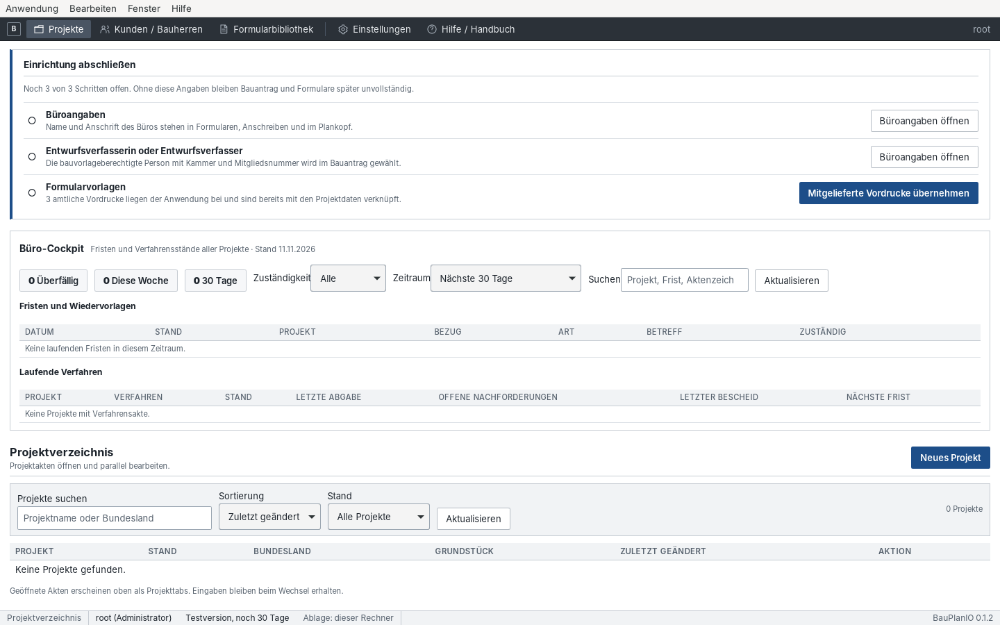
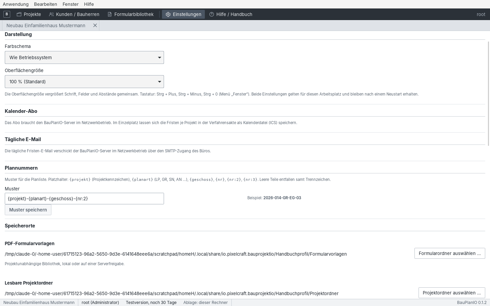
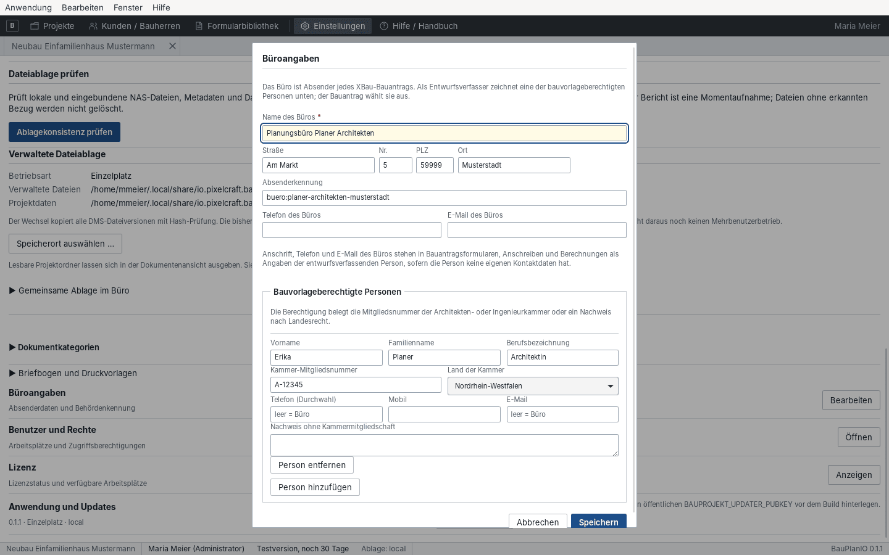
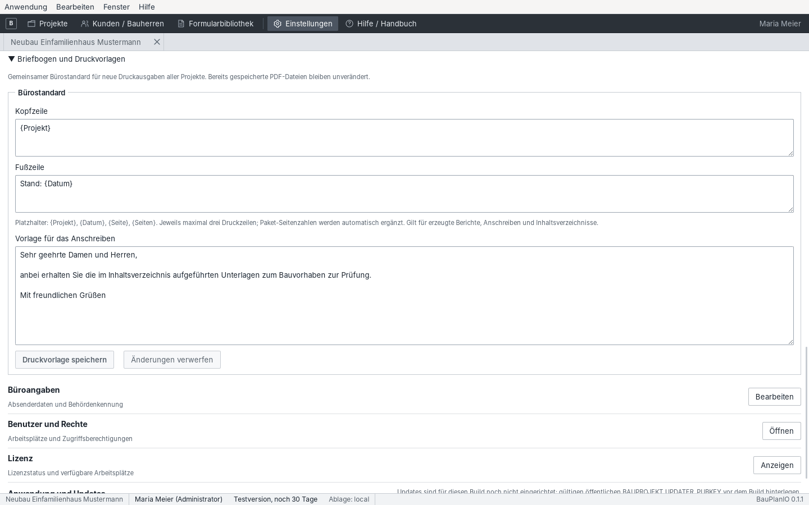
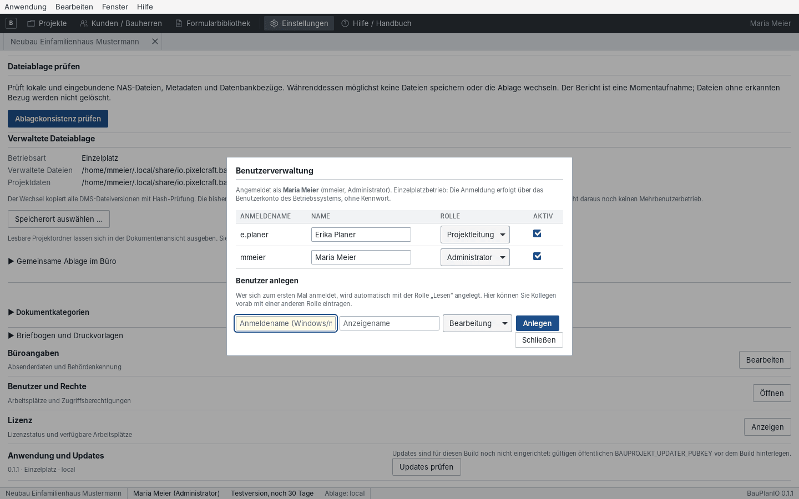
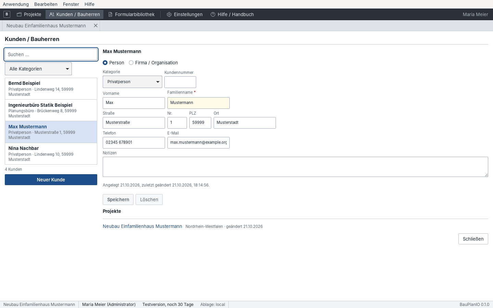
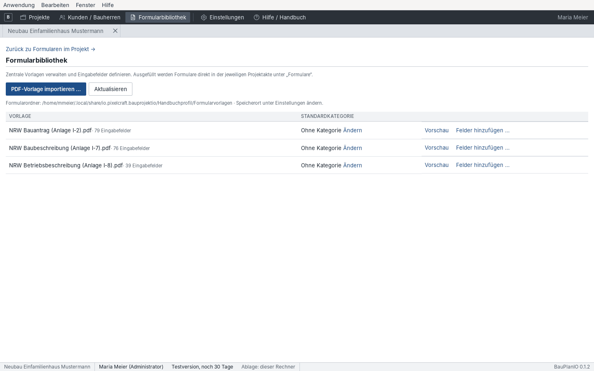

# 3 Büro einrichten

[← Oberfläche](02-oberflaeche.md) · [Inhalt](README.md) · [Weiter: Projekt und Grundlagen →](04-projekt-grundlagen.md)

Die Einrichtung erfolgt einmal je Büro bzw. Arbeitsplatz unter
**Einstellungen** im Arbeitsplatz. Einige Punkte benötigen die Rolle
Administrator.

## Einrichtung abschließen

Solange dem Büro etwas für den ersten Bauantrag fehlt, zeigt der Arbeitsplatz
unter **Projekte** oberhalb der Büroübersicht den Kasten **„Einrichtung
abschließen“** mit drei Schritten:

| Schritt | Erledigt, wenn | Schaltfläche |
| --- | --- | --- |
| Büroangaben | Name und Ort des Büros eingetragen sind | „Büroangaben öffnen“ |
| Entwurfsverfasserin oder Entwurfsverfasser | mindestens eine bauvorlageberechtigte Person angelegt ist | „Büroangaben öffnen“ |
| Formularvorlagen | mindestens eine Vorlage in der Formularbibliothek steht | „Mitgelieferte Vordrucke übernehmen“ |

Erledigte Schritte sind abgehakt. Ist alles eingerichtet, verschwindet der
Kasten.

## Einstellungen im Überblick

| Abschnitt | Wofür |
| --- | --- |
| Darstellung | Farbschema Hell, Dunkel oder „Wie Betriebssystem“ und Oberflächengröße (90 bis 150 %, auch mit Strg + Plus / Minus / 0) für diesen Arbeitsplatz |
| Speicherorte | Ordner der **PDF-Formularvorlagen** (projektunabhängig, auch Serverfreigabe) und der **lesbaren Projektordner** (Ausgaben unter „Dokumente“ und „Pläne“) |
| Sicherung und Wiederherstellung | „Sicherung erstellen …“, „Archiv prüfen …“, „In neues Profil wiederherstellen …“ |
| Dateiablage prüfen | „Ablagekonsistenz prüfen“ vergleicht Dateien, Metadaten und Datenbankbezüge (löscht nichts) |
| Verwaltete Dateiablage | Betriebsart und Ort der verbindlichen Dokumentversionen; „Speicherort auswählen …“ kopiert mit Prüfsummen um |
| Gemeinsame Ablage im Büro | Hinweise und Einstellungen für NAS/Server im Netzwerkbetrieb |
| Dokumentkategorien | Haupt- und Unterkategorien für Projektdateien (Lageplan, Baubeschreibung, E-Mail …) |
| Briefbogen und Druckvorlagen | Kopf- und Fußzeile, Anschreiben-Vorlage für Ausgaben |
| Büroangaben | Absender, Anschrift, Kennung und bauvorlageberechtigte Personen |
| Benutzer und Rechte | Konten, Rollen, Erstkennwörter (Netzwerk) |
| Lizenz | Lizenzstand, Arbeitsplätze, Lizenzdatei einspielen |
| Anwendung und Updates | Version, „Updates prüfen“ |

> Projektordner sind lesbare **Kopien**. Verbindlich ist die verwaltete
> Ablage. Eine außerhalb der App geänderte Datei wird erst durch ausdrücklichen
> Import zur neuen Version. Ein Projektordner ersetzt keine Sicherung.

## Büroangaben und bauvorlageberechtigte Personen

„Büroangaben → Bearbeiten“ öffnet die Absenderdaten des Büros.

1. Namen, Anschrift, Telefon und E-Mail des Büros eintragen. Die
   **Absenderkennung** wird im XBau-Bauantrag verwendet.
2. Unter **Bauvorlageberechtigte Personen** jede entwurfsverfassende Person mit
   Kammer-Mitgliedsnummer und Land der Kammer anlegen („Person hinzufügen“).
   Ohne Kammermitgliedschaft den Nachweis nach Landesrecht beschreiben.
3. Eigene Durchwahl und E-Mail nur eintragen, wenn sie von den Büroangaben
   abweichen.
4. Speichern. Der Bauantrag wählt die entwurfsverfassende Person später aus
   dieser Liste; Formulare, Anschreiben und Berechnungen übernehmen ihre Daten.

## Briefbogen und Druckvorlagen

Kopf- und Fußzeile gelten für alle erzeugten Berichte und Anschreiben
(höchstens drei Zeilen). Platzhalter: `{Projekt}`, `{Datum}`, `{Seite}`,
`{Seiten}`. Die „Vorlage für das Anschreiben“ ist der Standardtext jeder
Behördenausgabe und kann je Ausgabe angepasst werden. Mit „Druckvorlage
speichern“ sichern. Amtliche PDF-Formulare erhalten keinen zusätzlichen
Briefkopf.

## Benutzer und Rechte

- **Einzelplatzbetrieb:** Die Anmeldung erfolgt automatisch mit dem
  Benutzerkonto des Rechners. Weitere Konten werden mit ihrem
  Windows-Anmeldenamen angelegt.
- **Netzwerkbetrieb:** Jeder meldet sich mit eigenem Anmeldenamen und
  Kennwort an (auch beim Rechnerwechsel). Ein vergebenes Erstkennwort muss bei
  der ersten Anmeldung ersetzt werden. „Anwendung → Abmelden / Benutzer
  wechseln …“ wechselt das Konto.
- **Rollen:** Lesen, Bearbeitung, Projektleitung, Administrator. Der Zugriff
  auf ein Projekt wird zusätzlich über die **Projektmitglieder** gesteuert
  ([Kapitel 4](04-projekt-grundlagen.md#stammdaten)).

| Rolle / Projektrecht | Darf |
| --- | --- |
| Lesen | Daten und Nachweise ansehen; Felder sind gesperrt |
| Bearbeiten | Projektangaben und Unterlagen bearbeiten |
| Projektleitung | zusätzlich Freigaben und Projektmitglieder verwalten |
| Administrator | Konten, Büro- und Ablagekonfiguration |

> Mehrere Arbeitsplätze brauchen eine gemeinsame PostgreSQL-Datenbank und eine
> gemeinsame Dateiablage. Eine SQLite-Datei auf einer Netzwerkfreigabe ist dafür
> nicht vorgesehen. Die Einrichtung übernimmt die Administration.

## Sicherung

1. „Sicherung erstellen …“ wählen und das Archiv außerhalb der Arbeitsablage
   aufbewahren (Büro-Backup).
2. Mit „Archiv prüfen …“ die Vollständigkeit kontrollieren.
3. Zum Wiederherstellen „In neues Profil wiederherstellen …“ verwenden. Die
   Wiederherstellung überschreibt keine bestehenden Projekte; nach dem
   Neustart arbeitet die App mit dem wiederhergestellten Profil. „Nach Neustart
   zum Standardprofil zurückkehren“ führt zurück.

Im Netzwerkbetrieb gilt das administrierte Sicherungsverfahren für Datenbank
und Ablage.

## Kunden und Bauherren

Kunden (Privatpersonen, Firmen, Bauträger, Planungsbüros) werden einmal im
Kundenstamm erfasst und Projekten als Bauherrschaft zugeordnet. Änderungen
gelten sofort in allen Projekten.

1. Erst suchen, dann „Neuer Kunde“. Art (Person oder Firma / Organisation),
   Name, Anschrift und Kontakt erfassen, „Speichern“.
2. Unter **Projekte** sieht man, wo der Kunde Bauherr ist.
3. Die Zuordnung zum Projekt erfolgt in der Akte unter „Stammdaten →
   Bauherren …“.

## Formularbibliothek

Die Formularbibliothek enthält die PDF-Vorlagen des Büros, unabhängig von
Projekten. Ausgefüllt wird später in der Projektakte unter „Formulare“.

1. **„Mitgelieferte Vordrucke übernehmen“** legt die der Anwendung
   beiliegenden amtlichen NRW-Vordrucke (Bauantrag Anlage I/2,
   Baubeschreibung Anlage I/7, Betriebsbeschreibung Anlage I/8) in die
   Bibliothek. Der Hinweis erscheint, solange einer davon fehlt. Weitere
   Vordrucke mit „PDF-Vorlage importieren …“ als unverändertes amtliches PDF
   hinzufügen. Die Liste zeigt die erkannten Eingabefelder.
2. „Vorschau“ zur Kontrolle; „Ändern“ setzt eine **Standardkategorie** für
   daraus erzeugte Projektdokumente.
3. Fehlen Eingabefelder (nicht ausfüllbares PDF), mit **„Felder hinzufügen …“**
   Textfelder oder Kontrollkästchen auf der Seite platzieren, eindeutig
   benennen (z. B. „Anschrift“, mehrzeilig) und „Vorlage erstellen“.
4. Für die mitgelieferten NRW-Vordrucke sind Zuordnungen hinterlegt, mit
   denen Projektdaten automatisch vorgeschlagen werden.

Eine geänderte Vorlage ändert bereits ausgefüllte Projektdokumente nicht.

> Für andere Bundesländer liegen noch keine Vordrucke bei. Die amtlichen PDFs
> des Landes lassen sich importieren; Projektdaten werden dann je Feld über
> „Quelle“ zugeordnet.
