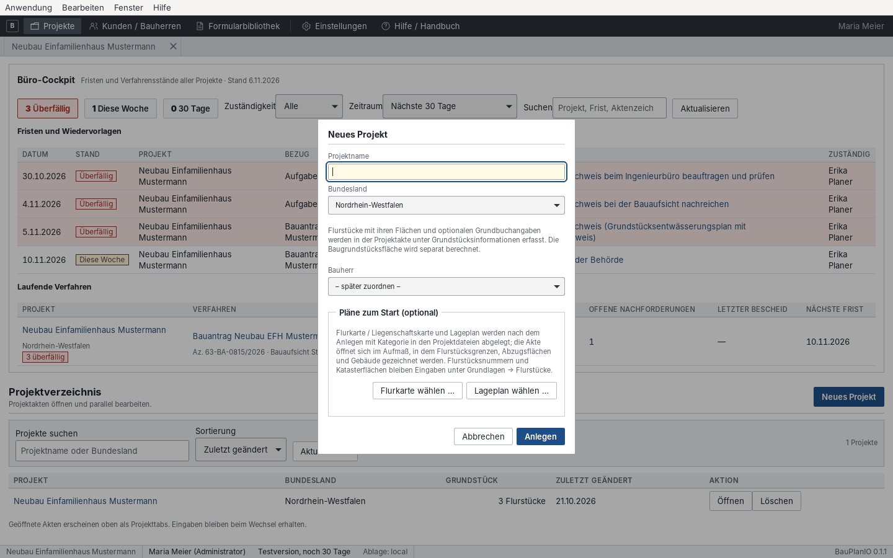
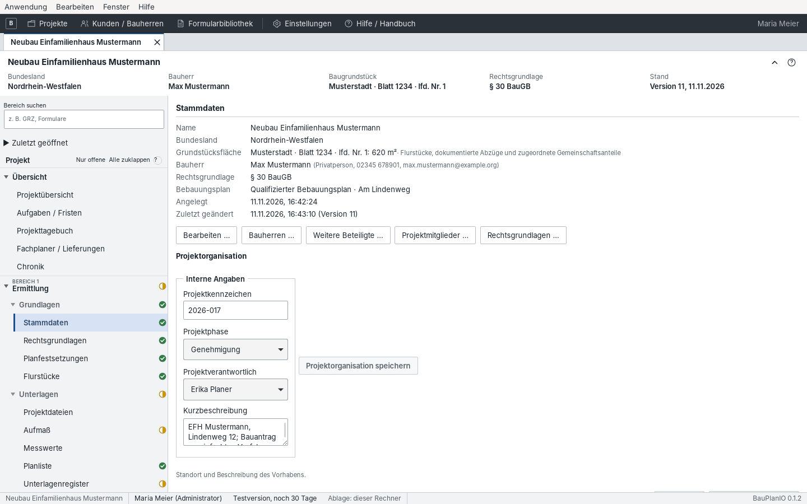
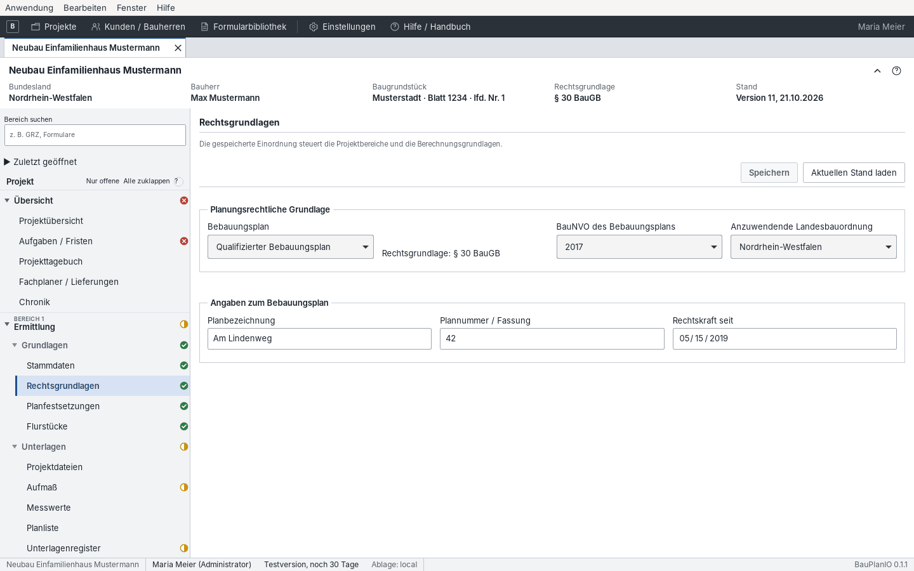
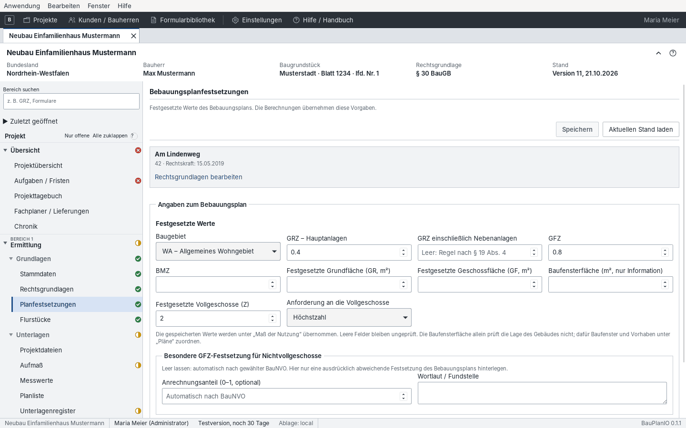
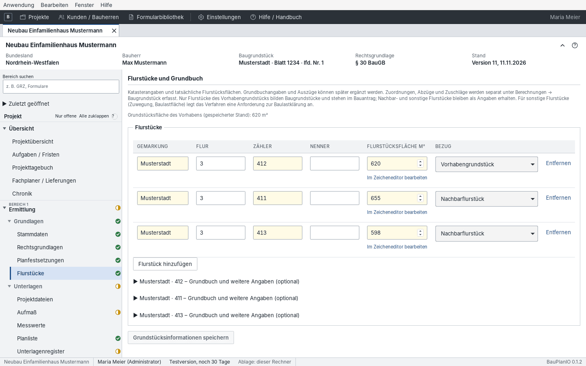

# 4 Projekt anlegen und Grundlagen erfassen

[← Büro einrichten](03-einrichtung.md) · [Inhalt](README.md) · [Weiter: Unterlagen, Aufmaß, Gebäudemodell →](05-ermittlung.md)

Alle Bereiche dieses Kapitels liegen in der Projektakte unter **Bereich 1 ·
Ermittlung → Grundlagen**.

## Neues Projekt

1. Im Projektverzeichnis **Neues Projekt** (oder Strg+N).
2. **Projektname** eindeutig wählen (z. B. „Neubau EFH Mustermann, Lindenweg 12“).
3. **Bundesland** des Vorhabens wählen. Es steuert Landesbauordnung,
   Regelpakete, Verfahrensarten und Formulare und sollte von Anfang an stimmen.
4. **Bauherr** aus dem Kundenstamm wählen oder „später zuordnen“.
5. Optional **Pläne zum Start**: „Flurkarte wählen …“ und „Lageplan wählen …“.
   Die PDFs werden mit Kategorie in den Projektdateien abgelegt, und die Akte
   öffnet direkt im Aufmaß, wo Flurstücksgrenzen, Abzugsflächen und Gebäude
   gezeichnet werden.
6. **Anlegen**. Das Projekt öffnet als Projekttab.

## Stammdaten

Die Stammdaten zeigen Name, Bundesland, Grundstücksfläche, Bauherr,
Rechtsgrundlage und Bebauungsplan auf einen Blick. Die Knöpfe darunter öffnen
die zugehörigen Dialoge:

| Knopf | Inhalt |
| --- | --- |
| Bearbeiten … | Projektname, Bundesland, Vorhabenbeschreibung |
| Bauherren … | Bauherrschaft aus dem Kundenstamm zuordnen (mehrere möglich) |
| Weitere Beteiligte … | Fachplaner, Tragwerksplanung, Vermesser, Nachbarn … |
| Projektmitglieder … | Wer im Büro das Projekt lesen, bearbeiten oder leiten darf |
| Rechtsgrundlagen … | Sprung zu den Rechtsgrundlagen |

Die **Anschrift des Baugrundstücks** (Straße, Hausnummer, Postleitzahl, Ort)
wird nur hier erfasst. Bauantrag, Formulare und Ausdrucke übernehmen sie; im
Bauantrag ist sie deshalb nicht änderbar, ein Knopf führt zurück in die
Stammdaten. Die „Lagebezeichnung“ ergänzt die Anschrift, etwa bei Grundstücken
ohne Hausnummer.

Unter **Projektorganisation** stehen interne Angaben: Projektkennzeichen,
Projektphase (z. B. Genehmigung), Projektverantwortliche und eine
Kurzbeschreibung. „Projektorganisation speichern“ sichert sie.

## Rechtsgrundlagen

Die Rechtsgrundlagen steuern, welche Berechnungen zugänglich sind und mit
welchen Regeln sie rechnen.

1. **Bebauungsplan** wählen: qualifiziert, einfach, vorhabenbezogen oder kein
   Bebauungsplan. Daraus ergibt sich die **Rechtsgrundlage** § 30, § 34 oder
   § 35 BauGB.
2. **BauNVO des Bebauungsplans** wählen (1962, 1968, 1977, 1990, 2017). Maßgebend
   ist die Fassung, die zum Zeitpunkt des Plans galt – nicht das aktuelle Jahr.
   Ist die Rechtskraft eingetragen, schlägt die Anwendung die an diesem Tag
   geltende Fassung vor. Der Vorschlag ersetzt die Prüfung nicht: Rechtlich
   kommt es in der Regel auf den Tag der öffentlichen Auslegung an.
3. **Anzuwendende Landesbauordnung** prüfen.
4. Unter „Angaben zum Bebauungsplan“ Planbezeichnung, Plannummer/Fassung und
   Rechtskraft eintragen.
5. Ohne Bebauungsplan (§ 34) lassen sich Vergleichswerte der näheren Umgebung
   dokumentieren; sie sind Beurteilungsgrundlage, keine Festsetzung.
6. **Speichern**.

> GRZ, GFZ, Geschossigkeit und BMZ werden erst mit gespeicherter
> Rechtsgrundlage und BauNVO berechenbar. Zum Vorbereiten gibt es „Entwurf
> öffnen“; wählen Sie keine beliebige BauNVO, nur um die Sperre aufzuheben.

## Bebauungsplanfestsetzungen

1. Den angezeigten Plan prüfen (Änderungen an Name und Nummer erfolgen in den
   Rechtsgrundlagen).
2. **Festgesetzte Werte** eintragen: Baugebiet (z. B. WA), GRZ für
   Hauptanlagen, GRZ einschließlich Nebenanlagen, GFZ, BMZ, festgesetzte
   Grund- und Geschossfläche, Baufensterfläche, Zahl der Vollgeschosse und ob
   sie Höchst-, Mindest- oder zwingendes Maß ist.
3. Nicht festgesetzte Werte **leer lassen**. Leere Felder bleiben ungeprüft.
4. Bei einer besonderen GFZ-Festsetzung für Nichtvollgeschosse den
   Anrechnungsanteil mit Wortlaut/Fundstelle eintragen; sonst gilt die gewählte
   BauNVO.
5. Unter **Bauweise, Höhen und Dach** Bauweise, höchste Trauf-, First- und
   Gebäudehöhe, den Höhenbezug (z. B. Straßenoberkante mit Höhe über NHN),
   Dachform und Dachneigung eintragen. Der Höhennachweis übernimmt diese
   Grenzen selbst; ändern sie sich, verlangt er eine neue Bestätigung.
6. Weitere Festsetzungen und Abweichungen mit Wortlaut ergänzen und speichern.

Das Baugebiet steht nur zur Wahl, wenn es die gewählte BauNVO-Fassung kennt
(ein Urbanes Gebiet gibt es zum Beispiel erst seit 2017). Die
Abstandsflächenberechnung übernimmt Gemeinde und Baugebiet aus dem Projekt.

Die Baufensterfläche allein beweist nicht, dass ein Gebäude im Baufenster liegt.
Die Lage wird geometrisch im Aufmaß geprüft ([Kapitel 5](05-ermittlung.md#lage-im-baufenster)).

## Flurstücke und Grundbuch

1. **Flurstück hinzufügen** und Gemarkung, Flur, Zähler/Nenner sowie die
   amtliche **Flurstücksfläche** eintragen.
2. Den **Bezug** wählen: *Vorhabengrundstück* (bildet das Baugrundstück),
   *Nachbarflurstück* oder *sonstiges Flurstück* (z. B. Zuwegung,
   Baulastfläche – dafür legt das Verfahren eine Anforderung zur
   Baulastklärung an).
3. Unter „Grundbuch und weitere Angaben (optional)“ Grundbuchbezirk, Blatt,
   laufende Nummer, Eigentümer und einen Grundbuchauszug (Dokumentversion)
   ergänzen. Fehlende Grundbuchangaben blockieren nichts; ohne eindeutige
   gemeinsame Buchung werden Flurstücke vorsorglich getrennt angesetzt.
4. **Grundstücksinformationen speichern**.

### Flurstücksgrenze aus der Flurkarte

Liegt eine Flurkarte oder ein Lageplan vor, kann die Grenze im Aufmaß
gezeichnet und dem Flurstück zugeordnet werden ([Kapitel 5](05-ermittlung.md#aufmaß-und-zeicheneditor)).
Am schnellsten über **Im Zeicheneditor ermitteln** neben der Flurstücksfläche:
Unterlage wählen (vorhandenes Aufmaß, Projektdatei oder eigene Zeichnung in
Metern), kalibrieren, **Grenze zeichnen** und **Fläche übernehmen und zurück**.
Bedeutung „Flurstück“ und Zuordnung setzt die App selbst. Bei einem bereits
verknüpften Flurstück heißt der Knopf **Im Zeicheneditor bearbeiten**.

Ist die Katasterfläche noch nicht bekannt, **Fläche wird im Aufmaß ermittelt**
wählen oder das Feld leer lassen und direkt **Im Zeicheneditor ermitteln**
anklicken – die App speichert das Flurstück dann ohne Rückfrage mit diesem
Vermerk. Bis zur Übernahme gilt die Fläche als fehlend, nicht als 0 m²:
Grundstücksfläche, Baugrundstück, GRZ und GFZ werden nicht berechnet, und die
Einreichung nennt die fehlende Fläche. Die Übernahme der Zeichnung setzt
automatisch „Gezeichnete Fläche als Flurstücksfläche verwenden“.

Dann gilt:

- Die **Katasterfläche bleibt Rechenwert**. Die gezeichnete Fläche steht
  daneben mit ihrer Abweichung.
- Weicht die Zeichnung um höchstens 1 m² oder höchstens 1 % ab, gilt sie als
  übereinstimmend. Liegt sie über beiden Grenzen, meldet die
  Baugrundstücksprüfung einen Hinweis; ab 5 % hält die Abweichung die
  Einreichung als fehlende Angabe auf. Die Schwellen stehen in
  `regelwerke/aufmass-toleranzen.json`.
- Fehlt ein amtlicher Wert, übernimmt „Gezeichnete Fläche als
  Flurstücksfläche verwenden“ die Zeichnung – mit Vorschau des bisherigen und
  neuen Werts.
- Ändert sich die Zeichnung, meldet die Maske den verknüpften Wert beim
  Öffnen als veraltet. „Aktuellen Aufmaßstand übernehmen“ aktualisiert,
  „Verknüpfung lösen“ behält den Wert als Handangabe.
- Wird ein Flurstück entfernt, nennt die App vorher die zugeordneten
  Aufmaß-Markierungen und Gebäude; deren Zuordnung wird gelöst.

Doppelt erfasste Flurstücke (gleiche Gemarkung, Flur und Nummer) lassen sich
nicht speichern.
