# 5 Unterlagen, Aufmaß und Gebäudemodell

[← Projekt und Grundlagen](04-projekt-grundlagen.md) · [Inhalt](README.md) · [Weiter: Berechnungen und Nachweise →](06-nachweise.md)

Register **Bereich 1 · Ermittlung**, Gruppen *Unterlagen* und *Gebäudemodell*.
Hier entstehen die Werte, mit denen später gerechnet wird, auch aus
IFC-Modellen der Planungssoftware.

## Projektdateien

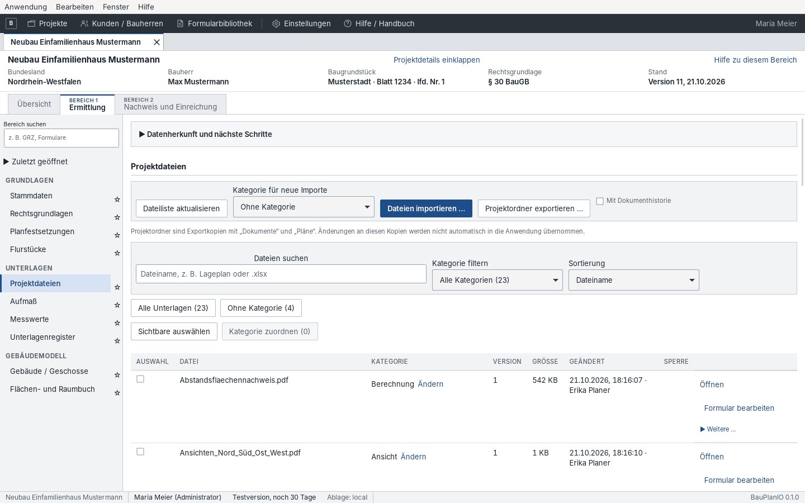

Alle Unterlagen des Projekts (PDF, DXF/DWG, Office, Fotos, E-Mails) liegen
versioniert in der verwalteten Ablage.

- **Importieren:** „Kategorie für neue Importe“ wählen, dann „Dateien
  importieren …“. Bei einer gleichnamigen Datei fragt die App, ob sie eine neue
  Version des vorhandenen Dokuments oder ein eigenes Dokument werden soll.
- **Ordnen:** Dateisuche, Kategoriefilter (Hauptkategorie schließt
  Unterkategorien ein, „Ohne Kategorie“ zum Nachpflegen) und Sortierung.
  Mehrere Dateien auswählen und „Kategorie zuordnen“.
- **Kategorie ändern:** „Ändern“ in der Zeile. Das erzeugt keine neue
  Dateiversion.
- **Öffnen / extern bearbeiten:** „Öffnen“ erstellt eine Arbeitskopie und
  startet das zugeordnete Programm (Excel, CAD …). Die Änderung wird unter
  „Externe Arbeitskopien“ geprüft und ausdrücklich als neue Version übernommen.
- **IFC-Modelle** (`.ifc`, `.ifczip`) werden im Aufmaß als
  [IFC-Modell](#ifc-modell-bim) geöffnet.
- **Weitere …:** Versionen und Historie, Dokumentangaben, „Im Aufmaß öffnen“
  (PDF/DXF), „Formular bearbeiten“ (ausgefüllte Formulare), „E-Mail lesen“
  (EML/MSG mit Übernahme von Anhängen).
- **Projektordner exportieren …** schreibt eine lesbare Kopie („Dokumente“,
  „Pläne“), auf Wunsch mit Dokumenthistorie.
- **Sperre:** Wer eine Datei extern bearbeitet, sperrt sie für andere.

DWG-Dateien werden als Datei verwaltet, aber nicht dargestellt. Für das Aufmaß
im CAD-Programm als DXF exportieren.

## Aufmaß und Zeicheneditor

Im Aufmaß werden Flächen, Strecken und Höhen auf Plänen gemessen und den
Zielen im Projekt zugeordnet (Flurstück, Abzugsfläche, Gebäude, Geschoss,
Raum, Wand, Fachberechnung).

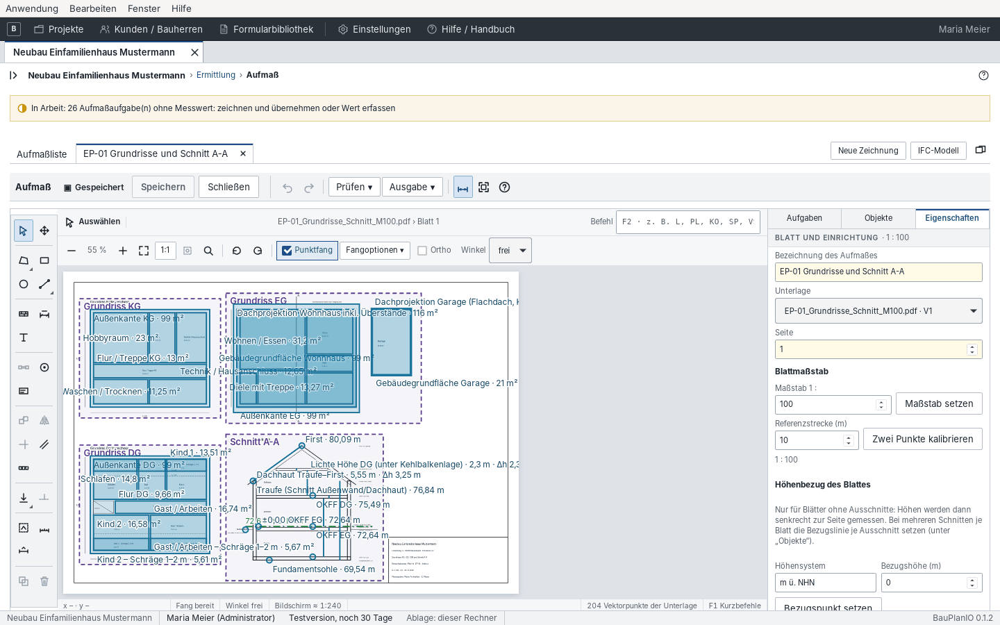

### Aufmaß anlegen

- Aus den Projektdateien: bei einer PDF oder DXF „Im Aufmaß öffnen“.
- Oder im Bereich „Aufmaß“: **Neu anlegen**, Unterlage, Dokumentversion,
  Seite (PDF) und Bezeichnung wählen.
- **Neue Zeichnung** legt ein leeres Blatt in Metern an (siehe unten).

Geöffnete Aufmaße und Zeichnungen erscheinen als **Tabs** über der
Zeichenfläche („Aufmaßliste“ führt zur Übersicht). Das Symbol rechts daneben
öffnet das Aufmaß **in einem eigenen Fenster**, z. B. auf dem zweiten
Bildschirm; die Akte bleibt im Hauptfenster bedienbar.

### Arbeitsplatz des Editors

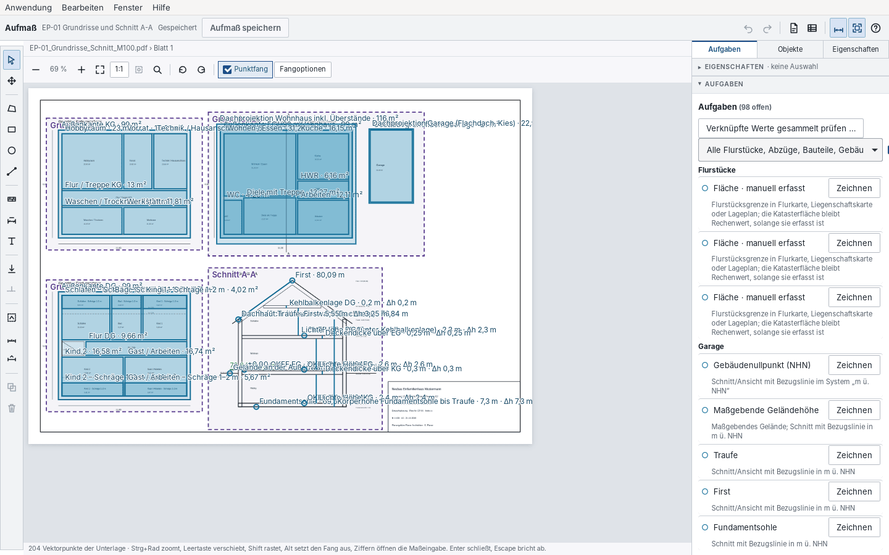

| Bereich | Inhalt |
| --- | --- |
| Kopfleiste | Speichern, Schließen, Rückgängig/Wiederholen, „Aufmaßblatt PDF …“, „Messwerte CSV …“, Maße anzeigen, Vollbild (F11), Kurzbefehle (F1) |
| Werkzeugleiste links | Auswählen (V), Verschieben (M), Polygon (P), Rechteck (R), Kreis (K), Strecke / Dach (S), Wand (W), Maßkette (L), Text (X), Höhenpunkt (H), Bezugslinie setzen, Ausschnitt anlegen, Zwei Punkte kalibrieren, Kontrollstrecke messen, Duplizieren, Markierung entfernen |
| Ansichtsleiste | Zoom, Einpassen, 1:1, Auf Auswahl, Zoomfenster (Z), drehen, **Punktfang** und Fangoptionen |
| Paletten rechts | **Aufgaben** (was noch gezeichnet bzw. übernommen werden muss), **Objekte** (Ausschnitte, Zeichenebenen, Markierungen), **Eigenschaften** (der Auswahl), **Werkzeugkiste** (Vorlagen) |
| Fußzeile | Kurzhilfe zu Maus und Tastatur |

Alle Werkzeuge erscheinen als Symbol; der Name und das Tastenkürzel stehen im
Tooltip. Die vollständige Tastenbelegung: [Kapitel 10](10-anhang.md#zeicheneditor).

### Maßstab und Ausschnitte

1. **PDF:** Blattmaßstab 1:n setzen oder mit „Zwei Punkte kalibrieren“ eine
   bekannte Strecke anklicken und ihre Länge eingeben. **DXF:** Die
   Zeichnungseinheit kommt aus der Datei und kann korrigiert werden;
   DXF-Ebenen lassen sich ein- und ausblenden.
2. Mit **Kontrollstrecke messen** eine bekannte Länge nachmessen.
3. Bei Sammelblättern (Grundrisse, Schnitt, Ansicht auf einem Blatt) je Teil
   einen **Ausschnitt** mit eigenem Maßstab anlegen. Für Höhen im Schnitt eine
   **Bezugslinie** mit Höhe und Höhensystem (z. B. m ü. NHN) setzen.

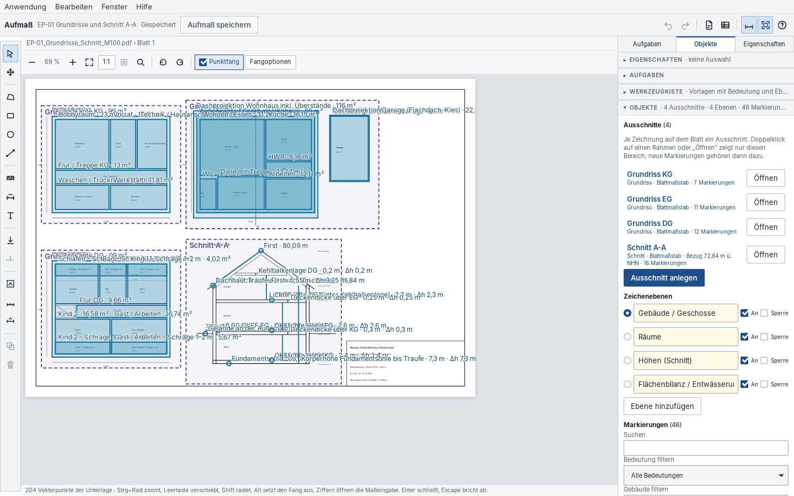

Die Palette **Objekte** listet die Ausschnitte („Öffnen“ zeigt nur diesen
Bereich), die **Zeichenebenen** (Sichtbarkeit „An“, „Sperre“, aktive Ebene)
und alle **Markierungen** mit Suche und Filtern nach Bedeutung und Gebäude.

### Zeichnen und zuordnen

Der schnellste Weg führt über die Palette **Aufgaben**: Sie listet alle Ziele
im Projekt, die einen Messwert brauchen – Flurstücke, Abzugsflächen,
GRZ-Bauteile, Gebäude und Geschosse, Abstandswände, Positionen der
Fachberechnungen und Räume der Raumbücher.

1. Beim gewünschten Ziel **Zeichnen** wählen. Werkzeug, Bedeutung und
   Zuordnung sind damit voreingestellt.
2. Auf dem Plan die Punkte setzen. Nach dem ersten Punkt öffnet eine Ziffer die
   **Maßeingabe** (Länge, Winkel). Enter schließt die Form, Escape bricht ab.
3. Aufmaß **speichern**.
4. Beim Ziel **Übernehmen** wählen (oder in der Zielmaske „Aus Aufmaß“). Der
   Wert wird eingesetzt, das Zielfeld ist danach mit der Markierung verknüpft
   und schreibgeschützt. „Verknüpfte Werte gesammelt prüfen …“ zeigt alle
   Übernahmen mit altem und neuem Wert.

Alternativ eine Vorlage aus der **Werkzeugkiste** anklicken (z. B. „DIN 277
NUF“, „Versiegelte Fläche“, „Gebäudegrundfläche“). Sie stellt Werkzeug,
Bedeutung, Namen und Zeichenebene ein. Freie Markierungen erhalten ihre
**Bedeutung** und Zuordnung in der Palette **Eigenschaften**.

| Zu zeichnen | Bedeutung | Zuordnung |
| --- | --- | --- |
| Flurstücksgrenze aus Flurkarte/Lageplan | Flurstück | Flurstück |
| Abzugsfläche (Grünfläche, Verkehrsfläche, außerhalb Bauland …) | passende Abzugsbedeutung | Flurstück |
| Zufahrt, Stellplatz, Garage, Nebenanlage, Terrasse, unterirdische Anlage | Bauteilbedeutung | Baugrundstück |
| Gebäudegrundfläche, Geschossfläche | Gebäudegrundfläche / Geschoss – Außenkante | Gebäude, Geschoss |
| Raum | DIN 277 NUF/TF/VF bzw. Wohnfläche | Raumbuch |
| Höhe (Traufe, First, Gelände) | Höhenpunkt bzw. Strecke / Dach | Gebäude |

### Lage im Baufenster

Für die Prüfung nach § 23 BauNVO im Lageplan je genau eine Markierung
**Baufenster** und **Vorhabenumriss** zeichnen (bei mehreren Baugrundstücken
dem Umriss das Baugrundstück zuordnen) und unter „Lage im Baufenster“ dem
Projekt zuordnen. Der GRZ-Nachweis zeigt dann die Fläche außerhalb des
Baufensters.

### Handwert und Zeichnung abgleichen

Oft wird ein Wert erst von Hand eingetragen und später gezeichnet. BauPlanIO
vermeidet dabei Doppelerfassungen:

- **Ein Feld hat genau eine Quelle.** Die Übernahme ersetzt den Handwert;
  „Verknüpfung lösen“ macht ihn wieder zur Handangabe und behält den Wert.
- **Abzugsflächen, GRZ-Bauteile, Räume:** Gibt es schon eine passende
  Handzeile (gleiche Art am selben Flurstück/Baugrundstück bzw. gleicher
  Raumname), fragt die Übernahme: *verknüpfen* (Art, Grundlage und
  Bezeichnung bleiben) oder *neue Zeile*. Die Aufgaben-Palette kennzeichnet von Hand
  erfasste Werte mit „manuell erfasst“ bzw. „Handwert ohne Zeichnung, passende
  Markierung vorhanden“.
- **Doppelerfassung:** Stehen eine gezeichnete und eine fast gleich große
  Handzeile (höchstens 1 m² oder 2 % Unterschied) nebeneinander, meldet die
  Baugrundstücksprüfung einen Hinweis mit „Handzeile entfernen“.
- **Veraltete Verknüpfung:** Ändert sich eine gezeichnete Kontur, der Maßstab
  oder die Dokumentversion, melden Zielmaske und Editor dies schon beim
  Öffnen. Im Ziel „Aktuellen Aufmaßstand übernehmen“, speichern und neu
  prüfen.
- **Löschen:** Vor dem Entfernen einer verknüpften Markierung nennt die App
  die betroffenen Werte.
- **Nachvollziehbarkeit:** Die Chronik vermerkt jede neue, aktualisierte oder
  gelöste Aufmaßverknüpfung mit Zielfeld, altem und neuem Wert.

### Eigene Zeichnung in Metern

1. **Neue Zeichnung** wählen. Das Blatt rechnet in Metern (Meterraster),
   Maßstab und Kalibrierung entfallen.
2. Unter „Blatt und Einrichtung → Hintergründe“ eine PDF-Seite oder DXF als
   Hintergrund hinzufügen und einpassen: Maßstab bzw. Einheit, „Über Strecke
   einpassen“, „Verschieben“, „Um Punkt drehen“, Deckkraft und Sichtbarkeit.
   Der Punktfang greift auf die Vektoren des Hintergrunds.
3. Mit **Wand** (W), **Maßkette** (L) und **Text** (X) zeichnen. Diese Elemente
   dienen der Darstellung und liefern keine Messwerte.
4. Flächen, Strecken und Höhen als Markierungen zeichnen und wie oben zuordnen.
   Der PDF-Export gibt die Zeichnung im Maßstab 1:100 aus.

## IFC-Modell (BIM)

Liefert die Planungssoftware ein Gebäudemodell im IFC-Format, wertet BauPlanIO
es für den Bauantrag aus. Importierte Modelle brauchen fast immer Nacharbeit,
bevor die Zahlen stimmen: Bauteile sind nur als „Unklassifiziertes Bauteil“
exportiert, liegen in keinem Geschoss, Räume fehlen oder tragen alte Mengen.
Diese Nacharbeit erledigen Sie in BauPlanIO, ohne die Datei des Planers zu
verändern.

Gelesen werden IFC2X3, IFC4 und IFC4X3 als `.ifc` oder `.ifczip` (IFC-XML
nicht). Die Bilder zeigen das Testmodell eines zweigeschossigen
Einfamilienhauses.

### Modell öffnen

1. Die IFC-Datei unter **Projektdateien** importieren.
2. Im Bereich **Aufmaß** oben rechts **IFC-Modell** wählen.
3. Unter „Neues Modell“ die **IFC-Datei** und eine **Bezeichnung** angeben
   (z. B. „Entwurf Architekt“) und **Modell öffnen**.

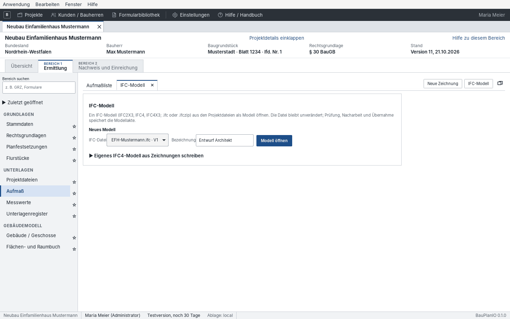

BauPlanIO legt dazu eine **Modellakte** an. Sie verweist auf die
Dokumentversion und speichert Prüfung, Nacharbeit und Übernahme; die IFC-Datei
selbst bleibt unverändert. Vorhandene Modellakten stehen beim nächsten Mal unter
„Vorhandene Modelle“. Das Modell öffnet als eigener Tab neben den Zeichnungen.

### Modellansicht

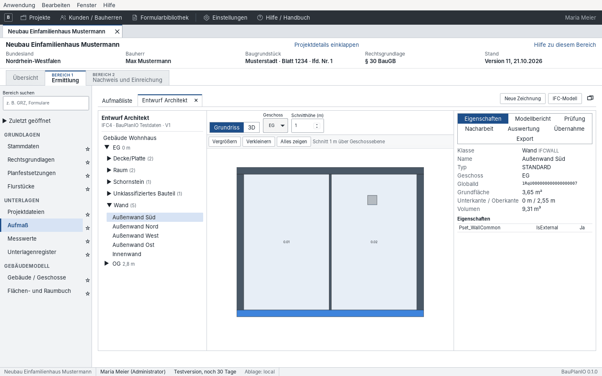

| Bereich | Inhalt |
| --- | --- |
| Links: Modellstruktur | Gebäude → Geschoss (mit Höhe) → Bauteilklasse → Element. Ein Klick wählt das Element. Kursiv: Element ohne auswertbare Geometrie. |
| Mitte: Grundriss | Schnitt durch das gewählte **Geschoss** in der eingestellten **Schnitthöhe** (Standard 1 m über der Geschossebene). Klick auf ein Bauteil wählt es; „Vergrößern“, „Verkleinern“, „Alles zeigen“. |
| Mitte: 3D | Das ganze Modell; mit der Maus drehen, verschieben und zoomen, Klick wählt. „Gesamt“, „Draufsicht“, „Ansicht Süd“ setzen die Blickrichtung. |
| Rechts | **Eigenschaften** des gewählten Elements (Klasse, Name, Geschoss, GlobalId, Grundfläche, Unter- und Oberkante, Volumen, Mengen und Eigenschaften der Datei) und die Werkzeuge der Modellakte. |

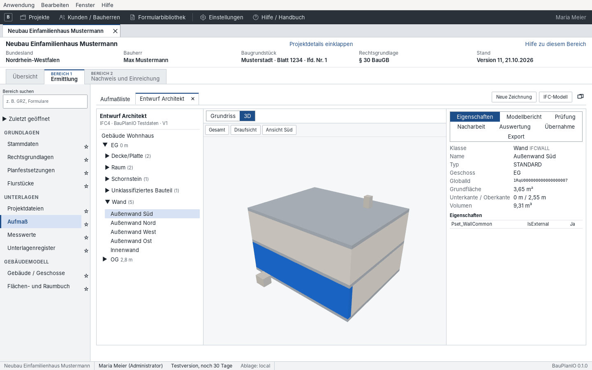

Alle Zahlen rechnet BauPlanIO selbst aus der Geometrie der Datei. Die
3D-Ansicht dient nur der Anschauung.

### Modellbericht und Prüfung

**Modellbericht** zeigt, was in der Datei steht: Schema, Software,
Projektname, Längeneinheit, Georeferenz und die Zahl der Elemente je Klasse,
dazu Darstellungen, die nicht ausgewertet werden konnten.

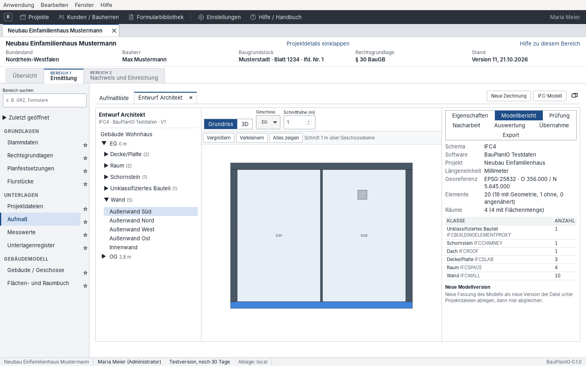

**Prüfung** prüft das Modell auf die Angaben, die ein Bauantrag braucht. Als
Regelwerk ist „Modell für den Bauantrag“ mitgeliefert: Gebäude und Geschosse
mit Namen, Räume mit Nutzung, Außenwände gekennzeichnet, Platten mit Art.
Ein eigenes Regelwerk des Büros im IDS-Format (`.ids` in den Projektdateien)
kann stattdessen gewählt werden. Dazu kommen feste Regeln, z. B. fehlende
Einheiten, Elemente ohne Geschoss, unklassifizierte Bauteile oder Raummengen,
die von der Geometrie abweichen.

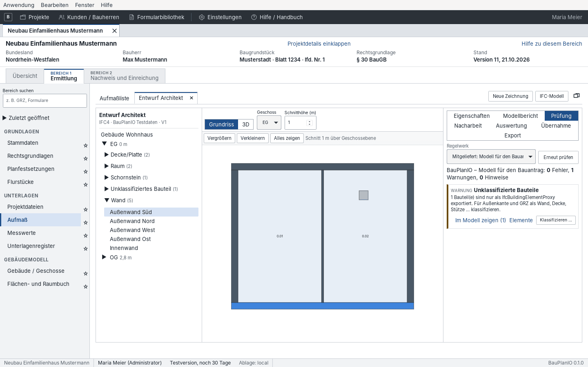

Jeder Befund ist Fehler, Warnung oder Hinweis. **Im Modell zeigen** hebt die
betroffenen Elemente im Grundriss und in 3D hervor, **Elemente** listet sie
auf. Die Aktion des Befunds (z. B. „Klassifizieren …“) öffnet die passende
Nacharbeit mit diesen Elementen.

### Nacharbeit

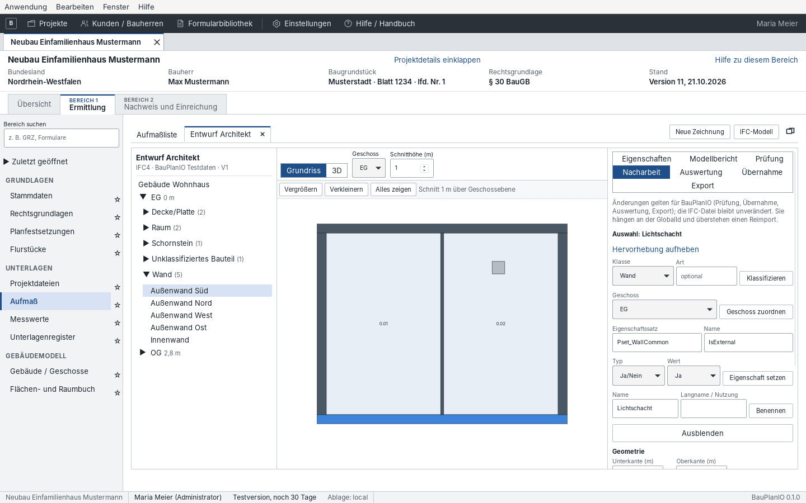

Die Nacharbeit gilt für BauPlanIO (Prüfung, Übernahme, Auswertung, Export). Sie
hängt an der GlobalId der Elemente und übersteht daher eine neue Fassung der
Datei.

| Änderung | Wofür |
| --- | --- |
| Klassifizieren | Klasse und Art setzen, z. B. ein unklassifiziertes Bauteil als Wand oder eine Platte als Dach |
| Geschoss zuordnen | Element ohne oder mit falschem Geschoss einem Geschoss zuordnen |
| Eigenschaft setzen | z. B. `Pset_WallCommon` / `IsExternal` = Ja für eine Außenwand |
| Benennen | Name und Langname, bei Räumen Nummer und Nutzung |
| Ausblenden | Element aus Prüfung, Übernahme und Auswertung nehmen |
| Höhe ändern | Unter- und Oberkante (Wandhöhe, Deckendicke, Brüstung) |
| Neuen Umriss zeichnen | Grundriss eines Raums, einer Decke oder Wand im Grundriss neu zeichnen |
| Räume aus Wänden | „Geschlossene Flächen suchen“ schlägt Räume aus den Wänden des Geschosses vor; ein Vorschlag wird mit Nummer und Nutzung zum Raum |

Unter „Änderungen“ stehen alle Nacharbeiten der Modellakte; **Zurücknehmen**
entfernt eine davon.

> Nur so klassifizieren, wie das Bauteil wirklich ist. Wände, Stützen und
> Decken bilden die Außenkante und zählen damit zur Gebäudegrundfläche. Ein
> Lichtschacht als „Wand“ würde die Grundfläche vergrößern.

### Auswertung

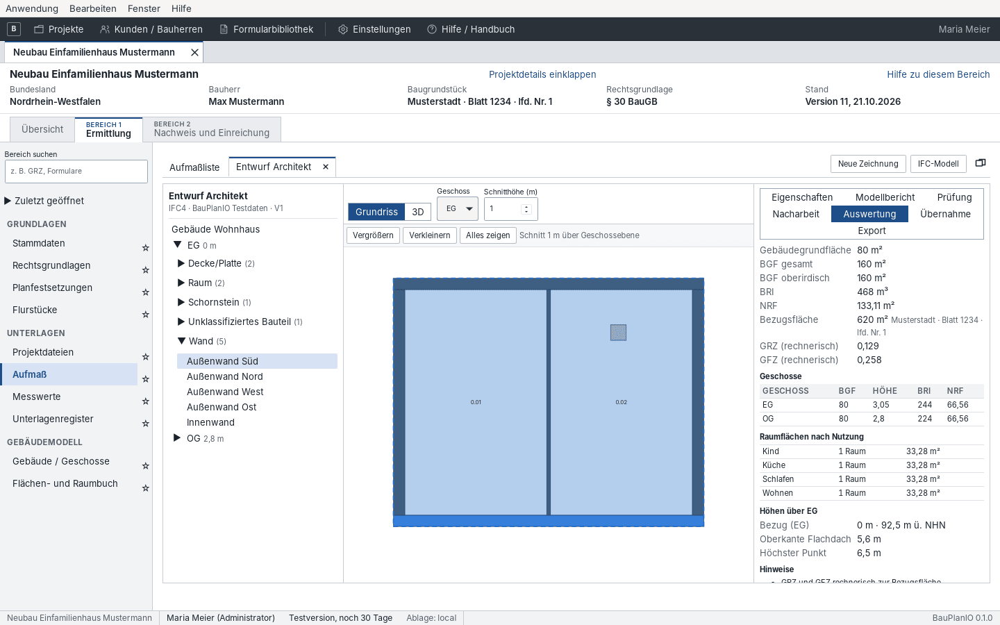

**Auswertung** rechnet aus der Geometrie des Modells mit Nacharbeit:

- **Gebäudegrundfläche** aus den Außenkanten aller Geschosse ab dem
  Erdgeschoss, im Grundriss blau gestrichelt,
- **BGF**, **BRI** und **NRF** je Geschoss (die Raumflächen der Datei stehen
  im Tooltip),
- **Raumflächen nach Nutzung**,
- **Höhen über dem Erdgeschoss**: Oberkante Flachdach bzw. First und Traufe,
  höchster Punkt, Bezug in m ü. NHN bei georeferenzierten Modellen,
- **GRZ und GFZ** rechnerisch zur Bezugsfläche des Baugrundstücks (bei
  mehreren Baugrundstücken oben auswählen).

GRZ und GFZ der Auswertung sind Orientierungswerte. Vollgeschosse,
Anrechnungen nach § 19 Abs. 4 BauNVO und Abstandsflächen rechnen die
Fachmodule. Dafür das Modell ins Projekt übernehmen.

### Ins Projekt übernehmen

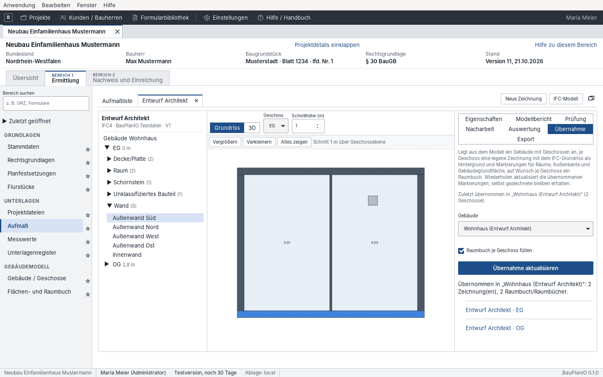

**Übernahme** legt aus dem Modell an:

- ein **Gebäude** mit je einem Geschoss je IFC-Geschoss (oder ergänzt ein
  vorhandenes Gebäude, Auswahl „Gebäude“),
- je Geschoss eine **eigene Zeichnung** mit dem IFC-Grundriss als Hintergrund
  und den Markierungen *Raum*, *Geschoss-Außenkante* und
  *Gebäudegrundfläche*,
- mit „Raumbuch je Geschoss füllen“ die **Raumbücher**.

Die Links unter dem Ergebnis öffnen die Zeichnungen als Tab. Von dort geht es
weiter wie bei jedem Aufmaß: Markierungen zuordnen, Werte in Gebäude,
Raumbuch und Berechnungen übernehmen. Eine erneute Übernahme
(**Übernahme aktualisieren**) ersetzt nur die übernommenen Markierungen und
behält ihre Verknüpfungen; selbst gezeichnete Markierungen bleiben.

Ein IFC-Geschoss kann auch in jeder eigenen Zeichnung als Hintergrund dienen
(„Blatt und Einrichtung → Hintergründe“), mit Fang an allen Kanten.

### Neue Fassung vom Planer

Kommt eine überarbeitete IFC-Datei, legen Sie sie unter **Projektdateien** als
**neue Version** der vorhandenen Datei ab. Die Modellansicht meldet dann
„Neue Version … vorhanden: abgleichen“.

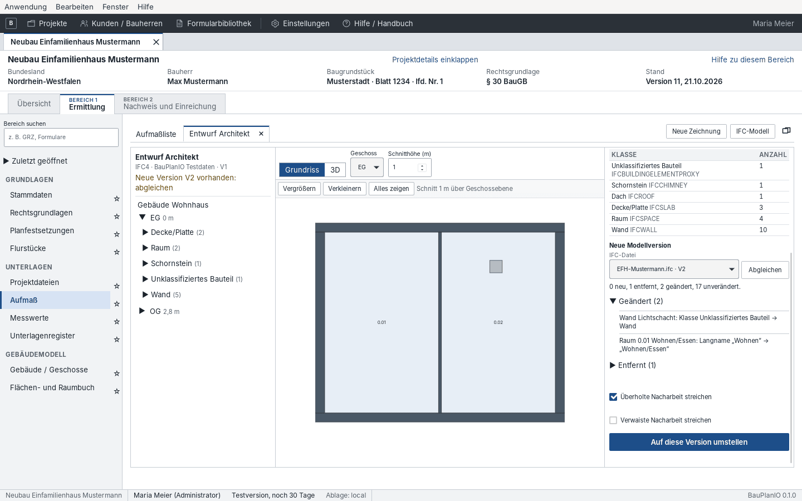

Im **Modellbericht** unter „Neue Modellversion“ **Abgleichen** wählen. Der
Abgleich über die GlobalId zeigt neue, entfernte und geänderte Elemente und den
Stand jeder Nacharbeit:

- *wirksam*: wirkt in der neuen Fassung weiter,
- *überholt*: die neue Fassung hat den Zustand schon selbst (z. B. der Planer
  hat das Bauteil jetzt richtig als Wand exportiert),
- *verwaist*: das Element gibt es nicht mehr.

**Auf diese Version umstellen** übernimmt die Nacharbeit in die neue Fassung;
überholte und verwaiste Änderungen können dabei gestrichen werden. Danach die
Übernahme aktualisieren.

### IFC-Datei schreiben und dem Bauantrag beifügen

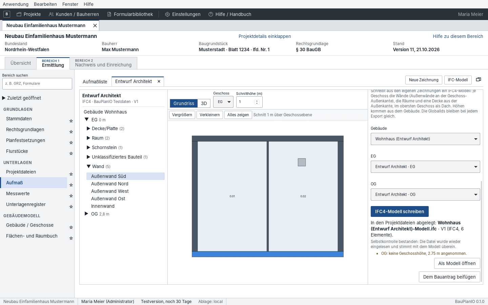

Unter **Export**:

- **IFC-Datei schreiben** schreibt die Datei des Planers mit der Nacharbeit
  neu (`…-nachgearbeitet.ifc`, im Schema der Quelle). Nur die geänderten Teile
  ändern sich, alles andere bleibt Zeichen für Zeichen gleich. So kann der
  Planer die Korrekturen in seine Software zurücknehmen.
- **Eigenes IFC4-Modell aus Zeichnungen**: Gebäude und je Geschoss eine eigene
  Zeichnung wählen, **IFC4-Modell schreiben**. Aus Wänden, Außenkante und
  Raummarkierungen entsteht `<Gebäude>-Modell.ifc` mit Wänden, Decken (oberstes
  Geschoss als Dach) und Räumen. Die GlobalIds bleiben bei jedem Export gleich,
  sodass Empfänger neue Fassungen abgleichen können.
- **Modelldatei dem Bauantrag beifügen** ordnet die Datei den Anlagen des
  Bauantrags zu, mit der XBau-Anlagenart 2010 „BIM-Gebäudemodell“. Übermittelt
  wird die jeweils neueste Version (siehe [Kapitel 8](08-verfahren.md#bauantrag--xbau)).

Jede geschriebene Datei wird zur **Selbstkontrolle** wieder eingelesen und mit
dem Modell verglichen; das Ergebnis steht unter dem Knopf. Die Datei liegt
danach in den Projektdateien (bei gleichem Namen als neue Version) und lässt
sich mit **Als Modell öffnen** sofort prüfen.

## Messwerte

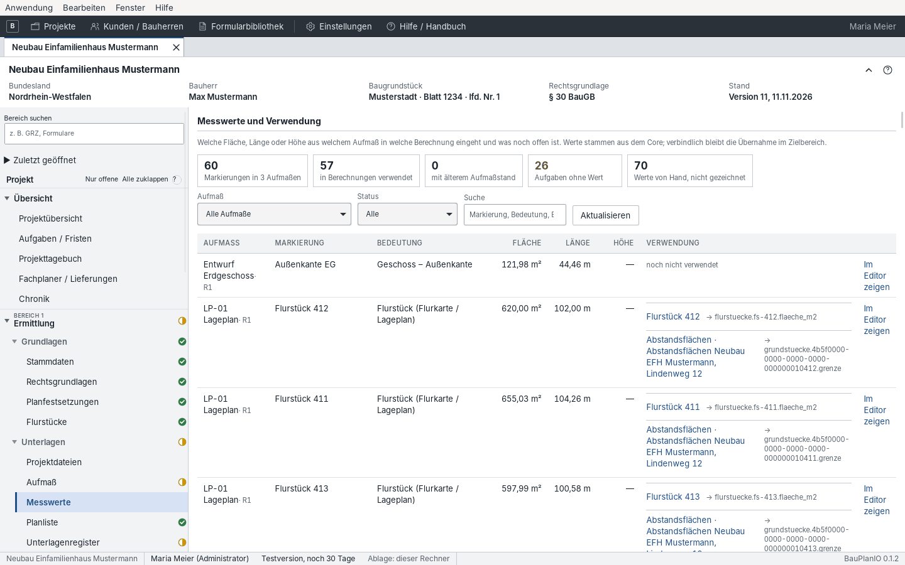

„Messwerte“ beantwortet, welche Fläche, Länge oder Höhe aus welchem Aufmaß in
welche Berechnung eingeht. Oben stehen die Zähler (Markierungen, davon
verwendet, mit älterem Aufmaßstand, offene Aufgaben). Filter nach Aufmaß,
Status und Suchtext. **Im Editor zeigen** springt zur Markierung.

## Unterlagenregister

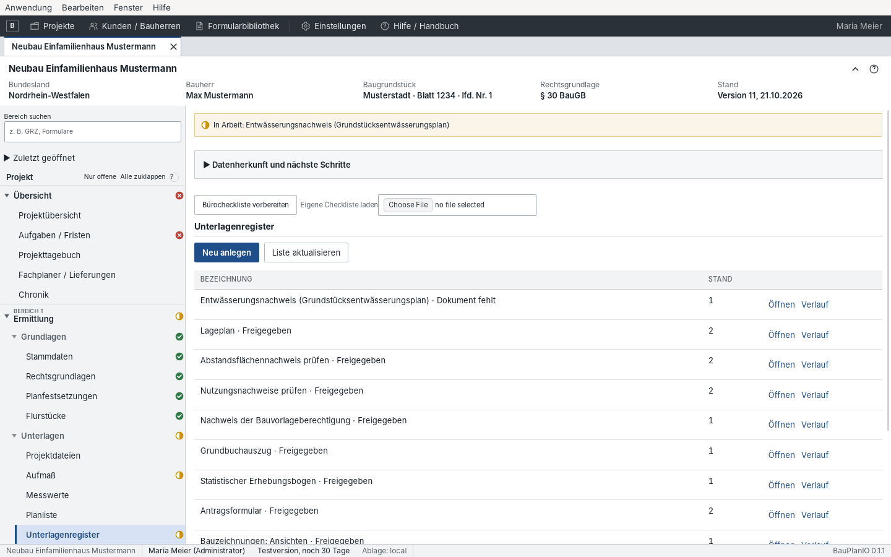

Das Unterlagenregister führt die Bauvorlagen des Projekts als Liste mit Stand
(z. B. „Dokument fehlt“, „Freigegeben“). Jeder Eintrag verbindet eine Unterlage
mit einer konkreten Dokumentversion und ihrer Prüfung. „Bürocheckliste
vorbereiten“ lädt die mitgelieferte Standard-Checkliste als Vorlage für neue
Einträge; „Eigene Checkliste laden“ liest eine Büro-Checkliste als JSON-Datei.

## Gebäude und Geschosse

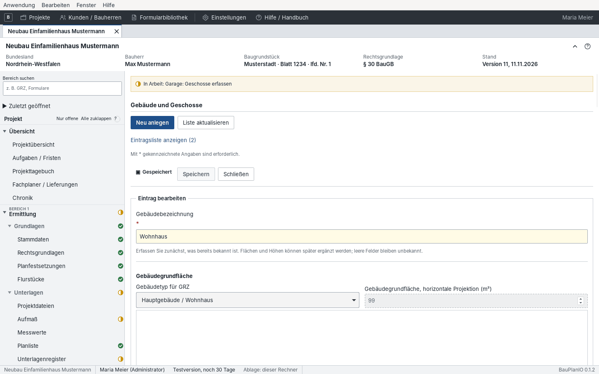

Das Gebäudemodell ist die gemeinsame Quelle für GRZ, GFZ, Geschossigkeit,
Vollgeschosse, Höhen und den Bauantrag.

1. **Neu anlegen**, Bezeichnung und **Gebäudetyp** (Hauptgebäude/Wohnhaus,
   Garage, Nebenanlage …) erfassen.
2. Die **Flurstücke** zuordnen, auf denen das Gebäude steht. Daraus ergibt sich
   das Baugrundstück.
3. **Gebäudegrundfläche** (horizontale Projektion) eingeben oder aus dem
   Aufmaß übernehmen.
4. **Geschosse** mit Fläche nach Außenmaßen und Einstufung (Vollgeschoss ja/nein)
   ergänzen. „Vollgeschossstatus dieses Geschosses prüfen …“ legt einen
   Prüfauftrag in der Vollgeschossprüfung an; das Ergebnis wird danach mit
   „Aus Vollgeschossnachweis übernehmen“ verknüpft.
5. Gelände-, Trauf- und Firsthöhen mit Höhensystem ergänzen und speichern.

Vollständig erfasste Gebäude fließen automatisch in GRZ und GFZ ein. Dort nicht
noch einmal von Hand erfassen.

## Flächen- und Raumbuch

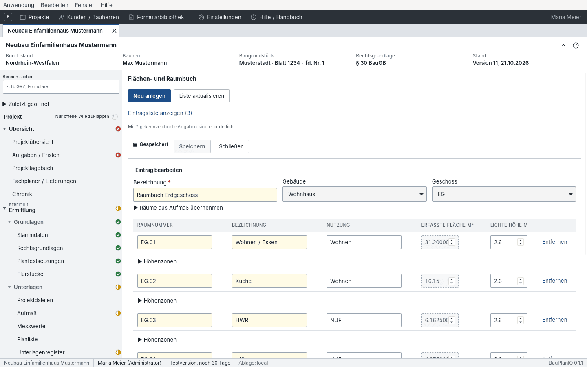

Das Raumbuch sammelt die Räume je Gebäude und Geschoss. Es ist Quelle für
Wohnflächenberechnung und DIN-277-Nachweis.

1. **Neu anlegen**, Gebäude und Geschoss wählen.
2. Räume mit Nummer, Bezeichnung, Nutzung, Fläche und lichter Höhe erfassen.
   Bei Dachschrägen die Höhenzonen getrennt angeben.
3. Oder „Räume aus Aufmaß übernehmen“: gezeichnete Raumkonturen werden zu
   Räumen; vorhandene Handräume mit gleicher Nummer/Bezeichnung werden
   verknüpft statt verdoppelt.
4. Speichern. Nach einer Planänderung zuerst das Aufmaß, dann das Raumbuch und
   danach die Wohnfläche/DIN 277 aktualisieren.
