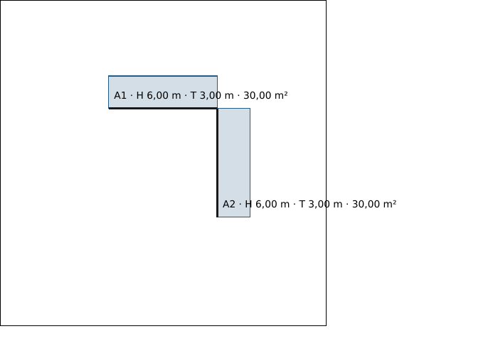
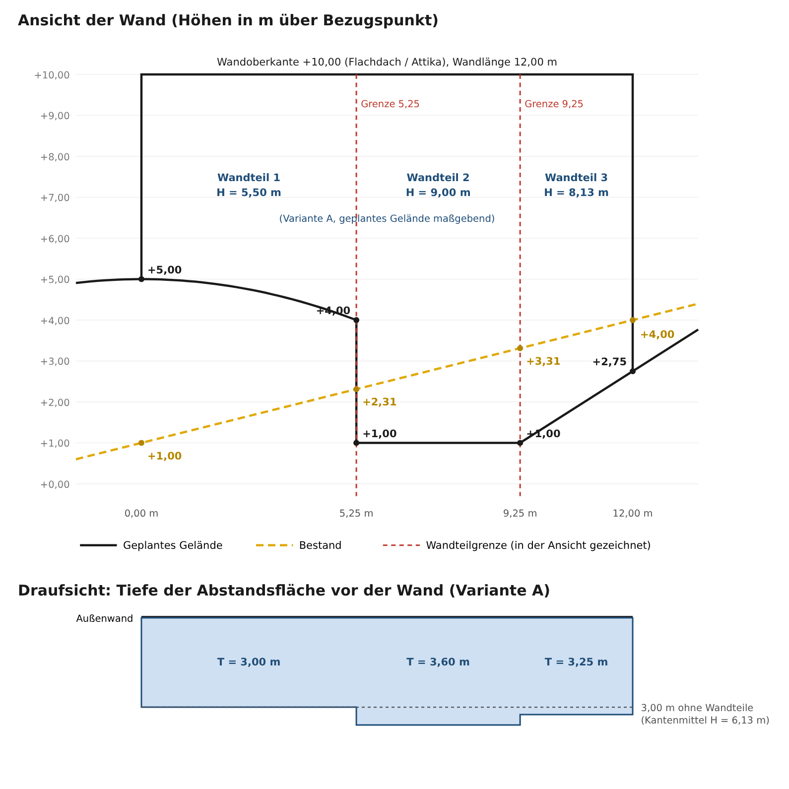

# 6 Berechnungen und Nachweise

[← Unterlagen, Aufmaß, Gebäudemodell](05-ermittlung.md) · [Inhalt](README.md) · [Weiter: Formulare und Druck →](07-formulare-druck.md)

Register **Bereich 2 · Nachweis und Einreichung**, Gruppen *Grundstück und
Nutzung*, *Gebäude und Flächen* und *Weitere Nachweise*.

## Baugrundstück

Das Baugrundstück ist die Bezugsfläche aller Nutzungsmaße. Es wird aus den
gespeicherten Vorhabenflurstücken gebildet.

1. Oben steht die **Datengrundlage**: die gespeicherten Flurstücke mit Fläche
   und Grundbuchzuordnung (Änderungen dort, nicht hier).
2. **1 · Flächenabzüge und Zuordnungen:** je Flurstück nicht maßgebende Flächen
   abziehen (z. B. festgesetzte Verkehrs- oder Grünfläche) – von Hand oder mit
   „Abzugsflächen aus Aufmaß übernehmen“. Die rechtliche Grundlage ist zu
   ergänzen. Eine besondere Zuordnung mehrerer Flurstücke braucht eine belegte
   Grundlage.
3. **2 · Baugrundstücksermittlung:** „Baugrundstücke ermitteln“ bildet die
   Einheiten mit Eigentumsfläche, Abzügen und Bauland.
4. **Maßgebende Grundstücksfläche:** Zuschläge oder Gemeinschaftsanteile
   („Flächenansatz anlegen“), dann **Bezugsflächen berechnen** und **Eingaben
   speichern**.

Die Prüfung meldet hier auch Abweichungen zwischen gezeichneter und amtlicher
Flurstücksfläche sowie Doppelerfassungen von Hand- und Zeichnungswerten
([Kapitel 5](05-ermittlung.md#handwert-und-zeichnung-abgleichen)).

> „Ermittlung ist veraltet“ heißt: Flurstücke oder Zuordnungen haben sich
> geändert. Neu ermitteln und speichern. Abzüge nicht noch einmal in GRZ/GFZ
> abziehen.

## GRZ, GFZ, Geschossigkeit und BMZ

Die vier Nutzungsmaße arbeiten gleich: **Baugrundstück** oben wählen,
Eingaben prüfen, **Berechnen**, **Eingaben speichern**, **Nachweis
erstellen …**

**GRZ (Grundflächenzahl)**

- „Bekannte Flächen aus Gebäude/Geschosse“: Gebäude, die dem Baugrundstück
  zugeordnet sind, kommen automatisch mit ihrer Grundfläche und Art
  („Verknüpfung lösen“ macht daraus eine Handzeile).
- „Bauteile für GRZ I und GRZ II“: weitere Flächen wie Zufahrt, Stellplatz,
  Terrasse, Garage, Nebenanlage, Tiefgarage. Der **Bauteiltyp** steuert die
  Anrechnung, nicht die Bezeichnung. „Bauteile aus Aufmaß übernehmen“ holt
  gezeichnete Flächen.
- Bei BauNVO 1990/2017 werden GRZ I (Hauptanlagen) und GRZ II (mit Flächen
  nach § 19 Abs. 4) getrennt ausgewiesen; ältere Fassungen rechnen anders.

Das Ergebnis vergleicht ermittelte und zulässige Werte mit Grundlage und
Abweichung („✓ Vorgabe eingehalten“ bzw. Überschreitung) und zeigt die Lage
im Baufenster, sofern im Aufmaß zugeordnet. Eine Überschreitung zeigt einen
möglichen Abweichungs- oder Befreiungsbedarf an; sie ist keine Befreiung
([Kapitel 8](08-verfahren.md#vorbereitung)).

**GFZ und Geschossigkeit** übernehmen die Geschosse aus dem Gebäudemodell.
Weitere Geschosse nur ergänzen, wenn sie dort fehlen. Bei Nichtvollgeschossen
die anrechenbaren Teilflächen getrennt angeben. Die Einstufung als
Vollgeschoss ändert man am Gebäude bzw. im verknüpften Vollgeschossnachweis.

**Bauvolumen / BMZ** braucht einen eigenen, nachvollziehbaren Volumenansatz in
m³. Ein DIN-277-Bruttorauminhalt ist nicht ohne Prüfung die Baumasse im
planungsrechtlichen Sinn.

Ohne gespeicherte Rechtsgrundlage lassen sich die Maße mit „Entwurf öffnen“
vorbereiten; „Entwurf auf diesem Gerät sichern“ hält ihn lokal fest.

## Fachberechnungen

Überbaubare Grundstücksfläche, Wohnflächenberechnung, DIN-277-Flächen,
Vollgeschossprüfung, Gebäudehöhen, Stellplatznachweis, Abstandsflächen,
Versiegelung / Freiflächen und Regenwasser / Rückhaltung folgen demselben
Aufbau:

1. **Neu anlegen** oder einen Eintrag **öffnen**. Für getrennte Gebäude,
   Wohnungen oder Varianten getrennte Einträge führen.
2. Oben steht der Ablauf **Entwurf → Berechnen und prüfen → Nachweis →
   Freigabe**.
3. Reiter **Eingaben:** Bezeichnung, Baugrundstück, Gebäude und die
   Positionen. „Positionen als Tabelle bearbeiten“ wechselt in die
   Tabellenerfassung; Werte lassen sich aus Raumbuch oder Aufmaß übernehmen.
4. Reiter **Regeln / Grundlagen:** geltende Regeln mit Quelle, Fassung und
   Prüfvermerk. Mitgelieferte Beispielregeln vor Verwendung bestätigen oder
   ersetzen. Bestätigte Regelversionen (z. B. eine kommunale
   Stellplatzsatzung) lassen sich merken und als JSON weitergeben.
5. Reiter **Quellen / Übernahmen:** Dokumentversionen und Messwerte
   verknüpfen; bei geänderter Quelle „Aktuellen Aufmaßstand übernehmen“.
6. Reiter **Prüfbericht:** Ergebnis, offene Punkte, Hinweise. Offene Punkte
   klären – eine 0 ersetzt keinen unbekannten Wert.
7. Speichern, „Gespeicherte Grundlagen bestätigen …“ (mit Berechtigung) und
   **Nachweis erstellen …**.

Besonderheiten der einzelnen Nachweise:

| Nachweis | Worauf achten |
| --- | --- |
| Überbaubare Grundstücksfläche | Abstände zu Baugrenze/Baulinie mit Vorzeichen und Richtung; ergänzt die geometrische Baufensterprüfung |
| Wohnflächenberechnung | Räume „aus Raumbuch“ übernehmen; Raumart, Wohnung, Dachschrägen-Höhenzonen, Außenflächen-Anteil |
| DIN-277-Flächen | Teilflächen nach NUF/TF/VF/KGF; BRI über eigene äußere Volumenkörper |
| Vollgeschossprüfung | Landesrechtliche Definition (z. B. § 2 Abs. 6 BauO NRW); Ergebnis im Gebäude-Geschoss verknüpfen |
| Gebäudehöhen / Dachneigung | Einheitliches Höhensystem; absolute (m ü. NHN) und relative Höhen nicht mischen |
| Stellplatznachweis | Faktoren der örtlichen Satzung, Kfz und Fahrräder getrennt, Rundungsstufe |
| Abstandsflächen | Geführte Schritte siehe unten |
| Versiegelung / Freiflächen | Teilflächen vollständig bilanzieren, Faktoren mit Satzungsbezug |
| Regenwasser / Rückhaltung | Vereinfachte stationäre Bilanz; kein vollständiger Überflutungsnachweis |

### Abstandsflächen

Der Abstandsflächennachweis führt mit „Vorheriger Schritt“ / „Nächster
Schritt“ durch die Reiter **Grundlagen → Gebäudeumriss → Wände / Bauteile →
Lagepläne / Grenzen → Sonderfälle / Sicherungen → Prüfbericht**.

1. Grundlagen: Gemeinde, Baugebiet, Anwendbarkeit. Unter **Rechtsgrundlage**
   schlägt die App die Fassung der Landesbauordnung vor, die am Stichtag
   (in der Regel Eingang des Bauantrags) gilt; jede Fassung ist eine eigene
   Regeldatei. Ein Wechsel zeigt vorher den Vergleich je Wand. Solange das Büro
   eine Regeldatei nicht fachlich freigegeben hat, trägt jeder Nachweis den
   Hinweis „Regelwerk fachlich nicht freigegeben“.
2. Gebäudeumriss mit Eckpunkten in Umlaufrichtung; „Seiten als Wände
   übernehmen“ erzeugt die Wände.
3. Je Wand Gelände- und Wandabschluss, Dachanteile und Bauteile; die
   Planskizze hebt die aktive Wand hervor. „Dachansatz einer anderen Wand
   verwenden“ kopiert nur die Dachwerte.
4. Grundstücksgrenzen und Nachbargebäude im selben Koordinatenbezug.
5. Sonderfälle und rechtliche Sicherungen (Baulast, Übernahme) mit Belegen.
6. Berechnen, Konflikte in Tabelle und Plan prüfen, Nachweis erstellen.

#### Wände im Lageplan und in den Ansichten zeichnen

Statt Koordinaten zu tippen, lassen sich die Wände im Zeicheneditor zeichnen:

1. **Lageplan:** am Werkzeug „Strecke / Dach“ die Vorlage **Abstandsfläche**
   wählen und je Außenwand eine Linie entlang der Außenkante ziehen. Die Linien
   heißen A1, A2 … Im selben Plan die Flurstücke zuordnen; ein Vorhabenumriss
   zeigt, nach welcher Seite die Fläche klappt.
2. **Ansicht oder Schnitt** (Ausschnitt mit Maßstab und Bezugslinie): die
   gleichnamige Linie zwischen den Gebäudekanten ziehen, vom Wandanfang zum
   Wandende. Bei übersichtlichen Vorhaben genügt die Linie in der Ansicht; die
   Breite kommt dann aus der Ansicht, und der Abstand zur Grenze wird als
   Angabe des Planers eingetragen.
3. **Höhen** in derselben Ansicht über der Linie zeichnen: Gelände (Punkte oder
   Geländelinie), Abgrabung, Traufe als Schnittlinie der Dachhaut, Attika,
   First, Dachneigung, Wandteilgrenze und Gaube. Die waagerechte Lage bestimmt
   die Stelle an der Wand, die Höhe kommt von der Bezugslinie. Abgrabungen
   zählen für die Wandhöhe nicht.
4. Im Abstandsflächennachweis unter **Wände / Bauteile → Abstandsflächen aus
   Lageplan und Ansichten** das Aufmaß wählen und **Linien übernehmen**. Jede
   Linie wird eine Wand; Lage, Breite und Höhen sind danach gesperrt und
   bleiben an die Zeichnung gebunden. Nach Änderungen im Plan **Linien
   aktualisieren**. „Im Lageplan zeigen“ und „In der Ansicht zeigen“ springen
   zur Linie im Editor.

Weicht die Breite in der Ansicht mehr als 5 cm bzw. 1 % vom Lageplan ab,
nennt der Prüfbericht beide Werte. Die Toleranz steht in
`regelwerke/aufmass-toleranzen.json`.

#### Abstandsflächenplan auf dem Lageplan

Stammen Wände aus Linien im Lageplan, erzeugt **Abstandsflächenplan auf dem
Lageplan (PDF)** unter dem Ergebnis aus dem archivierten Nachweisstand ein
Blatt für den Bauantrag: die unveränderte Lageplanseite mit den
Abstandsflächen (blau), Flächen jenseits der Grenze (rot) und Überdeckungen
(violett), jede Wand beschriftet mit „A1 · H … m · T … m“. Ein zweites Blatt
nennt Quellen, Regeldatei und je Wand Höhe, Tiefe, Fläche und Ergebnis.

#### Rechenbeispiel: Aufschüttung und Abgrabung (BauO NRW)

Das Beispiel zeigt, wie eine veränderte Geländeoberfläche die Abstandsfläche
einer Außenwand bestimmt und wie es in BauPlanIO eingegeben wird. Rechtsstand
ist die BauO NRW 2018 in der Fassung ab 01.09.2026, Baugebiet WA
(Tiefe 0,4 H, mindestens 3,00 m). Die Werte stammen aus einer Planskizze und
sind gerundet; sie sind kein geprüfter Einzelfall.

**Ausgangslage.** Die Wand ist 12,00 m lang, ihre Oberkante liegt durchgehend
bei +10,00 (Flachdach oder Attika, kein Dachanteil). Das Bestandsgelände
steigt gleichmäßig von +1,00 auf +4,00. Geplant sind:

| Station | Stelle | Bestand | Geplant | Veränderung |
| --- | --- | --- | --- | --- |
| 0,00 m | linke Gebäudekante | +1,00 | +5,00 | Aufschüttung +4,00 |
| 5,25 m | Geländesprung (Stützwand) | +2,31 | +4,00 oben / +1,00 unten | Aufschüttung +1,69 / Abgrabung −1,31 |
| 9,25 m | Fuß der Böschung | +3,31 | +1,00 | Abgrabung −2,31 |
| 12,00 m | rechte Gebäudekante | +4,00 | +2,75 | Abgrabung −1,25 |

**Welche Geländeoberfläche zählt.** Maßgebend ist die Oberfläche aus der
Baugenehmigung (§ 2 Abs. 4 BauO NRW); eine mitgenehmigte Aufschüttung oder
Abgrabung zählt also. Ausnahme: Abgrabungen, die der Belichtung, dem Zugang
oder der Zufahrt dienen, bleiben außer Betracht (§ 6 Abs. 4 Satz 6). Daraus
ergeben sich drei Varianten:

- **A:** Aufschüttung genehmigt, die Abgrabung dient keinem dieser Zwecke
  (z. B. Gartengestaltung). Überall gilt das geplante Gelände.
- **B:** Aufschüttung genehmigt, die Abgrabung dient der Belichtung oder dem
  Zugang (Lichthof, Eingang Untergeschoss). Wo geplant tiefer als Bestand ist,
  gilt der Bestand.
- **C:** Aufschüttung nicht genehmigt, die Abgrabung zählt. Links gilt der
  Bestand, rechts das abgegrabene Gelände.

**Wandhöhe je Wandteil.** Die Wandhöhe H ist der Abstand vom Gelände bis zur
Oberkante. Bei Wandteilen unterschiedlicher Höhe wird sie je Wandteil
ermittelt, bei geneigtem Gelände als Mittel aus den Höhen an den Kanten des
Wandteils (§ 6 Abs. 4 Satz 2 bis 5). Am Geländesprung steht die Wand links
6,00 m und rechts 9,00 m hoch; deshalb wird die Wand am Sprung (5,25 m) und am
Böschungsfuß (9,25 m) geteilt. Ohne diese Teilung bildet das Mittel der beiden
Gebäudekanten den abgesenkten Bereich nicht ab.

| Variante | Mittel der Gebäudekanten | Wandteil 0–5,25 m | Wandteil 5,25–9,25 m | Wandteil 9,25–12,00 m |
| --- | --- | --- | --- | --- |
| A | (5,00 + 7,25) / 2 = 6,13 → T 3,00 | (5,00 + 6,00) / 2 = 5,50 → T 3,00 | 9,00 → **T 3,60** | (9,00 + 7,25) / 2 = 8,13 → T 3,25 |
| B | (5,00 + 6,00) / 2 = 5,50 → T 3,00 | 5,50 → T 3,00 | (7,69 + 6,69) / 2 = 7,19 → T 3,00 | (6,69 + 6,00) / 2 = 6,34 → T 3,00 |
| C | (9,00 + 7,25) / 2 = 8,13 → T 3,25 | (9,00 + 7,69) / 2 = 8,34 → T 3,34 | 9,00 → **T 3,60** | 8,13 → T 3,25 |

Alle Höhen in Metern; T = max(0,4 · H; 3,00 m).

**Ergebnis.** Dient die abgesenkte Fläche der Belichtung oder dem Zugang
(Variante B), genügen vor der ganzen Wand 3,00 m. Sonst wird das abgesenkte
Mittelstück maßgebend: H = 9,00 m, Tiefe **3,60 m** auf 4,00 m Länge. Das
Mittel der Gebäudekanten käme in Variante A nur auf 3,00 m.

**So rechnet BauPlanIO das Beispiel.**

1. In der Ansicht der Wand die Linie **Abstandsfläche** von Kante zu Kante
   ziehen und die Oberkante als **Attika** (+10,00) abgreifen.
2. Die Linie **Gelände** entlang der maßgebenden Oberfläche zeichnen, also je
   nach Variante das geplante Gelände (A), ohne die privilegierte Abgrabung (B)
   oder links den Bestand (C). Die Markierung **Abgrabung** erscheint nur in der
   Herleitung als „nicht maßgebend“; welche Oberfläche gilt, entscheidet der
   Planer mit dieser Linie.
3. Am Geländesprung und am Böschungsfuß je eine **Wandteilgrenze** zeichnen.
   BauPlanIO teilt eine Wand von selbst nur dort, wo die Oberkante springt,
   nicht bei einem Sprung im Gelände.
4. **Linien übernehmen** und berechnen. Der Prüfbericht zeigt je Wandteil die
   Herleitung „im Mittel gemessene Wandhöhe aus den Kanten“ und die Tiefe;
   in Variante A also 5,50 / 9,00 / 8,13 m und 3,00 / 3,60 / 3,25 m.

Fehlen die Wandteilgrenzen, rechnet BauPlanIO mit dem Mittel der
Gebäudekanten (Variante A: H 6,13 m, T 3,00 m) und schreibt den Hinweis
„Die Wandhöhe zwischen den Kanten weicht um bis zu 3,016 m vom gleichmäßigen
Verlauf ab (größte Wandhöhe 9 m). Wandteilung oder Ansatz fachlich prüfen.“
Dieser Hinweis ist das Signal, Wandteilgrenzen zu setzen.

> Zu klären bleibt im Einzelfall: Wozu dient die Abgrabung, und wird die
> Aufschüttung mitgenehmigt? Die Bauaufsicht prüft nach § 8 Abs. 3, ob der
> Nachbar Nachteile hat, etwa Einsicht von der aufgeschütteten Fläche.
> Aufschüttung und Stützwand sind über 1 m hoch und begehbar; nahe an einer
> Grenze brauchen sie eine eigene Abstandsfläche (§ 6 Abs. 1 Satz 2 Nr. 2).
> Die Teilung am Geländesprung ist eine Auslegung des Wortlauts und vorab mit
> der Bauaufsicht abzustimmen.

Ausführlich mit allen Regeln: `docs/abstandsflaechen/README.md`.

## Nachweisstände und Freigaben

„Nachweisstände“ listet alle archivierten Nachweise mit Erstellungsdatum,
Vollständigkeit, **Aktualität** und **Freigabe**.

- **Aktualität prüfen** vergleicht jeden Stand mit den aktuellen Grundlagen.
  „Grundlagen geändert“ bedeutet: Der archivierte Inhalt bleibt, ist aber
  nicht mehr aktuell. „Berechnung öffnen“ führt zur Quelle, dort neu berechnen
  und einen neuen Nachweisstand anlegen.
- **Freigeben** ist eine Bürofreigabe durch die berechtigte Leitung. Archivieren
  und Freigeben sind getrennte Schritte; eine Freigabe ist keine Einreichung.
- „Archivstand wiederholen“ rechnet einen Stand mit seinen damaligen Eingaben
  und Regeln nach und meldet, ob dasselbe Ergebnis herauskommt. „Drucken /
  PDF“ öffnet die Druckausgabe; dort übernimmt „Als Projektunterlage ablegen“
  das PDF versioniert in die Projektdateien.
- „Grundlagen und Regeln ansehen“ zeigt, womit damals gerechnet wurde.
