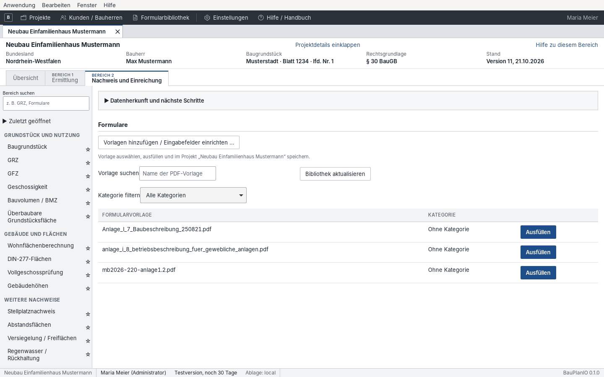
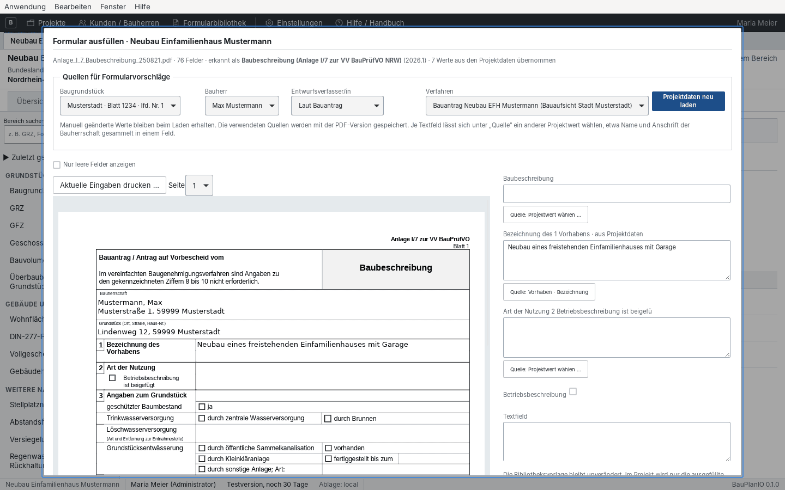
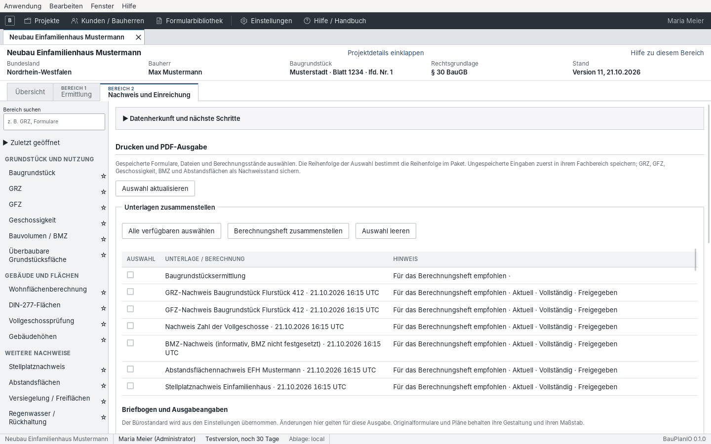

# 7 Formulare und Druckausgabe

[← Berechnungen und Nachweise](06-nachweise.md) · [Inhalt](README.md) · [Weiter: Verfahren und Einreichung →](08-verfahren.md)

Register **Bereich 2 · Nachweis und Einreichung → Formulare und Ausgabe**.

## PDF-Formulare ausfüllen

Der Bereich „Formulare“ zeigt die Vorlagen der Formularbibliothek
([Kapitel 3](03-einrichtung.md#formularbibliothek)). „Vorlagen hinzufügen /
Eingabefelder einrichten …“ wechselt in die Bibliothek.

1. Vorlage suchen oder nach Kategorie filtern und **Ausfüllen** wählen.
2. Die App erkennt bekannte Formulare (z. B. „Baubeschreibung (Anlage I/7 zur
   VV BauPrüfVO NRW)“) und übernimmt passende Projektdaten.

3. Unter **Quellen für Formularvorschläge** Baugrundstück, Bauherr,
   Entwurfsverfasser/in und Verfahren wählen, wenn es mehrere gibt.
   „Projektdaten neu laden“ holt geänderte Werte; manuell geänderte Felder
   bleiben erhalten.
4. Rechts die Felder ergänzen. Unter **Quelle** kann je Textfeld ein anderer
   Projektwert gewählt werden (z. B. Name und Anschrift der Bauherrschaft
   gesammelt oder „Familienname, Vorname“). „Nur leere Felder anzeigen“ hilft
   beim Vervollständigen.
5. Links die **Vorschau** der Originalseite prüfen (Seite wechseln).
   „Aktuelle Eingaben drucken …“ druckt den momentanen Stand.
6. **Im Projekt speichern.** Das ausgefüllte PDF wird Projektdatei mit
   Kategorie und erscheint im Projektordner. Für Korrekturen später in den
   Projektdateien „Formular bearbeiten“ verwenden; dann entsteht eine neue
   Version desselben Dokuments.

> Nicht jedes Berechnungsergebnis (z. B. Wohnfläche, DIN-277-Werte) steht als
> Formularquelle bereit. Diese Werte im Formular prüfen und gegebenenfalls aus
> dem Nachweis übertragen.

## Drucken und PDF-Ausgabe

Hier entstehen Berechnungsheft und Behördenausgabe aus gespeicherten
Formularen, Dateien und Nachweisständen.

1. Unter **Unterlagen zusammenstellen** die gewünschten Einträge ankreuzen.
   Die Reihenfolge der Auswahl ist die Reihenfolge im Paket. Die Hinweise
   zeigen, ob ein Nachweis aktuell, vollständig und freigegeben ist.
   - „Berechnungsheft zusammenstellen“ wählt die empfohlenen Nachweise.
   - „Alle verfügbaren auswählen“ / „Auswahl leeren“.
2. Unter **Briefbogen und Ausgabeangaben** Bezeichnung, Empfänger,
   Aktenzeichen, Datum und Anschreiben für diese Ausgabe anpassen (Vorgabe
   aus den Einstellungen), Inhaltsverzeichnis wählen.
3. **Druckausgabe erstellen** und alle Seiten in der Vorschau prüfen
   (Vollständigkeit, Lesbarkeit, Planmaßstab, richtige Version).
4. Als PDF speichern, mit **Als Projektunterlage ablegen** versioniert sichern
   oder **Drucken …** für den Systemdruck.

Originalformulare und Pläne behalten Gestaltung und Maßstab und erhalten keinen
Briefkopf. Nicht druckbare Dateien (DWG, Excel) müssen vorher als PDF
abgelegt werden. Aus einem Abgabestand der Verfahrensakte lassen sich genau die
eingereichten Versionen in die Druckausgabe übernehmen („Versionen aus
Abgabestand auswählen“).

> Ungespeicherte Eingaben zuerst im Fachbereich speichern; GRZ, GFZ,
> Geschossigkeit, BMZ und Abstandsflächen vorher als Nachweisstand sichern.
