# 8 Verfahren und Einreichung

[← Formulare und Druck](07-formulare-druck.md) · [Inhalt](README.md) · [Weiter: Standard-Workflows →](09-workflows.md)

Register **Bereich 2 · Nachweis und Einreichung**, Gruppen *Verfahren* und
*Einreichungswerkzeuge*. Führend ist immer die **Verfahrensakte**: Behörde,
Aktenzeichen, Unterlagenbedarf, Abgabestände, Kommunikation und Bescheide
gehören zu genau einem Verfahren. Ein Projekt kann mehrere Verfahren haben
(z. B. Vorbescheid und Bauantrag, Änderungsantrag).

## Verfahrensakte

**Neu anlegen** oder einen Eintrag **öffnen**. Die Akte ist in drei Phasen
gegliedert; jede Phase hat eigene Reiter. **Unterlagen und Arbeitsaufträge**
und **Verfahren** stehen in jeder Phase zur Verfügung; eine geöffnete Akte
beginnt in der Phase, in der das Verfahren steht:

| Phase | Reiter |
| --- | --- |
| Vorbereitung | Vorhabenprofil, Anforderungen, Abweichungen / Befreiungen, Unterschriften |
| Laufendes Verfahren | Kommunikation, Nachforderungen, Behördliche Schritte, Schreiben, Abgabestände |
| Entscheidung und Ausführung | Bescheide / Auflagen, Bauausführung, Korrekturen, Verfahrenschronik |

Der gelbe Verfahrenskopf zeigt Bezeichnung, Behörde und Aktenzeichen.
Darunter fasst die **Lage** den dokumentierten Stand zusammen, z. B. eine
laufende Genehmigungsfiktion mit Datum und Rechtsgrundlage. Die Lage ist eine
Arbeitshilfe aus den erfassten Daten, keine Rechtsentscheidung. Sie nennt den
nächstliegenden Schritt; weitere stehen unter „Weitere Möglichkeiten“. Ist
eine Fiktionsfrist abgelaufen, sagt die Lage das mit Datum und bietet an, die
Bescheinigung über die Genehmigungsfiktion zu verlangen; ob die Fiktion
eingetreten ist, bleibt zu prüfen (z. B. bei offenen Nachforderungen).

### Vorbereitung

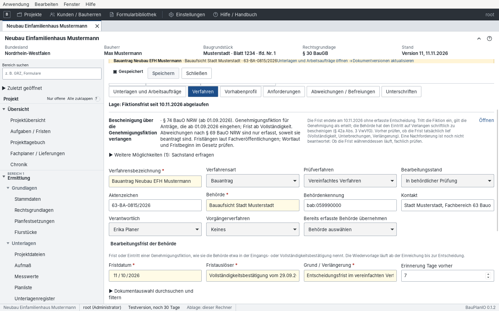

- **Verfahren:** Verfahrensbezeichnung, Verfahrensart (Bauantrag, Vorbescheid,
  Freistellung …), Prüfverfahren (regulär/vereinfacht), Bearbeitungsstand,
  Aktenzeichen, Behörde mit Behördenkennung und Kontakt, Verantwortliche,
  Vorgängerverfahren. Die Bearbeitungsfrist der Behörde wird mit Beleg
  erfasst.
- **Vorhabenprofil:** Bundesland, Nutzung, Gebäudeklasse, Sonderbau. Daraus
  schlägt die App einen passenden Bauvorlagenkatalog vor.
- **Anforderungen:** Für jede Unterlage ausdrücklich *erforderlich*, *nicht
  erforderlich* oder *ungeklärt* festlegen und die konkrete Dokumentversion
  zuordnen. Eine Kategorie allein erfüllt keine Anforderung.

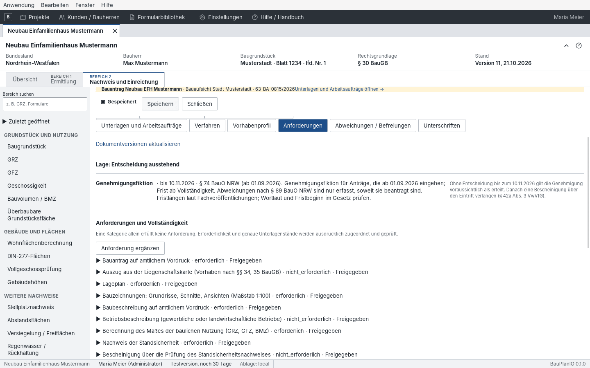

  **Nachweis als Unterlage:** Gehört zu einer Anforderung ein Nachweis der
  Projektakte (etwa GRZ und GFZ oder die Abstandsflächen), legt „Nachweis als
  Unterlage übernehmen“ den aktuellen Nachweisstand als PDF in den
  Projektdateien ab und ordnet ihn zu. Nach einer Neuberechnung meldet die
  Projektübersicht die Anforderung erneut; „Unterlage aus dem Nachweis
  aktualisieren“ schreibt dieselbe Datei als nächste Version fort.
  **Dateivorschläge:** Liegt in den Projektdateien eine Datei mit passender
  Kategorie (z. B. Lageplan), bietet die Anforderung sie mit „Zuordnen“ an.

- **Abweichungen / Befreiungen:** Art, Vorschrift, Soll/Ist, Begründung und
  Unterlagen. Die App schlägt Bedarf aus aktuellen Nachweisen vor (z. B.
  GRZ-Überschreitung).
- **Unterschriften:** wer welche Unterlage in welcher Version unterschreibt.
  Die Angabe erzeugt keine Signatur im PDF.
- **Unterlagen und Arbeitsaufträge** bündelt Anforderungen, Nachforderungs-
  punkte und Pflichten aus Bescheiden in einer Liste; Änderungen führen zum
  Originaleintrag.

### Laufendes Verfahren

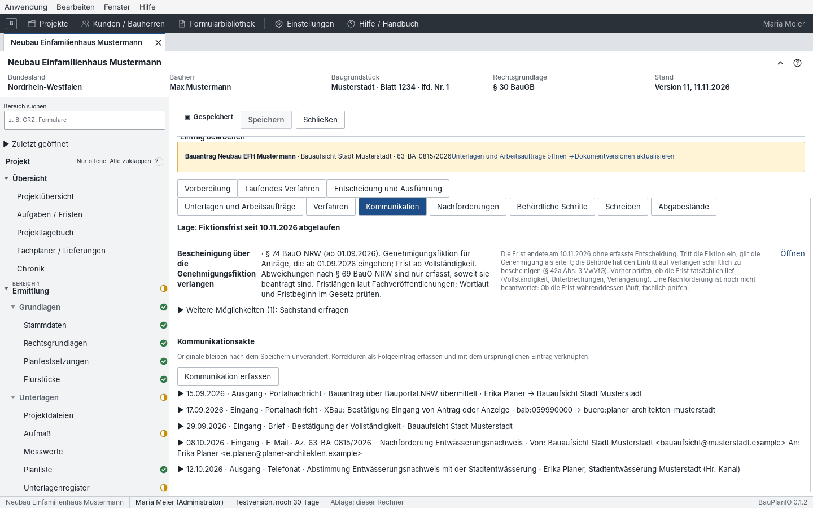

- **Kommunikation:** jedes Ereignis mit Richtung, Art, Datum, Betreff und dem
  Originalbeleg als Dokumentversion (Portalbeleg, Eingangsbestätigung,
  E-Mail, Telefonnotiz). „Kommunikation erfassen“ legt einen Eintrag an.
- **Nachforderungen:** jeden Forderungspunkt einzeln mit Wortlaut, Frist,
  Zuständigkeit und Antwortunterlagen. Der Status unterscheidet *in
  Bearbeitung*, *eingereicht* und *behördlich bestätigt*. **Antwort
  einreichen** führt durch die vier Schritte: Antwortunterlagen zuordnen,
  Nachreichung festhalten, Anschreiben erstellen, Versand erfassen. Ein Punkt
  kann eine **Unterlage der Akte** betreffen und **Aufgaben** mitführen: Der
  Vorgang erscheint dann in Übersicht und Fristen nur einmal, die
  Antwortunterlagen stehen auch bei der Unterlage, und die Aufgaben sind
  erledigt, sobald der Punkt beantwortet ist.

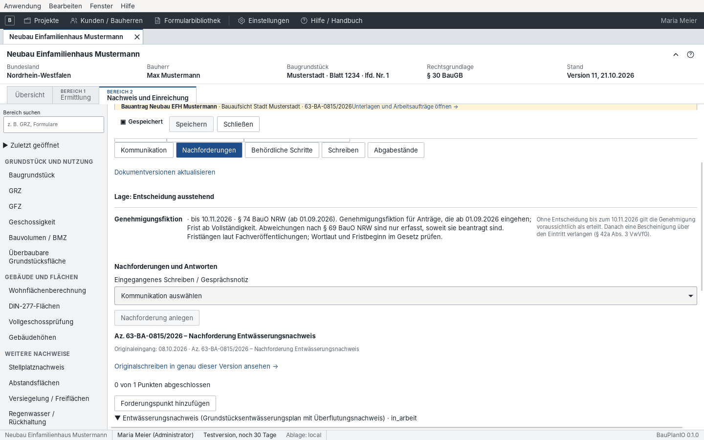

- **Behördliche Schritte:** Anhörung, Zurückstellung, Beteiligungen mit
  Fristen.
- **Schreiben:** Antwort auf Nachforderung, Fristverlängerung, Stellungnahme,
  Sachstandsanfrage, Rücknahme – als PDF im Briefbogen, auf Wunsch als
  Projektunterlage abgelegt.
- **Abgabestände:** siehe unten.

### Abgabestände

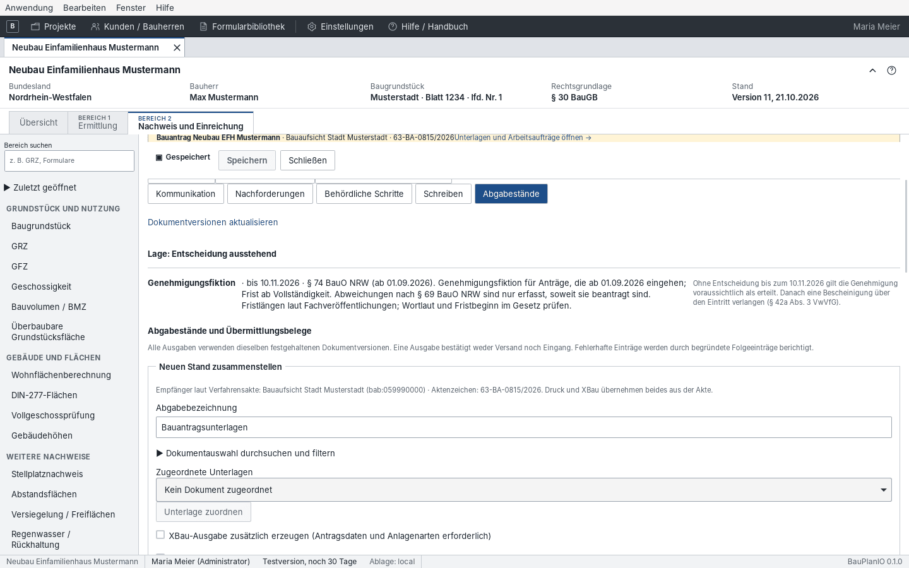

Ein Abgabestand hält **genau die Dokumentversionen** fest, die abgegeben
werden. Er ist unveränderlich.

1. Unter „Neuen Stand zusammenstellen“ die Unterlagen wählen; der Vergleich
   zeigt, was neu, geändert oder bereits eingereicht ist.
2. Bei einer Nachreichung den belegten Vorgänger und ersetzte Dokumente
   angeben.
3. Optional „XBau-Ausgabe zusätzlich erzeugen“.
4. **Festhalten.** ZIP-, PDF- und XBau-Artefakte bleiben diesem Stand
   zugeordnet.
5. Versand und Eingang **separat** mit Datum, Übermittlungsweg, Referenz und
   Beleg dokumentieren („Abgabestände und Übermittlungsbelege“).

Export ≠ Versand ≠ bestätigter Eingang ≠ Genehmigung. Jeder Zustand braucht
seinen eigenen Beleg.

Jeder Abgabestand trägt **eine Aussage** zu seinem Stand, etwa
„Zusammengestellt · Versand unbestätigt“, „Versendet am …“, „Eingang
bestätigt am …“ oder „Extern eingereicht (belegt) am …“. Dieselbe Aussage
steht in der Projektübersicht. Wurde der Stand erst nach einer extern
erfolgten Einreichung festgehalten, gilt er durch die externe Einreichung mit
denselben Dokumentversionen und Beleg als eingereicht; beide erscheinen in der
Übersicht als eine Zeile.

### Entscheidung und Ausführung

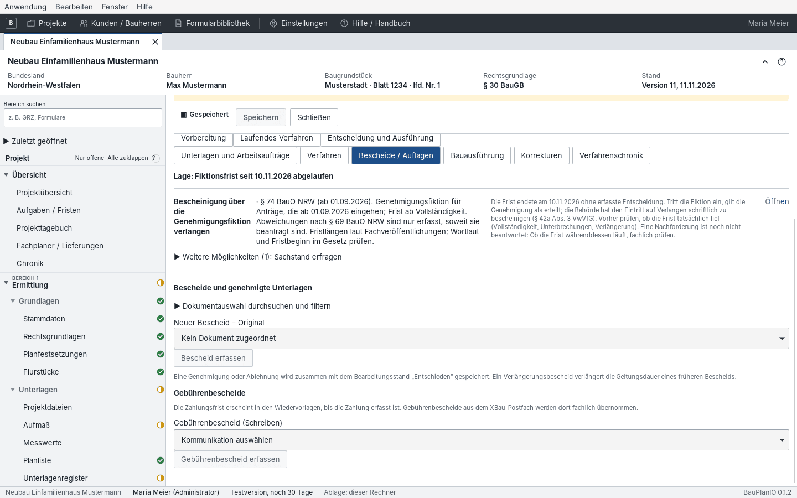

- **Bescheide / Auflagen:** „Bescheid erfassen“ mit Entscheidung, Zustellung
  und Bezug zum Abgabestand; die **ausdrücklich genehmigten Versionen**
  zuordnen (nicht pauschal die neuesten). Nebenbestimmungen als Auflage,
  Bedingung, Befristung, Vorbehalt oder Hinweis. „Gebührenbescheid erfassen“
  für Gebühren.
- **Bauausführung:** Checklisten für Baubeginn und Nutzungsaufnahme
  (Baubeginnanzeige, Bauleitung, Absteckung, bautechnische Nachweise) mit
  Fristen nach Landesrecht.

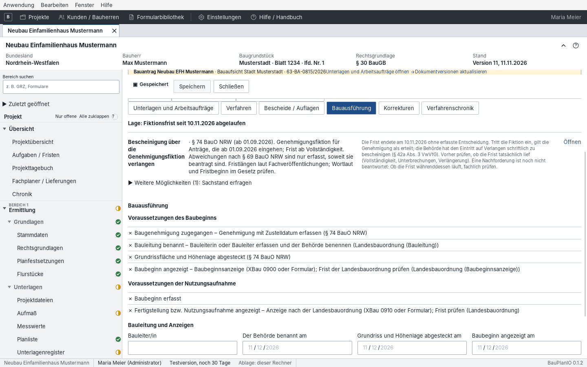

- **Korrekturen:** Gespeicherte Originalangaben werden nicht überschrieben,
  sondern begründet berichtigt.
- **Verfahrenschronik:** alle Ereignisse des Verfahrens in zeitlicher Folge.

## Einreichen / Nachreichen

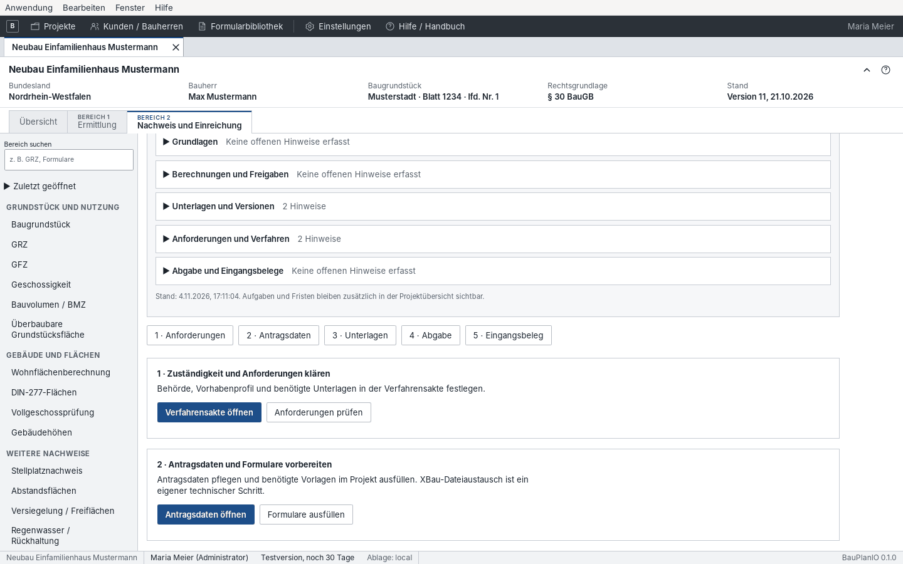

Der geführte Einstieg für jede Abgabe. Nach Wahl der Verfahrensakte zeigt der
**Arbeitscheck** offene Punkte in den Gruppen Grundlagen, Berechnungen und
Freigaben, Unterlagen und Versionen, Anforderungen und Verfahren, Abgabe und
Eingangsbelege. Darunter führen fünf Schritte zu den zuständigen Bereichen:

1. **Anforderungen** – Zuständigkeit und Unterlagenbedarf klären.
2. **Antragsdaten** – Bauantrag / XBau pflegen, Formulare ausfüllen.
3. **Unterlagen** – Projektdateien und Druckausgabe prüfen.
4. **Abgabe** – Portalziel bestätigen, Abgabestand festhalten, bereitstellen.
5. **Eingangsbeleg** – Portalbeleg, Kommunikation, Nachforderungen.

## Einreichungsprüfung

„Verfahren → Einreichungsprüfung“ fasst vor dem Absenden alles in einer Liste
mit Ampel zusammen: Bauvorlagen, Nachweise, Pläne und Planindex, Formulare,
Lieferungen der Fachplaner und offene Punkte der Verfahrensakte. Rot ist vor
dem Einreichen zu erledigen, Gelb bewusst zu prüfen. Ein Klick auf einen Punkt
öffnet die Stelle in der Akte; die Bereichskacheln filtern die Liste.

## Bauantrag / XBau

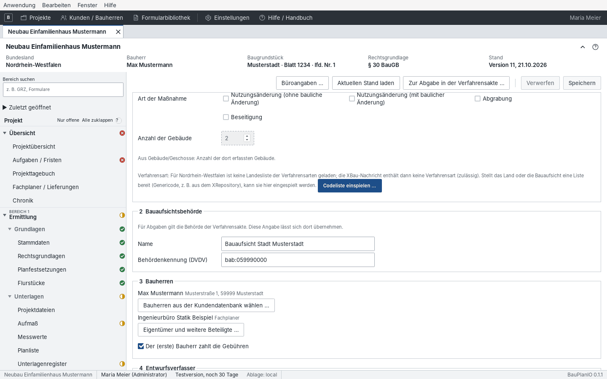

Die strukturierten Antragsangaben für jeden Abgabestand: Bauvorhaben (Art der
Maßnahme, Anzahl der Gebäude aus dem Gebäudemodell), Bauaufsichtsbehörde,
Bauherren, Entwurfsverfasser (aus den Büroangaben), Grundstück. „Büroangaben
…“ öffnet die Absenderdaten, „Zur Abgabe in der Verfahrensakte …“ springt zu
den Abgabeständen.

Der gelbe Kasten „Bitte prüfen“ nennt, was die XBau-Nachricht derzeit nicht
abbilden kann (z. B. fehlende Landes-Verfahrensart-Codeliste; „Codeliste
einspielen“). Die Antragsmaske ersetzt nicht das amtliche Landesformular –
dieses zusätzlich unter „Formulare“ ausfüllen.

Ein IFC-Gebäudemodell wird wie jede andere Bauvorlage beigefügt. Im
IFC-Modell unter „Export“ ordnet **Modelldatei dem Bauantrag beifügen** die
Datei mit der Anlagenart 2010 „BIM-Gebäudemodell“ zu
([Kapitel 5](05-ermittlung.md#ifc-datei-schreiben-und-dem-bauantrag-beifügen)).
IFC-Dateien ohne eigene Kategorie bekommen diese Anlagenart vorgeschlagen.
Übermittelt wird die neueste Version der Datei.

## Einreichen / Portal

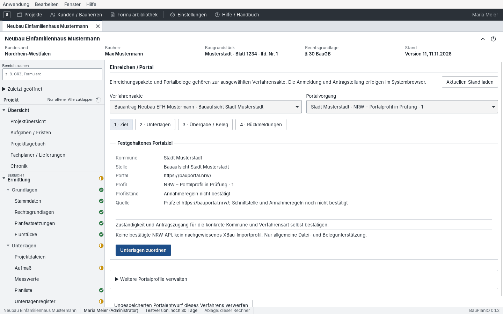

BauPlanDESK bereitet die **manuelle** Portalübergabe vor; es gibt keinen
automatischen Versand.

1. **Ziel:** Kommune, Stelle, Portaladresse und Portalprofil festhalten und
   die Zuständigkeit bestätigen.
2. **Unterlagen:** Abgabestand wählen, Uploadnamen und Unterlagenarten prüfen.
3. **Übergabe / Beleg:** ZIP oder Einzeldateien exportieren, „Portal im
   Systembrowser öffnen“, dort hochladen und verbindlich absenden.
   Anschließend den Portalbeleg importieren und zuordnen.
4. **Rückmeldungen:** Eingangsbestätigung, Nachforderungen, Bescheid als
   Originale importieren und der Akte zuordnen.

## XBau-Nachrichten

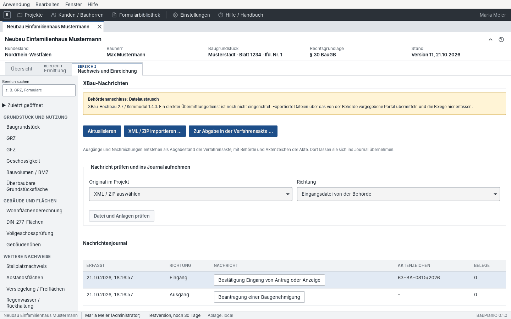

- **Ausgehend:** XBau-Nachrichten entstehen aus dem Abgabestand (Antrag,
  Nachreichung, Anzeige) und stehen im **Nachrichtenjournal**.
- **Eingehend:** „XML / ZIP importieren …“, dann unter „Nachricht prüfen und
  ins Journal aufnehmen“ Original und Richtung wählen und „Datei und Anlagen
  prüfen“. Kopf, Anlagen, Schema und Zuordnung werden geprüft; „Auswerten“
  zeigt die Auswirkungen (Eingangsbestätigung, Aktenzeichen, Bescheid …), die
  erst nach Bestätigung übernommen werden.
- Der Behördenanschluss ist derzeit Dateiaustausch: exportierte Dateien über
  das vorgegebene Portal übermitteln und Belege hier erfassen.

## Einreichungen

Der Eintrag erscheint im Projektbaum nur, wenn das Projekt frühere
Einreichungspakete enthält. Frühere Einreichungspakete (vor Einführung der
Abgabestände) bleiben hier lesbar und exportierbar. Neue Einreichungen entstehen immer als Abgabestand
der Verfahrensakte. Eine außerhalb der App erfolgte Einreichung wird in der
Verfahrensakte mit „Externe Einreichung nachtragen …“ dokumentiert.

## Suche / Wiedervorlagen

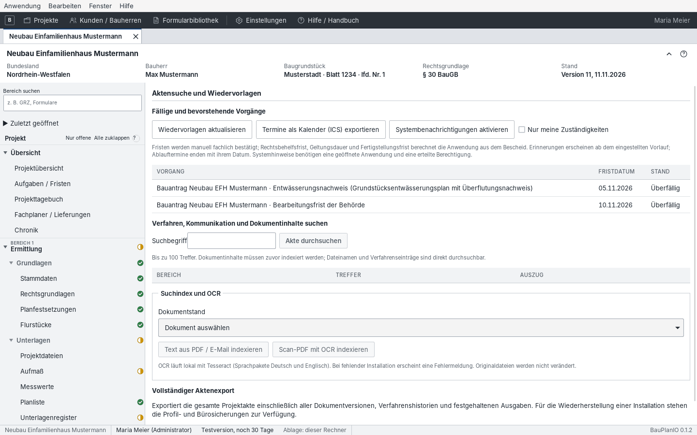

- **Fällige und bevorstehende Vorgänge** aus allen Verfahren; „Nur meine
  Zuständigkeiten“ filtert. „Termine als Kalender (ICS) exportieren“ übergibt
  sie an Outlook & Co.; „Systembenachrichtigungen aktivieren“ erinnert, solange
  die App läuft.
- **Akte durchsuchen:** Dateinamen und Verfahrenseinträge sofort,
  Dokumentinhalte nach „Text aus PDF / E-Mail indexieren“ bzw. „Scan-PDF mit
  OCR indexieren“ (Tesseract mit deutschem Sprachpaket nötig).
- **Vollständiger Aktenexport:** die ganze Projektakte mit allen Versionen,
  Historien und Artefakten als ZIP – zur Weitergabe oder Archivierung, nicht
  als Behördenabgabe.

## Übersicht: Aufgaben, Fristen und Chronik

Im Register **Übersicht**:

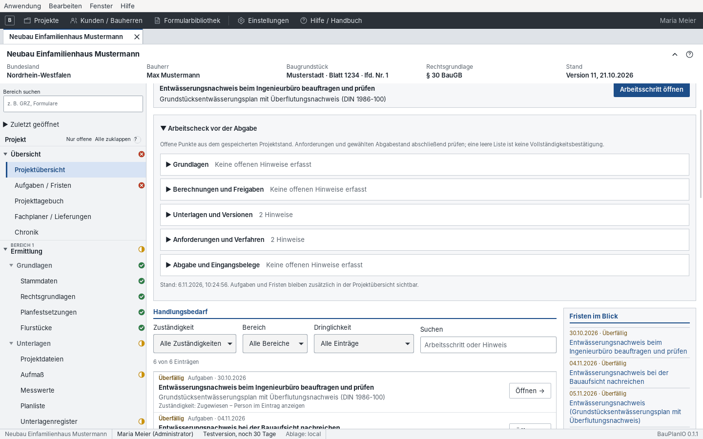

- **Projektübersicht:** Zähler für offene Aufgaben, Unterlagen,
  Nachweise, Nachforderungen, Auflagen und überfällige Fristen; der **nächste
  Arbeitsschritt**; der aufklappbare „Arbeitscheck vor der Abgabe“;
  **Handlungsbedarf** mit Filtern nach Zuständigkeit, Bereich und
  Dringlichkeit; „Fristen im Blick“; Verfahren und Abgaben mit dokumentiertem
  Behördenstand („Welche Dokumentversionen wurden eingereicht?“).
- **Aufgaben / Fristen:** Aufgabe, Status, Frist und Verantwortliche; erledigt
  erst, wenn das Ergebnis vorliegt.

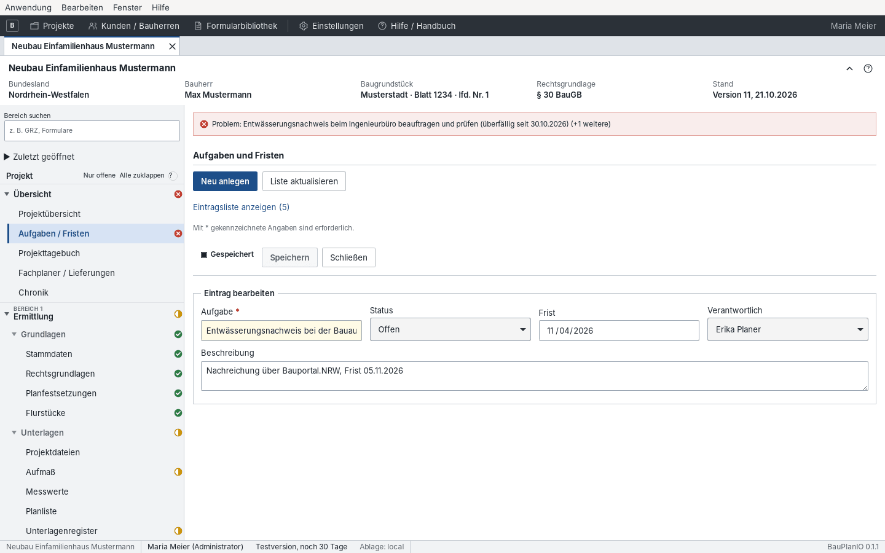

- **Chronik:** alle gespeicherten Änderungen mit Zeit, Benutzer, Aktion und
  Details, einschließlich Aufmaßübernahmen mit altem und neuem Wert.

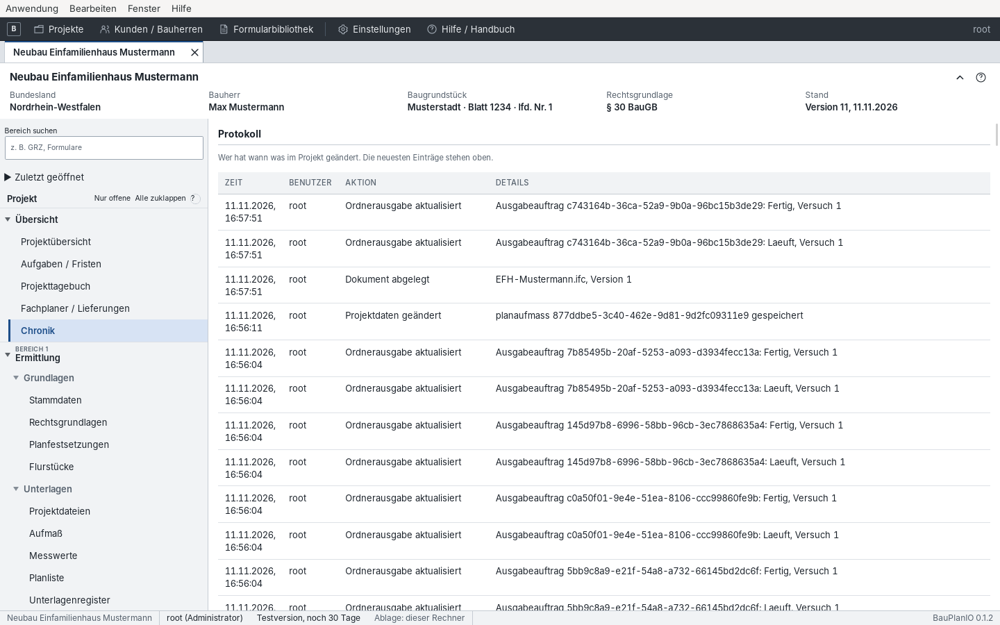

## Projektstand und Projektabschluss

Oben in der Projektübersicht zeigt eine Leiste den **Projektstand** in sechs
Stufen: Vorbereitung, Eingereicht, Genehmigt, Im Bau, Fertiggestellt,
Abgeschlossen. Die aktuelle Stufe ist hervorgehoben und nennt das Datum
(„Eingereicht · seit 15.09.2026“). Derselbe Stand steht im
Projektverzeichnis in der Spalte „Stand“.

- Die Stufen bis „Fertiggestellt“ ergeben sich aus den Verfahrensakten:
  Einreichung, Entscheidung, Baubeginn und Fertigstellung werden dort
  dokumentiert und nicht doppelt gepflegt. Eine Ablehnung erscheint als
  „Abgelehnt“ an der Stelle von „Eingereicht“.
- **„Projekt abschließen …“** führt das Projekt als abgeschlossen. Alle Daten
  bleiben erhalten und bearbeitbar; im Projektverzeichnis blendet der Filter
  „Laufende“ abgeschlossene Projekte aus.
- **„Projekt wieder öffnen“** nimmt den Abschluss zurück; es gilt wieder der
  Stand aus den Verfahrensakten.

## Projekttagebuch und Fachplaner

Das **Projekttagebuch** hält Telefonate, Besprechungen, Ortstermine, Mängel und
Entscheidungen des Bauherrn fest, mit Anhängen und Wiedervorlage.

Unter **Fachplaner / Lieferungen** führt das Büro je Statiker, Vermesser,
Brandschutz- oder Wärmeschutzplaner eine Lieferliste: angeforderte Unterlagen,
Anfrage, zugesagter Termin, Stand und gelieferte Dateien. Ausstehende
Lieferungen erscheinen im Büro-Cockpit, im Kalender-Abo und in der
Einreichungsprüfung.

## Büro-Cockpit, Kalender-Abo und tägliche E-Mail

Die Startseite zeigt alle laufenden Fristen und Verfahren der lesbaren
Projekte. Im Netzwerkbetrieb gibt es unter Einstellungen ein persönliches
**Kalender-Abo** und die **tägliche E-Mail** mit überfälligen und in sieben
Tagen fälligen Terminen, mit Abwesenheit und Vertretung.

## Sachstandsbericht

„Sachstandsbericht für Bauherrn …“ in der Projektübersicht gibt ein Schreiben
mit Verfahrensstand, eingereichten Unterlagen, offenen Nachforderungen,
nächsten Fristen und Bescheiden aus. Bürointerne Aufgaben, Tagebuch und
Fachplaner stehen nicht darin.
