# 10 Leitfaden: ein Projekt vollständig umsetzen

[← Standard-Workflows](09-workflows.md) · [Inhalt](README.md) · [Weiter: Anhang →](11-anhang.md)

Dieser Leitfaden führt einmal durch ein ganzes Bauantragsprojekt: vom
eingerichteten Büro über Grundlagen, Aufmaß und Nachweise bis zur Einreichung,
zum laufenden Verfahren und zum Abschluss. Jeder Schritt sagt, **was** zu tun
ist, **wo** es in der App steht und **wie es im Beispielprojekt aussieht**.
Die Einzelheiten stehen in den verlinkten Kapiteln; die Checklisten in
[Kapitel 9](09-workflows.md) fassen dieselben Abläufe kurz zusammen.

Das Beispiel ist der **„Neubau Einfamilienhaus Mustermann“** in Nordrhein-Westfalen:
ein freistehendes Einfamilienhaus mit Keller, ausgebautem Dachgeschoss und
Grenzgarage für Max Mustermann, Lindenweg 12, 59999 Musterstadt (alle Namen
und Orte erfunden). Alle Bilder des Handbuchs stammen aus genau diesem Projekt.

> **Tipp:** Arbeiten Sie den Leitfaden mit geöffnetem Beispielprojekt durch.
> Sie sehen dann zu jedem Schritt das fertige Ergebnis und können es mit
> Ihrem eigenen Projekt vergleichen.

## Überblick

| Phase | Schritte | Ergebnis im Beispielprojekt |
| --- | --- | --- |
| A Vorbereiten | 1–2 | Beispielprojekt geladen, Büro und Kunden vorhanden |
| B Grundlagen | 3–6 | Projekt NRW, B-Plan Nr. 42, Festsetzungen, drei Flurstücke |
| C Ermitteln | 7–10 | Pläne im DMS, Aufmaß, Wohnhaus und Garage, drei Raumbücher |
| D Nachweisen | 11–14 | 13 Nachweise, alle aktuell und freigegeben |
| E Unterlagen | 15–16 | Bauantragsformular, Berechnungsheft, Bauvorlagenpaket |
| F Einreichen | 17–20 | Verfahrensakte, Abgabestand mit XBau, Bauportal.NRW mit Beleg |
| G Verfahren begleiten | 21–23 | Az. 63-BA-0815/2026, Vollständigkeit, offene Nachforderung |
| H Abschließen | 24–26 | Bescheid, Bauausführung, Projektabschluss, Sicherung |

Das Beispiel steht am Stand „in behördlicher Prüfung“: Schritte 1 bis 22 sind
erledigt, die Nachforderung des Entwässerungsnachweises (Schritt 23) ist offen.
Die Schritte 24 bis 26 zeigt der Leitfaden als Ausblick.

## A Vorbereiten

### Schritt 1: Beispielprojekt laden

Das Beispielprojekt wird nicht mit der App ausgeliefert. Es liegt als
Sicherungsarchiv `Beispielprojekt-EFH-Mustermann.zip` bei (im Repository unter
`beispiele/`).

1. Auf dem Arbeitsplatz im **Projektverzeichnis** „Aus Sicherung übernehmen …“
   wählen. Den Knopf sehen nur Administratoren, und er steht nur im
   Einzelplatzbetrieb zur Verfügung.
2. Das Archiv auswählen. Das Projekt wird mit allen Dokumenten in das laufende
   Profil kopiert und öffnet sich sofort; ein Neustart ist nicht nötig.
3. Ihre eigenen Projekte, Kunden und Büroangaben bleiben unverändert. Fehlt in
   Ihrem Büro die Entwurfsverfasserin des Beispiels (Erika Planer), wird sie
   ergänzt, damit der Bauantrag vollständig bleibt.
4. Zum Zurücksetzen das Beispielprojekt im Projektverzeichnis löschen und
   erneut übernehmen. Ein schon vorhandenes Projekt wird nicht doppelt
   übernommen.

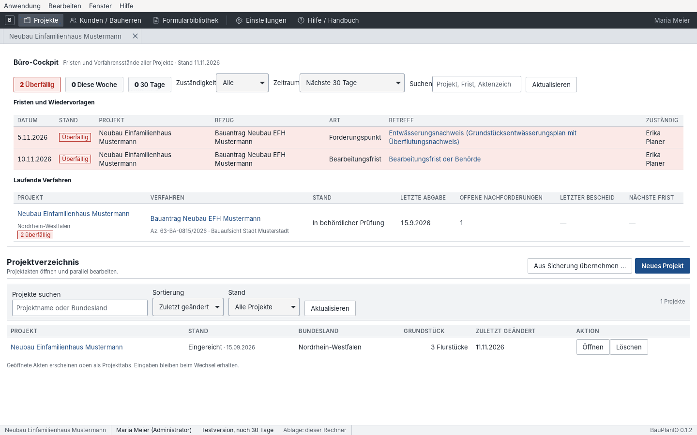

Mehr dazu: [Kapitel 3, Sicherung](03-einrichtung.md#sicherung).

### Schritt 2: Büro, Benutzer und Kunden

Einmal je Büro, bevor das erste Projekt beginnt
([Kapitel 3](03-einrichtung.md)).

1. **Einstellungen → Büroangaben:** Büroname, Anschrift und die
   bauvorlageberechtigten Personen mit Kammer und Mitgliedsnummer. Sie
   erscheinen später im Bauantrag als Entwurfsverfasser.
2. **Einstellungen → Benutzer:** ein Konto je Mitarbeiter mit passender Rolle.
3. **Kunden / Bauherren:** Bauherrschaft, Fachplaner und Nachbarn als Kunden
   anlegen. Sie werden im Projekt nur noch zugeordnet.
4. **Formularbibliothek:** die mitgelieferten NRW-Vordrucke übernehmen und
   eigene Büroformulare ablegen.

**Im Beispiel:** Planungsbüro Planer Architekten, Am Markt 5, 59999 Musterstadt;
Entwurfsverfasserin Erika Planer, Architektin, Architektenkammer NRW,
Mitgliedsnummer A-12345. Kunden: Bauherr Max Mustermann, der Tragwerksplaner
und die Eigentümer der Nachbarflurstücke 411 und 413.

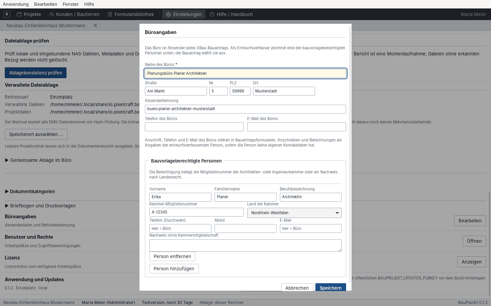

## B Grundlagen

### Schritt 3: Projekt anlegen und Stammdaten

**Projekte → Neues Projekt**, dann **Ermittlung → Grundlagen → Stammdaten**
([Kapitel 4](04-projekt-grundlagen.md#neues-projekt)).

1. Projektname und Bundesland wählen. Das Bundesland bestimmt Landesbauordnung,
   Bauvorlagen und Regelpakete und lässt sich später nur bewusst ändern.
2. In den Stammdaten Vorhaben, Anschrift, Kennzeichen, Phase, Bauherrschaft
   und Projektmitglieder eintragen und speichern.

**Im Beispiel:** „Neubau Einfamilienhaus Mustermann“, Nordrhein-Westfalen,
Kennzeichen 2026-017, Phase „Genehmigung“, Vorhaben „Neubau eines
freistehenden Einfamilienhauses mit Garage“, Nutzung Wohnen (eine
Wohneinheit). Bauherr Max Mustermann; Projektleitung Erika Planer.

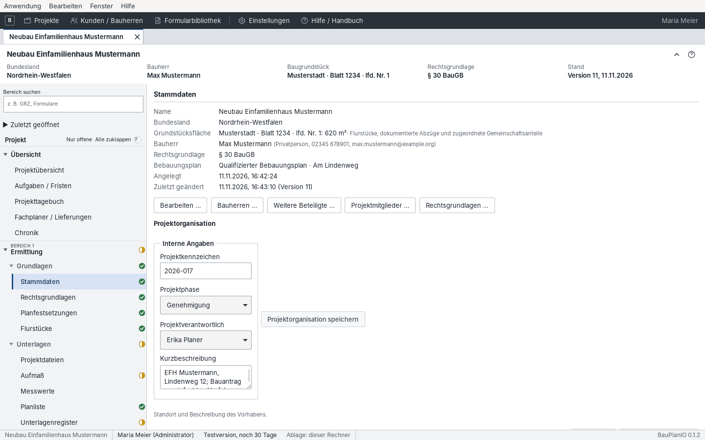

### Schritt 4: Rechtsgrundlagen

**Ermittlung → Grundlagen → Rechtsgrundlagen**
([Kapitel 4](04-projekt-grundlagen.md#rechtsgrundlagen)).

Planungsrechtliche Grundlage, Art des Bebauungsplans, BauNVO-Fassung und die
Landesbauordnung festlegen. Ohne Rechtsgrundlage bleiben GRZ und GFZ gesperrt.

**Im Beispiel:** § 30 BauGB, qualifizierter Bebauungsplan Nr. 42 „Am
Lindenweg“ der Stadt Musterstadt, rechtskräftig seit 15.05.2019, BauNVO 2017,
BauO NRW.

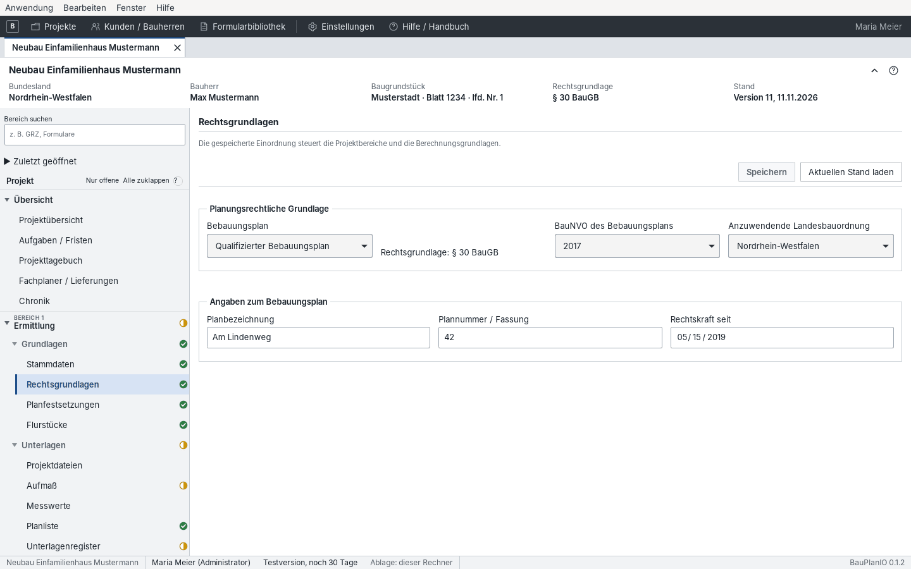

### Schritt 5: Planfestsetzungen

**Ermittlung → Grundlagen → Planfestsetzungen**
([Kapitel 4](04-projekt-grundlagen.md#bebauungsplanfestsetzungen)).

Die Festsetzungen des Bebauungsplans als Werte eintragen. Gegen genau diese
Werte prüfen später GRZ, GFZ, Vollgeschosse und Gebäudehöhen.

**Im Beispiel:** Allgemeines Wohngebiet (WA), GRZ 0,4, GFZ 0,8, höchstens
II Vollgeschosse, offene Bauweise, Satteldach 30–45°, Traufhöhe höchstens
6,50 m, Firsthöhe höchstens 10,00 m über Straßenoberkante Lindenweg
(72,40 m ü. NHN).

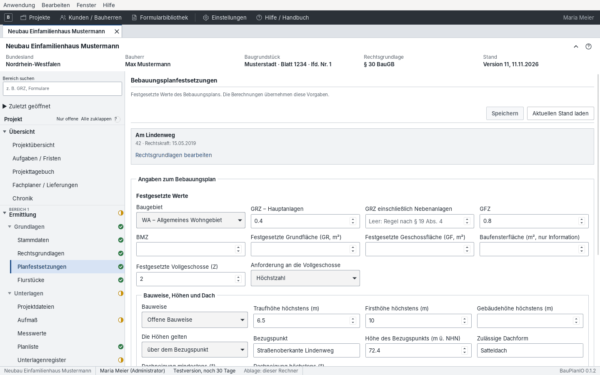

### Schritt 6: Flurstücke und Grundbuch

**Ermittlung → Grundlagen → Flurstücke**
([Kapitel 4](04-projekt-grundlagen.md#flurstücke-und-grundbuch)).

Jedes betroffene Flurstück mit Gemarkung, amtlicher Fläche, Bezug zum Vorhaben,
Eigentümern und Grundbuchangaben erfassen. Nachbarflurstücke werden für
Abstandsflächen und Nachbarbeteiligung gebraucht.

**Im Beispiel:** Flurstück 412 mit 620 m² ist das Vorhabengrundstück
(Eigentümer Max Mustermann, Grundbuch von Musterstadt Blatt 1234). Die
Nachbarflurstücke 411 (655 m²) und 413 (598 m²) gehören den beiden Nachbarn.
Alle drei sind später im Lageplan gezeichnet; die gezeichnete Fläche steht als
Gegenprobe neben der Katasterfläche.

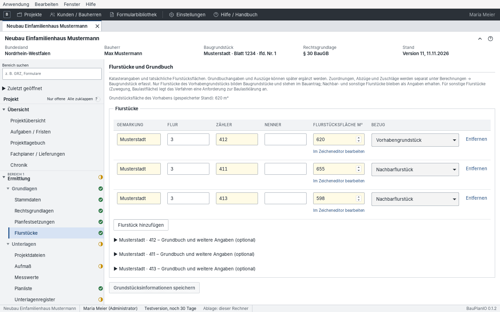

## C Ermitteln

### Schritt 7: Projektdateien, Planliste und Unterlagenregister

**Ermittlung → Unterlagen**
([Kapitel 5](05-ermittlung.md#projektdateien)).

1. Pläne und Schriftstücke in **Projektdateien** importieren und einer
   Kategorie zuordnen. Eine überarbeitete Datei immer als **neue Version**
   desselben Dokuments ablegen, nie als neues Dokument.
2. In der **Planliste** jedem Plan Plannummer, Index und Dokument geben.
3. Das **Unterlagenregister** zeigt, welche Bauvorlagen das Verfahren
   verlangt und welche schon vorliegen, geprüft und freigegeben sind.

**Im Beispiel:** Lageplan 1:500, Grundrisse KG/EG/DG, Schnitt A-A, Ansichten,
Baubeschreibung, Grundbuchauszug, Statik-Vorabzug mit Kriterienkatalog,
Nachweis der Bauvorlageberechtigung und Baustatistik. Die Planliste führt
LP-01 (Lageplan), GR-01 (Grundrisse), SN-01 (Schnitt) und AN-01 (Ansichten).
Im Unterlagenregister sind zwölf Unterlagen freigegeben; der
Entwässerungsnachweis steht noch im Entwurf.

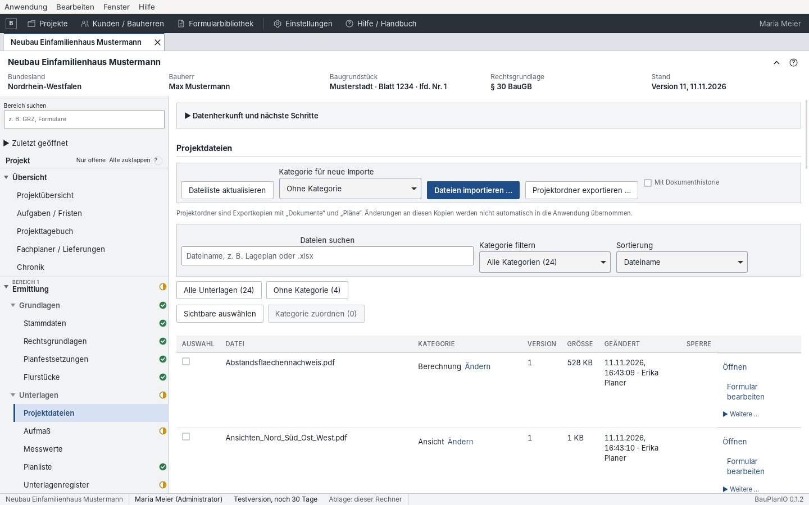

### Schritt 8: Aufmaß

**Ermittlung → Unterlagen → Aufmaß**
([Kapitel 5](05-ermittlung.md#aufmaß-und-zeicheneditor)).

1. Für jeden Plan ein Aufmaß anlegen und den **Maßstab kalibrieren** (eine
   bekannte Strecke nachmessen).
2. Ausschnitte für Grundrisse und Schnitt bilden, damit Messungen dem
   richtigen Geschoss zugeordnet sind.
3. Unter **Aufgaben** zeichnen, was die Berechnungen brauchen:
   Flurstücksgrenzen, Gebäudeumriss, Geschossflächen, Räume, Höhen und Linien
   für Abstandsflächen. Jede Aufgabe zeigt, wofür ihr Messwert verwendet wird.

**Im Beispiel:** Der Entwurfsplan EP-01 (Grundrisse und Schnitt, M 1:100) und
der Lageplan LP-01 (M 1:200) sind aufgemessen. Im Lageplan liegen die drei
Flurstücke, die Umrisse von Wohnhaus und Garage und je Außenwand eine Linie
„Abstandsfläche“ (A1 bis A8).

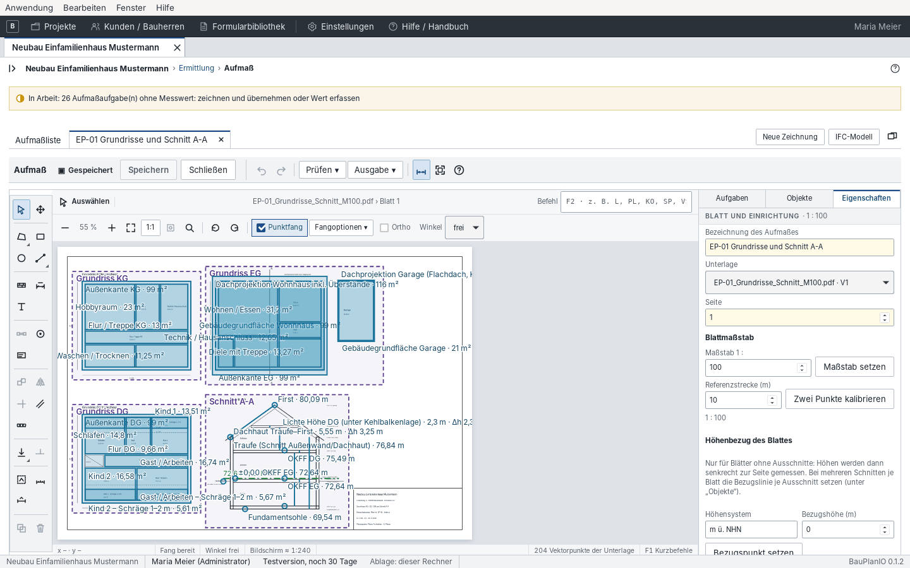

### Schritt 9: Gebäude und Geschosse

**Ermittlung → Gebäudemodell → Gebäude / Geschosse**
([Kapitel 5](05-ermittlung.md#gebäude-und-geschosse)).

Jedes Gebäude mit Flurstückszuordnung, Grundfläche, Höhenbezug, Dach und
Geschossen anlegen; jedes Geschoss als Vollgeschoss oder nicht einstufen. Die
Werte kommen am besten aus dem Aufmaß, dann bleibt die Herkunft nachvollziehbar.

**Im Beispiel:**
- **Wohnhaus** 11,00 × 9,00 m (99 m²) mit KG, EG und DG, Satteldach 36°.
  ±0,00 = OK Fertigfußboden EG = 72,64 m ü. NHN, Traufe +4,20 m, First +7,45 m.
- **Garage** 3,50 × 6,00 m als Grenzgarage an der Ostgrenze, Flachdach,
  kein Vollgeschoss.

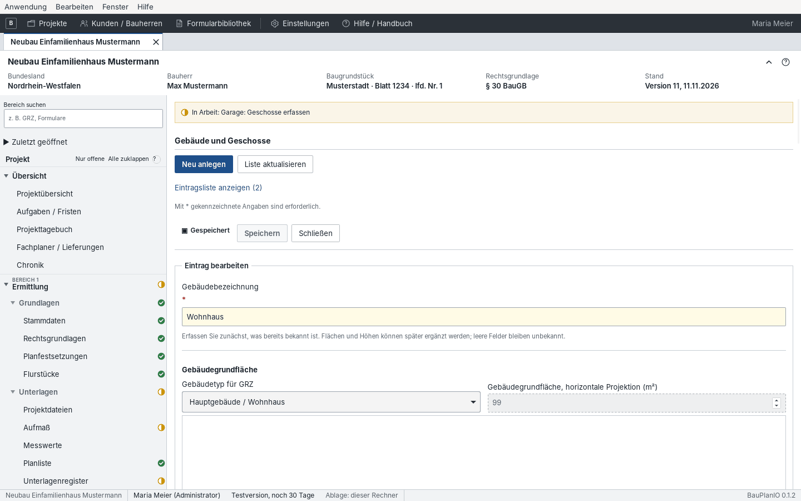

### Schritt 10: Flächen- und Raumbuch

**Ermittlung → Gebäudemodell → Flächen- und Raumbuch**
([Kapitel 5](05-ermittlung.md#flächen--und-raumbuch)).

Je Geschoss ein Raumbuch mit allen Räumen, Flächen und Nutzungen. Dachschrägen
werden als Höhenzonen geführt, damit Wohnfläche und DIN 277 richtig rechnen.

**Im Beispiel:** Raumbücher für KG, EG und DG. Das DG hat 6 Räume mit
5 Höhenzonen (lichte Höhe 1,00 bis 2,00 m unter den Dachschrägen).

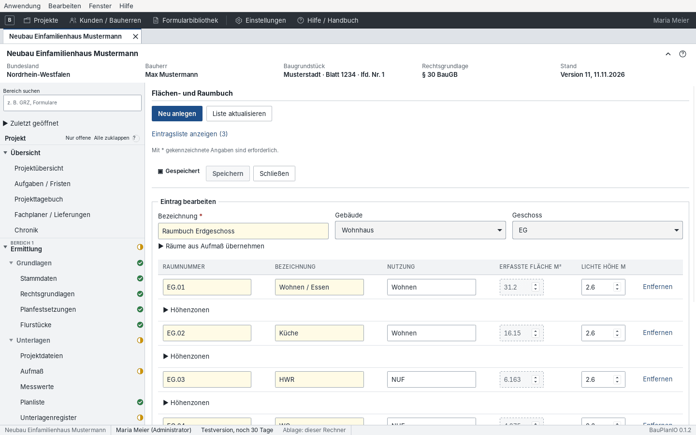

## D Nachweisen

### Schritt 11: Baugrundstück

**Nachweis und Einreichung → Grundstück und Nutzung → Baugrundstück**
([Kapitel 6](06-nachweise.md#baugrundstück)).

Festlegen, welche Flurstücksflächen zum Baugrundstück zählen und welche
Bezugsfläche für GRZ und GFZ gilt.

**Im Beispiel:** Baugrundstück ist Flurstück 412 mit 620 m², ohne Abzüge.

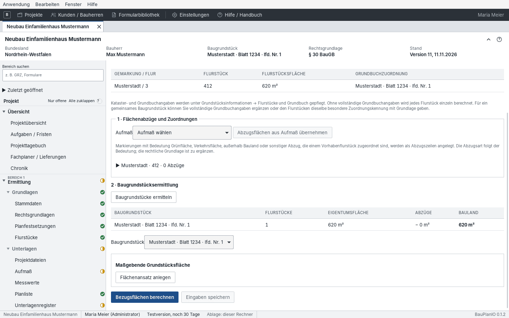

### Schritt 12: Maß der baulichen Nutzung

**Nachweis und Einreichung → Grundstück und Nutzung → GRZ, GFZ,
Geschossigkeit, Bauvolumen / BMZ, Überbaubare Grundstücksfläche**
([Kapitel 6](06-nachweise.md#grz-gfz-geschossigkeit-und-bmz)).

Jede Berechnung prüfen und mit **Nachweis erstellen** als Nachweisstand
festhalten.

**Im Beispiel:** Grundfläche 119 m², GRZ 0,19 (mit Nebenanlagen nach § 19
Abs. 4 BauNVO 0,29) bei zulässigen 0,4; GFZ 0,16 bei zulässigen 0,8; ein
Vollgeschoss bei zulässigen zwei; BMZ 0,46 nur informativ, weil sie nicht
festgesetzt ist. Die überbaubare Grundstücksfläche (Baugrenzen) ist
eingehalten.

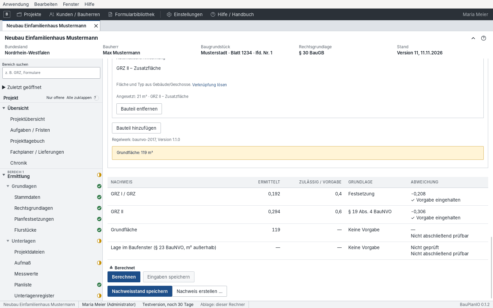

### Schritt 13: Fachnachweise

**Nachweis und Einreichung → Gebäude und Flächen / Weitere Nachweise**
([Kapitel 6](06-nachweise.md#fachberechnungen)).

Die Nachweise berechnen, die das Vorhaben braucht; was nicht gebraucht wird,
im Projektbaum über **⋯ → als nicht benötigt kennzeichnen**.

**Im Beispiel:**

| Nachweis | Ergebnis |
| --- | --- |
| Wohnflächenberechnung nach WoFlV | 154,47 m² |
| DIN 277 | BGF 294,87 m², BRI 883,57 m³ |
| Vollgeschossprüfung (§ 2 Abs. 6 BauO NRW) | KG und DG keine Vollgeschosse |
| Gebäudehöhen | Traufe, First und Dachneigung innerhalb der Festsetzungen |
| Stellplatznachweis | Garage und Stellplatz davor sowie Fahrradstellplätze |
| Versiegelung / Freiflächen | Bilanz für Flurstück 412 |
| Regenwasser / Rückhaltung | Rückhaltung mit Drosselabfluss |
| Abstandsflächen (§ 6 BauO NRW) | Wände aus den Linien A1–A8 im Lageplan, Giebelanrechnung, Grenzgarage nach § 6 Abs. 8; Nachweis mit PDF, JSON und DXF |

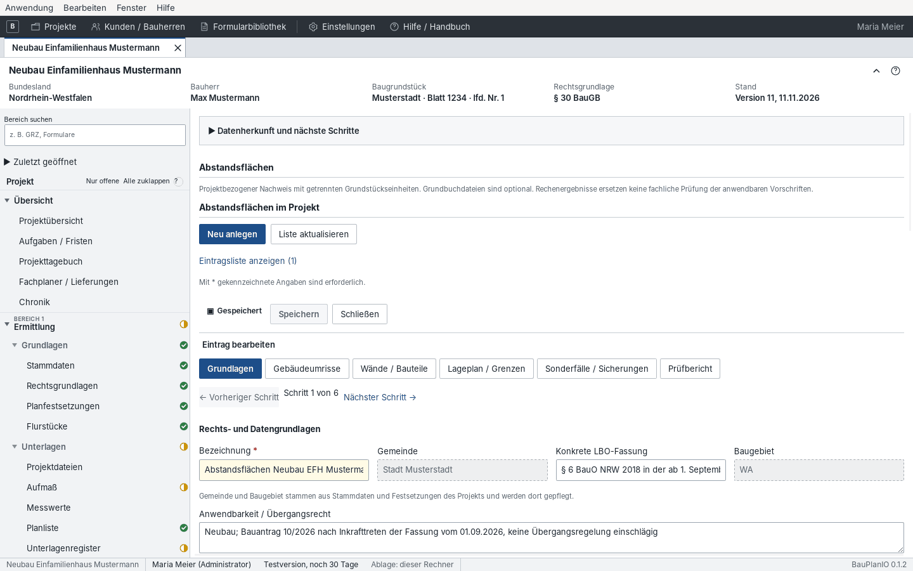

### Schritt 14: Nachweisstände prüfen und freigeben

**Nachweis und Einreichung → Weitere Nachweise → Nachweisstände**
([Kapitel 6](06-nachweise.md#nachweisstände-und-freigaben)).

Ein Nachweis gilt nur, solange seine Grundlagen unverändert sind. Ändert sich
später ein Plan oder ein Wert, wird er als **veraltet** markiert (oranger
Pfeil im Projektbaum) und muss neu erstellt werden. Aktuelle Nachweise prüft
und **freigibt** die Projektleitung; erst dann werden die Bereiche grün.

**Im Beispiel:** alle 13 Nachweise sind aktuell und freigegeben.

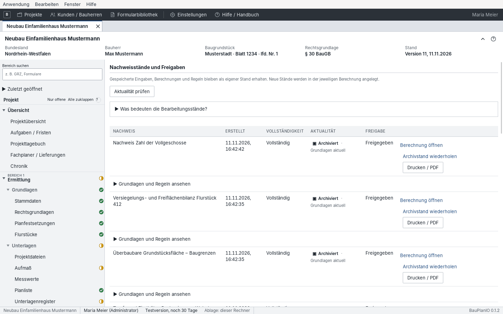

## E Unterlagen erstellen

### Schritt 15: Formulare ausfüllen

**Nachweis und Einreichung → Formulare und Ausgabe → Formulare**
([Kapitel 7](07-formulare-druck.md#pdf-formulare-ausfüllen)).

Amtlichen Vordruck oder Büroformular wählen. Projektdaten und Ergebnisse der
Nachweise werden eingesetzt; geänderte Quellen zeigt der Abgleich an. Das
ausgefüllte Formular als Projektunterlage speichern.

**Im Beispiel:** Bauantrag NRW als Büroformular und als Musterformular. Die
Formulare erhalten Grundstück 620 m², Flurstück 412, WA, B-Plan 42, GRZ 0,19,
GFZ 0,16, Grundfläche 119 m², Bauherr Max Mustermann und Entwurfsverfasserin
Erika Planer.

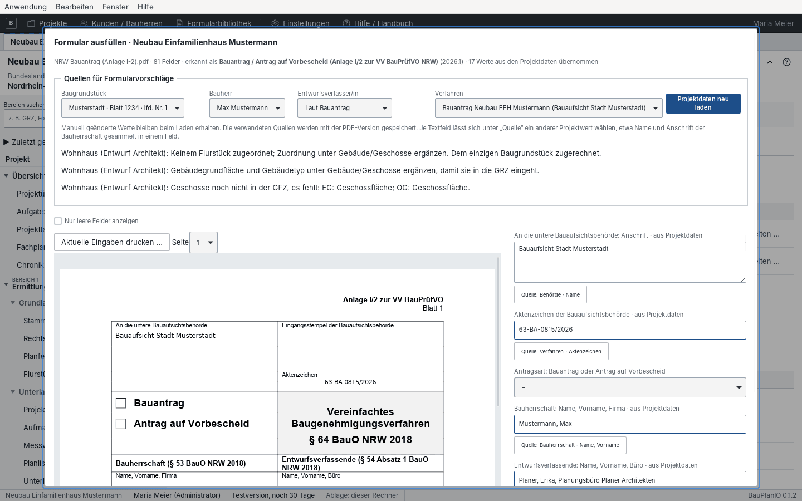

### Schritt 16: Berechnungsheft und Bauvorlagenpaket drucken

**Nachweis und Einreichung → Formulare und Ausgabe → Drucken / PDF-Ausgabe**
([Kapitel 7](07-formulare-druck.md#drucken-und-pdf-ausgabe)).

Berechnungsheft und Bauvorlagenpaket mit Deckblatt, Anschreiben,
Anlagenverzeichnis und Trennblättern erzeugen und als Projektunterlage
ablegen.

**Im Beispiel:** Berechnungsheft und Abstandsflächennachweis; das
Bauvorlagenpaket hat 216 Seiten mit 36 Anlagen (liegt als
`Bauvorlagen-EFH-Mustermann.pdf` neben dem Beispielarchiv).

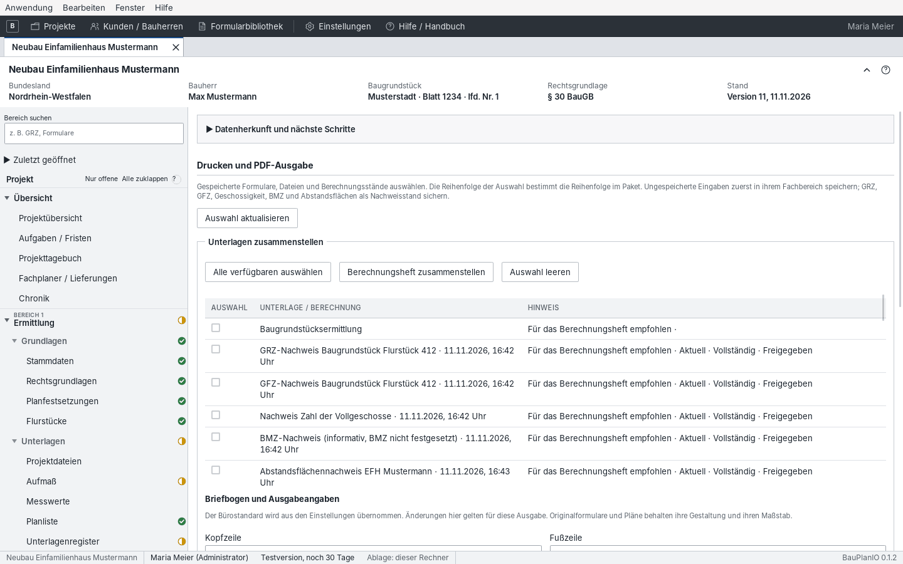

## F Einreichen

### Schritt 17: Verfahrensakte anlegen

**Nachweis und Einreichung → Verfahren → Verfahrensakte**
([Kapitel 8](08-verfahren.md#verfahrensakte)).

Verfahrensart, Prüfverfahren, Gebäudeklasse und zuständige Behörde festlegen
und das Vorhabenprofil bestätigen. Daraus entsteht die Liste der verlangten
Bauvorlagen.

**Im Beispiel:** Bauantrag im vereinfachten Verfahren (§ 64 BauO NRW),
Gebäudeklasse 1, Wohngebäude, Bauaufsicht Stadt Musterstadt (Fachbereich 63
Bauordnung). Der NRW-Bauvorlagenkatalog (Entwurf) liefert 18 Anforderungen.

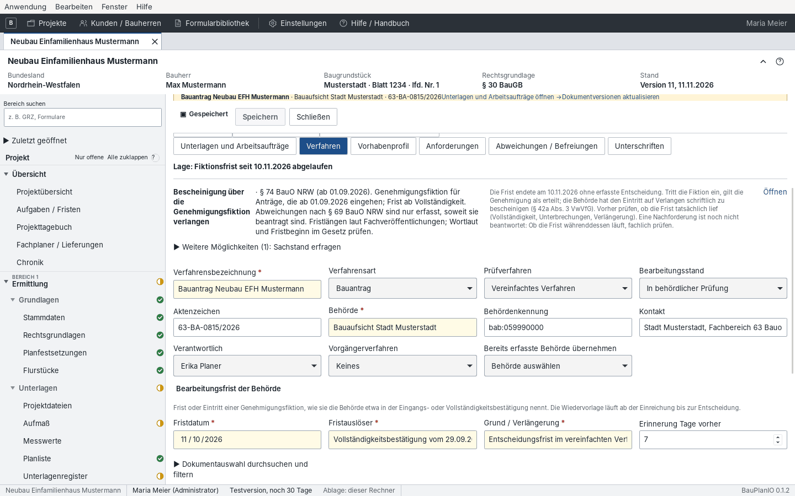

### Schritt 18: Anforderungen, Unterschriften und Aufgaben klären

**Verfahrensakte → Vorbereitung**, **Übersicht → Aufgaben / Fristen**
([Kapitel 8](08-verfahren.md#vorbereitung)).

1. Jede Anforderung entscheiden (erforderlich, nicht erforderlich) und die
   passende Dokumentversion zuordnen.
2. Abweichungen prüfen und Unterschriften erfassen.
3. Was im Büro noch zu tun ist, als Aufgabe mit Fälligkeit anlegen.

**Im Beispiel:** Alle Anforderungen sind zugeordnet, es gibt keine
Abweichungen, 14 Unterschriften sind erfasst (Entwurfsverfasserin, Bauherr
und Tragwerksplaner). Erledigte Aufgaben: Statik-Vorabzug abstimmen (08.09.2026),
Bauvorlagen zusammenstellen und freigeben (10.09.2026), Bauantrag vom Bauherrn
unterschreiben lassen (14.09.2026).

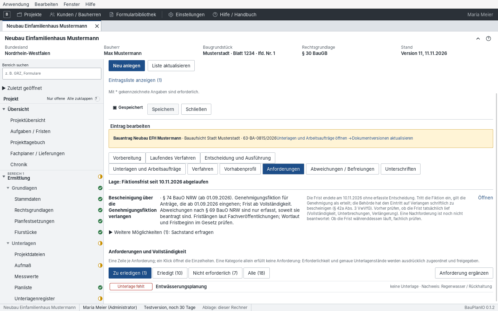

### Schritt 19: Bauantrag / XBau und Arbeitscheck

**Einreichungswerkzeuge → Bauantrag / XBau**, **Verfahren → Einreichen /
Nachreichen** ([Kapitel 8](08-verfahren.md#bauantrag--xbau)).

Antragsdaten prüfen, Anlagen den XBau-Anlagearten zuordnen und den
Arbeitscheck abarbeiten, bis nichts Blockierendes mehr offen ist.

**Im Beispiel:** XBau-Antrag `baugenehmigung.antrag.0200`, schemageprüft, mit
Fachrichtung des Tragwerksplaners. Eine Verfahrensart enthält er nicht, weil
für NRW keine Landesliste veröffentlicht ist.

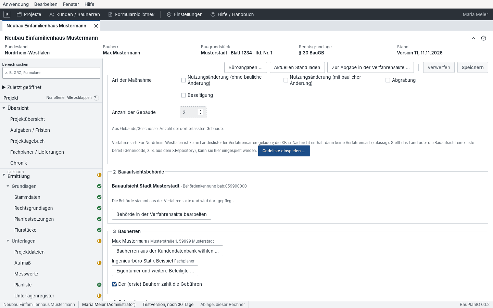

### Schritt 20: Abgabestand festhalten und im Portal einreichen

**Verfahrensakte → Abgabestände**, **Einreichungswerkzeuge → Einreichen /
Portal** ([Kapitel 8](08-verfahren.md#abgabestände)).

1. **Abgabestand festhalten:** friert genau die ausgewählten
   Dokumentversionen ein, optional mit XBau-Datei.
2. Portalziel bestätigen, Dateien exportieren, im Portal hochladen und
   absenden.
3. Den Portalbeleg importieren und die Einreichung damit belegen.

**Im Beispiel:** Abgabestand „Bauantrag Neubau EFH Mustermann (Bauvorlagen
mit XBau)“ mit 11 Bauvorlagen, am 15.09.2026 über Bauportal.NRW eingereicht
(Vorgangsnummer BP-NRW-2026-447120), Übermittlungsbestätigung als Beleg.

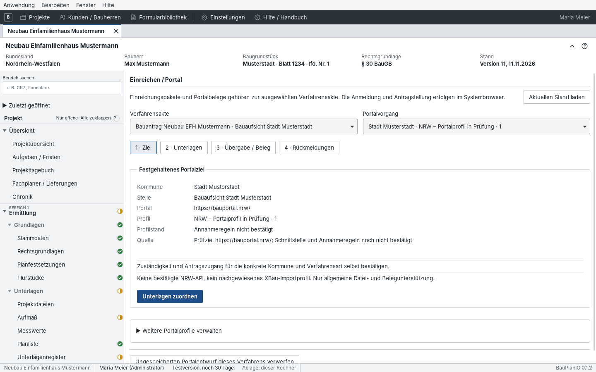

## G Verfahren begleiten

### Schritt 21: Eingang und Vollständigkeit dokumentieren

**Verfahrensakte → Kommunikation**, **XBau-Nachrichten**
([Kapitel 8](08-verfahren.md#laufendes-verfahren)).

Jede Nachricht der Behörde mit Datum und Original erfassen. Mit der
Vollständigkeitsbestätigung beginnt die Bearbeitungsfrist; sie erscheint mit
Erinnerung in Projektübersicht, Wiedervorlagen und Büro-Cockpit.

**Im Beispiel:**
- 17.09.2026: XBau-Eingangsbestätigung, Aktenzeichen 63-BA-0815/2026.
- 29.09.2026: Bestätigung der Vollständigkeit. Daraus folgt die
  voraussichtliche Genehmigungsfiktion am 10.11.2026.
- Fachbeteiligung der Stadtentwässerung mit Frist 27.10.2026.

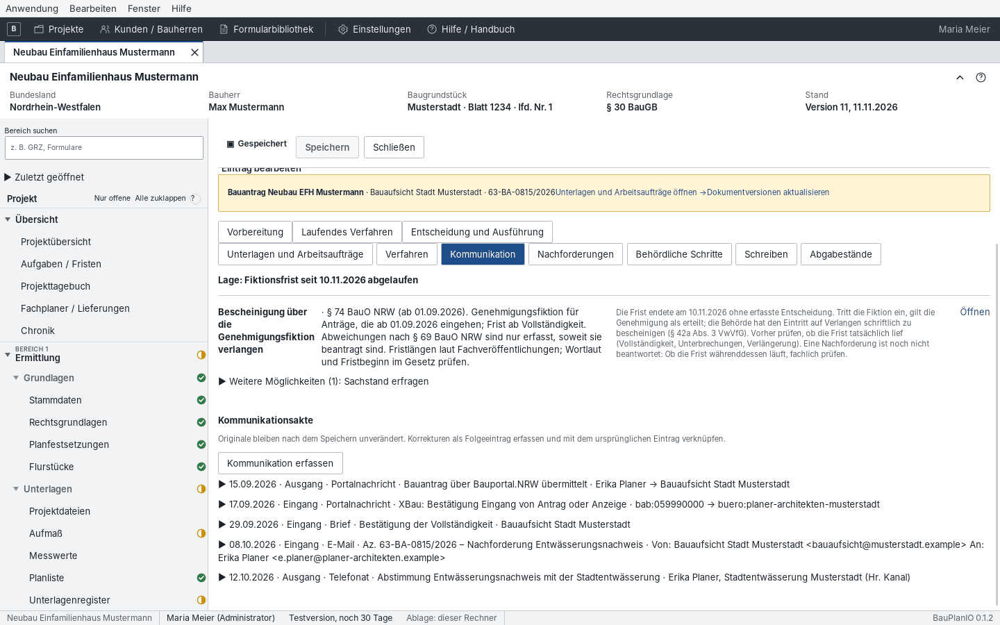

### Schritt 22: Projektstand im Blick behalten

**Übersicht → Projektübersicht**, **Aufgaben / Fristen**, **Chronik**
([Kapitel 8](08-verfahren.md#übersicht-aufgaben-fristen-und-chronik)).

Die Projektübersicht sammelt alles Offene: Aufgaben, fehlende Unterlagen,
veraltete Nachweise, Nachforderungen und Fristen. Die Chronik zeigt, wer wann
was geändert hat.

**Im Beispiel:** Offen ist bewusst nur die Nachforderung zum
Entwässerungsnachweis mit ihren zwei Aufgaben.

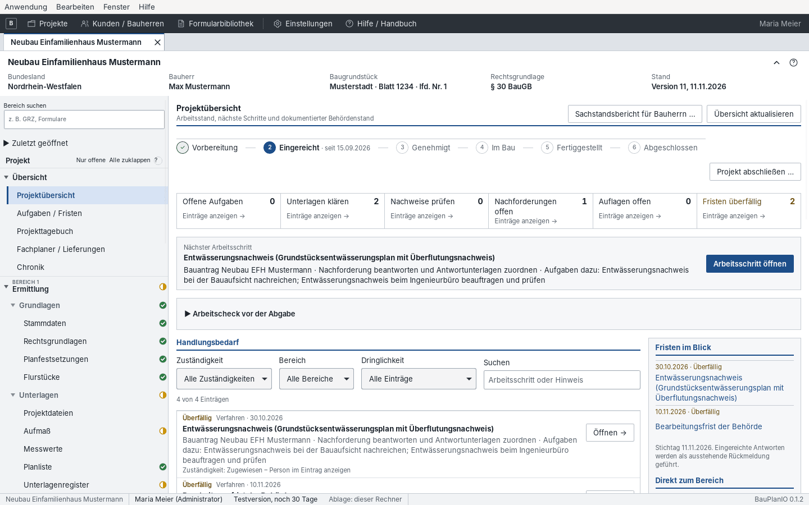

### Schritt 23: Nachforderung beantworten

**Verfahrensakte → Nachforderungen**; Ablauf in
[Workflow 2](09-workflows.md#workflow-2-nachforderung-beantworten-und-nachreichen).

Jeden Forderungspunkt mit Wortlaut, Frist und Zuständigkeit anlegen, intern
Aufgaben daran hängen, die Antwortunterlagen zuordnen, die Nachreichung als
neuen Abgabestand festhalten und den Versand belegen.

**Im Beispiel:** Nachforderung per E-Mail vom 08.10.2026: Entwässerungsnachweis
(Grundstücksentwässerungsplan), Frist 05.11.2026. Am 12.10.2026 wurde
telefonisch mit der Stadtentwässerung abgestimmt. Aufgaben: „Entwässerungsnachweis
beim Ingenieurbüro beauftragen und prüfen“ (in Arbeit, fällig 30.10.2026) und
„Entwässerungsnachweis bei der Bauaufsicht nachreichen“ (offen, fällig
04.11.2026). Ein Entwurf des Antwortschreibens liegt als PDF in der Akte.

**Zum Üben:** Legen Sie im Beispiel eine PDF als neue Version des
Entwässerungsnachweises ab, ordnen Sie sie dem Forderungspunkt zu und halten
Sie die Nachreichung fest. Danach können Sie das Beispiel löschen und neu
übernehmen.

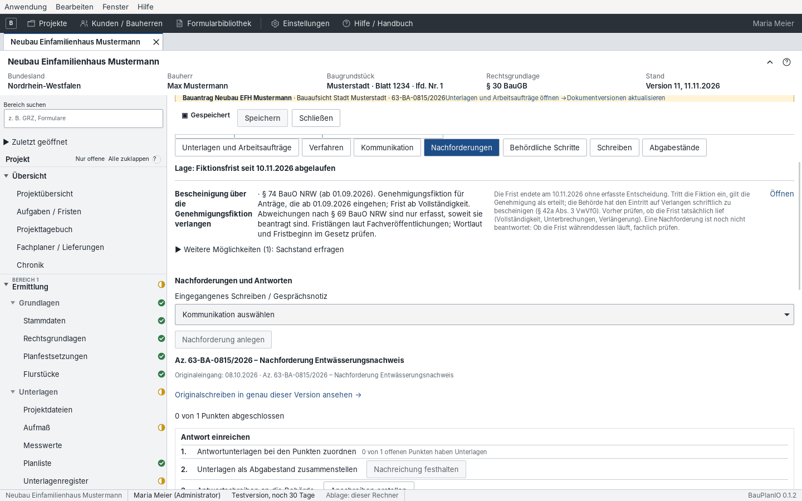

## H Abschließen

Das Beispiel endet vor dem Bescheid. Für Ihr eigenes Projekt geht es so weiter:

### Schritt 24: Bescheid erfassen

**Verfahrensakte → Entscheidung und Ausführung → Bescheide / Auflagen**
([Kapitel 8](08-verfahren.md#entscheidung-und-ausführung),
[Workflow 3](09-workflows.md#workflow-3-bescheid-erfassen-und-bauausführung-begleiten)).

Originalbescheid importieren, Entscheidung und Zustellung erfassen, die
genehmigten Dokumentversionen ausdrücklich zuordnen und jede Auflage als
eigenen Punkt mit Frist anlegen.

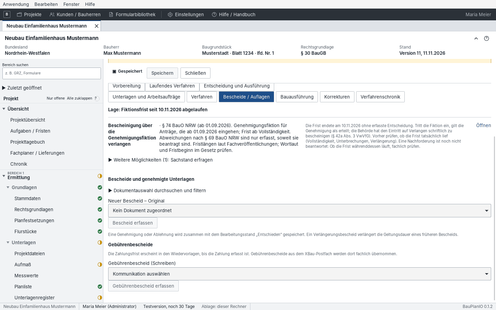

### Schritt 25: Bauausführung begleiten

**Verfahrensakte → Entscheidung und Ausführung → Bauausführung**
([Kapitel 8](08-verfahren.md#entscheidung-und-ausführung)).

Baubeginnsanzeige, Bauleitung, Nachweise vor Baubeginn, Abnahmen und
Fertigstellung dokumentieren. Fachplaner und Lieferungen stehen unter
**Übersicht → Fachplaner / Lieferungen**, Ereignisse auf der Baustelle im
**Projekttagebuch**.

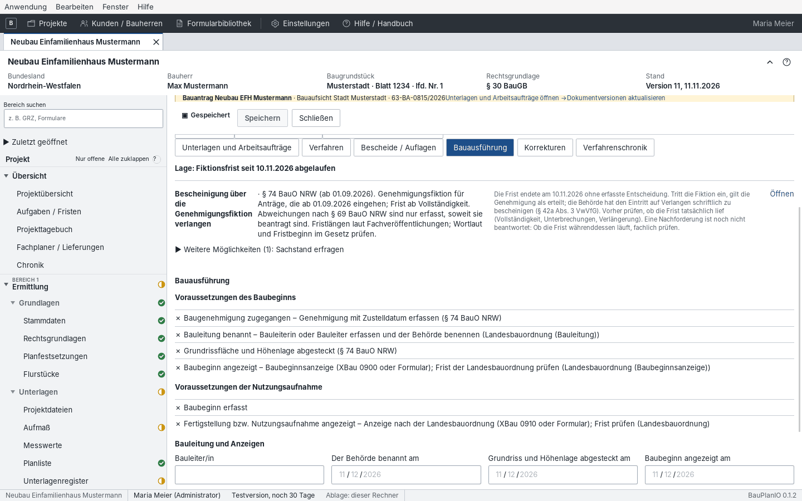

### Schritt 26: Projekt abschließen und sichern

**Übersicht → Projektübersicht**
([Kapitel 8](08-verfahren.md#projektstand-und-projektabschluss),
[Abschlusscheckliste](11-anhang.md#abschlusscheckliste)).

1. Die Abschlusscheckliste durchgehen: alle Auflagen erledigt, Fertigstellung
   angezeigt, keine offenen Aufgaben und Fristen. Die Leiste „Projektstand“
   zeigt dann „Fertiggestellt“.
2. **„Projekt abschließen …“** wählen. Alle Daten bleiben erhalten; im
   Projektverzeichnis findet der Filter „Abgeschlossene“ das Projekt.
3. Eine **Sicherung** erstellen und im Büro-Backup aufbewahren
   ([Kapitel 3](03-einrichtung.md#sicherung)). Aus genau so einer Sicherung
   stammt auch das Beispielprojekt.
