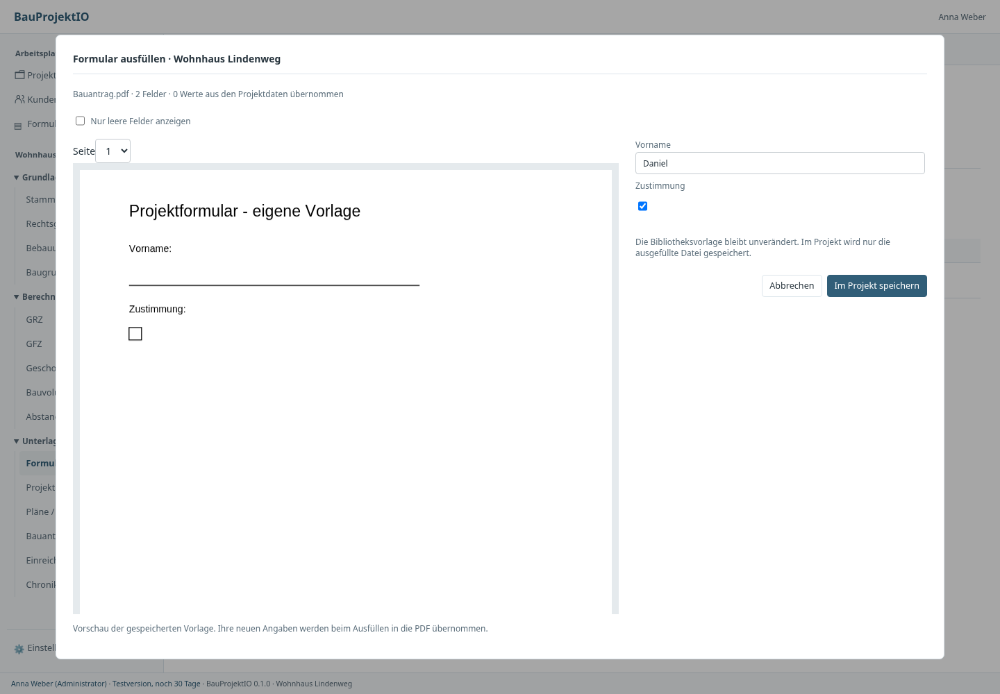
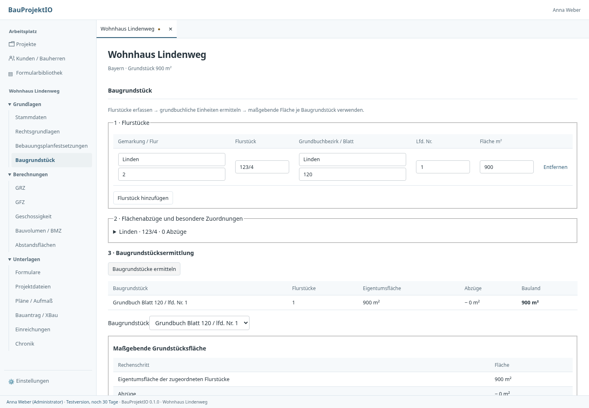
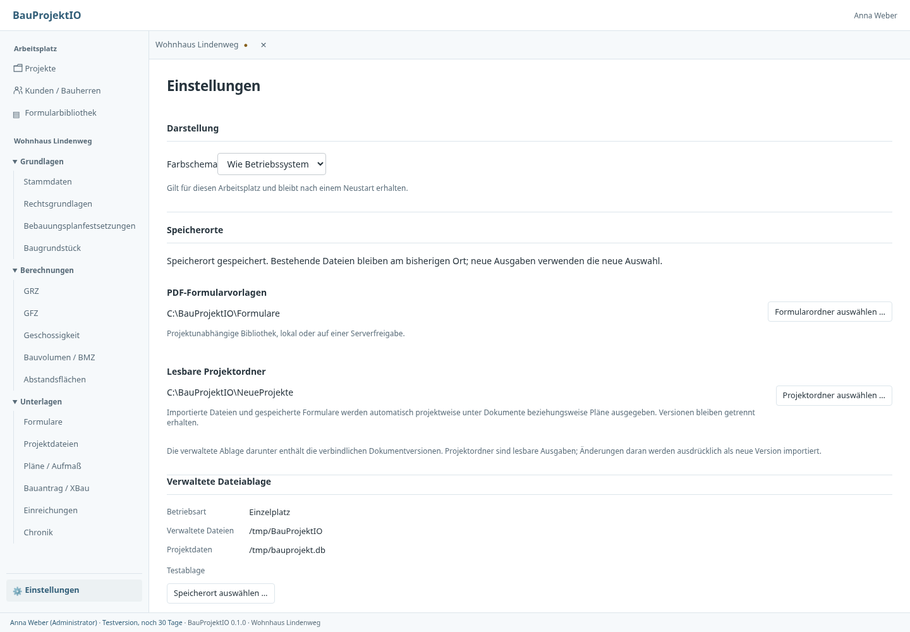
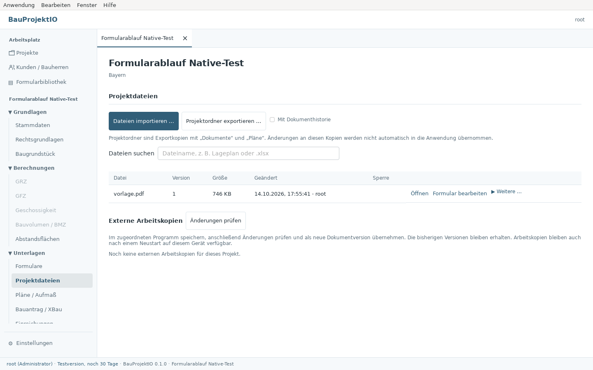

# Klare Projektstruktur und Formulare im Projekt

## Formular auswählen, ausfüllen, speichern

1. Projekt öffnen und links **Unterlagen → Formulare** wählen.
2. Eine ausfüllbare Vorlage aus der gemeinsamen Bibliothek auswählen.
3. Felder ausfüllen und **Im Projekt speichern** anklicken.
4. Das ausgefüllte PDF erscheint einmal unter **Projektdateien** und wird
   automatisch im eingestellten lesbaren Projektordner abgelegt.

Beim Öffnen der Maske wird noch kein Dokument angelegt. Abbrechen erzeugt weder
eine leere Projektkopie noch ein ausgefülltes Dokument. Nach erfolgreichem Speichern
erscheint kein zusätzlicher Speicherdialog. Ein manueller Export bleibt unter
**Projektdateien → Weitere …** verfügbar.

**Formular bearbeiten** an einer Projektdatei speichert die nächste Version unter
derselben Dokument-ID. In der Dateiliste bleibt eine Zeile; die bisherigen Versionen
sind in der Historie verfügbar. Die Bibliotheksvorlage bleibt unverändert.

Die globale **Formularbibliothek** verwaltet ausschließlich Vorlagen. Importieren,
ansehen und eigene Felder platzieren funktionieren auch ohne geöffnetes Projekt.
Der Editor erzeugt eine zusätzliche ausfüllbare Bibliotheksvorlage; er legt keine
Vorlagendokumente im Projekt an. PDFs ohne unterstützte bearbeitbare Felder sind
in der Projektauswahl deaktiviert. Sie lassen sich zuerst in der Bibliothek mit
Feldern versehen. Textfelder und Checkboxen können selbst definiert werden;
vorhandene unterstützte PDF-Feldtypen verwenden dieselbe Ausfüllmaske.



## Eine Navigation für die Projektakte

Die hierarchische Sidebar ersetzt die zweite Bereichsnavigation in der Projektakte
und die zusätzliche Werkzeugleiste. Geöffnete Projekte bleiben als Tabs erhalten.
Das native Menü enthält allgemeine Anwendungs-, Bearbeitungs-, Fenster- und
Hilfefunktionen; es dupliziert die Fachbereiche nicht mehr.

- **Grundlagen:** Stammdaten, Rechtsgrundlagen, gegebenenfalls
  Bebauungsplanfestsetzungen und Baugrundstück.
- **Berechnungen:** GRZ, GFZ, Geschossigkeit, Bauvolumen/BMZ und Abstandsflächen.
- **Unterlagen:** Formulare, Projektdateien, Pläne/Aufmaß, Bauantrag/XBau,
  Einreichungen und Chronik.

Unter Rechtsgrundlagen stehen Planart, Rechtsgrundlage, anzuwendende BauNVO und
Landesbauordnung. Ohne Plan werden §34 oder §35 ausgewählt; ein vorhandener Plan
setzt §30. Konkrete Festsetzungen sind ein eigener Bereich, der nur bei §30 mit
einem vorhandenen Plan angezeigt wird. Flächenberechnungen werden nach Festlegung
von Rechtsgrundlage und BauNVO freigeschaltet. Die BauNVO des Projekts ist für die
Core-Berechnung maßgebend; die Abstandsflächenansicht verwendet die Landesbauordnung
des Projekts. Die Verfügbarkeit konkreter Abstandsflächenregeln hängt weiterhin von
den installierten Regelpaketen ab.

## Baugrundstück als Berechnungstabelle

Die Flurstückstabelle enthält Grundbuchbezirk, Blatt, laufende Nummer und
Eigentumsfläche. Abzugsflächen und besondere Zuordnungen werden am Flurstück
erfasst. **Baugrundstücke ermitteln** ruft das eigenständige Core-Modul auf und
zeigt dessen Gruppen mit Eigentumsfläche, Abzügen und Baulandfläche an.

Nachfolgende Berechnungen verwenden diese Gruppen und ihre Identitäten. Die UI
berechnet die Gruppierung nicht selbst. Geänderte Gruppierungsangaben machen
Ergebnisse ungültig; verwaiste Berechnungszuordnungen müssen ausdrücklich entfernt
werden. Gemeinschaftsflächen und nachweisspezifische Anteile bleiben Bestandteil
der bestehenden Grundstücksberechnung.

Baugrundstück, GRZ, GFZ, Geschossigkeit und Bauvolumen teilen sich einen Entwurf je
Projekt. Jeder Bereich zeigt seine passenden Eingaben. Das Grundstück kann zuerst
gespeichert werden, ohne bereits sämtliche Bauteile und Geschosse zu erfassen.
Fehlende Eingaben erzeugen keine scheinbar bestandenen Nullnachweise.

Die Einstufung als Vollgeschoss/Nichtvollgeschoss wird weiterhin eingegeben;
Geschosszahl und GFZ verwenden diese Eingabe. Die Baumasse wird in m³ erfasst.
Eine geometrische Vollgeschossklassifikation oder ein neuer 3D-Volumensolver ist
mit dieser Überarbeitung nicht hinzugekommen.



## Einstellungen und Speicherorte

**Einstellungen** am unteren Rand der Sidebar bündelt Darstellung, Speicherorte,
Büro, Benutzer, Lizenz und Updates. Hell, Dunkel oder System werden pro Gerät
gespeichert; System folgt auch späteren Änderungen des Betriebssystemdesigns.

Administratoren können unter Speicherorte drei getrennte Orte konfigurieren:

| Ort | Aufgabe |
| --- | --- |
| Formularbibliothek, z. B. `C:\BauProjektIO\Formulare` | Gemeinsame leere PDF-Vorlagen |
| Projektordner, z. B. `C:\BauProjektIO\Projekte` | Automatische lesbare Ausgabe gespeicherter Dateien |
| Verwaltete Dateiablage | Verbindliche DMS-Dateiversionen mit Prüfsummen |

Die lesbare Ausgabe verwendet folgende Struktur:

```text
Projekte/
  Projektname--Projekt-ID/
    Dokumente/Dokument-ID/v1-Formular.pdf
    Pläne/Dokument-ID/v2-Lageplan.dwg
```

Neue Formularergebnisse, Dateiimporte und übernommene externe Arbeitskopien werden
automatisch ausgegeben. Ein Wechsel des Projektordners verschiebt vorhandene
Ausgaben nicht; neue Ausgaben verwenden den neuen Ort. Bestehende Projektdokumente
können mit **Projektordner exportieren …** zusätzlich ausgegeben werden. Änderungen
an lesbaren Kopien werden nicht automatisch zurückgelesen.

Ist die Ordnerausgabe nicht erreichbar, bleibt das bereits gespeicherte DMS-Dokument
erhalten. Die Oberfläche zeigt eine Warnung statt eines vermeintlich fehlgeschlagenen
Speichervorgangs, der zu einer zweiten Dokumentanlage führen könnte. Ein erneuter
Projektordnerexport kann die Ausgabe nachholen. Ordner- und DMS-Dateien sind bewusst
getrennte physische Ablagen, aber kein doppelter Eintrag in der Projektdateiliste.

Die Auswahl wird arbeitsplatzbezogen in `formularbibliothek.json`,
`projektordner.json` beziehungsweise `dateiablage.json` gespeichert. Der vorhandene
Wechsel der verwalteten Einzelplatzablage kopiert und prüft die DMS-Versionen;
die Projektdatenbank wird dabei nicht verlegt. Gemeinsame Serverordner erfordern
zusätzlich die gemeinsame Datenbank des Netzwerkmodus.



## Modulverträge

- `CoreServices::formular_schema` analysiert Bibliotheksbytes mit Projektkontext,
  ohne ein Dokument anzulegen. `formular_aus_bibliothek` validiert/befüllt vor der
  ersten Dokumentanlage. `formular_im_projekt_speichern` erzeugt unter Beachtung
  der Basisversion eine weitere Version desselben Dokuments.
- `ProjektDokument` ergänzt die serialisierte `DocumentVersion` um optionale
  `projektordner_pfad` und `ablage_hinweis`. Die zusätzliche Ausgabe ist im
  Desktop-Ablageadapter gekapselt; PDF-Parser und Grundstücksmodul kennen sie nicht.
- `Planungsrecht.bau_nvo` ist optional und wird im vorhandenen JSON-Objekt
  gespeichert; eine SQL-Schemamigration ist nicht erforderlich. Falls gesetzt,
  überschreibt es die lokale BauNVO der Flächenaufstellung.
- `FlaechenErgebnis.bauteile_vorhanden` und `geschosse_vorhanden` kennzeichnen
  Teilergebnisse. Bei fehlenden Ansätzen sind die betroffenen `Nachweis.ist` und
  Bewertungsfelder leer. Verbraucher dürfen die weiterhin numerischen Kennzahlen
  nicht ohne diese Vollständigkeitsprüfung als vollständigen Nachweis ausgeben.
- Die bisherigen APIs zum Erzeugen abgeleiteter PDF-Dokumente bleiben erhalten;
  der neue Desktop-Ablauf verwendet die expliziten neuen Operationen.

## Prüfung

Svelte-Check und Produktionsbuild, Clippy mit `-D warnings` sowie Rust-Tests für
Core, Storage, Server und Desktop bestehen. Neue Integrationsfälle prüfen die
Bibliotheksanalyse ohne Dokumentanlage, genau ein ausgefülltes Dokument,
Bearbeitung als Version 2, Versionskonflikte, Rollen und unveränderte Vorlagen.
Der Desktop-Ablagetest prüft echte Dateibytes, wiederholte Ausgabe und eine
fehlgeschlagene Ordnerausgabe bei weiterhin genau einem DMS-Dokument.

Die UI-Suiten prüfen Projekt-/Bereichswechsel, Entwurfsschutz, bedingte Navigation,
Tabelleneingaben, Speicherfehler, fehlenden Exportdialog, Vorlageneditor, Theme,
Ordnerauswahl und die vorhandene Einreichungschronik. Sie verwenden den echten
Produktionsbuild und PDF.js mit kontrolliertem Test-IPC.

Zusätzlich wurde der Ablauf in einer nativen Linux-Desktop-Testinstallation
ausgeführt: Vorlage mit Textfeld und Checkbox ausgewählt, **Daniel** eingegeben,
Zustimmung angekreuzt und gespeichert. SQLite enthält genau ein Dokument mit
Version 1; die automatisch ausgegebene PDF enthält die Werte und entspricht der
DMS-Prüfsumme. Die Bibliotheksvorlage ist bytegleich zum Original geblieben.

[UI-Prüfprotokoll](ui-pruefung.json) · [Native Prüfung](native-pruefung.json) ·
[Bibliothekseditor](pdf/01-bibliothekseditor.png)


