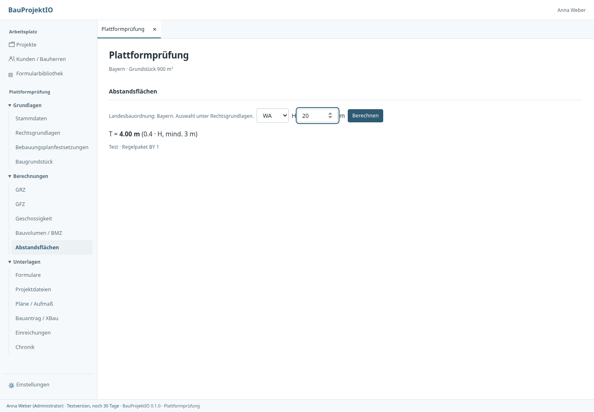
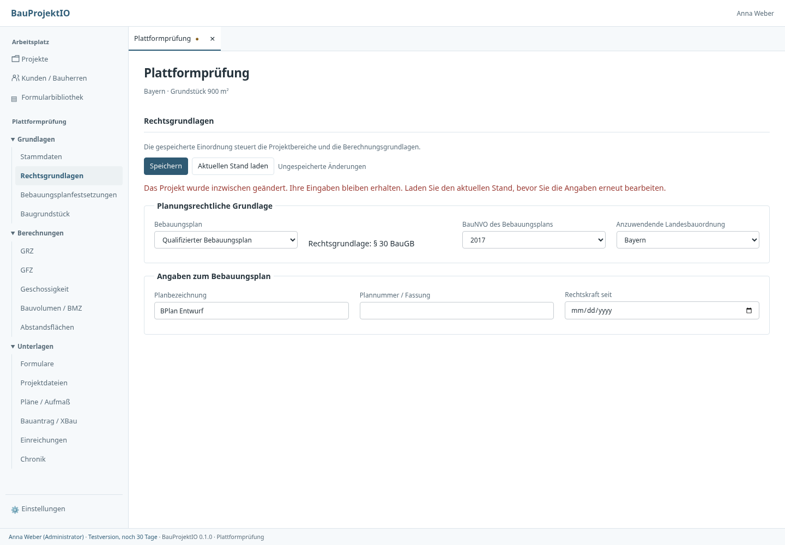
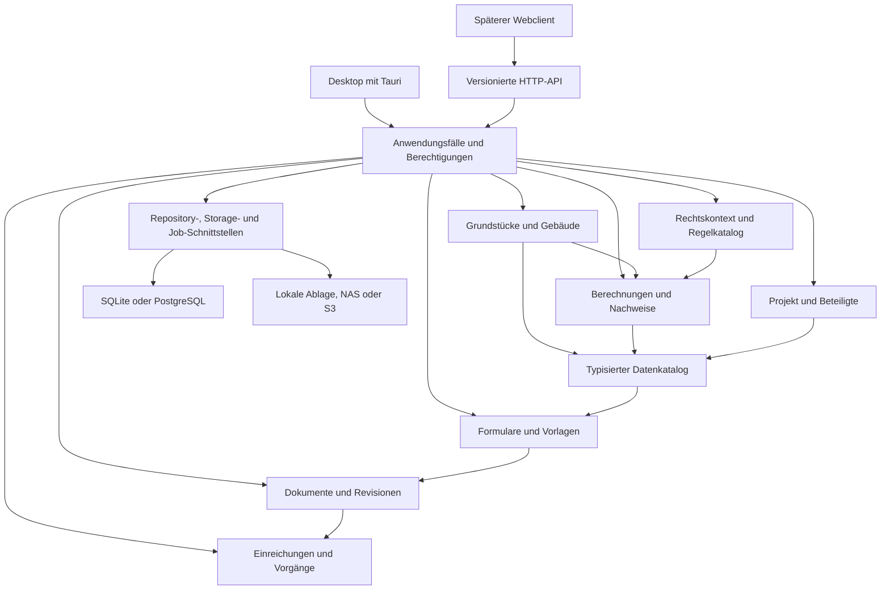

# BauProjektIO: Analyse und Entwicklungsstrategie

Stand: 14. Oktober 2026. Analysierter Anwendungsstand: **`31a1957`** auf
`codex/klare-projektstruktur`. Der beim Prüfen abgerufene Main steht auf
`98715bc`; die neue Navigation und der Formularablauf sind dort noch nicht
enthalten. Die fachliche Bewertung bezieht sich auf den neueren Arbeitsstand. Der separate
Analysebranch enthält ausschließlich Dokumentation und Belege; er übernimmt die
UI-Änderungen nicht.

**Empfehlung:** BauProjektIO zu einer modularen Fachplattform für Planung und
Genehmigung entwickeln. Die vorhandene Rust-Basis eignet sich dafür. Als Nächstes
sollten die Herkunft und Aktualität fachlicher Daten sowie die Übergaben zwischen
Modulen abgesichert werden. Anschließend folgen Büro-Zusammenarbeit und gezielte
Erweiterungen des Planungsablaufs.

Die Analyse behandelt Produktabläufe, Oberfläche, Fachmodelle, Berechnungen,
PDFs, Dokumente, Einreichungen, Desktop/Server, Datenhaltung, Berechtigungen,
Betrieb und Entwicklungsqualität. Sie verbindet Codeprüfung mit ausgeführten
Tests und gezielten Reproduktionen. Sie ist keine juristische Freigabe aller
Regeln, kein Lasttest und kein vollständiger Penetrationstest.

Für die Priorisierung wird zunächst eine Desktop-Anwendung für kleine und
mittlere Planungsbüros mit späterer gemeinsamer Serverplattform angenommen.
Ein öffentliches, mehrere Büros bedienendes Cloud-Angebot benötigt zusätzliche
Vorarbeiten. Die Reihenfolge lässt sich anhand des gewünschten Betriebsmodells
anpassen; fachliche Konsistenz ist in allen Varianten notwendig.

[Konkreter Maßnahmenplan](massnahmenplan.md) ·
[Fundstellen und Prüfungen](pruefungen.md) ·
[Verbindliche Entwicklungsregeln](../entwicklungsregeln.md)

## 1. Was bereits trägt

Es gibt mehr als eine Sammlung von Eingabemasken:

- `core-lib` enthält die Fachlogik und wird von Desktop und Server eingebunden.
  Datenbanken, Dateiablagen und Lizenzanbieter werden über Traits angeschlossen.
- Grundstücksgruppen, historische BauNVO-Ansätze und Festsetzungen sind eigene
  Module. Mehrere Baugrundstücke können getrennt berechnet werden.
- Dateien haben unveränderliche Versionen, Prüfsummen und Sperren. Der Cache
  prüft Inhalte und hat eine Größenbegrenzung. Die Einreichungschronik hält die
  tatsächlich zusammengestellten Dokumentversionen fest.
- PDF-Analyse, Felddefinition, Befüllung und DMS-Persistenz sind unterscheidbare
  Verantwortungen. Die neue Oberfläche nutzt Vorlagen direkt im Projekt.
- Optimistic Locking verhindert stilles Überschreiben. Die UI berücksichtigt
  mehrere Projektentwürfe und verspätete Antworten.
- Regelkonfiguration, Rhai-Sandbox, Rust-/UI-Tests und Release-Workflows sind
  vorhanden. Das sind gute Ausgangspunkte für kontrollierte Erweiterungen.

Diese Grundlagen sollten weiterentwickelt werden. Ein pauschaler Wechsel des
Technologie-Stacks würde die gefundenen fachlichen Übergabeprobleme nicht lösen.

## 2. Gesamtbild der bestehenden Bereiche

Die Einordnung beschreibt die vorhandenen Fähigkeiten, keine pauschale
Produktionsfreigabe.

| Bereich | Vorhanden | Nächster wesentlicher Ausbau |
| --- | --- | --- |
| Projektakte | Mehrere Tabs, Stammdaten, Kunden/Bauherren | Projektkennzeichen, Status, Verantwortliche, Gebäude und Bearbeitungsstände |
| Rechtsgrundlagen | §30/34/35, Planart, BauNVO, Landesauswahl, Festsetzungen | Gültigkeit, Quellenbelege, historischer Rechtsstand und fachliche Freigabe |
| Baugrundstück | Flurstücke, Grundbuchgruppen, Abzüge, Gemeinschaftsanteile | Stabile Grundstücksidentitäten und ein verbindlicher Ergebnisvertrag für alle Verbraucher |
| GRZ/GFZ/Geschosse/BMZ | Typisierte Ansätze, konfigurationsgestützte Anrechnung, getrennte Grundstücksprüfungen | Gebäudezuordnung, vollständige Nachweisstände und reproduzierbare Berechnungsberichte |
| Abstandsflächen | Rhai-Engine und drei beispielhafte Länderpakete | Gespeicherte Wand-/Gebäudefälle, geprüfte Regeln, Eingabeherleitung und Sonderfälle |
| CAD/Baugrenzen | DXF-Viewer, Aufmaß, polygonale Grenzprüfung | Verknüpfte Geometrieobjekte, Planrevisionen und Zuordnungen statt einzelner Kopieraktionen |
| PDF/Formulare | AcroForm, eigene Textfelder/Checkboxen, Bibliothek, Projektbefüllung | Versionierte Vorlagen, fachlicher Datenkatalog, Pflichtfelder und verknüpfte Formularinstanzen |
| Projektdateien | Beliebige Ablage, unterstützte Dateien extern öffnen, Arbeitskopien, Versionen | Dokumentarten, fachliche Revision/Freigabe, Suche, Vorschau und nachvollziehbare Beziehungen |
| Einreichungen/XBau | ZIP-Stände, Versionsvergleich, Bestätigung, XBau-2.7-Export | Unterlagenchecklisten, Prüfung/Freigabe, Empfängerstände und Empfangsnachweise |
| Zusammenarbeit | Rollen, Sperren, gemeinsame PostgreSQL-/NAS-/S3-Grundlage | Verifizierte Identitäten, Projektmitgliedschaften, Änderungsabgleich und Verantwortlichkeiten |
| Betrieb | Verschiedene Ablagen, Cache, Lizenz-/Update-Komponenten | Backup/Wiederherstellung, Diagnose, Hintergrundaufträge und geprüfte Installationspfade |
| Web-/Cloud-Zugang | HTTP-Adapter zu vielen Core-Funktionen | Authentifizierung, projektbezogene Rechte, Datei-API und ein unabhängiger Web-Transport |

DWG-Dateien können verwaltet und mit dem zugeordneten Programm geöffnet werden;
der interne Viewer unterstützt DXF. Vollgeschossigkeit wird bisher eingegeben,
nicht geometrisch nach Landesrecht ermittelt. BMZ verwendet eine eingegebene
Baumasse. Ein XBau-Export ist noch keine nachgewiesene Annahme durch ein Bauportal.

## 3. Zuerst zu behebende Befunde

### 3.1 Fachkontext geht bei Grundstücksberechnungen teilweise verloren

Bei einem §35-Projekt ergibt die direkte Nutzungsprüfung keinen automatischen
GRZ-Sollwert. Die Prüfung desselben Ansatzes je Baugrundstück liefert dagegen
`0,4` für WA. Der Adapter baut einen neuen `Planungsrecht`-Wert auf, übernimmt
aber die Rechtsgrundlage nicht. Dieser Fehler wurde mit dem kompilierten Core
reproduziert, obwohl die vorhandene Testsuite besteht.

**Verbesserung:** Ein kleiner, expliziter `Rechtskontext` mit den tatsächlich
benötigten Grundlagen wird vollständig übergeben. Direkte und gruppierte Prüfung
müssen denselben Kontext interpretieren. Referenzfälle benötigen auch die
Kombinationen §30/34/35, Grundstücksgruppen und Planabweichungen.

§17-Orientierungswerte dürfen zudem nicht als eigenständiger Nachweis einer
Zulässigkeit nach §34 erscheinen. Dafür fehlen Nachbarschafts-/Einfügungsprüfung
und weitere fachliche Voraussetzungen. Informationswerte und verbindliche
Grenzwerte brauchen unterschiedliche Zustände und Beschriftungen.

### 3.2 Es gibt mehrere konkurrierende Grundstücksflächen

Die Grundstücksermittlung kann beispielsweise `800 m²` liefern, während
`Project.grundstuecksflaeche_m2` noch `640 m²` enthält. Der PDF-Kontext schlägt dann
`640,00` vor. Auch Projektkopf, Übersicht und Bauantrag haben eigene Darstellungen
beziehungsweise Eingabestrukturen. Mehrere Grundstücke lassen sich nicht durch
eine einzige Projektfläche zuverlässig repräsentieren.

**Verbesserung:** Alle Verbraucher erhalten Grundstückseinheiten über denselben
typisierten Vertrag. Ein Formular benennt, für welches Grundstück und welchen
Flächenbezug es erstellt wird. Bei mehreren Einheiten wird eine Auswahl oder eine
ausdrücklich definierte Summe verlangt. Alte Summenfelder dürfen nicht unbemerkt
Vorrang vor der Ermittlung erhalten.

### 3.3 Abstandsflächenergebnisse können sichtbar veraltet sein

In der UI-Probe wurde mit `H = 10 m` gerechnet. Nach Änderung auf `20 m` blieb
das alte Ergebnis `T = 4,00 m` ohne Veraltet-Hinweis sichtbar. Bei einem
verspäteten Request fehlt außerdem die für andere Bereiche vorhandene Bindung
an den Eingabestand. Diese Ansicht ist noch kein gespeicherter Projektnachweis.

**Verbesserung:** Einheitlicher Ergebniszustand mit Eingabefingerabdruck.
Änderungen kennzeichnen den bisherigen Stand sofort als veraltet. Verspätete
Antworten werden nur dem passenden Eingabestand zugeordnet. Wand-/Gebäudezuordnung,
Eingaben und Regelpaket müssen mit einem speicherbaren Nachweis verbunden werden.



### 3.4 Unabhängige Bereiche erzeugen unnötige Speicherkonflikte

Stammdaten, Rechtsgrundlagen, Festsetzungen, Flurstücke und Berechnungen liegen
teilweise gemeinsam in `Planungsrecht` und verwenden dieselbe Projektversion.
Bereits eine Person kann einen Konflikt erzeugen: Rechtsgrundlagen ändern,
Festsetzungen ändern und speichern, anschließend Rechtsgrundlagen speichern.
Der Entwurf bleibt erhalten, aber die Oberfläche fordert zum Neuladen auf.

Die Versionierung schützt die Daten. Die gemeinsame Speichergrenze passt jedoch
nicht zu den unabhängig angebotenen Fachbereichen. Auch `Planungsrecht.validate`
validiert abhängige Berechnungen beim Speichern von Grundlagen. Ein rechtlicher
Grundlagenwechsel kann dadurch durch einen inzwischen unpassenden Altansatz
blockiert werden.

**Verbesserung:** Fachliche Schreiboperationen und Versionsgrenzen trennen.
Eine Änderung der Rechtsgrundlagen speichert nur diesen Bereich und markiert
abhängige Ergebnisse als neu zu prüfen. Ein zentraler Sitzungsdienst koordiniert
Entwürfe und bietet bei echten Überschneidungen einen verständlichen Vergleich.



### 3.5 Die Projekt-API hat keine Benutzeranmeldung

Ein isolierter lokaler Server lieferte ohne Authentifizierungsheader die
Projektliste mit HTTP 200 und nahm eine Projektanlage mit HTTP 201 an. Im
Protokoll steht dafür „System“. Das entspricht dem ausdrücklich vorläufigen
technischen Konto im Code. Der Lizenzserver besitzt dagegen eigene Token- und
Signaturprüfungen; das ersetzt keine Anmeldung am Projektserver.

**Verbesserung:** Vor einer Öffnung für nicht vertrauenswürdige Teilnehmer
braucht der Projektserver verifizierte Benutzer und Rechte je Projekt. Das
Desktop-Netzwerkmodell mit direktem Datenbankzugang sollte auf API-Zugriff
umgestellt werden, damit dieselben Rechte für jeden Client durchgesetzt werden.
Eine lokale Einzelplatzinstallation ist davon anders betroffen als ein
öffentlich erreichbarer Server.

### 3.6 Ein Protokollfehler kann einen erfolgreichen Schreibvorgang als Fehler melden

Dokumentanlage, Projektänderungen und Einreichungen schreiben zunächst den
fachlichen Datensatz und anschließend das Protokoll über einen separaten
Repository-Aufruf. Schlägt der zweite Schritt fehl, gibt der Service einen
Fehler zurück, obwohl der erste bereits gespeichert ist. Ein erneuter Versuch
kann beispielsweise ein weiteres Dokument erzeugen.

Das ist aus dem Ablauf im Code ableitbar; eine gezielte Protokoll-Ausfallinjektion
wurde für diese Analyse nicht ausgeführt.

**Verbesserung:** Fachänderung und Audit-Ereignis innerhalb einer passenden
Datenbanktransaktion speichern. Externe Dateiausgabe anschließend über einen
dauerhaften Auftrag abarbeiten. Schreiboperationen mit Wiederholungsrisiko
benötigen eine eindeutige Vorgangskennung. Ein bestätigter Commit darf durch
eine nachgelagerte Ausgabe nicht zu einem scheinbar fehlgeschlagenen Commit werden.

## 4. Zielarchitektur: klar getrennte Fachmodule

Empfohlen ist zunächst ein **modularer Monolith**: ein gemeinsamer Anwendungskern
mit klaren Modulverträgen, gemeinsamem Deployment und bestehenden Datenbanken.
Neue Features werden als abgegrenzte Module ergänzt. Eigene Netzwerkdienste sind
erst bei konkreten Betriebs- oder Lastgründen nötig.



Die Pfeile beschreiben fachliche Abhängigkeiten. Der Datenkatalog liefert
Lesesichten; er wird keine neue zentrale Datenbank und übernimmt keine fremde
Berechnung. Synchrone Fachregeln werden direkt aufgerufen. Ereignisse dienen
gezielter Aktualisierung und nachgelagerten Aufgaben, etwa Suche oder Ordnerausgabe.

### 4.1 Jedes Modul bekommt einen dokumentierten Vertrag

Ein Modul benennt Eigentümer seiner Daten, Eingaben, Ausgaben, Einheiten,
Identitäten, Fehler und Versionsregeln. Beispiele:

| Modul | Verantwortet | Liefert anderen Modulen |
| --- | --- | --- |
| Grundstück | Flurstücke, Zuordnungen, Abzüge, begründete Zuschläge | Liste stabil identifizierter Grundstückseinheiten und Bezugsflächen |
| Gebäude | Gebäude, Gebäudeteile, Geschosse und Zuordnungen | Geometrie-/Flächenreferenzen und dokumentierte Klassifikationen |
| Rechtskontext | Anwendbare Rechtsstände und belegte Planfestsetzungen | Versionierter Kontext und Fähigkeiten der verfügbaren Regeln |
| Nachweise | Ansätze, Berechnungsläufe, Ergebnisse, Freigaben | Nachvollziehbare Ergebnisstände je Gegenstand und Nachweisart |
| Formulare | Vorlage, Feldschema, Zuordnung und Formularinstanz | Befüllte PDF-Bytes plus Quellen- und Vorlagenreferenzen |
| Dokumente | Inhalte, Versionen, Metadaten und Revisionen | Stabile Dateireferenzen mit Hash und Verfügbarkeit |
| Einreichung | Auswahl, Empfänger, Paketstand und Bestätigung | Unveränderlicher Versandstand mit späteren Nachträgen |

Für Grundstücke muss der bisher aus Grundbuchangaben abgeleitete Gruppenschlüssel
von einer dauerhaften Identität getrennt werden. Änderungen von Blatt, Nummer,
Aufteilung oder Zusammenführung sind fachliche Vorgänge, keine stillen
Identitätswechsel. Verbraucher verwenden die Grundstücks-ID und Eingabeversion.

### 4.2 Berechnungsläufe werden eigene fachliche Ergebnisse

Empfohlener Vertrag für einen Berechnungslauf:

```text
Nachweisstand
  Projekt-ID, Gegenstand-ID (Grundstück/Gebäude/Wand), Nachweisart
  fachliche Eingaberevisionen und Eingabe-Hash
  Regelpaket-ID, Regelversion und Inhalts-Hash
  Berechnungsmodul-Version und Einheiten
  Status: unvollständig / aktuell / veraltet / fehlerhaft
  Ergebnis, nachvollziehbare Ansätze, Warnungen und Quellen
  berechnet am/von; fachliche Freigabe als eigener Vorgang
```

„Aktuell“, „Grenzwert eingehalten“ und „fachlich freigegeben“ sind drei verschiedene
Informationen. Ein aktueller Nachweis kann einen Grenzwert überschreiten. Ein
veralteter Nachweis bleibt für einen bereits eingereichten Stand reproduzierbar.
Eine fehlende Eingabe wird nicht durch eine gültige Null ersetzt.

Beispiel: Ein Grundstück wird von `800` auf `760 m²` korrigiert. Seine Revision
steigt. GRZ/GFZ/BMZ dieses Grundstücks und davon abhängige Formularentwürfe werden
als neu zu prüfen markiert. Unabhängige Kontaktangaben bleiben unberührt. Bereits
eingereichte PDFs bleiben Bestandteil ihres damaligen Paketstands.

### 4.3 Gebäude fehlen als eigenständiger Gegenstand

Die heutige Geschossliste zählt alle als Vollgeschoss markierten Einträge eines
Ansatzes. Es gibt keine Gebäude-ID am Geschoss. Für mehrere Gebäude auf demselben
Grundstück ist eine gemeinsame Geschosszahl deshalb nicht ausreichend.

Zielmodell: Projekt → Grundstückseinheiten und Gebäude; Gebäude → Gebäudeteile →
Geschosse. Grundstücke und Gebäude werden ausdrücklich miteinander verbunden.
Flächen und Volumen tragen Quelle und Einheiten. Ein Gebäude kann mehrere
Nachweise haben, ohne dessen interne Geometrie in jedem Modul neu aufzubauen.

Raum-/Raumbuchobjekte sollten erst ergänzt werden, wenn konkrete Funktionen wie
Wohnflächen, Nutzflächen oder IFC-Zuordnung sie benötigen. Der Kern muss sie
anschließen können, ohne schon jetzt ein vollständiges BIM-Autorensystem zu bauen.

### 4.4 Regeln werden fachlich verwaltete Inhalte

Heute sind BauNVO-Regeln gemeinsam für Frontend und Core eingebettet. LBO-Pakete
werden dagegen zur Laufzeit je Land geladen; ein neues Paket ersetzt das bisherige
im aktiven Katalog. Für historische und wiederholbare Nachweise ist das zu grob.

Benötigt werden Regel-ID, Ausgabe, Gültigkeits-/Anwendungszeitraum, Rechtsquellen,
Prüfstatus und ein unveränderlicher Hash. Ein Projekt beziehungsweise Nachweis
bindet den konkret verwendeten Stand. Ein Update bietet einen Vergleich und eine
bewusste Neuberechnung an. Ausgelieferte Beispielregeln dürfen nicht denselben
Freigabestatus wie geprüfte Regeln erhalten.

Die Landesauswahl ist noch keine Auswahl einer historischen LBO-Fassung.
Geltungsbereich, Übergangsregel und gegebenenfalls örtliche Satzung müssen
ausdrücklich darstellbar werden. Weitere Sonderfälle werden im zuständigen
Regelmodul ergänzt und mit fachlich geprüften Referenzfällen belegt.

## 5. Moderne Oberfläche heißt verlässlicher Arbeitsablauf

Die neue Sidebar ist ein sinnvoller Schritt. Der nächste Ausbau sollte vor allem
Orientierung und Datenqualität verbessern.

### 5.1 Projektstart mit Bearbeitungsstand

Eine Projektübersicht zeigt Kennzeichen, Vorhaben, Verantwortliche und nächste
offene Schritte. Geeignete Statusinformationen sind etwa „Rechtsgrundlagen offen“,
„Grundstücke ermittelt“, „zwei Nachweise neu zu prüfen“ oder „drei Unterlagen fehlen“.
Jede Meldung führt direkt zum betroffenen Objekt. Ein bloßer allgemeiner
Prozentfortschritt wäre irreführend, solange erforderliche Unterlagen nicht
vorhabensabhängig bestimmt sind.

Das Projektverzeichnis braucht später Filter für Bearbeiter, Status und Gemeinde,
gespeicherte Ansichten und Suche nach Kennzeichen. Derzeit werden sämtliche
Projekte vollständig geladen und lokal gefiltert; für größere Bestände sind
serverseitige Suche und Seitennavigation vorzusehen.

### 5.2 Einheitliche Arbeitsfläche für Fachbereiche

Jeder Bereich folgt derselben erkennbaren Struktur: Gegenstand, Grundlage,
Eingaben, Ergebnis, offene Punkte und Aktionen. Tabellen zeigen Einheiten,
Zwischensummen und Herkunft. Details und seltene Sonderfälle können aufklappen;
wichtige Fehler werden nicht hinter Untermenüs versteckt.

Für ausgeblendete oder gesperrte Bereiche wird der Grund genannt, beispielsweise
„BauNVO noch nicht festgelegt“ mit direktem Verweis auf die Grundlage. Ein
fehlendes Regelpaket erhält einen erklärten Zustand statt nur eines inaktiven
Berechnen-Knopfs. Fachliche Sichtbarkeit ist von Schreibberechtigung zu trennen.

Eine zentrale Prüfstellenliste sammelt fehlende Angaben, veraltete Ergebnisse
und Freigabebedarf. Sie ersetzt keine Fachentscheidung, macht aber den nächsten
Arbeitsschritt sichtbar.

### 5.3 Entwürfe, Speicherung und Konflikte vereinheitlichen

Ein gemeinsamer Editorvertrag enthält `dirty`, `busy`, Validierungsstatus,
Speichern und Verwerfen. Die Projektakte registriert diese Editoren, statt bei
jedem Feature zusätzliche Sonderabfragen einzubauen. Lokale Entwürfe sollten
nach einem Absturz wiederherstellbar sein. Das ist von einem fachlich gespeicherten
oder freigegebenen Stand zu unterscheiden.

Bei echten Mehrbenutzerkonflikten werden alter Stand, eigener Entwurf und neuer
Serverstand verglichen. Unabhängige Felder können kontrolliert zusammengeführt
werden; widersprüchliche Werte benötigen eine Entscheidung. Hintergrundspeichern
eignet sich zunächst für lokale Entwürfe, nicht für eine unbemerkte fachliche Freigabe.

### 5.4 Kleines, verbindliches Designsystem

Vorhandene CSS-Variablen zu konsistenten Designwerten für Abstände, Typografie,
Farben, Fokus und Dichte ausbauen. Wiederverwendbare Tabellen, Feldgruppen,
Statusanzeigen, Dialoge und Fehlermeldungen erhalten klare Varianten. Das spart
bei jedem neuen Feature Arbeit und hält die Oberfläche einheitlich.

Prüfen: Tastaturbedienung, sichtbarer Fokus, Beschriftungen, Tabellenkopfzuordnung,
Kontrast in allen Themes, 200-%-Vergrößerung und lange deutsche Fachtexte. Der
CAD-Canvas braucht zu den Mausfunktionen nachvollziehbare Tastaturaktionen und
textliche Ergebnisalternativen. Das Theme muss auch Canvas-Neuzeichnung auslösen.
Eine verifizierte Barrierefreiheitskonformität wurde bisher nicht nachgewiesen.

## 6. Dokumente, Formulare und Einreichungen als zusammenhängender Ablauf

### 6.1 Version ist nicht gleich fachliche Revision

Eine Dateiversion beschreibt eine technische Änderung. Ein Plan benötigt zusätzlich
Planart, Plannummer, Maßstab, Verfasser, Revisionsindex, Datum und Freigabestatus.
Diese Metadaten gehören in ein Dokumentmodell, nicht ausschließlich in Dateinamen.
Für Formulare werden Vorlage, Vorlagenversion, Datenquellen, eigener Entwurf und
erzeugte PDF miteinander verknüpft.

Eine Änderung am Bauherrn oder Grundstück kann dann gezielt anzeigen, welche
Formulare veraltet sind. Bereits ausgegebene oder eingereichte Dokumente werden
nicht automatisch überschrieben. Ein neuer Stand entsteht bewusst und kann mit
dem letzten Stand verglichen werden.

### 6.2 Daten einmal erfassen und gezielt verwenden

Ein fachlicher Datenkatalog bietet stabile Schlüssel und typisierte Werte, etwa
`bauherr.person.vorname`, `grundstueck[id].bezugsflaeche.grz` und
`nachweis[id].gfz.ist`, einschließlich Quelle und Stand. Die konkrete Benennung
muss noch als Vertrag festgelegt werden; die Beispiele sind ein Zielbild.

PDF-Zuordnungen werden über einen grafischen Datenbrowser erstellt. Anwender
wählen den fachlichen Wert und gegebenenfalls Grundstück oder Bauherrn.
Formatierung und Feldschema bleiben im Formularmodul. Dadurch können später auch
Berechnungsberichte und XBau dieselben geprüften Quellen nutzen.

### 6.3 Unterlagenstand und Abgabe vorbereiten

Ausgehend von der vorhandenen Einreichungschronik sollte ein Unterlagenregister
entstehen: erforderlich, vorhanden, geprüft, freigegeben, im Paket und eingereicht.
Anforderungen können aus einer konfigurierten Verfahrensvorlage kommen und werden
von der Projektleitung bestätigt. Ein Nachtrag zeigt ersetzt, ergänzt, unverändert
und noch offen, jeweils bezogen auf Empfänger und Dokumentrevision.

Ein Export, eine manuell bestätigte Einreichung und eine tatsächliche
Empfangsbestätigung sind unterschiedliche Ereignisse. Künftige Portaladapter
speichern Rückmeldungen und technische IDs. Eine Anbindung benötigt neben dem
XBau-Schema die konkreten Anforderungen des empfangenden Systems.

### 6.4 Speicherorte verständlich und robust halten

Die verwaltete DMS-Ablage bleibt verbindliche Quelle. Lesbare Projektordner sind
eine Ausgabe. Arbeitskopien sind bearbeitbare lokale Kopien mit kontrollierter
Rückübernahme. Diese drei Rollen müssen überall gleich benannt werden.

Die Ordnerausgabe sollte als dauerhafter Auftrag mit Status, Wiederholen und
Fehlerdiagnose arbeiten. Für Büros sind eine zentrale Ordnerregel und gemeinsame
Vorlagenpolitik sinnvoll; lokale Pfadzuordnungen bleiben gerätespezifisch. Eine
Browseranwendung kann einen beliebigen Windows-Pfad nicht genauso benutzen wie
eine Desktop-App. Öffnen in Excel/CAD benötigt dort Download/Upload oder einen
ausdrücklich eingerichteten Desktop-Begleiter.

## 7. Zusammenarbeit, Betrieb und Skalierung

### 7.1 Ein zentraler Zugang im Bürobetrieb

Der jetzige Netzwerkdesktop verbindet sich direkt mit PostgreSQL und NAS/S3.
Das ermöglicht gemeinsame Daten, verteilt aber Datenbankzugänge, Regelstände und
Zugriffsentscheidungen auf die Arbeitsplätze. Langfristig sollte der Büroserver
die fachliche und sicherheitsrelevante Instanz sein; Clients verwenden seine API.

Projektmitgliedschaften und Rechte sind zusätzlich zur globalen Rolle nötig.
Identitäten sollten über einen etablierten Anbieter beziehungsweise OIDC oder
einen geeigneten Büro-Identitätsdienst geprüft werden. Betriebssystemnamen ohne
verifizierte Bindung sind kein Ersatz. Das Entfernen von Domänenpräfixen im
heutigen Benutzernamenmodell kann gleichnamige Konten zusammenführen.

Für ein Büro kann zunächst eine Installation eine Organisation darstellen.
Mandantentrennung über mehrere fremde Büros, Speicherzuordnung und Schutz aller
Abfragen müssen vor einem gemeinsamen SaaS-Angebot entworfen und geprüft werden.
Das muss nicht den lokalen Einzelplatzstart verzögern.

### 7.2 Offline-Fähigkeiten ausdrücklich begrenzen

Der vorhandene Dateicache ist hilfreich. Er macht den Netzwerkmodus aber nicht
zu einer vollständig offline bearbeitbaren Projektplattform: Projektmetadaten
liegen weiterhin in PostgreSQL. Zuerst Offline-Lesen ausgewählter Projektstände
und lokale Entwurfsrettung definieren. Offline-Schreiben mit Synchronisation
erfordert zusätzlich einen Änderungsverlauf, Konfliktregeln und passende Rechte.

### 7.3 Große Dateien und lange Aufgaben

Bibliothekslisten lesen und analysieren PDFs gegenwärtig erneut. Dateioperationen
arbeiten vielfach mit vollständigen Bytes im Speicher; PDF-Vorschauen werden
zusätzlich Base64-kodiert übertragen. Für größere Bestände sind ein nach Hash
geführter Metadatenindex, begrenzte Arbeitsaufträge, Vorschaucache und
Dateistreaming beziehungsweise native Asset-Übertragung sinnvoll.

PDF-/DXF-Verarbeitung und ZIP-Erstellung brauchen Fortschritt, Abbrechen und
Ressourcengrenzen. CPU-intensive Arbeit gehört in einen geeigneten Worker oder
begrenzte blockierende Tasks. Serverseitige Dateisuche und Listen brauchen
Seitennavigation. Vor einer konkreten Optimierung sind repräsentative Plan- und
Dokumentbestände zu messen; aus der Codeprüfung allein ergibt sich keine
nachgewiesene Performancegrenze.

### 7.4 Betrieb muss mit dem Produkt wachsen

Eine vollständige Sicherung umfasst Datenbank, DMS-Dateien, Vorlagen, Konfiguration
und benötigte Regelstände. Ein ZIP-Export einzelner Projektdateien ersetzt das
nicht. Der wichtigste Nachweis ist eine erfolgreiche Wiederherstellung auf einer
frischen Testinstallation.

Ergänzen: Bereitschaftsprüfung von Datenbank/Ablage, strukturierte Diagnose mit
Vorgangs-ID, Größen- und Speicherplatzwarnungen, dokumentierte Aufbewahrung und
Löschvorgänge sowie sichtbarer Update-/Migrationsstatus. Vertrauliche Projektdaten
gehören nicht standardmäßig in Diagnosepakete. Das vorhandene `/health` liefert
gegenwärtig nur eine einfache Prozessantwort.

Der Release-Workflow baut mehrere Plattformen und bereitet Updater-Artefakte vor.
Tatsächliche Signaturschlüssel, OS-Code-Signing, Installation, Update und Rollback
müssen je Zielplattform separat nachgewiesen werden. Vorhandene Platzhalter und
Workflow-Dateien sind dafür noch kein Betriebsnachweis.

## 8. Erweiterungen ohne wachsende zentrale Fallunterscheidungen

Für neue Features reicht zunächst eine zur Buildzeit registrierte Modulliste.
Ein Eintrag beschreibt Navigation, benötigte Fähigkeiten, Rechte, Editorvertrag,
Lesesichten und Migrationen. Sichtbarkeitsregeln werden daraus zentral abgeleitet;
heute stehen sie unter anderem in Sidebar und App separat.

Frontend-Module werden nach Fachbereichen organisiert. `App.svelte` bleibt
Anwendungshülle; `Projektakte` koordiniert Sitzungen. Der große `api.ts` wird in
generierte Vertragstypen, Transport und fachliche Clients aufgeteilt. `CoreServices`
kann seine Methoden in fachbezogene Implementierungsmodule gliedern, ohne seine
öffentliche Fassade sofort zu brechen; das Einreichungsmodul zeigt diesen Ansatz
bereits. Dateilänge allein ist kein Fehler, die heutigen mehrfachen Zustands- und
Navigationslisten machen Erweiterungen aber unnötig fehleranfällig.

Tauri und HTTP erhalten Adapter derselben Anwendungsfälle. Neue Funktionen brauchen
einen gemeinsamen Vertrag und passende Transporttests. Rust-/TypeScript-Typen
sollten aus einer definierten Quelle erzeugt werden; für HTTP ergänzt eine
versionierte OpenAPI-Beschreibung die Verträge. Ein unabhängiger Transport erlaubt
später den Webclient, ohne Tauri-Aufrufe in jeder Fachmaske auszutauschen.

Ein Marktplatz für beliebige Fremdplugins wäre jetzt zusätzliche Komplexität.
Zuerst interne Erweiterungspunkte stabilisieren und an zwei echten Modulausbauten
beweisen: erweiterte Grundstücksermittlung und komplexeres PDF-Modul.

## 9. Sinnvolle Produktentwicklung in Reihenfolge

1. **Verlässliche Genehmigungsakte:** gemeinsame Grundstücks-/Gebäudedaten,
   nachvollziehbare Nachweise, gut bedienbare Formulare und konsistenter
   Unterlagenstand. Das vertieft den bereits vorhandenen Nutzen.
2. **Zusammenarbeit im Planungsbüro:** Zuständigkeiten, Aufgaben/Fristen,
   dokumentbezogene Prüfung und Freigabe, Änderungsübersicht sowie sichere
   Serveranbindung. Aufgaben werden mit Grundstück, Nachweis oder Unterlage
   verknüpft, statt eine losgelöste zweite Projektverwaltung zu bilden.
3. **Plan- und Modellbezug:** zuerst gezielte IFC-Leseimporte mit kontrollierter
   Zuordnung von Gebäuden, Geschossen, Einheiten und Herkunft; später BCF-Themen
   und Planrevisionen. Importdaten sind Vorschläge bis zur bestätigten Übernahme.
   XPlanungs-/Geodaten können über einen eigenen Adapter hinzukommen.
4. **Weitere Fachmodule:** etwa Wohn-/Nutzflächen oder Kostenstruktur nach
   konkretem Bedarf. Sie verwenden dieselben Gebäude- und Flächenreferenzen.
   Eine komplette AVA-, BIM-Autoren- oder Buchhaltungssoftware ist kein sinnvoller
   erster Ausbauschritt.
5. **Externe Beteiligte und Cloud:** freigegebene Bereiche, zeitlich begrenzte
   Zugriffe, Portaladapter und Mehrbürofähigkeit nach bewiesener Zugriffs- und
   Betriebsarchitektur.

KI kann später Dokumente vorsortieren, Formularzuordnungen vorschlagen oder
Plantextstellen mit Quellenbezug erschließen. Rechtliche Einordnung, Nachweise
und Freigaben bleiben nachvollziehbare Fachoperationen. Modellvorschläge brauchen
Herkunft, Bestätigung und eine kontrollierte Datenverwendung.

## 10. Woran der Ausbau gemessen werden sollte

Jede Entwicklungsstufe bekommt überprüfbare Ziele, beispielsweise:

- Grundstücksänderungen erreichen alle betroffenen Verbraucher; kein Formular
  erhält still eine alte Bezugsfläche.
- Ein geänderter Eingabestand wird niemals zusammen mit einem ungekennzeichneten
  alten Ergebnis angezeigt.
- Ein komplexeres Grundstücksmodul lässt sich austauschen, während die
  Vertragstests für PDF, Berechnungen und Bauantrag weiterhin bestehen.
- Ein weiterer Nachweis lässt sich mit demselben Editor-/Ergebnisvertrag einbauen,
  ohne neue Sonderfälle in allen zentralen Komponenten zu ergänzen.
- Neue Anwender finden im beobachteten Benutzertest den Weg von Projektanlage zu
  ausgefülltem Formular und Abgabepaket; Zeit und Fehler werden erhoben.
- Ein Büro kann aus einer Sicherung auf einer frischen Installation wieder anlaufen.
- Rechteprüfungen und echte Mehrbenutzerkonflikte werden über denselben Zugang
  getestet, den die späteren Anwender verwenden.

Konkrete Zeit- und Lastbudgets sollten mit Pilotbüros und repräsentativen
Dateibeständen vereinbart werden. Die [Maßnahmenliste](massnahmenplan.md) enthält
die dazu passenden ersten Arbeitspakete und Abnahmekriterien.
