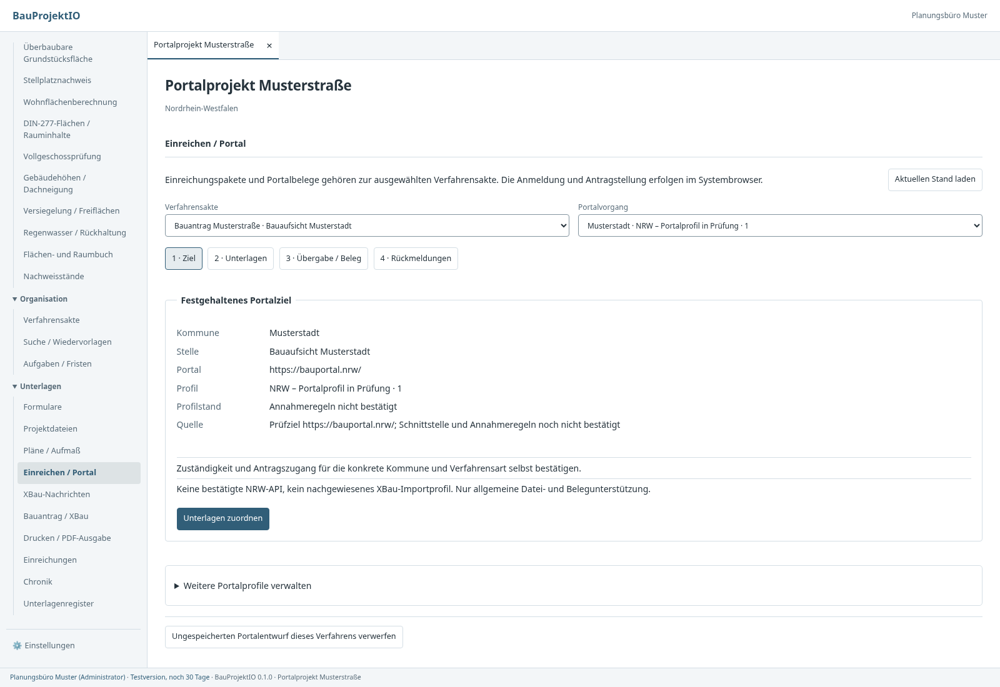
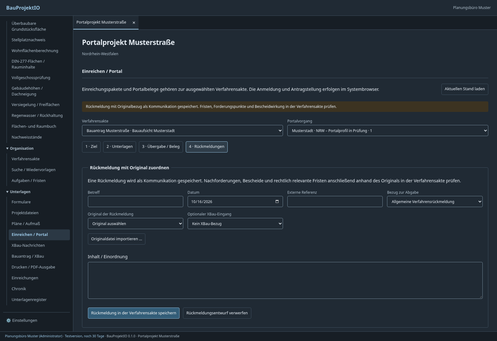

# Einreichen über Landesportale

BauProjektIO unterstützt die **manuelle Einreichung über das jeweils zuständige
Portal**. Projekt → Unterlagen → **Einreichen / Portal** führt durch Zielwahl,
Unterlagen, Übergabe/Beleg und Rückmeldungen. Es gibt keinen automatischen
NRW-, FIT-Connect-, OSCI- oder XTA-Versand und keine automatische Postfachabholung.
Ein Export oder das Öffnen des Systembrowsers belegt keine Einreichung.

## Bedienung

1. Eine Verfahrensakte mit zuständiger Behörde anlegen. Im Portalbereich Profil
   auswählen, Kommune und HTTPS-Portaladresse erfassen und Zuständigkeit für die
   konkrete Verfahrensart bestätigen. Das festgehaltene Ziel bleibt unverändert.
2. Konkrete Dokumentversionen auswählen und einen Abgabestand einfrieren oder
   einen bereits eingefrorenen Stand auswählen. Bei Bedarf XBau ergänzen:
   ohne Bezug 0200, mit archiviertem passendem 0200/1140 eine Nachreichung 0202.
   Uploadnamen, profilierte Unterlagenarten und ggf. ersetzte Unterlagen zuordnen.
   Dateizuordnung prüfen und Portalbereitstellung festhalten.
3. ZIP oder einzelne Originaldateien exportieren. Im Systembrowser anmelden,
   den Antrag im Portal bearbeiten, geforderte Dateien hochladen und dort die
   verbindliche Abgabe auslösen. **Die lokale ZIP ist kein zugesichertes
   Portalimportformat.** Auch ein XBau-Import im jeweiligen Portal ist damit
   nicht bestätigt. Formulare und PDF-Originale werden unverändert bereitgestellt.
4. Originalbeleg im DMS auswählen/importieren, Datum und Portalreferenz erfassen.
   Tatsächlich abgegebene Dateiversionen ausdrücklich mit dem Paket abgleichen.
   Bei unbekannter oder abweichender Dateiliste bleibt der Versandstand
   **ungeklärt**. Erst ein vollständiger, beleggebundener Abgleich dokumentiert
   einen abgegebenen/eingegangenen Dateistand. Änderungen, die ausschließlich im
   Portal entstanden sind, werden nicht automatisch in der Anwendung erfasst.
5. Nachreichungen auf einen vollständig belegten Vorgänger beziehen. Der
   Vergleich berücksichtigt dessen gesamte Vorgängerkette, einschließlich
   unveränderter älterer Unterlagen. Er unterscheidet neue, identische und neue
   Versionen sowie ausdrücklich ersetzte andere Dokumente. Ältere Versionen
   werden abgewiesen. Ein später ungeklärter Vorgänger erscheint als Prüfhinweis.
6. Rückmeldungen mit Originalbezug bewusst als Kommunikation übernehmen.
   Nachforderungen, Bescheide, Auflagen und rechtlich relevante Fristen anhand
   des Originals in der Verfahrensakte bearbeiten. Sie werden nicht aus einem
   Freitext geraten oder automatisch bestätigt. Verknüpfte Nachforderungspunkte
   dokumentieren den Bezug; den Antwortstatus separat fachlich prüfen.

Fehler lassen den Eingabeentwurf erhalten. Entwürfe bleiben beim Bereichswechsel
und getrennt nach Benutzer, Projekt und Verfahrensakte auf dem Gerät erhalten.
Belegentwürfe sind zusätzlich nach konkretem Abgabestand getrennt.
Sie sind keine gespeicherten amtlichen Abgaben und kein geräteübergreifender
Entwurfsabgleich. Während einer laufenden Operation sind Kontextwechsel im
Portalbereich gesperrt; angeforderte Navigation wird danach ausgeführt.

## Profile und ihr Nachweisstand

`portalprofile/profile.json` enthält versionierte Ausgangsprofile:

| Profil | Bedeutung |
| --- | --- |
| `allgemein-manuell@1` | Allgemeine Dateibereitstellung; Zieladresse manuell bestätigen; keine erfundenen Größen-, Format- oder Unterlagenregeln |
| `nrw-manuell@1` | NRW-Prüfprofil, ausdrücklich **Entwurf**; Ziel `https://bauportal.nrw/`; Annahmeregeln und technische Schnittstelle unbestätigt |

Ein Entwurfsprofil sperrt allgemeine manuelle Bereitstellung nicht. Seine offenen
Punkte bleiben sichtbar und werden im eingefrorenen Prüfbericht mitgeführt.
`null` bei Größen und leere Format-/Unterlagenlisten bedeuten **unbekannt bzw.
nicht profiliert**, nicht die Bestätigung, dass das Portal beliebige Dateien
annimmt. Zuständigkeit und Portalvorgaben immer am tatsächlichen Zugang prüfen.

Projektleitung/Administration kann über „Profil-JSON importieren“ ein einzelnes
Profil ins Büro aufnehmen. Grundlage ist ein Objekt aus der JSON-Datei, kein
Array. Pflichtangaben sind ID, Version, Titel, Freigabe, Quelle und Stand sowie
die übrigen Vertragsfelder. Optionale Größen sind Bytes; Endungen ohne Punkt
und in Kleinbuchstaben. Unterlagenarten haben `code`, `name`, `erforderlich` und
`kategorien` (IDs der DMS-Kategorien). Die Pflichtprüfung verwendet die beim
Abgabestand eingefrorenen Kategorien, nicht nachträglich geänderte Kategorien.

Neue Regeln erhalten eine neue Profilversion. Eine vorhandene ID/Version darf
nicht mit anderen Angaben überschrieben werden. Vorgänge speichern ihr Profil
vollständig; Katalogänderungen verändern alte Pakete nicht. `fachlich_geprueft`
ist eine **Bürofreigabe**, keine behördliche Zertifizierung. Profilimport maximal
256 KiB, Katalog maximal 100 Profile einschließlich Ausgangsprofilen. Profile enthalten keine Zugangsdaten.

Offene Betreiberfragen und die Grenzen der bisherigen Quellenprüfung stehen im
[Prüfprotokoll](../xbau/portal-pruefprotokoll.md) und im
[Portalplan](../xbau/portal-anbindung-plan.md). Eine produktive automatische
Schnittstelle benötigt bestätigte Spezifikation, Betreiberzugang, Transport-
und Empfangsprofil sowie Ende-zu-Ende-Abnahme.

## Daten und Modulgrenzen

Die Fachlogik liegt in `core-lib::portale`; Svelte, Tauri und HTTP sind Adapter.
Die Verträge werden über `examples/vertraege.rs` nach
`apps/desktop/src/lib/generated/plattform.ts` generiert.

- `Portalprofil`: unveränderliche Regelversion mit Herkunft und offenen Punkten.
- `Portalvorgang`: bestätigtes Ziel, eingefrorenes Profil und Append-only-Historie.
- `Portalabgabe`: vorhandener Abgabestand, Originalversionen, Uploadzuordnungen,
  Vorgänger, Forderungsbezüge, Prüfbericht und unveränderliches ZIP-Artefakt.
- `Portalereignis`: Originalbeleg, Datum, Referenz, ausdrücklicher Dateiabgleich,
  erfasste Versionen und ggf. Verweis auf ein zu berichtigendes Ereignis.
- `Portalrueckmeldung`: Originalbezug und bestätigte Metadaten; optionaler Bezug
  zu Portalabgabe und passendem XBau-Eingang.

Portalzustand ist optionaler Bestandteil derselben `Verfahrensakte`, damit
Portalereignis, vorhandenes Versandereignis und Audit **in einem Aktencommit**
mit Versionsvergleich geschrieben werden. Es gibt keinen zweiten unabhängigen
Versandstatus. Rückmeldungen erzeugen im selben Commit eine deterministisch
identifizierte Kommunikation. Generische Aktenänderungen dürfen weder die
Portalhistorie noch die gebundenen Versandbelege umgehen. Berichtigungen hängen
neue Ereignisse an; bisherige Belege und Originalversionen bleiben erhalten.

Wiederholungen identischer Aufträge mit derselben ID erzeugen keine zweiten
Einträge. Geänderte Aufträge mit bereits belegter ID werden abgewiesen.
Paralleländerungen erzeugen einen Konflikt, keine stillen Überschreibungen.
ZIP-Ablage und Aktencommit sind getrennte Schritte; bei fehlgeschlagenem Commit
wird ein neu erzeugtes Artefakt bereinigt. Ein zuvor eingefrorener Abgabestand
bleibt bei Folgefehlern erhalten und kann erneut zugeordnet werden.

Die lokale ZIP enthält `Unterlagen/`, `Dateiliste.csv`, `Manifest.json` und
`Liesmich.txt`. Dateiinhalt, Größe und SHA-256 werden vor Bereitstellung gegen
die eingefrorenen Originale geprüft. Dateinamen sind eindeutig und ohne Pfade;
Umbenennung ändert das Dateiformat nicht. Die CSV enthält Kategorie, Original-
und Uploadname, Version, Größe, Hash und Vergleich. Das Manifest dokumentiert
Profil/Ziel/Bezüge für die lokale Nachvollziehbarkeit. Beide sind **keine
amtlichen Importdateien**. Der vollständige Aktenexport enthält auch die
Portalbereitstellungen und Historie.

Eingefrorene XBau-Nachrichten lassen sich ins vorhandene Nachrichtenjournal
übernehmen. Dabei wird das vorhandene Artefakt geprüft und archiviert, keine
Nachricht aus später geänderten Projektdaten neu erzeugt. Seine Nachrichten-ID
entspricht dem Abgabestand. Allgemeine XBau-Journalbelege werden weiterhin nicht
automatisch zu Portalbelegen umgedeutet.

Alte Akten ohne `portal` und alte Abgabedokumente ohne Kategorie bleiben lesbar.
Es erfolgt keine nachträgliche Erfindung einer damaligen Kategorie. Die neuen
Felder sind optional; alte JSON-Daten benötigen keine destruktive SQL-Migration.
Verbraucher des Versandstatus müssen den neuen Wert `ungeklaert` berücksichtigen.

## Zugriff und Grenzen

Core und HTTP prüfen Projektmitgliedschaft; Schreiben verlangt Bearbeitung und
eine schreibfähige Lizenz. Leser können Profile, Zuordnungsprüfung und Dateien
lesen/exportieren. Profilimporte erfordern Projektleitung/Administration.
Portaladressen müssen öffentliche HTTPS-DNS-Adressen ohne Zugangsdaten, Query,
Fragment oder abweichenden Port sein. Bei festem Profilziel muss der Host passen.
Das Betriebssystem öffnet die validierte Adresse im Browser; der Server ruft
keine benutzerdefinierte Zieladresse ab. Eine zulässige HTTPS-Adresse beweist
noch keine behördliche Identität oder Zuständigkeit.

Belege sind manuell dokumentierte Nachweise. Die Anwendung prüft ihre Zuordnung,
**nicht** eine behördliche Signatur, Authentizität oder rechtliche Wirksamkeit.
Ein vollständiger Dateiabgleich ist eine bewusste Bestätigung des Bearbeiters.
Es gibt keine automatische Überprüfung des tatsächlichen Portalpostfachs.

HTTP: `/api/portalprofile` GET/POST; projektgebunden unter
`/api/projekte/{p}/verfahren/{v}/portale` POST; darunter `/{g}/pruefen` POST
(lesend), `/{g}/abgaben` POST, `/{g}/url` GET und `/{g}/rueckmeldungen` POST.
Unter `/{g}/abgaben/{b}`: `paket` GET, `dateien/{d}/{version}` GET,
`ereignisse` POST und `xbau` POST. Schreibaufträge enthalten erwartete Akten-
revision und typisierten Wunsch. HTTP öffnet keinen Browser auf dem Server.

## Prüfung

`crates/storage/tests/portale.rs` prüft mit echter SQLite-/Dateiablage
Originaltreue, mehrstufige Nachreichungen, Profilversionen, ungültige URLs,
Berechtigungen, Konflikte, Wiederholungen, Belegberichtigungen, Kommunikation,
Aktenexport und Schutz vor generischen Historienänderungen.
`crates/server/tests/zugriff.rs` prüft auch die neuen Portalwege.
`crates/server/tests/xbau.rs` prüft eingefrorene 0202 mit echtem XSD-Prüfer.

`apps/desktop/tests/portale.py` verwendet von den Core-Tests erzeugte echte
Stände und simuliert nur den nativen Transport. Geprüft werden Export ohne
Abgabebehauptung, Fehler-/Entwurferhalt, Dateiabgleich, Berichtigung,
Rückmeldungen, Leserechte, Hell/Dunkel und schmale Ansichten. Testdaten über
`BAUPROJEKT_PORTAL_ARTEFAKTE`, Browserbilder über
`BAUPROJEKT_PORTAL_UI_ARTEFAKTE`. CI führt beide Tests aus.

## Ansichten

