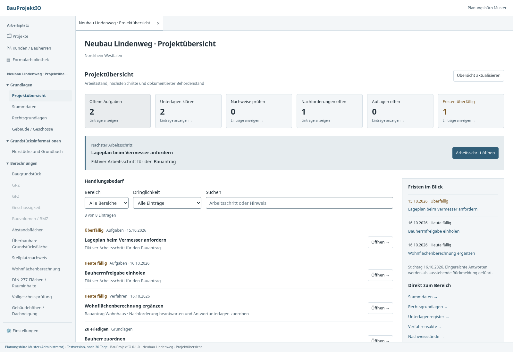
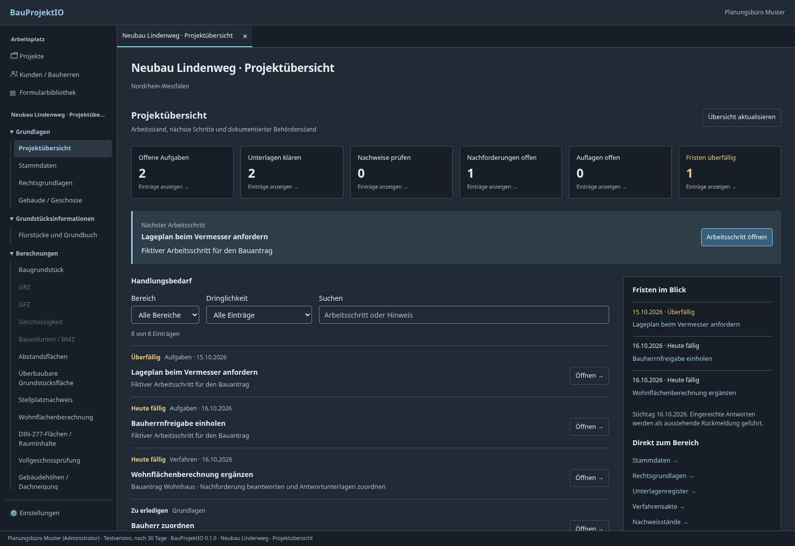
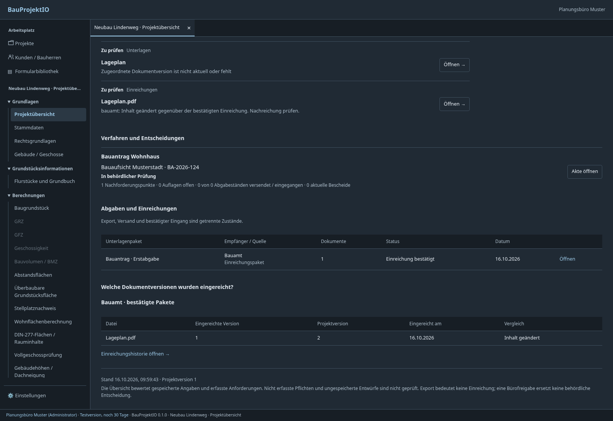

# Zentrale Projektübersicht

Ein geöffnetes Projekt startet in **Projektübersicht**. Stammdaten und bestehende
Fachbereiche bleiben getrennt erreichbar. Die Übersicht ist ein eigenes,
projektbezogenes Lesemodell; sie ändert keine Anforderungen, Berechnungen,
Freigaben, Dokumentversionen oder Versandereignisse.

## Bedienung

- Sechs Bereichszähler führen zu offenen Aufgaben, zu klärenden Unterlagen,
  Nachweisen, Nachforderungen, Auflagen und überfälligen Fristen.
- **Nächster Arbeitsschritt** greift den ersten priorisierten aktiven Eintrag auf.
  Reihenfolge: überfällig, heute fällig, zu erledigen, zu prüfen, Rückmeldung
  ausstehend; innerhalb einer Stufe nach Termin und Bezeichnung.
- **Handlungsbedarf** lässt sich nach Bereich, Dringlichkeit und Suchtext filtern.
  Nachforderungs-/Auflagenzähler setzen zusätzlich einen passenden Registerfilter.
  Die Übersicht zeigt zunächst 20 Einträge; weitere sind nachladbar.
- **Fristen im Blick** enthält die nächsten acht erfassten offenen Termine,
  einschließlich überfälliger Fristen. Es werden keine behördlichen Fristen neu
  aus Gesetzen, Feiertagen oder Zustellungsregeln errechnet. Maßgebend ist das
  erfasste Datum; der ausgewiesene Stichtag ist der UTC-Kalendertag des Servers.
- Links öffnen den passenden Bereich. Aufgaben, Unterlagen und Verfahren werden
  gezielt als Datensatz geöffnet; Verfahren springen außerdem zum Register und,
  soweit vorhanden, zum betreffenden Forderungspunkt, zur Auflage oder Abgabe.
  Nachweisstände und Einreichungspakete werden in ihrer Liste angesteuert.
- Ungespeicherte Entwürfe werden nicht durch einen Sprung ersetzt. Ist im
  Zielmodul ein anderer Entwurf offen, erscheint ein Hinweis. Erst speichern oder
  verwerfen, dann den gewünschten Eintrag erneut aus der Übersicht öffnen.
- Bei der Rückkehr und über **Übersicht aktualisieren** wird neu geladen;
  während die Übersicht sichtbar ist zusätzlich alle 60 Sekunden. Ungespeicherte
  Projektänderungen sind ausdrücklich als noch nicht berücksichtigt markiert.

## Fachliche Auswertung

Die Übersicht verwendet vorhandene öffentliche Fachanbieter:

| Quelle | Sichtbarer Prüfbedarf |
| --- | --- |
| Projekt / Grundstücksanbieter / Bauherren | Fehlende Rechtsgrundlage, bei § 30 fehlende BauNVO-Fassung, fehlender Bauherr, fehlende oder geänderte Bezugsflächen. Keine eigene Grundstücksberechnung. |
| Aufgaben | Offene/in Arbeit befindliche Aufgaben, Fälligkeit und Zuständigkeit. Erledigte Aufgaben fallen aus dem Handlungsbedarf. |
| Unterlagenregister | Erforderliche Unterlagen ohne Dokument oder mit fehlender/veralteter Dokumentversion beziehungsweise fehlender Bürofreigabe. |
| Nachweisverwaltung | Neuester archivierter Stand je Fachproduzent bzw. Nutzungsart/Flurstücksumfang; Aktualität, Vollständigkeit und Freigabe stammen aus der Nachweisverwaltung. Frühere Stände bleiben im Archiv und werden nicht mehrfach als neue Arbeit gezählt. |
| Verfahrensakte | Ungeklärte Erforderlichkeit, fehlende Zuordnungen/Freigaben, unbestätigtes Profil, offene Nachforderungspunkte, aktuelle Bescheide und unerledigte Auflagen. Ersetzte Bescheide erzeugen keine zusätzlichen Auflagen. Zurückgenommene Verfahren erzeugen keine aktiven Verfahrensaufgaben. |
| Versand / Einreichungen | Zusammengestellte, versendete, eingegangene oder zurückgewiesene Abgaben sowie lediglich exportierte und ausdrücklich bestätigt eingereichte ZIP-Pakete. |

Eine eingereichte Antwort ist noch kein von der Behörde bestätigter Abschluss.
Sie erscheint unter **Rückmeldung ausstehend**, aber nicht erneut als
unbeantwortete überfällige Nachforderung. Unerledigte Auflagen bleiben auch nach
einer Genehmigung sichtbar. Der letzte aktuelle Bescheid wird mit Entscheidung
und Datum angezeigt; er ersetzt keine Prüfung sämtlicher Bescheide.

## Dokumentierter Behördenstand

Verfahrensabgaben werden pro gespeicherter Behördenidentität ausgewertet.
Maßgebend sind tatsächlich dokumentierte Versand-/Eingangsstände und ihre
Berichtigungen. Datum und Status stammen aus demselben maßgebenden
Versandereignis. Eine später nacherfasste historische Zurückweisung überschreibt
keinen neueren bestätigten Eingang.

Bestätigte klassische Einreichungspakete werden zusätzlich und ausdrücklich
gekennzeichnet nach Empfänger ausgewertet. Die bestehenden Vergleichsregeln
unterscheiden geänderten Inhalt von einer neuen Version mit gleichem Inhalt.
Die Tabelle zeigt Dateiname, eingereichte Version, aktuelle Projektversion und
Einreichungsdatum. Neuere Projektversionen führen zum Hinweis, eine Nachreichung
zu prüfen; sie werden niemals automatisch als eingereicht markiert.

Dateien ohne bestätigten Versand werden nicht als Behördenbestand dargestellt.
Nicht jede neue Datei eines Projekts muss eingereicht werden; die Übersicht
entscheidet dies nicht allein aus dem Vorhandensein einer Datei. Gleichlautende
Empfängernamen aus klassischer Paketverwaltung und Behördenidentitäten werden
nicht ohne ausdrückliche Zuordnung zusammengeführt.

## Schnittstellen und Grenzen

`crates/core-lib/src/projektuebersicht.rs` besitzt den Ergebnisvertrag
`Projektuebersicht`: Projektidentität/-version, Zeitpunkt/Stichtag, Bereichszahlen,
priorisierte Arbeitspunkte, Verfahren, Abgaben und Empfängerstände. Ein
`UebersichtsZiel` enthält Bereich und optionale Objekt-, Register- und Eintrags-
identität. Das Frontend zeigt diese Auswertung an und filtert sie; es dupliziert
keine Fachberechnung oder Versandentscheidung.

Tauri `projektuebersicht` und HTTP `GET /projekte/{id}/uebersicht` verwenden
 denselben Core-Service mit Projektleserecht. Es gibt keine neue Datenbanktabelle
oder Migration. Das alte Projektstatus-API bleibt kompatibel; die bisherige
kleine Statusanzeige wird im Stammblatt nicht zusätzlich angezeigt.

Die Quellen werden beim Laden gelesen, nicht als transaktionale Gesamtsicherung
aller Fachmodule eingefroren. Eine gleichzeitig geänderte Projektversion wird
abgewiesen; weitere Änderungen werden bei Aktualisierung erneut ausgewertet.
Eine fehlgeschlagene Quelle erzeugt einen Fehler, keine scheinbar erfolgreichen
Nullwerte. Ein früherer erfolgreicher Stand bleibt als solcher gekennzeichnet.
Requests sind an Projekt und Anfragegeneration gebunden; verspätete Antworten
verändern keine andere Projektakte. Gezielte Editoraufrufe laden ihre Liste
frisch, beachten lokale Entwürfe und behalten die bestehende CAS-Speicherung.

Die Übersicht bewertet **erfasste** Angaben. Noch nicht angelegte Anforderungen,
nicht dokumentierte Behördenkontakte und rechtlich erforderliche, aber nicht
erfasste Nachweise sind dadurch nicht vollständig geprüft. Es gibt keine
pauschale Ampel „Bauantrag vollständig“ oder automatische Genehmigungszusage.

## Prüfungen

- `crates/storage/tests/projektuebersicht.rs`: Fristen, erledigte Aufgaben,
  Pflichtunterlagen/Versionswechsel, Anforderungen, gezielte Sprungziele,
  Leserechte/Projektgrenzen, alte und neue Fachnachweise, Export gegenüber
  bestätigter Einreichung und Inhaltsvergleich.
- `crates/storage/tests/verfahren.rs`: reales Musterverfahren einschließlich
  Versandberichtigung, Behördenstand und ausstehender Antwortbestätigung.
- `crates/server/tests/zugriff.rs`: eigener und fremder Projektbereich mit
  Leserzugang auch über den neuen Übersichts-Endpunkt.
- `apps/desktop/tests/projektuebersicht.py`: produktives Frontend mit echten
  Core-Testdaten; Startseite, Zähler/Filter, gezielte Objekt-/Registersprünge,
  Entwurfschutz, Refreshfehler, verspätete Projektantworten, Leserrolle und
  600-/900-Pixel-Fenster. Für den Browser ist nur der native Transport ersetzt.
- CI erzeugt Testdaten mit `BAUPROJEKT_UEBERSICHT_ARTEFAKTE` und führt den neuen
  Browserablauf zusammen mit den bestehenden UI-Prüfungen aus.

