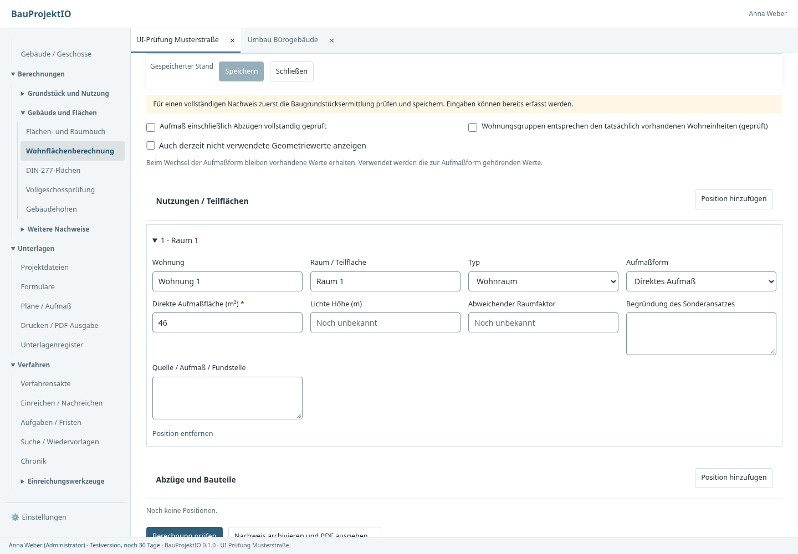
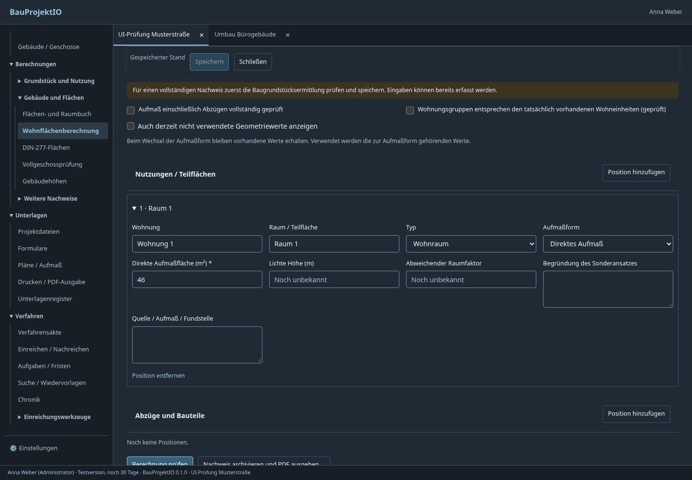
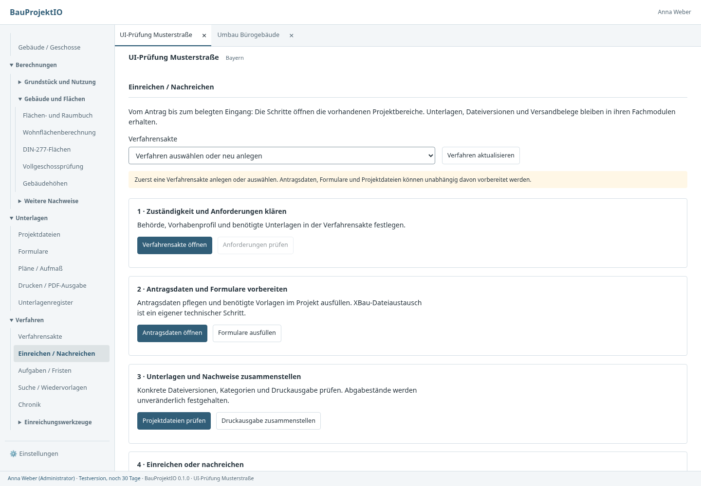
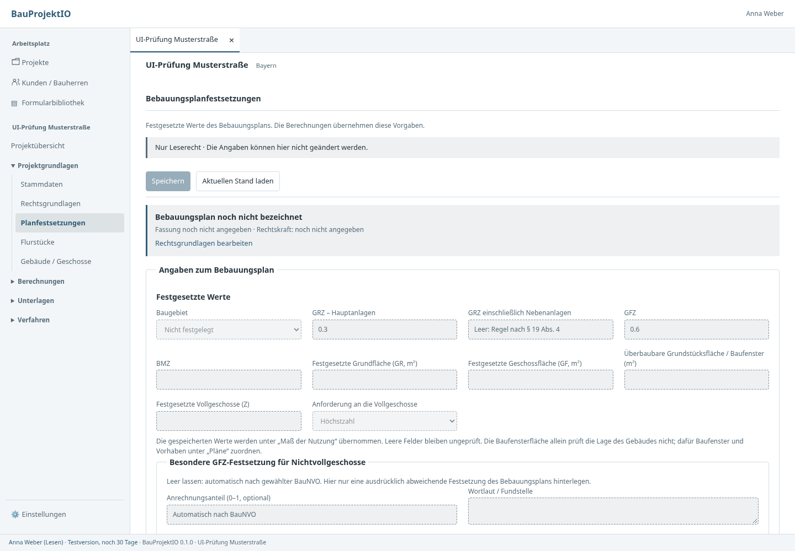

# Einheitliche Eingaben und klarere Projektführung

Ausgangspunkt: UI-Prüfung von Main `926fd35` am 17.10.2026. Die Überarbeitung
betrifft die Oberfläche und die Absicherung ihrer Eingabeaufträge. Fachliche
Berechnungen, gespeicherte Datentypen, Original-PDFs und Abgabestände erhalten
keine neue Bedeutung und keine Datenmigration.

## Änderungen

| Befund | Umsetzung |
| --- | --- |
| Checkboxen von ihren Texten getrennt | Eigene Checkboxzeile mit Kästchen vor dem Text und gemeinsamer Klickfläche; Mehrfachauswahl als Feldgruppe. |
| Gesperrte Felder wirken bearbeitbar | Gemeinsame gedämpfte Fläche, gestrichelter Rahmen, Lesemodushinweis. Übernommene Zahlen/Texte sind schreibgeschützt und kopierbar; die Herkunft wird benannt. |
| Löschen wird automatisch zu 0 | Zahl bleibt im lokalen Entwurf leer. Bei zwingendem Zahlenvertrag erscheinen Feldfehler und Fehlerübersicht. Speichern, Berechnen und Archivieren werden abgefangen. Optionale Zahlen bleiben unbekannt; ausdrücklich eingegebene Null bleibt eine eigene Angabe. |
| Unpassende Geometriefelder | Wohnfläche und DIN 277 blenden Maße abhängig von Rechteck, Dreieck, Trapez oder direktem Aufmaß ein. Nicht verwendete Werte bleiben erhalten und können ausdrücklich eingeblendet werden. |
| Kurze Namen als mehrzeilige Felder | Textangaben standardmäßig einzeilig, Begründungen/Quellen mehrzeilig gemäß Darstellungskonfiguration. |
| Fehlende Feldführung | Einheitliche Kennzeichnung statischer Pflichtfelder; Feldfehler, `aria-invalid`, zugeordnete Fehlermeldungen und Sprünge zum betroffenen Feld. Native Format-/Pflichtfehler werden auch beim Speichern über Menü oder Fensterschließen geprüft. |
| Zu viel Kopf und leere Eintragsliste | Kompakter Projektkopf innerhalb der Arbeitsbereiche; leere Bestandsliste während einer Neuanlage standardmäßig verborgen, weiterhin aufrufbar. |
| Speichern erst am Formularende | Oben haftende Speicherleiste mit gespeichertem/ungespeichertem Status; kein zweiter, unabhängiger Speicherweg. |
| Ungeordnete Dateifilter | Eigene Werkzeugleiste für Suche, Kategorie und Sortierung, Beschriftungen über den Controls; Dateiaktionen davon getrennt. |
| Zu lange Navigation | Projektübersicht als Direkteinstieg, vier Hauptgruppen mit weiteren Berechnungsgruppen. Aufklappzustände je Projekt gespeichert, aktive Zielgruppen werden geöffnet. Kurztitel, Zeilenumbruch, vollständige Tooltips und `aria-current`. |
| Einreichungsfunktionen verstreut | Neuer Einstieg „Einreichen / Nachreichen“ mit fünf Schritten zu Verfahren, Antrag/Formularen, Unterlagen, Portalübergabe und Belegen/Rückmeldungen. Technische Werkzeuge bleiben erreichbar. |
| Planangaben doppelt bearbeitbar | Planbezeichnung, Fassung und Rechtskraft nur unter Rechtsgrundlagen bearbeiten; in Festsetzungen steht ein Quellenbezug mit Querverweis. |
| Druckdialog zu schmal | Dialog mit Druckliste verwendet eine größere, an das Fenster angepasste Breite. |

Die zentrale Projektnavigation verarbeitet Querverweise jetzt selbst. Zuvor
konnten von Kindkomponenten angeforderte Sprünge ihren Zielbereich vorbereiten,
ohne die sichtbare Projektansicht umzuschalten. Aufträge werden je Projektakte
und einmal je Auftragsnummer übernommen; ein alter Auftrag zieht eine spätere
manuelle Bereichswahl nicht wieder zurück.

## Feldverträge und Leerwerte

Die persistierten Core-Verträge bleiben erhalten. `number` bezeichnet weiterhin
eine zwingende Zahl, `optional_number` eine optionale Zahl. Ein geleertes
`number`-Feld ist ein **unvollständiger lokaler UI-Entwurf**, keine speicherbare
Null und kein neuer gültiger Core-Datentyp. Der vorhandene Entwurfsspeicher
bewahrt diesen Zustand auch bei Bereichswechsel und Wiederherstellung.

`FachSitzung.vorSpeichern` wird vor jedem generischen Speicheraufruf ausgeführt:
Formular, Menü, Sammelspeichern und Archivierung benutzen dieselbe Sperre.
`FachBerechnung` prüft vor einem Berechnungsaufruf zusätzlich die Formate über
sämtliche Eingabe-/Regelbereiche. Der ungültige Entwurf wird nicht als Auftrag
an Tauri geschickt. Für die betroffene Stelle öffnen sich nötigenfalls der
Eingabebereich und die zugehörige Position.

Die Frontendprüfung entscheidet **nicht**, ob eine Null fachlich zulässig ist.
Sie prüft nur, ob eine zwingende Zahl vorhanden und endlich ist. Wertebereiche,
Anwendbarkeit, Quellenaktualität, rechtliche Regeln und Vollständigkeit bleiben
beim Core. Dessen fachliche Fehlermeldungen bleiben als Bereichsmeldungen
sichtbar; sie werden nicht durch geratene Zuordnungen auf einzelne Felder ersetzt.

Auch ein derzeit ausgeblendeter Wert muss zum bestehenden zwingenden Datentyp
passen, wenn er Bestandteil eines Speicherauftrags ist. Bei einem unvollständigen
Entwurf öffnet die Prüfung dafür die vollständige Feldansicht. Es gibt kein
stilles Löschen oder Umwandeln ausgeblendeter Werte.

## Konfiguration und Modulgrenzen

- `berechnungen/feldDarstellung.json`, Version 1: rein visuelle Feldregeln,
  mehrzeilige Eingaben und sichtbare Maße je Aufmaßform.
- `feldDarstellung.ts`: gemeinsame, ohne UI testbare Regeln für Darstellung und
  elementare Formatprüfung. Die Sichtbarkeitsfunktion verändert keine Daten.
  Unbekannte ältere Aufmaßformen lassen alle Maße sichtbar.
- `Fachfeld.svelte`: Eingabeart, Label, Hilfe, Herkunft und Feldfehler. Numerische
  und textliche Übernahmen verwenden `readonly`; Auswahlfelder bleiben bei
  Bindung deaktiviert. Rechenergebnisse werden weiterhin als Ergebnistabellen
  und nicht als vermeintlich freie Eingaben dargestellt.
- `Fachliste.svelte`: gemeinsame Speicher-/Validierungsführung. Die zusätzliche
  Prüfung vor dem Speichern ist optional, bestehende Verbraucher behalten ihren
  Konstruktor und ihre Repository-Verträge.
- `navigation.ts`: Aufbau der Sidebar, unabhängig von Fachlogik und Datenhaltung.
  Neue im bestehenden Modulregister eingetragene Features werden ohne weitere
  Sidebaranpassung in die passende Gruppe aufgenommen.
- `EinreichenStart.svelte`: Lese-/Navigationsoberfläche. Keine eigene Versand-
  projektion, keine neuen Dokumentkopien, keine parallele Verfahrenshistorie.

Bisherige Module, Routen und Berechtigungen bleiben bestehen. Der neue Einstieg
löst keine Einreichung aus. Portalabgabe und Empfängerstand bleiben an den
vorhandenen Originalbeleg und Dateiabgleich gebunden.

## Prüfungen

- Svelte-Typprüfung und Produktionsbuild.
- Node-Vertragsfälle für Null/Leerwert, endliche Zahlen, passende Geometriefelder,
  unveränderte Daten bei der Sichtbarkeitsprüfung, Übereinstimmung mit den echten
  Formularkonfigurationen und automatische Aufnahme neuer Module.
- Neue Browserprüfung `apps/desktop/tests/ui-felder-navigation.py`: Vorzeichen-/Dezimaleingabe, leere Zahl,
  blockiertes Speichern über Formular/Menü, blockierter Rechenauftrag, Rettung
  nach Neuladen, ausdrücklich eingegebene Null, Geometriewechsel, Speicherkonflikt,
  Fehlerfokus, alle acht generischen Rechenmasken, Checkboxzuordnung, statische Pflichtfelder, Leserechte, kompakter
  Kopf, Filter, Projektaufklappzustände, Querverweise und Einreichungsführung.
- Bestehende Browserprüfungen für Projekttabs, Plattformeditoren,
  Fehlerregressionen und Updater. Der Testtransport der bestehenden Fachsuiten
  verwendet bewusst eine gespeicherte offene Navigation. Die neue UI-Prüfung
  setzt diese Präferenz zurück und prüft den kompakten Standard.
- Helle/dunkle Darstellung und 1024/800/600 CSS-Pixel in der neuen Suite;
  Navigation ohne abgeschnittene horizontale Beschriftungen. 1024 ist die native
  Mindestbreite, kleinere Breiten sind ergänzende Belastungsproben.

Browserprüfungen verwenden den Produktionsbuild mit Test-IPC und fiktiven Daten.
Sie ersetzen keine native Prüfung bei Windows-/macOS-Skalierung und keinen
Ende-zu-Ende-Test realer Bauanträge oder offizieller PDF-Formulare. Die Rust-
Berechnungen wurden in diesem UI-Arbeitsschritt nicht verändert.

```sh
npm run check --prefix apps/desktop
npm run build --prefix apps/desktop
node --experimental-strip-types --test apps/desktop/tests/feld-darstellung.test.mjs
# Produktionsbundle lokal bereitstellen; BAUPROJEKT_UI_URL anpassen.
python3 apps/desktop/tests/ui-felder-navigation.py
```

CI führt die neuen Fälle ebenfalls aus. `BAUPROJEKT_UI_FELDER_ARTEFAKTE`
legt einen alternativen Ausgabeordner für die neuen Screenshots fest.

## Ansichten








