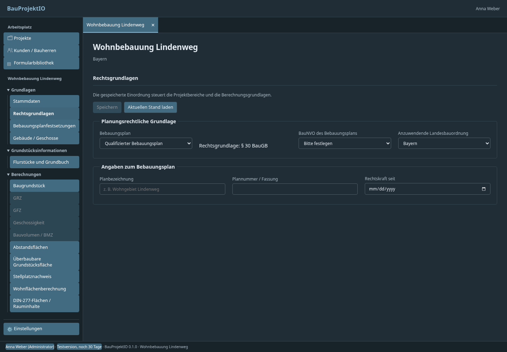
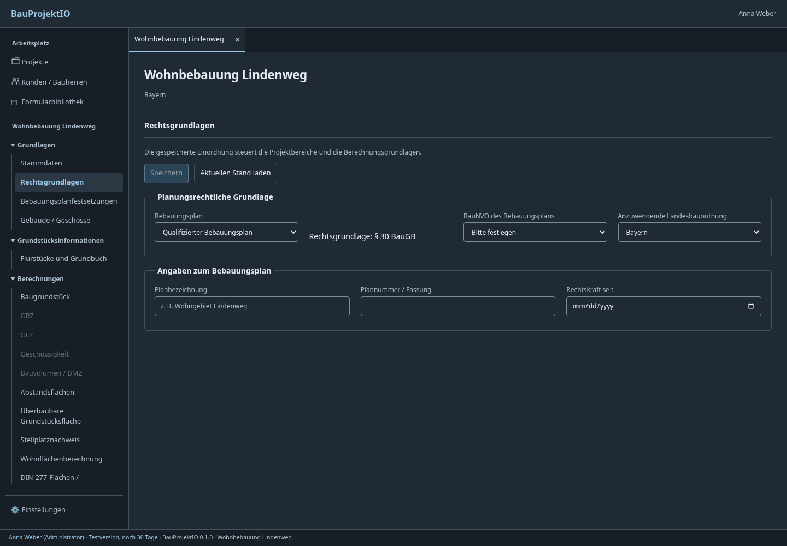
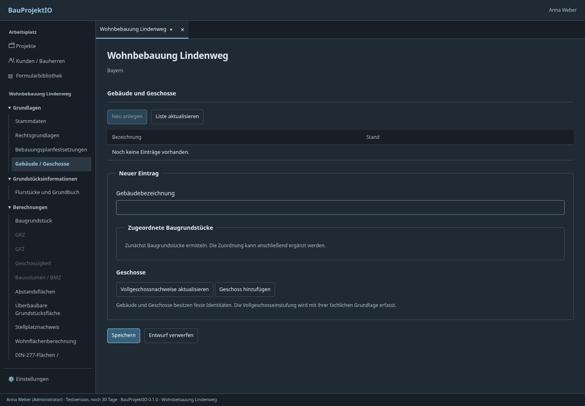
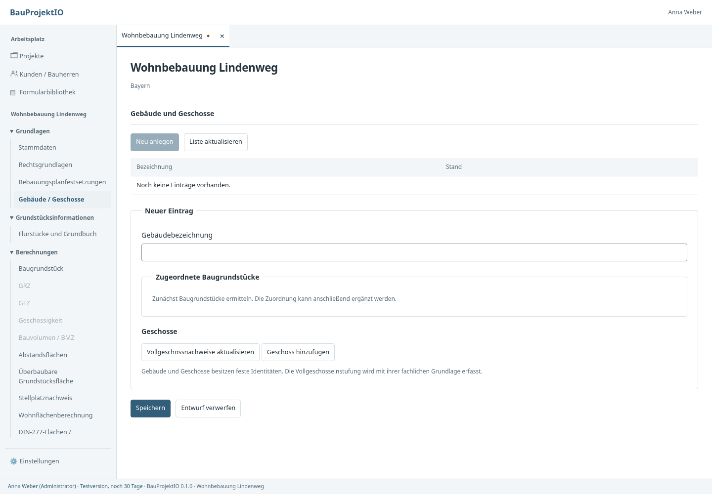

# UI-Prüfung: Dark Mode und Formularabstände

Geprüfter Stand: aktueller Main einschließlich der acht Fachberechnungsmodule,
anschließend die in diesem Branch beschriebenen Korrekturen. Die Screenshots
stammen aus dem Produktionsbundle mit ersetztem nativen Transport und fiktiven
Projektdaten. Es handelt sich nicht um einen vollständigen Ergonomie- oder
Barrierefreiheitsnachweis und nicht um einen Test jeder Landes-/Kommunalvorschrift.

## Bestätigte Befunde und Korrekturen

| Befund | Ursache | Korrektur |
| --- | --- | --- |
| Im Dark Mode sehen fast alle Navigations- und Tab-Schaltflächen aktiv aus. | `:root[data-theme="dark"] button` war spezifischer als die neutralen Navigations-, Tab- und Linkstile und übersteuerte deren Hintergrund und Schrift. | Dunkle Primärschaltflächen verwenden gemeinsame Farbwerte; der pauschale Dark-Button-Selektor entfällt. Navigation, Textaktionen und Sekundäraktionen behalten ihre eigenen Rollen. |
| Rechenmasken erhalten uneinheitliche Bereichsschaltflächen. | `--surface` und `--text` waren nicht definiert; `--accent-soft` fehlte ebenfalls. | Vorhandene Panel-/Textvariablen verwenden und die weiche Auswahlfarbe zentral definieren. |
| Speichern steht bei einigen Fachformularen seitlich, Feldbezeichnungen kleben an Eingaben. | Der allgemeine Formularstil war ein umbrechendes Flexlayout; nur einzelne Fachmodule hatten eine Blockhülle. | Gemeinsame Fachformularhülle, volle Formularbreite, Aktionen darunter. Direkt unter Feldgruppen stehende Beschriftungen erhalten eigene Zeilen und Abstand. |
| Unruhige Abstände, dünne Feldränder und uneinheitliche Checkboxgrößen. | Mehrere historische Farbdefinitionen, Browser-Feldgruppenränder und pauschale Mindesthöhen auch für Checkboxen. | Ein gemeinsamer Farbsatz je Theme; stärkere Eingaberänder, 36-px-Standardfelder, eigene Checkbox-/Radiogrößen sowie Abstände für Gruppen, Überschriften und Feldbeschriftungen. |

Änderungen betreffen die Darstellung. Fachberechnungen, gespeicherte Projekte,
Rechte, Nachweishistorie und Original-PDF-Inhalte erhalten keine Vertrags- oder
Datenmigration. Die Papierdarstellung eines Original-PDFs wird nicht dunkel
umgefärbt; dunkle Bedienoberfläche und weißes Dokument haben getrennte Aufgaben.

## Tatsächlich ausgeführte Prüfungen

- Frontend-Typprüfung und Produktionsbuild.
- Bestehende Browserprüfungen: Projekttabs/Entwürfe, Plattform-Fachmodule,
  Druckausgabe, Verfahrensakte, Abstandsflächen und alle acht neuen Rechenmasken.
- Heller/dunkler Modus, Betriebssystemvorgabe während der Sitzung und gespeicherte
  Darstellung nach Neuladen; keine JavaScript-Fehler in den geprüften Abläufen.
- Rechtsgrundlagen bei 600, 900 und 1440 Pixel Fensterbreite: kein horizontaler
  Überlauf der Dokumentwurzel. Fachliche Tabellen dürfen separat scrollen.
- Gebäudeformular: Eingabe vollständig sichtbar und Speichern unter dem Formular.
- Je Theme 46 sichtbare Textelemente der Rechtsgrundlagen und Navigation mit
  berechneten Vorder-/Hintergrundfarben einschließlich transparenter Vorfahren:
  kleinster Textkontrast **5,11:1 hell**, **6,68:1 dunkel**. Deaktivierte Aktionen
  waren ausgenommen. Diese Stichprobe ist kein vollständiges WCAG-Audit.

## Weitere Prüfschwerpunkte

Die folgenden Punkte sind gezielte nächste Prüfungen, keine pauschale Behauptung,
dass die vorhandenen Funktionen fehlerhaft sind.

| Priorität | Bereich | Konkrete Prüfung / Abnahmekriterium |
| --- | --- | --- |
| Hoch | Fachliche Referenzfälle | Reale B-Pläne, zeitlich passende BauNVO-/LBO-Fassungen und kommunale Stellplatzsatzungen mit unabhängig geprüften Sollwerten vergleichen. Vor allem Übergangsrecht, Sonderfälle und begründete Ausnahmen prüfen. Fiktive Konfigurationsbeispiele sind keine kommunale Freigabe. |
| Hoch | Durchgängige Projektabhängigkeiten | Grundstücke teilen/zusammenführen, Aufmaß und Gebäude ändern, Quellnachweis ersetzen: sämtliche Verbraucher müssen neue Prüfbedarfe sichtbar machen. Archivierte und eingereichte Stände müssen unverändert lesbar bleiben. Vorhandene Integrationstests durch reale Büroprojekte ergänzen. |
| Hoch | Gemeinsame Ablage und parallele Bearbeitung | Zwei Arbeitsplätze am tatsächlichen NAS-/Serverbackend, gleichzeitiges Speichern, Dateisperren, externe DWG-/Office-Änderungen, Verbindungsabbruch und Wiederherstellung einer Sicherung prüfen. Browser-Transporttests ersetzen diesen Betrieb nicht. |
| Hoch | Amtliche PDF-Vorlagen | Reale Vorlagen verschiedener Behörden mit langen Anschriften, mehrzeiligem Text, Umlauten, Checkboxgruppen und unterschiedlichen PDF-Betrachtern prüfen. Ausdruck und gespeicherte Originalvorlage müssen denselben Feldinhalt zeigen. Signierte oder geschützte Vorlagen gesondert behandeln. |
| Mittel | Tastatur, Skalierung und Screenreader | Fokusreihenfolge und sichtbaren Fokus in verschachtelten Dialogen, Tabellen und Baum-Navigation prüfen; Pflichtfelder/Fehler verständlich vorlesen lassen; Windows-Skalierungen von 125–200 % an einem nativen Tauri-Fenster testen. |
| Mittel | Große Projektakten | Tausende Dokumentversionen, umfangreiche Pläne, viele offene Akten und lange Nachforderungschroniken messen. Antwortzeiten, Speicherverbrauch und Filterleistung mit realistischen Daten bestimmen. |
| Mittel | Weg bis zur Einreichung | Mit einem Planer einen vollständigen Antrag zusammenstellen: fehlende Voraussetzungen verstehen, Nachweise freigeben, Dokumentstände auswählen, nachfordern/korrigieren und genehmigten Stand rekonstruieren. Begriffe, Doppelaktionen und unnötige Klicks anhand dieses Ablaufs abbauen. |
| Mittel | Ausgabequalität | Lange Tabellen, mehrseitige Begründungen, gemischte Papierformate und Originalformulare im Stapel prüfen: Tabellenköpfe, Umbrüche, Inhaltsverzeichnis, Seitenzahlen und exakte Dokumentversionen müssen übereinstimmen. |

## Sichtbarer Vergleich

Vorher: Die pauschale Dark-Regel färbt auch inaktive Navigationseinträge.

Nachher: aktive Navigation, neutrale Aktionen und erkennbarere Eingabefelder.

Fachformular mit gruppierten Eingaben und Aktionen darunter, dunkel und hell.

