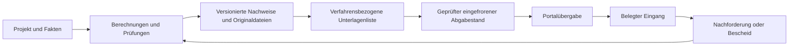

# Workflow- und UX-Prüfung BauPlanIO

Stand: 23.10.2026. Untersucht: `e80717f39fe82f05d21705a0e70a5f94662d26d2`
(Arbeitsstand einschließlich Stabilitäts-/Performanceänderungen). Dies ist keine
Behauptung über einen inzwischen möglicherweise weiterentwickelten Main-Branch.

## Ergebnis

Die Anwendung hat bereits die wesentlichen Bausteine einer digitalen Projektakte.
Entwurfsschutz, gezielte Prüfpunktnavigation, konkrete Dateiversionen und die
Trennung von Export und belegtem Eingang sind gute Grundlagen. Der größte
Verbesserungsbedarf liegt in den Übergängen zwischen diesen Bausteinen:

1. Vorbereitende Dateneingabe wird teilweise gemeinsam mit fachlichen
   Voraussetzungen gesperrt. Besonders auffällig: §34 ohne BauNVO.
2. Berechnen, Speichern, Regeln bestätigen, Archivieren, Freigeben und PDF-Ausgabe
   haben je Modul unterschiedliche Abläufe. Die fachlichen Unterschiede sind
   nötig; die unterschiedlichen Bedienmuster erschweren das Erlernen.
3. Unterlagenregister, Verfahrensanforderungen, Projektdateien, Druckausgabe,
   Einreichungen und Portalübergabe erfordern mehrere Zuordnungsentscheidungen.
   Die Software sollte den Kontext weiterreichen und die Entscheidungen bündeln.
4. Große Fachmasken und die Verfahrensakte besitzen mehrere Navigationsebenen.
   Eine klare nächste Aktion fehlt gerade dann, wenn Voraussetzungen fehlen.

Es wurde kein realer Datenverlust in den ausgeführten Browserprüfungen
reproduziert. Das ist kein Nachweis für alle Betriebsbedingungen.

## Unterlagen dieses Audits

- [12 praxisnahe Workflows mit Sollverhalten und Prüfstatus](workflows.md)
- [15 priorisierte Befunde mit Akzeptanzkriterien und Umsetzungsreihenfolge](verbesserungen.md)
- [Maschinenlesbare Ergebnisse der explorativen Browserprüfung](belege/probe.json)
- [Reproduzierbares Browser-Prüfskript](probe.py)
- [Prüfläufe und Grenzen](pruefung.md)

## Methode und Aussagegrenzen

**B** bedeutet in diesem Audit in der Produktionsoberfläche mit Playwright und
Test-IPC reproduziert. **Q** bedeutet durch Lesen des aktuellen Quellcodes und
Bedienhandbuchs nachvollzogen. **H** bedeutet Nutzungshypothese, die mit Planern
im Alltag getestet werden sollte. Ein workflowbezogener Prüfstatus ist kein
pauschales „End-to-End bestanden“.

Die Browserläufe verwenden fiktive Projekte und teilweise bereits vorhandene,
vom Backend erzeugte PDF-/Workflow-Fixtures. Native IPC, echte Büroablagen,
Office-/CAD-Starts, Behördenportale, tatsächliche Uploads und behördliche Annahme
wurden hier nicht ausgeführt. Fachliche Regeln, Satzungen und Rechtsstände wurden
nicht rechtlich nachgeprüft. Es gab keine beobachteten Sitzungen mit echten
Architekten; Bearbeitungszeiten und Einsparungen werden deshalb nicht behauptet.

Die Szenarien sind bewusst unterschiedlich: Einfamilienhaus ohne Bebauungsplan,
mehrere Grundstückseinheiten, mehrere Gebäude, Dachgeschoss, kommunale Satzung,
Formularvorlagen, Erstabgabe, Teilnachreichung und Genehmigungsauflagen.

## Sichtbelege

| Beleg | Beobachtung |
| --- | --- |
| [§34-Navigation](belege/01-par34-navigation.png) | Vier Nutzungsmodule gesperrt; Grund steht als Tooltip am deaktivierten Eintrag. |
| [Baugrundstück](belege/02-baugrundstueck.png) | Grundbuch als optional erklärt; gespeicherte Flurstücke sind die Quelle. |
| [Gebäude](belege/03-gebaeude.png) | Erfassung und Geschoss-/Quellenkontext innerhalb eines Editors. |
| [Abstandsflächen: Grundlagen](belege/04-abstand-grundlagen.png) | Mehrere Navigationsebenen; die Fachmaske beginnt erst weit unterhalb des Projektkopfes. |
| [Abstandsflächen: Wände](belege/05-abstand-waende.png) | Eigener Unterbereich neben Umrissen, Lageplan, Sicherungen und Prüfbericht. |
| [Formulare ohne Vorlagen](belege/06-formulare-leer.png) | Hinweis auf globale Bibliothek, aber kein direkter Einrichtungsweg in dieser Maske. |
| [Abgabe ohne Verfahrensakte](belege/07-einreichen.png) | Arbeitscheck und Schrittführung vorhanden; Akte nötig für die Portalübergabe. |
| [Wohnflächen: Prüfbericht](belege/08-wohnflaechen.png) | Konkretes Ergebnis aus Fixture, keine erneute fachliche Berechnung im Browser. |
| [Stellplätze: Prüfbericht](belege/09-stellplaetze.png) | Regelkontext, Eingaben, Quellen und Bericht sind getrennte Unterbereiche. |

Die Werte in `probe.json` zählen gerenderte Elemente einschließlich Navigation
und Elementen außerhalb des sichtbaren Scrollausschnitts. Sie messen weder
mentale Belastung noch die Zahl fachlich erforderlicher Eingaben. Die
Dokument-Scrollhöhe erfasst keine inneren Scrollcontainer und wird nicht als
Maß für Formularlänge verwendet. Screenshots zeigen den Zustand vor dem Scrollen.

## Empfohlenes Zielbild

Eine gemeinsame Oberfläche darf diese Schritte zusammenführen. Die fachlichen
Module und unveränderlichen Stände bleiben getrennt. Fehlende Eingaben dürfen
im Entwurf offen bleiben; eine verbindliche Freigabe oder Abgabe muss ihre
konkreten Voraussetzungen weiterhin prüfen. Eine leere Prüfliste ist keine
Vollständigkeitsbestätigung.

Vor einer Umsetzung gelten die [Entwicklungsregeln](../../entwicklungsregeln.md).
Dieses Audit verändert keine Berechnungsregeln, Benutzerrechte, Datenmodelle
oder Abläufe der Anwendung.
