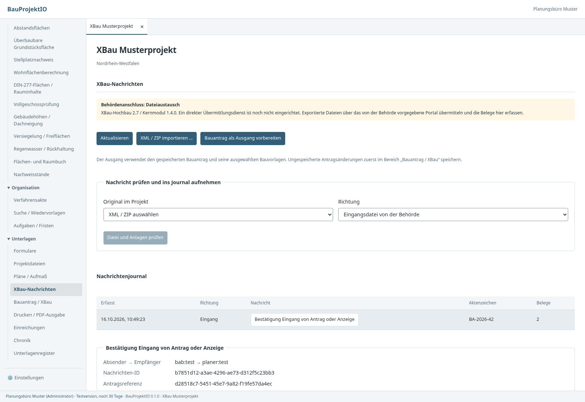
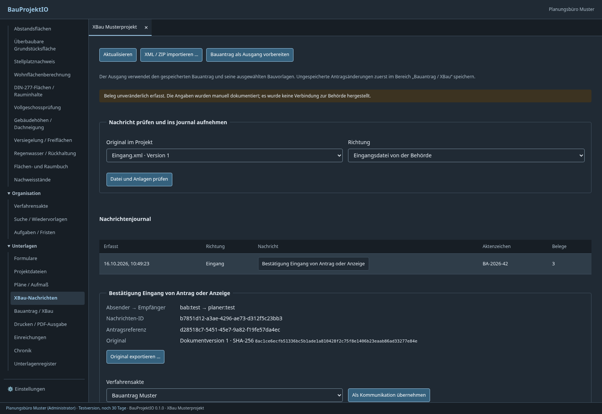

# XBau-Nachrichten und Behördenanschluss

## Planung des Portalanschlusses

[Analyse und Umsetzungsplan für NRW und weitere Landesportale](portal-anbindung-plan.md)
mit [Prüfprotokoll und offenen Betreiberfragen](portal-pruefprotokoll.md).
Der [geführte manuelle Portalablauf](../portale/README.md) ist jetzt implementiert.
Eine automatische Schnittstelle bleibt gesondert nachzuweisen und abzunehmen.

## Tatsächlich implementierter Umfang

BauProjektIO unterscheidet **XBau-Dateien** und **Übermittlungsdienst**. Der
Dateiaustausch ist implementiert; ein produktiver Behördenanschluss ist noch
nicht eingerichtet. Ein Export löst keinen Versand aus. Weder ein erfolgreicher
XML-Import noch eine XSD-Prüfung beweist die Identität des Absenders, Zustellung,
Wirksamkeit eines Bescheids oder die Annahme eines Antrags.

| Bereich | Umsetzung |
| --- | --- |
| Versionsstand | XBau-Hochbau 2.7, Kernmodul 1.4.0, fest eingebettete offizielle Schemas |
| Nachrichtenkatalog | 137 globale Nachrichten aus diesen Schemas; keine Behauptung über andere oder neuere Fassungen |
| Erstellung | Bauantrag 0200 sowie Änderungen/Nachreichungen 0202 aus dem gespeicherten Bauvorhaben und den ausgewählten Anlagen. Abgabestände eines Verfahrens wählen die Nachricht nach der Verfahrensart, siehe unten |
| Bezug einer Nachreichung | Archivierter ursprünglicher Antrag derselben Art (0200 oder 0210) oder Befundliste 1140 mit passender Antragsreferenz/Behörde; neue Nachrichten-ID, bisherige Originale bleiben erhalten |
| Empfang | Original XML oder ein ZIP mit genau einer XBau-Nachricht und den referenzierten Anlagen |
| Prüfung | XML-Struktur, XSD, Identitäten, Dateinamen, Anlagenvollständigkeit sowie angegebene Größen und SHA-256-Werte |
| Journal | Projektgebunden, Original als unveränderliche DMS-Version, Prüfzeitpunkt, Hash, Erfassender; Wiederholung derselben Nachrichten-ID/Inhalt/Richtung erzeugt keinen zweiten Journaleintrag |
| Anlagen | Einzeln mit Herkunft und Hash als Projektdatei übernehmen; wiederholbare, identische Übernahme erzeugt keine neue Datei oder Version |
| Verfahrensakte | Bewusste, wiederholbare Übernahme als Kommunikation mit Originalbezug und Zugangsdatum; Behördenkennung und Antragsreferenz werden geprüft, ein leeres Aktenzeichen der Akte wird übernommen, Bezüge zur Abgabe entstehen aus der Bezugsnachricht; jede Nachricht projektweit nur einmal |
| Versandbelege | Manuell dokumentierter Versand, Transportquittung, fachliche Annahme, Rückweisung; Originalbeleg zwingend, Berichtigung ergänzt Historie |
| Aktenexport | Journalhistorie, Originalversionen und Anlagenherkunft sind im vollständigen Aktenexport enthalten |
| Transport | **Kein implementierter FIT-Connect-, OSCI- oder XTA-Adapter; kein automatischer Versand/Empfang** |

Die Nachreichung übermittelt den vollständigen gespeicherten Bauvorhabenstand
und alle im Bauantrag ausgewählten Anlagen. Sie ermittelt keinen automatischen
Differenzdatensatz. Eine geforderte Erläuterung/Übereinstimmungserklärung ist als
Anlage auszuwählen. Änderungen im Bauantragseditor zuerst speichern.

## Nachricht nach Verfahrensart

Ein Abgabestand mit XBau-Ausgabe schreibt die Antragsnachricht, die zur
Verfahrensart der Akte gehört. Arten ohne passende Antragsnachricht werden
abgewiesen, statt als Bauantrag gesendet zu werden.

| Verfahrensart | Erstantrag | Nachreichung |
| --- | --- | --- |
| Bauantrag, Änderungsantrag | `baugenehmigung.antrag.0200` | `baugenehmigung.antragGeaendert.0202` |
| Vorbescheid | `vorbescheid.antrag.0210` mit den Fragen aus der Akte | `vorbescheid.antragGeaendert.0212` |
| Freistellung | `genehmigungsfreistellung.anzeige.0600` mit „als Bauantrag weiterführen“ | keine (XBau kennt keine geänderte Anzeige) |
| Teilbaugenehmigung, Sonstiges | keine XBau-Ausgabe | keine |

Die Vorbescheidsfragen und die Angabe zur Weiterführung als Bauantrag stehen im
Register „Verfahren“ der Akte. Jede Frage wird ein `beantragterVorbescheid`,
jede Zeile ein Textabsatz. Der Abgabestand friert Verfahrensart und Angaben ein.
XBau-Ausgänge entstehen nur noch aus Abgabeständen der Verfahrensakte; das
Postfach führt dorthin.

## Bedienung

Im Projekt **Unterlagen → XBau-Nachrichten** öffnen. Ein Original importieren
oder eine vorhandene XML-/ZIP-Dokumentversion auswählen. „Datei und Anlagen
prüfen“ zeigt Absender, Empfänger, Antragsreferenz, Aktenzeichen und Prüfhinweise.
Nach Abgleich mit dem Original Projektzuordnung und Richtung bestätigen und die
Nachricht ins Journal aufnehmen. Der Import bleibt eine Dateiablage und
bestätigt keinen Eingang bei einer Behörde.

Ausgänge und Nachreichungen entstehen als Abgabestand der Verfahrensakte („Zur
Abgabe in der Verfahrensakte …“). Dort lässt sich die Bezugsnachricht wählen,
etwa den eigenen Antrag oder einen eingegangenen 1140-Befund, und der Stand mit
„Im XBau-Journal erfassen“ übernehmen. Über „Original exportieren“ die
unveränderte Datei für das vorgeschriebene Behördenportal beziehen. Anschließend den echten Portalbeleg im
Projekt ablegen und im Nachrichtenjournal erfassen. Eine Transportquittung ist
von einer fachlichen Annahme zu unterscheiden.

Eine ausgewählte Nachricht lässt sich als Kommunikation in eine vorhandene
Verfahrensakte übernehmen:

- **Datum** ist der Zugang (Eingang) bzw. Versand (Ausgang) als deutsches
  Ortsdatum, nicht das Erstelldatum des XML. Vorbelegt ist der Tag der Erfassung
  im Journal; der Benutzer bestätigt oder ändert ihn. Das Datum liegt nicht nach
  heute, nicht vor der Erstellung der Nachricht und bei einem Eingang nicht nach
  der Journalerfassung. Die Kommunikation nennt, ob das Datum bestätigt wurde.
- **Aktenzeichen:** Ist das der Akte leer, übernimmt ein Eingang das Aktenzeichen
  der Behörde aus der Nachricht (mit Eintrag in der Verfahrenschronik). Weicht es
  ab, bleibt die Akte maßgebend; die Kommunikation enthält einen Hinweis, die
  Oberfläche zeigt ihn vor der Übernahme.
- **Bezüge:** Nennt die Nachricht als Bezugsnachricht die eigene Abgabe, erhält
  die Kommunikation den Bezug auf diesen Abgabestand, sonst auf eine bereits
  übernommene Nachricht. Führt die Akte XBau-Abgaben, muss die Antragsreferenz
  zu einer davon passen.
- **Keine Doppelung:** Dieselbe Nachrichten-ID steht projektweit höchstens einmal
  in einer Akte, gleich ob über das Postfach oder als Portalrückmeldung erfasst.
  Die wiederholte Übernahme in dieselbe Akte bleibt wirkungslos.

Bescheid, Auflagen, Nachforderungen und Fristen
werden **nicht automatisch aus unbestätigtem XML gesetzt**. Diese fachlichen
Folgen anhand des Originals in den vorhandenen Bereichen dokumentieren. Eine
Verfahrenszuordnung ist keine behördliche Verifikation. Belege haben derzeit
kein automatisches Mapping auf die Versandereignisse eingefrorener Abgaben;
deren Versandstand bleibt separat beleggebunden in der Verfahrensakte.

## Installation des XSD-Prüfers

Der Plattformadapter verwendet **xmllint/libxml2**, unter Linux beispielsweise
`apt install libxml2-utils`. Unter Windows/macOS eine vertrauenswürdige,
gepflegte libxml2-Installation bereitstellen. `xmllint` muss im Prozess-PATH
liegen, alternativ `BAUPROJEKT_XMLLINT` als vollständigen Pfad zur ausführbaren
Datei setzen. Die Anwendung liefert aktuell **kein Windows-Validator-Binary**
mit. Ohne verfügbaren Prüfer schlagen Prüfung und XBau-Abgabe
fehl; eine ungeprüfte Nachricht wird nicht als geprüft ausgewiesen.

Schemas werden beim Build eingebettet und für jede Prüfung in ein privates
Temporärverzeichnis geschrieben. Benutzerseitige Schemaangaben bestimmen das
Prüfschema nicht. DTD, XML-Verarbeitungsanweisungen und unbekannte Entitäten
werden vor dem Validator abgewiesen. Kein XInclude, keine externe Entitäten-
oder Linkauflösung; `--nonet`, 64-MiB-Validator-Speicherlimit, 15 Sekunden
Zeitlimit und höchstens zwei parallele Prozesse pro Prüferinstanz.

Weitere Grenzen: 64 MiB Eingabedatei, 8 MiB Nachrichten-XML, 128 MiB entpackt,
256 ZIP-Einträge, 100.000 XML-Elemente und 64 Ebenen. UTF-8 ist erforderlich;
verschlüsselte Archive, Pfadbestandteile, doppelte Dateinamen ohne Beachtung der
Großschreibung, Ordner und symbolische Links werden abgewiesen. ZIP-Anlagen
werden nicht auf dem Dateisystem entpackt oder geöffnet. Verlinkte Unterlagen
werden nicht abgerufen und bleiben als offener Vollständigkeitshinweis sichtbar.
Die Parser-/Paketgrenzen sind eine bewusst eingeschränkte Austauschkonvention;
sie bedeuten keine Unterstützung jedes zulässigen behördlichen Paketprofils.

Die mitgelieferte Anlagenliste ist laut `codelisten/README.md` Version 4.0
**Entwurf**. Vor einem Echtbetrieb den von der Gegenstelle akzeptierten
veröffentlichten Listenstand bereitstellen; eine Testliste oder ein
Entwurfsstand ist keine fachliche Abnahme.

Dynamische Typ-3/4-Codelisten werden beim bisherigen Erstellen von 0200/0202
gegen die eingerichteten Listen geprüft. Beim allgemeinen Import ist die
vollständige versionsbezogene Prüfung dieser externen Listen **noch offen**;
der Prüfbericht weist ausdrücklich darauf hin. XSD-Gültigkeit allein ersetzt
keine landes- oder empfangsspezifischen Fachregeln/Schematron-Prüfungen.

## Fachmodul und Verträge

- `core-lib::xbau::austausch`: reiner Parser, Katalog, Grenzen und Prüfvertrag
  `SchemaPruefer`; kennt weder Dateipfade noch UI, Prozessaufrufe oder HTTP.
- `core-lib::xbau::postfach`: Originalbezüge, Berechtigungen, idempotente
  Nachrichtenaufnahme, unveränderliche Belege, CAS und Verfahrensübergabe.
- `storage::xbau`: konkreter, austauschbarer XSD-Adapter. Die produktiven
  Desktop-/Server-Bootstraps injizieren ihn; Core ohne Adapter scheitert sicher.
- Dünne Tauri-/HTTP-Adapter verwenden identische Core-Operationen.
- Neues Fachmodul `xbau_nachrichten`, Schema 1; bestehende Daten benötigen keine
  destruktive Migration. Generierte TS-Verträge kommen aus `vertraege`.
- Fachstand/Audit werden atomar geschrieben. DMS-Original und Journalaufnahme
  sind getrennte Schritte: bei einem Journalfehler bleibt das Original erhalten
  und lässt sich erneut aufnehmen. Ebenso bleibt der Belegentwurf bei Fehlern
  erhalten. Die DMS-Ablage selbst besitzt ihren atomaren Commit.
- Belege sind manuelle Nachweise, keine kryptographisch verifizierten
  Transportbeweise. Die vorhandene DMS-/Datenbankrevision ist kein externes
  qualifiziertes Langzeitarchiv oder manipulationssicherer Zeitstempeldienst.

HTTP unter `/api/projekte/{id}/xbau`: `nachrichten` GET/POST, `pruefen` POST
(Dokumentbezug); unter `nachrichten/{nachricht}`: `anlagen`, `belege`,
`verfahren` jeweils POST. Ausgänge entstehen über
`/api/projekte/{id}/verfahren/{verfahren}/abgabe` (POST) und
`…/abgaben/{abgabe}/xbau-journal` (POST). Der Katalog liegt unter
`/api/xbau/nachrichtentypen`. Projektmitgliedschaft wird auch im Core geprüft;
lesende Mitglieder können prüfen/lesen, Änderungen erfordern Bearbeitungsrechte.

## Was für einen produktiven sicheren Behördenanschluss noch fehlt

1. Zuständige Behörde, Bundesland, unterstützte XBau-Fassung, Nachrichten-
   und Anlagenprofil sowie verbindliche Testfälle der Gegenstelle bestimmen.
2. Den tatsächlich geforderten Kanal auswählen (Portal-Upload, FIT-Connect,
   OSCI/XTA oder eine ausdrücklich dokumentierte Portal-API). Ein generisches
   HTTPS-POST an die Behördenkennung ist kein gültiger Ersatz.
3. Einen konkreten Transportadapter mit sicherem Schlüsselspeicher, verifizierter
   Zieladresse, Zugangsdaten/Zertifikaten, Rotation/Widerruf, Nachrichten-
   Verschlüsselung und Signaturen **entsprechend dem gewählten Protokoll** bauen.
4. Dauerhafte Outbox/Inbox, Wiederholungen mit unveränderlicher Nachrichten-ID,
   Deduplizierung, Quittungsprüfung, Rückweisungen und Abholbestätigungen anhand
   dieses Transportprotokolls implementieren. Kein Versandstatus allein durch
   HTTP 200 oder einen Datei-Export.
5. Behördliche Sandbox mit Ende-zu-Ende-Test einschließlich Empfang, Nachforderung,
   Nachreichung und Bescheid durchlaufen; fachliche und Transportannahme getrennt
   nachweisen. Zugelassene Größen, aktuelle Codelisten, Signaturen und
   Frist-/Zustellungsregeln mit der Gegenstelle abnehmen.

Ohne diese Gegenstelleninformationen ist „XBau vollständig“ oder „sichere
Kommunikation garantiert“ keine belastbare Produktbeschreibung. Die hier
implementierten Datei-/Archivfunktionen sind bereits verwendbar und schaffen
eine prüfbare Modulgrenze für diesen anschließenden Ausbau.

## Validierung und Vorschau

- Workspace: 256 Tests erfolgreich, keine fehlgeschlagen oder übersprungen.
- Echte XSD-Prüfung: 0200, 0202, Antwort auf 1140, 1120 und Anlagenpaket 1130;
  daraus keine Behauptung über eine behördliche Ende-zu-Ende-Abnahme ableiten.
- Manipulierte XML-/ZIP-Strukturen, falsche Versionen/Codes, fehlende und
  veränderte Anlagen, doppelte Nachrichtenidentität, fremde Projekte,
  Leserechte, konkurrierende Belege und unveränderliche Originale geprüft.
- Produktionsoberfläche: Prüfvorschau, ausdrückliche Importzuordnung,
  Verfahrensübernahme, Fehlerzustand, Entwurferhalt und Belege sowie
  Hell-/Dunkelmodus bei schmalen Fenstern; Tabs und Projektübersicht regressionsgeprüft.
- Clippy mit `-D warnings`, Formatprüfung, generierte TypeScript-Verträge,
  Svelte-Prüfung und Produktionsbuild.

