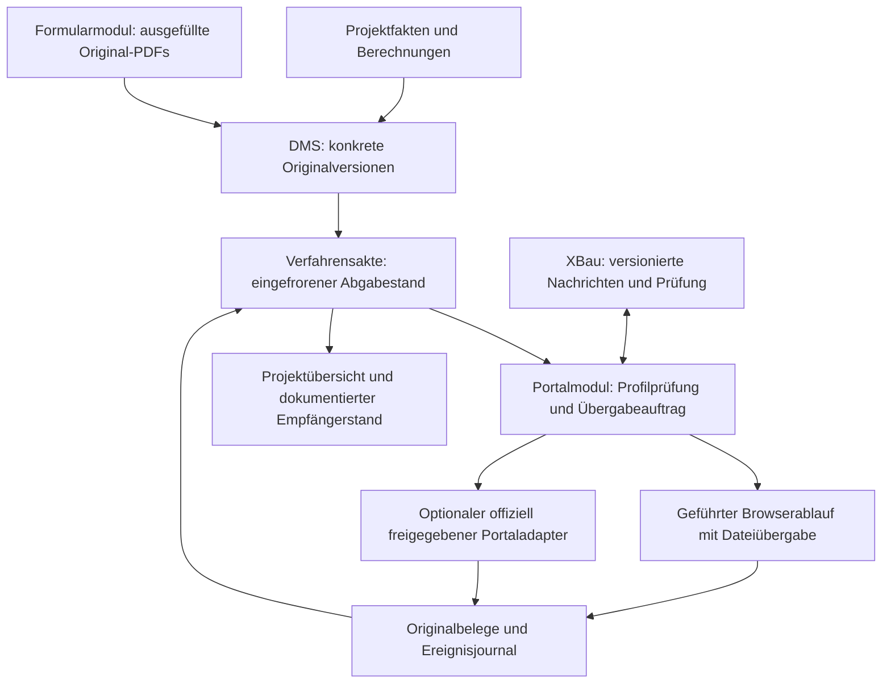

# Planung: Bauportal-Anbindung für NRW und weitere Bundesländer

Stand: 16.10.2026. Dies ist ein Analyse- und Umsetzungsplan, keine implementierte
Portalschnittstelle und keine behördliche Schnittstellenfreigabe.

## 1. Ergebnis und belastbare Entscheidungsgrundlage

**Empfehlung:** Ein eigenes Portalmodul über den bestehenden Fachmodulen aufbauen.
Zuerst einen durchgehenden, beleggebundenen Ablauf für die manuelle Einreichung
über das tatsächlich zuständige Portal umsetzen. Eine automatische Verbindung
nur für die offiziell dokumentierten und freigegebenen Funktionen ergänzen.
NRW ist das erste geplante Pilotprofil.

Die fachliche Anlaufstelle „Bauportal“ legt das technische Übertragungsprotokoll
noch nicht fest. Ein Portal kann browserbasierte Anträge, Dateiimporte oder eine
freigegebene Fachsoftwareschnittstelle anbieten. Welche davon für NRW und das
konkrete Verfahren verfügbar sind, konnte hier **noch nicht live bestätigt**
werden. Ebenso ist nicht bestätigt, dass jeder NRW-Antrag dieselbe Plattform
oder denselben Zugang verwendet. Die Auswahl benötigt daher Kommune, zuständige
Stelle und Verfahrensart, nicht nur das Bundesland.

### Evidenzstand

| Aussage | Prüfung | Konsequenz |
| --- | --- | --- |
| BauProjektIO besitzt eingefrorene Abgabestände, Originalversionen und Versandereignisse | Im Repository geprüft | Diese Verträge wiederverwenden |
| Der XBau-Arbeitsbranch besitzt Prüfung, Journal und Erstellung 0200/0202 | Im Repository geprüft | Wiederverwendbar, aber noch keine Portalverbindung |
| Portalbelege und Abgabestände sind durchgängig automatisch verknüpft | Im Code nicht vorhanden | Fachliche Brücke vor automatischem Upload implementieren |
| NRW bietet eine für externe Planungssoftware freigegebene Upload-/Rückkanal-API | Nicht bestätigt | Keinen API-Adapter, Endpoint oder Zugang erfinden |
| NRW akzeptiert das bisherige XBau-ZIP oder einen bestimmten XBau-Stand | Nicht bestätigt | ZIP nicht als „NRW-kompatibel“ bezeichnen |
| NRW nutzt für diesen Zugang FIT-Connect, OSCI oder XTA | Nicht bestätigt | Kein Protokoll allein aufgrund von XBau auswählen |
| Offizielle NRW-/FITKO-Unterlagen konnten hier abgerufen werden | Nein, Cloud-Netzrichtlinie verweigert den Abruf | Betreiberprüfung bleibt offen; siehe Prüfprotokoll |

Eine fehlende Bestätigung ist **kein Nachweis, dass eine Schnittstelle nicht
existiert**. Der Plan hält beide Varianten offen. Auch ein erfolgreicher Abruf
öffentlicher Webseiten wäre noch keine Freigabe einer API-Nutzung.

### Geprüfter Anwendungsstand

`origin/main` stand beim Abruf auf `4953dcc` (PR #28, Projektübersicht).
Die zusätzlichen XBau-Funktionen liegen im Arbeitsbranch
`codex/xbau-nachrichtenaustausch`, Implementierungsstand `7b3a5a6`.
Dieser Plan ist die anschließende Dokumentation in demselben Branch.
Die XBau-Erweiterung war bei der Prüfung noch nicht in Main enthalten.

## 2. Fachlicher Ablauf im Projekt

1. **Verfahren und Ziel bestimmen:** Projekt, konkrete Verfahrensakte, Bundesland,
   Kommune, zuständige Stelle, Portal und Einreichungsart auswählen. Bei ungeklärter
   Zuständigkeit darf kein automatischer Versand angeboten werden.
2. **Unterlagen vorbereiten:** Vorhandene Formulare und freigegebene Berechnungen
   als konkrete DMS-Versionen auswählen. Anforderungen/Nachforderungen und
   Empfängerprofil prüfen. Fehlende Pflichtunterlagen, veraltete Nachweise und
   nicht passende Dateiformate unterscheiden.
3. **Abgabestand festhalten:** Exakte Dateien, Kategorien, Versionen, Hashwerte,
   Antragsdaten, Fach-/Profilstände und ausgewählte Bezüge einfrieren.
4. **Für das Portal bereitstellen:** Die vom bestätigten Portalprofil erlaubten
   Einzeldateien bzw. Importartefakte aus diesem eingefrorenen Stand erzeugen
   und ebenfalls unverändert archivieren. Anschreiben und interne Dateiliste
   sind von den tatsächlich hochzuladenden Dateien zu unterscheiden.
5. **Einreichen:** Beim manuellen Weg Portal im normalen Browser öffnen,
   dort anmelden, Antrag erfassen bzw. zulässige Importfunktion verwenden und
   absenden. Bei späterem API-Zugang vor verbindlicher Abgabe eine konkrete
   Zusammenfassung mit Ziel, Rolle und Dateiversionen bestätigen lassen.
6. **Beleg sichern und abgleichen:** Portalreferenz, Datum, Originalbeleg und
   tatsächlich übermittelte Dateiliste erfassen. Portalentwurf, Datei-Upload,
   verbindliche Abgabe, technischer Empfang und fachliche Annahme unterscheiden.
7. **Verfahren weiterführen:** Rückmeldungen mit Originalbelegen importieren,
   Aktenzeichen und Nachforderungen zuordnen, Verantwortlichkeiten und Fristen
   anhand der Originale prüfen.
8. **Nachreichen:** Ersetzte, ergänzte und unveränderte Unterlagen gegenüber dem
   letzten belegten Stand derselben Verfahrensakte und desselben Empfängers
   zeigen. Neuen Abgabestand erstellen und auf Forderungspunkte/alte Unterlagen
   beziehen. Eine neue lokale Version ersetzt keinen bereits eingereichten Plan.
9. **Entscheidung dokumentieren:** Bescheid, Zustellung, genehmigte Planversionen
   und Auflagen erfassen. Eine Genehmigung schließt offene Auflagen nicht still.

Ein Beleg kann weniger Informationen enthalten als das lokale Paket. Dann ist
„Abgabe belegt, Dateiliste noch abzugleichen“ ein sinnvoller eigener Hinweis.
Es darf nicht pauschal jede im Paket enthaltene Datei als behördlich bestätigt
angezeigt werden. Ändert oder ergänzt der Nutzer Dateien direkt im Portal,
entspricht dessen Stand nicht automatisch dem vorbereiteten lokalen Paket.

## 3. Konkrete Lücken im bestehenden Code

| Bereich / Vertrag | Vorhanden | Erforderliche Ergänzung |
| --- | --- | --- |
| [`verfahren/abgabe.rs`](../../crates/core-lib/src/verfahren/abgabe.rs): `Abgabestand`, `Abgabedokument`, `Artefakt` | Eingefrorene konkrete DMS-Versionen, Hashwerte, einmal erzeugte Artefakte | Portalprofil, versionierte Dateizuordnung und Portalübergabe ausdrücklich auf diesen Stand beziehen |
| [`xbau/postfach.rs`](../../crates/core-lib/src/xbau/postfach.rs): `XbauNachricht` | Original, Richtung, Prüfbericht, manuelle Belege | Explizite Verbindung zu Projekt, Verfahren, Abgabestand und späterem Portalvorgang; nicht aus Dateinamen erraten |
| [`service.rs`](../../crates/core-lib/src/service.rs): `xbau_paket` | Liest den gespeicherten aktuellen Antrag und die neuesten ausgewählten Anlagen | Für Portalabgaben ausschließlich eingefrorene Quellen verwenden; erneuter Download darf keine neuen Bytes/IDs erzeugen |
| [`verfahren/abgabe.rs`](../../crates/core-lib/src/verfahren/abgabe.rs): XBau-Artefakt | Erstellt aus der eingefrorenen Auswahl aktuell 0200 | Einreichungsart und Ausgangsbezug typisieren; 0202/weitere freigegebene Nachrichten aus demselben Snapshot ermöglichen |
| [`xbau/postfach.rs`](../../crates/core-lib/src/xbau/postfach.rs): `xbau_beleg` | Manuelle Journalbelege | Belegte Ereignisse über einen gemeinsamen Anwendungsfall gezielt mit dem richtigen Abgabestand verbinden; keine zweite unabhängige Statuswahrheit |
| [`einreichung.rs`](../../crates/core-lib/src/einreichung.rs) | Ältere allgemeine ZIP-Einreichungen mit manueller Bestätigung | Für neue Portalvorgänge Verfahrensabgabe als Quelle festlegen; vorhandene historische Pakete weiter lesbar halten und nur ausdrücklich verknüpfen |
| [`dokumentkategorien.rs`](../../crates/core-lib/src/dokumentkategorien.rs) | Büro-/Projektkategorien mit Revisionen | Eigene Zuordnung zu Portal-Unterlagenarten; keine Gleichsetzung interner Kategorie-ID mit amtlichem Code |
| [`formular/instanz.rs`](../../crates/core-lib/src/formular/instanz.rs) und Druckausgabe | Vorlagen-/Wertstände und gespeicherte PDFs | Profilabhängig einzelne Originalformulare/Pläne bereitstellen; keine zusätzlichen Kopf-/Fußzeilen in amtliche PDFs schreiben |
| [`xbau/austausch.rs`](../../crates/core-lib/src/xbau/austausch.rs) | XSD, Paketstruktur, lokale Größenlimits; Hinweise auf nicht vollständig geprüfte dynamische Listen | Empfangsprofil, zugelassene Versionen, Listenstände und ggf. offizielle Fachprüfungen ergänzen |
| [`storage/xbau.rs`](../../crates/storage/src/xbau.rs) | Laufzeitprüfung über externes `xmllint` | Installation/Distribution insbesondere für Windows zuverlässig lösen, bevor Portalbereitschaft zugesichert wird |
| Projektübersicht und Verfahrensakte | Dokumentierte Aufgaben, Fristen, Einreichungen und Bescheide | Portalstände, unbekannte Zustellergebnisse und nicht zugeordnete Rückmeldungen im selben Lesemodell anzeigen |

Die aktuellen XBau-Grenzen (64 MiB Eingabe, 128 MiB entpackt, 255 Anlagen usw.)
sind **Anwendungsgrenzen**, keine nachgewiesenen NRW-Portalgrenzen. Ein größerer
amtlicher Grenzwert erhöht sie nicht automatisch. Ressourcenbegrenzung und
Portalprofil müssen zusammenpassen; nötige Streaming-Erweiterungen bleiben im
Austausch-/Speicheradapter gekapselt.

Die ausgelieferte Anlagenliste ist laut bestehender Dokumentation ein
Entwurfsstand. Ein produktives Profil braucht den von der Gegenstelle
akzeptierten veröffentlichten Listenstand. Für den allgemeinen XML-Import
fehlt außerdem noch die vollständige versionsbezogene Typ-3/4-Codelistenprüfung.

## 4. Modulaufbau

Die Pfeile beschreiben Anwendungsfälle, keine gegenseitige Kenntnis interner
Tabellen. `CoreServices` koordiniert den Ablauf. Das Portalmodul rechnet keine
GRZ, füllt keine PDFs selbst und führt kein zweites DMS.

Vorgesehene Grenzen:

- `core-lib::portale`: Ziel-/Profilwahl, Paketprüfung, Übergabeauftrag,
  Ereignisvalidierung und fachliche Zuordnungen. Keine konkreten HTTP-Clients,
  Browsersteuerung oder Zugangsdaten.
- `core-lib::xbau`: Erzeugung und Prüfung bestimmter Nachrichtenstände. Übergabe
  erhält exakte Snapshotdaten und Originalartefakte.
- `core-lib::verfahren`: Einreichungs-/Nachforderungs-/Bescheidbezüge und die daraus
  nachvollziehbar abgeleiteten fachlichen Stände.
- Konkreter Plattformadapter für Browseröffnung oder später bestätigte API;
  beide unterstützen denselben fachlichen Übergabevertrag mit verschiedenen
  Fähigkeiten. Ein neuer Infrastruktur-Crate ist nur bei Bedarf nötig.
- Portalprofile als versionierte Konfiguration; geschützte Verbindungsdaten
  getrennt davon. Ein neues Bundesland mit denselben technischen Fähigkeiten
  benötigt nach fachlicher Abnahme möglichst nur ein weiteres Profil.

## 5. Öffentliche Verträge des Portalmoduls

Dies sind Zielverträge, noch keine bestehenden Rust-Typen.

| Vertrag | Wesentliche Informationen |
| --- | --- |
| `Portalprofil` | Stabile ID/Version, Portal und Geltungsbereich, Verfahren/Zuständigkeiten, Nachweisquellen und fachlicher Freigabestatus, Format-/Größenregeln, unterstützte XBau-/Codelistenstände, Unterlagenzuordnungen, tatsächlich bestätigte Fähigkeiten |
| `Portalziel` | Profilversion, konkrete Kommune/Stelle, Verfahrensart, bestätigte Portaladresse, optional vom Dienst gelieferte Zielkennung; keine aus Nutzereingaben konstruierte Versand-URL |
| `Portalverbindung` | Installations-/Bürozuordnung, Umgebung Test/Produktion, technische Zugangsdatenreferenz und gemeldete Fähigkeiten; keine Geheimnisse im Fachdatensatz |
| `Portalvorgang` | Lokale stabile ID, Projekt-ID, Verfahrens-ID, Profil-/Ziel-/Verbindungsbezug, ggf. externe Vorgangs-/Antrags-ID, Antragsreferenz, Historie von Aktenzeichen/Beteiligten |
| `Portalabgabe` | Stabile Auftrags-ID, eingefrorener Abgabestand, Erst-/Nachreichungsart, ursprüngliche Abgabe/Forderungspunkte, Nachrichten-IDs, unveränderliche Uploadartefakte und deren Hashwerte, menschliche Freigabe |
| `Dateizuordnung` | DMS-ID/Version/Hash und amtliche Unterlagenart, tatsächlicher Uploadname, optionale externe Datei-ID/Version, ersetzt/ergänzt-Bezug; mehrere Dateien pro Kategorie möglich |
| `Portalpruefbericht` | Gelesene Quellen-/Profilstände, blockierende Fehler, offene Fragen, Hinweise; unbekannte Pflicht nie als erfüllt werten |
| `Portalereignis` | Lokale ID, Herkunft manuell/Adapter, externe Ereignis-ID soweit vorhanden, Ereignisart, Zeitpunkt der Gegenstelle und lokaler Erfassung, Rohbeleg/Hash, Zuordnung, ggf. Berichtigung |
| `PortalAdapter` | Fähigkeiten abfragen, erlaubten Übergabeweg vorbereiten; nur bestätigte API-Funktionen wie Einreichen, Ergebnisabgleich oder Rückmeldungsabruf anbieten; fehlende Fähigkeit ausdrücklich zurückmelden |

Schema-Version, Profil-Version und Projekt-/Dokumentrevision sind unterschiedliche
Begriffe. Historische Daten behalten ihre damaligen Profile und Ergebnisse.
Externe Vorgangsnummern werden mindestens im Namensraum von Betreiber,
Verbindung/Büro und Verfahren gespeichert; sie sind keine globalen Projekt-IDs.

Eine allgemeine Funktion `senden(xml)` wäre unzureichend: Sie könnte weder den
konkreten Paketstand noch einen unklaren Versandausgang zuverlässig dokumentieren.
Nicht jeder Adapter muss einen Postkorb oder eine Statusabfrage unterstützen.

## 6. Profilregeln statt fest eingebauter NRW-Sonderfälle

Ein Profil enthält nur **belegte und fachlich freigegebene** Anforderungen:

- Verfahren, zuständige Stellen und Portaladressen; Quelle und Stand der Angaben.
- Unterstützte Nachrichten und Versionen oder ausdrücklich nur Einzeldatei-Upload.
- Amtliche Unterlagenarten und deren zulässige Zuordnung aus lokalen Kategorien.
- Regeln für Dateiformate, Namen, Größen, Anzahl, gegebenenfalls PDF/A,
  Signaturen, Planmaße oder Auflösung, jeweils nur soweit belegt.
- Erforderliche Erklärung/Vollmacht, Beteiligtenrollen und Antragsdaten.
- Behandlung von Erstantrag, Änderung, Nachreichung und Rücknahme, soweit
  der tatsächliche Zugang diese unterstützt.
- Verfügbare Rückmeldungen, Belegarten und deren Bedeutung.

„Unbekannt“ benötigt eine eigene Darstellung. Beispielsweise wäre ein
NRW-Profil mit unbekanntem Uploadformat ein Entwurf und keine
„NRW-kompatibel“-Freigabe. Ein internes ZIP mit Manifest ist nicht automatisch
auf dem Portal hochladbar. Ein Druckstapel mit Inhaltsverzeichnis ist ebenfalls
kein Ersatz für einzeln geforderte Bauvorlagen.

Der Pilot wird auf **eine bestätigte Kommune/Stelle und eine Verfahrensart**
begrenzt. Weitere Kombinationen erst nach eigener Profilprüfung freischalten.

## 7. Nachvollziehbare Statusführung

Drei Dimensionen trennen:

| Dimension | Beispiele / Bedeutung |
| --- | --- |
| Vorbereitung | Entwurf, prüfbedürftig, freigegebener Abgabestand, unverändert bereitgestellt |
| Technische Übergabe | Noch nicht übergeben, Upload/Versand begonnen, Ausgang unklar, Übergabe belegt, technisch abgewiesen |
| Fachliches Verfahren | Behördliche Zuordnung/Prüfung, Nachforderung, eingereichte Antwort, Bescheid und offene Auflagen; vorhandene Verfahrenslogik verwenden |

Ein Export oder Browserstart setzt keinen Versandstatus. Ein Portalentwurf oder
Datei-Upload ist nicht automatisch ein rechtswirksam gestellter Bauantrag.
Ein erfolgreicher HTTP-Aufruf ist nicht automatisch ein bestätigter Eingang.
Auch eine fehlende Rückmeldung ist keine Zurückweisung oder Genehmigung.

Bei einem Netzabbruch nach möglicher Annahme entsteht **„Ausgang unklar“**.
Eine automatische Wiederholung erfolgt erst nach dem vom Betreiber vorgesehenen
Abgleich bzw. einer bestätigten Idempotenzgarantie. Wiederholungen verwenden
unveränderte Paketbytes und Nachrichten-/Auftrags-IDs. Geänderte Inhalte sind
eine neue fachliche Abgabe.

Manuelle Belege bleiben als manuell erfasst erkennbar. Ein API-Beleg wird erst
nach protokollgemäßer Prüfung als technisch verifiziert eingeordnet. Aus einer
kryptographisch oder technisch gültigen Quittung folgt nicht automatisch eine
fachliche Genehmigung oder ein bestimmter Fristbeginn.

## 8. Oberfläche: ein durchgehender Arbeitsablauf

Im Projekt einen zentralen Bereich **„Einreichen / Portal“** anbieten:

1. Ziel und Verfahren.
2. Unterlagen mit Kategorie, Dateiname, Version und „neu/ersetzt/unverändert“.
3. Profilprüfung mit konkreten offenen Punkten.
4. Zusammenfassung und verbindlicher Abgabestand.
5. Übergabe: „Dateien bereitstellen / Portal öffnen“ oder die tatsächlich
   freigegebene API-Aktion.
6. Belegabgleich und dokumentierter Portalstand.

Diese Schritte gehören zu einem Ablauf, nicht zu sechs weiteren Sidebar-Einträgen.
Die Verfahrensakte bleibt für Nachforderungen, Bescheide und Auflagen zuständig;
Projektdateien bleiben die zentrale Dateiablage. Bestehende allgemeine
Einreichungs-/XBau-Ansichten erhalten gezielte Verweise. Für neue Portalabgaben
soll es keinen parallelen Weg geben, der still einen anderen Dateistand nutzt.

Das Portal wird zunächst im normalen Systembrowser geöffnet. Anmeldung und
gegebenenfalls weitere Authentisierung erfolgen dort. Keine Passwortablage für
Browserzugänge, keine nachgebauten Loginformulare und kein automatisches
Durchklicken privater Browserendpunkte. Eine später offiziell erlaubte
Browserübergabe kann als eigene bestätigte Fähigkeit ergänzt werden.

Die letzte Zusammenfassung zeigt genau, ob nur Dateien bereitgestellt oder
ein Antrag tatsächlich übermittelt werden soll. Empfänger, Vertretungsrolle,
Datenstand und nachträglich im Portal veränderte Dateien bleiben sichtbar.

## 9. Sichere technische Integration nach Betreiberfreigabe

- Nur bestätigte Zieladressen, TLS mit Zertifikatsprüfung und getrennte Test-/
  Produktivzugänge verwenden. Ungeprüfte Datei-/Nachrichten-URLs nicht aufrufen.
- Für eine API das vom Betreiber verlangte Verfahren verwenden; OAuth,
  Zertifikate, Signaturen oder Verschlüsselung nicht ohne Spezifikation auswählen.
  Rechte auf den erforderlichen Büro-/Vorgangsumfang begrenzen.
- Geheimnisse über den Betriebssystem-Schlüsselspeicher oder einen geeigneten
  serverseitigen Secretspeicher referenzieren; nicht in Projektdateien,
  Protokollen oder Profil-JSON speichern. Erneuerung und Widerruf vorsehen.
- Netzwerkbetrieb: klarer verantwortlicher Synchronisierungsdienst mit
  dauerhafter Inbox/Outbox, Sperren/Leases und atomarer Ereignisverarbeitung.
  Nicht mehrere Arbeitsplätze unabhängig denselben Auftrag senden lassen.
- Einzelplatz: ausstehende Aufträge bleiben gespeichert; ohne laufenden Dienst
  keinen kontinuierlichen Rückmeldeempfang bei geschlossener Anwendung zusagen.
- Push-Rückmeldungen nur bei tatsächlich unterstütztem Protokoll und geeignetem
  Serverbetrieb mit dessen Authentizitäts-/Wiederholungsprüfung; kein impliziter
  öffentlicher Callbackserver in der Desktop-App.
- Empfang zunächst als Original und Rohbeleg sichern. Zuordnung über belegte
  Vorgangs-/Nachrichtenbezüge, nicht bloß Dateiname oder Personenname.
  Unklare bzw. fremde Vorgänge in einen berechtigungsgeschützten Zuordnungsbereich.
- Unbekannte XBau-Version, widersprüchliche Wiederholung oder unvollständige
  Anlagen bleiben prüfbedürftig. Keine stillen Überschreibungen.
- Bei zwei lokalen Fachständen (z. B. Abgabestand und Journal) entweder gemeinsame
  Transaktion oder dauerhaftes, idempotentes Ereignis mit Wiederaufnahme nach
  Teilfehler einführen. Erfolg erst melden, wenn das zugesicherte Ergebnis
  gespeichert ist. Bestehende Originale bleiben bei Fehlern erhalten.

## 10. Umsetzungsreihenfolge und Abnahme

| Schritt | Ergebnis | Abnahmekriterium | Abhängigkeit |
| --- | --- | --- | --- |
| A: Betreiberprüfung | Quellen-/Fähigkeitsmatrix für den NRW-Piloten, dokumentierte Schnittstellenentscheidung | Bestätigte Portalzuständigkeit, Upload-/Importweg, Dateiregeln, Nachrichtenstände, Zugang und Belegbedeutung; API ggf. ausdrücklich ungeklärt | Livequellen und bei nicht öffentlichen Details Betreiberantwort |
| B: Fachliche Brücke | Portalvorgang/Portalabgabe und unveränderliche Verknüpfung zum bestehenden Abgabestand | Jede Datei und jeder Beleg eindeutig Projekt, Verfahren, Ziel und Abgabe zugeordnet; keine doppelte Statuswahrheit | Bestehende DMS-/Verfahrensverträge |
| C: Portalpakete | Profilprüfung und reproduzierbare Einzeldateien/Artefakte | Export morgen liefert dieselben Bytes wie heute; spätere Projektänderung ändert alte Abgabe nicht | B, bestätigte Profilregeln; ohne A nur allgemeine Dateibereitstellung |
| D: Geführter Portalablauf | Projektmaske, externe Browseröffnung, manueller Belegabgleich, Nachreichungsübersicht | Ein echter manueller Testantrag lässt sich einschließlich exakter tatsächlich übermittelter Dateien dokumentieren; kein Versand bei Export/Abbruch | A–C, zugelassener Testweg |
| E: Rückmeldungen | Originalimport, Vorgangszuordnung, manuell bestätigte Nachforderungen/Bescheide | Rückmeldung eines anderen Projekts kann dieses Verfahren nicht verändern; Fristen/Originale bleiben nachvollziehbar | B, D |
| F: Optionaler API-Adapter | Dauerhafter Versand-/Empfangsdienst mit bestätigten Fähigkeiten | Offizielle Tests einschließlich Authentisierung, unklarem Ausgang, Wiederholung, Quittung und Rückweisung bestehen | Dokumentierte API, Nutzungsfreigabe, Zugang, Testumgebung |
| G: Produktivfreigabe / weitere Profile | Pilotabnahme und versionierter Ausbau | Bestätigter Durchlauf Erstantrag → Rückmeldung → Nachreichung → Entscheidung; gesonderte Profilabnahme je weiterem Ziel | A–F soweit für den angebotenen Funktionsumfang relevant |

B lässt sich bereits ohne Portalzugriff entwickeln. C und D dürfen ohne A
nur als allgemeine Unterstützung erscheinen. F ist eine optionale Ausbaustufe,
kein Versprechen, dass NRW eine geeignete API bereitstellt. Zeiten für F lassen
sich ohne Spezifikation und Onboardingprozess nicht seriös zusagen.

### Wesentliche Tests

- Erstantrag mit mehreren gleich kategorisierten Plänen; richtige Einzeldateien,
  keine ungewollten Änderungen an offiziellen Formularen.
- Nachreichung ersetzt Lageplan Version 1 durch Version 2 und ergänzt einen
  Nachweis; Version 1 bleibt als früher eingereicht belegt.
- Portaldatei weicht vom vorbereiteten Paket ab; kein falscher Dateiabgleich.
- Export abgebrochen oder Portal nur geöffnet; kein Versandereignis.
- Beleg belegt nur die Abgabe, keine Dateiliste; Unterschiede bleiben offen.
- Doppelklick, Arbeitsplatzwechsel, Timeout, Absturz zwischen Ereignis und
  Fachstand: kein doppelter Versand und kein verloren gegangener Beleg.
- Fachliche Ablehnung trotz erfolgreicher technischer Übergabe bleibt möglich.
- Projektübergreifende Rechte, gleiches Aktenzeichen bei verschiedenen Stellen,
  mehrere Verfahren eines Projekts und mehrere Büros sauber trennen.
- Externe Rückmeldung wird zweimal abgeholt; eine Nachricht, beide technischen
  Empfangsnachweise gegebenenfalls erhalten; widersprüchlicher Inhalt bleibt Konflikt.
- Geändertes Portalprofil invalidiert keine historischen Export-/Belegstände.
- Produktivzugang fehlt, Testzugang abgelaufen oder Rückkanal nicht verfügbar:
  klarer Fehler; kein Umschalten auf einen anderen Empfänger/Transportweg.

## 11. Konkreter Fragenkatalog an den NRW-Betreiber

Noch nicht versendet; für eine spätere fachliche/technische Klärung vorbereitet.

1. Welche Antragsverfahren und Kommunen/Stellen laufen über welchen Zugang?
2. Gibt es einen offiziell zugelassenen Zugang für externe Planungssoftware oder
   ausschließlich interaktive Browseranträge? Wo liegen Spezifikation und Nutzungsbedingungen?
3. Falls ein Datenimport existiert: XML, XBau-ZIP oder anderes Paket; exakte
   Nachrichtentypen, Versionen, Codelisten, Fachprüfungen und Beispiele?
4. Falls eine API existiert: Betreiber, technische Zieladresse, Versionierung,
   Authentisierung, Clientregistrierung, Vertretung und erforderliche Freigaben?
5. Welche Anmeldung, Entwurfsverfasserrolle, Vollmacht oder Bauherrnfreigabe ist
   für den konkreten Vorgang erforderlich? Welche Schritte bleiben interaktiv?
6. Welche Format-, Datei-, Gesamtgrößen-, Benennungs- und Unterlagenregeln gelten?
   Dürfen unveränderte Originalformulare und einzeln erstellte Nachweise hochgeladen werden?
7. Was unterscheidet hochgeladenen Entwurf, verbindliche Abgabe, technischen
   Empfang und fachliche Annahme? Welche Originalbelege werden jeweils erzeugt?
8. Welche stabilen Vorgangs-, Nachrichten- und Datei-IDs gibt es, und welche
   davon werden bei Nachreichungen und ersetzten Dokumenten wiederverwendet?
9. Wie kann nach einem Timeout geprüft werden, ob die Abgabe bereits angenommen
   wurde? Welche Idempotenzgarantien gibt es?
10. Welche Rückmeldungen sind abrufbar oder werden zugestellt: Aktenzeichen,
    Nachforderungen, Status, korrigierte Pläne, Bescheide und Auflagen?
11. Welche Bedeutung haben Zeitstempel, Lesebestätigung und Zustellereignisse?
    Welche Informationen dürfen für Fristen herangezogen werden?
12. Gibt es eine Testumgebung, öffentliche Testfälle, Hersteller-Onboarding und
    einen technischen Ansprechpartner? Wie werden Tests ohne echte Antragstellung abgegrenzt?
13. Wie sind Vertretungswechsel, mehrere Bearbeiter/Büros, Rechteentzug und
    Datenexport zu behandeln?
14. Wie werden Schnittstellen-/Regeländerungen angekündigt; gibt es ein
    Kompatibilitätsfenster und nachvollziehbare Versionsstände?

## 12. Nächste Entscheidung

Der nächste Entwicklungsauftrag sollte **B und die allgemeine Paketvorbereitung
von C** umfassen: ein Portalvorgang auf Basis des eingefrorenen Abgabestands,
exakte Dateizuordnung, nachvollziehbarer Belegabgleich und eine gemeinsame
Projektoberfläche. Parallel A nach freigeschaltetem Quellenzugriff abschließen.

Erst danach wird entschieden, ob der NRW-Pilot einen interaktiven Portalablauf,
einen offiziellen Paketimport oder eine freigegebene API verwenden kann.
Ein Landesadapter darf diese Entscheidung nicht vorwegnehmen.

Die offizielle Quellenprüfung und die noch benötigte Netzfreigabe sind im
[Prüfprotokoll](portal-pruefprotokoll.md) festgehalten.
